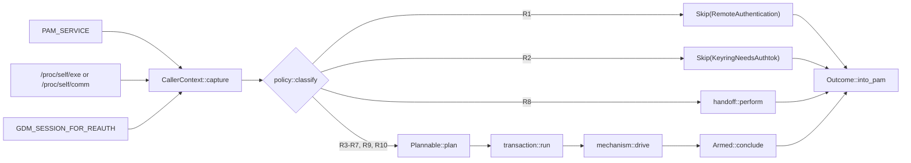

# PAM conversation policy

Status: specification of shipped behaviour. Scope: `client-pam`. This document ships with the change it specifies: it describes the module as it stands at the end of that change (nineteen commits, `57d829a..7d4c486`) plus the gap-closure follow-up (`8ecea4c`, `d94196e`, `ae4afd4`, `b00f647`, `5a6c122`, `753e3f9`, `9f4fb57`, `bdb39a7`, `7ad8f31`, `9da2d85`) the named second decision phase `policy::refine` (§3.3.1), the reuse record split into `conclusion_cache.rs` (§3.6), and the layout split of `transaction/`, `pam_logic/` and `policy/` (`9c69211..c639839`). `client-pam/src/policy/` is the executable form of the rule table in §3.3, and where this prose and that code disagree, the code is authoritative. §4's inventory (the fixture corpus) and §6's tests are what make such a disagreement visible.

---

## 1. Summary

The module answers four questions about one `pam_authenticate` call: *does the phone take part*, *how may the host's conversation be driven*, *how long do we wait*, and *which `PAM_*` code goes back*. Each is now one value produced in one place:

| Piece | File | Responsibility |
| :--- | :--- | :--- |
| `CallerContext` | `context.rs` | The three caller facts — service, process, GDM reauth — read once, before any credential or conversation work (`context.rs:13-17`, `:27-51`) |
| `classify` + `RULES` + `refine` | `policy/{mod,table,refine}.rs` | One ordered table of ten rules, each with a class, a predicate and a decision (`policy/table.rs`, `RULES`), the test-only audit record that names and justifies every row (`policy/table.rs`, `audit`), plus the one constrained second phase that can only add a skip (`policy/refine.rs`, `refine`) |
| `Plan` | `plan.rs` | `Plannable` and one total function to `{deadline, announcement, tty_use}` (`plan.rs`, `Plannable::plan`) |
| `Outcome` | `outcome.rs` | The verdict as data, converted to a `PAM_*` code in one exhaustive match (`outcome.rs`, `Outcome::into_pam`) |
| `transaction::run`, `Armed` | `transaction/{run,lifecycle}.rs` | The transaction: handoff, reuse lookup, probe, plan, request, mechanism, conclusion, one emission (`transaction/run.rs`, `run`) |
| `ConclusionCache` | `conclusion_cache.rs` | The 500 ms reuse record, its gates and its `pthread_atfork` child handler (`conclusion_cache.rs:52-362`) |
| `mechanism::{threaded, sequential, handoff}` | `mechanism/*.rs` | The three ways to answer a PAM ABI conversation; each takes `&mut Armed` and only what it needs, and returns a `MechanismEnd`, never an `Outcome` (`mechanism/mod.rs:21-23`) |

`pam_logic/` is orchestration, wiring and scans only: `pam_logic/mod.rs` holds `authenticate` and `orchestrate`, `pam_logic/wiring.rs` the four production effects (`probe_tty`, `connect`, `send_authenticate_request`, `cancel_on_fresh_connection`), and the tests live under `pam_logic/tests/` (`pam_logic/mod.rs`, `authenticate`; `orchestrate`).

**What the shape buys.**

1. *One place to look* for "why does host X behave like this": a row with a class, next to its audit record — name, why, citations — not a comment four hundred lines away. The record is `#[cfg(test)]`, so the shipped binary carries no string nothing reads and the table needs no lint escape; its citations are machine-checked (`policy/mod.rs`, `evidence_citations_resolve`). Policy is one table plus one constrained refinement, not two independent decision sites: `classify` decides from the caller facts before any config exists, and `policy::refine` (`policy/refine.rs`, `refine`) is the single second phase that may add R1's skip for a configured service name and may do nothing else (§3.3.1).
2. *One place for ordering.* `Skip` and `Participate` are different types (`policy/mod.rs`, `Classification`), so a skip cannot acquire a plan, a deadline or a mechanism. `authenticate` returns on a `Skip` before config, username, conversation and messages (`pam_logic/mod.rs`, `orchestrate`), the refinement runs after the one config read and still before all four (`policy::refine`'s one call site in `orchestrate`), and that order is pinned by call-counter tests, not by the compiler.
3. *One place that can grant.* `Outcome::Granted` is constructible only through `granted_from_daemon` (this call's `PamOutcome::Success`, `outcome.rs`, `Outcome::granted_from_daemon`) or `replayed` (a copy of this process's own record, `outcome.rs`, `Outcome::replayed`). A mechanism returns `MechanismEnd`, so it cannot mint a verdict (`mechanism/mod.rs`, `MechanismEnd`).
4. *Testability.* Identity resolution, the GDM flag, the deadline clamp, the `has_tty` invariance, the two skip policies and the loop's per-shape mapping are pure functions or unit assertions (§6.3).

**Invariants.**

* **The IPC schema does not change.** `PamAuthenticateRequest` keeps its fields; the caller context is local and never sent (`context.rs:1-3`). No host string is stored, logged or sent.
* **No `dev-*` feature is introduced.** The fixture corpus is test data, and the shipped build is the production feature set.
* **The reuse window's duration and key are unchanged**: 500 ms and `(username, service)` (`conclusion_cache.rs:52`, `:54-65`). The change is that a replay carries its provenance (`Via::Replay`) and is never re-recorded (`conclusion_cache.rs`, `ConclusionCache::record`).
* **A grant comes only from this call's daemon `Success` or from a replay of this process's own record** (`outcome.rs:138-160`).
* **The module does not participate in remote authentication.** A call whose service is `sshd` or `sshd-session` is refused before any side effect (`policy/table.rs`, `remote_refuse`).

---

## 2. Why it is shaped this way

The pre-refactor file is reachable at `git show 57d829a^:client-pam/src/pam_logic.rs`; the commits named below are the ones that removed each problem. The paragraphs state what is true of the branch, not what was proposed.

### 2.1 Decision and execution were one function

`authenticate_inner` decided *and* executed, with the decision inputs entering at three points and a fourth never read. `55b70c3` and `10a4899` split it: `CallerContext::capture` is now the single read site for `PAM_SERVICE`, `/proc` and `GDM_SESSION_FOR_REAUTH` (`context.rs:27-51`), `classify` is total and takes nothing but that context (`policy/mod.rs`, `classify`), and `orchestrate` reads the context once (`pam_logic/mod.rs`, `orchestrate`). The decision itself left the match arms for a table (`policy/table.rs`, `RULES`).

### 2.2 The failure-direction taxonomy is a table cell

The module used to distinguish *never ring*, *deadlock avoidance*, *always ring*, *keyring* and — after `1ec92bb` — *refuse remote* only in prose. `FailureDirection` is now one enum with those five variants (`policy/mod.rs`, `FailureDirection`), a field of every rule (`policy/table.rs`, `Rule`), copied onto the returned `Participation` (`policy/mod.rs`, `Participation`; `classification_of`), asserted against the conversation by one total, wildcard-free pairing function (`policy/mod.rs`, `class_permits`; `class_agrees_with_conversation`, `class_permits_matches_its_expectation`) and re-checked where the value first meets the plan (`transaction/run.rs:129-141`). A new arm cannot inherit its neighbour's direction silently, because the direction is a cell the tests name.

### 2.3 The return code is produced at one site

`outcome.rs`'s `into_pam` is the crate's only conversion from a verdict to a `PAM_*` value (`outcome.rs`, `Outcome::into_pam`); five exhaustive arms and no wildcard, so a sixth variant is a compile error. The `lib.rs` ABI stubs and the `pam_sys` plumbing stay outside that rule by name, and a source scan asserts no other site appears (§6.5). `authenticate` calls `into_pam` exactly once per return, after recording a conclusion (`pam_logic/mod.rs`, `authenticate`).

### 2.4 The deadline rule is tested

The clamp used to be an `if` with no coverage at any level. It is now `Deadline::GuiBounded` in one function (`plan.rs:33-39`), planned only for `Sequential` without a terminal (`plan.rs:98-102`), and pinned by `gui_deadline_is_min`, `deadline_saturates_at_u32_max` and `plan_table` (`plan.rs`, each by name). The doc comment on `gui_deadline_is_min` states why the integration shapes cannot see the difference: the host-cases stack sets gui 2 s / op 4 s, so an accidental `max` still passes every end-to-end test.

### 2.5 Identity reading is unit-testable

`classify_identity` takes the two `/proc` sources as parameters and does the interpretation — basename, `" (deleted)"` strip, empty rejection, `exe`-before-`comm` (`context.rs:179-197`); `identity_from_proc` does only the reads (`context.rs:164-172`). `GdmReauth::from_env` takes the already-read value (`context.rs:211-219`), so presence-only parsing is asserted without `set_var` (`context.rs`, `gdm_reauth_env_parsing`).

### 2.6 Host knowledge has one home

`RULES` is the only place that decides a host's conversation. The five prose lists the earlier edition counted were rewritten in `66b26b4` to point at the table — `AGENTS.md`, `INSTALLATION.md`, `config.toml.example`, `shared/src/config/toml_config.rs`, `docs/testing/e2e-testing-guide.md` — and the e2e harness stopped copying binaries from its own list. What remains outside the table is not policy: `INSTALLATION.md` keeps a support table for hosts the module does not handle (`light-locker`, `slock`, `betterlockscreen`) and a note on xsecurelock's retries, and the testing guide keeps a manual-test recipe naming `kscreenlocker_worker`. A host's name appears in the table, in its corpus row, and — when it is e2e-covered — in one harness arm (§3.9).

### 2.7 One sequential loop

The terminal and no-terminal shapes used to hold the same IPC check order twice. `5c1eea5` merged them into one loop driven by `Profile` (`mechanism/sequential.rs`, `Profile`, `Profile::of`, `run_loop`). The differences — which reason an IPC failure maps to, and whether a poll error ends the wait — are fields of the profile, and the contract is written at the top of the module (`mechanism/sequential.rs:20-41`).

### 2.8 The exposure R1 closes

On Debian/Ubuntu the package ships a `pam-auth-update` profile whose only auth line is `sufficient pam_tapauth.so` (`packaging/debian.pam-config:1-6`); `packaging/debian/rules:54` installs it as `/usr/share/pam-configs/tapauth`, and `packaging/debian/postinst:6-8` runs `pam-auth-update --package`. On the stock configuration `/etc/pam.d/sshd` includes `common-auth`, so with the profile enabled the module sat in sshd's stack. Before `1ec92bb`, a phone grant on such a host completed an SSH login without the account password: the module returned `PAM_SUCCESS` on a `sufficient` line and the stack short-circuited.

The service-name rule closes it. `REMOTE_SERVICES` is `shared::config::DEFAULT_PAM_REFUSED_SERVICES`, `["sshd", "sshd-session"]`, compared ASCII case-insensitively (`policy/table.rs`, `remote_refuse`); a matching call returns `PAM_AUTHINFO_UNAVAIL` before config, username, conversation or messages (`pam_logic/mod.rs`, `orchestrate`). A deployment that renames the service declares the new name in `pam_refused_services`, and the same refusal then runs immediately after the config read (`policy/refine.rs`, `refine`'s one call site).

Two narrowings belong with that statement. `pam-auth-update --package` declines to regenerate a `common-auth` that has been edited locally, and a deselected profile stays off, so the exposure requires the profile to be enabled over a stock `common-auth`. And the repository does not pin the refusal at package level: `scripts/ci/test-ubuntu-deb.sh:305-310` only asserts that the string `pam_tapauth.so` appears in `common-auth`, not where the line sits. The refusal itself is asserted — the built-in names by the corpus and the e2e shapes, a configured name by `configured_refused_services_match_only_declared_names` and `a_configured_renamed_service_is_refused_after_the_config_read` — but nothing drives the packaged `common-auth` stack, and an undeclared rename still falls through to R10 (§7).

### 2.9 Standing constraints

* **The 500 ms window is an assumption, not a property.** The source says so (`conclusion_cache.rs:54-65`), and the implementation does not strengthen it: the key and the duration are unchanged, and the only addition is provenance, so a replay cannot refresh the anchor (`conclusion_cache.rs`, `ConclusionCache::record`).
* **No `dev-*` feature is introduced.** The e2e builds `client-pam` with `dev-socket-override` (`scripts/ci/test-pam-conv-thread.sh:201-202`); no shipped artefact does.
* **The module does not participate in remote authentication.** §2.8 is the exposure; R1 is the control.

---

## 3. Architecture

### 3.1 Module map

```
lib.rs ──> pam_logic/ ──> context.rs
                        ├─> policy/ ──> context.rs
                        ├─> plan.rs   (leaf: PamConfig for `Deadline::resolve` only)
                        ├─> outcome.rs ──> policy/ (SkipPolicy only)
                        ├─> transaction/ ──> policy, plan, outcome, mechanism
                        │                  │   └─> mechanism/{threaded,sequential,handoff}.rs
                        │                  └─> conclusion_cache.rs (record/replay_for; owns the lock)
                        └─> config.rs, pam_messages.rs, pam_sys.rs, ipc_client.rs
```

Dependency direction is one-way. `context` depends on `pam_sys` and nothing else in the crate (`context.rs:5-7`); `policy` on `context` (`policy/mod.rs:9`); `plan` names no policy or caller type (`plan.rs:1-3`); `outcome` names `policy::SkipPolicy` from the policy and nothing else (`outcome.rs:10`); `transaction` on all of them plus the mechanisms (`transaction/run.rs:8-20`), and the only reuse-record call it makes is `conclusion_cache::replay_for`, the duplicate lookup — `record` is not its call at all: `pam_logic::authenticate` records on the way out, after `into_pam`'s inputs are fixed (`pam_logic/mod.rs:65`); `conclusion_cache` depends on no transport, policy or PAM-FFI module: it names `transaction` for the conclusion type, `outcome` for the verdict and `context` for the key type, and nothing else in the crate (`conclusion_cache.rs:10-12`); each mechanism on `transaction`'s `Armed`/`HostIo` and on the `MechanismEnd` contract in its own module (`mechanism/threaded.rs:9-14`, `mechanism/sequential.rs:43-47`, `mechanism/handoff.rs:18-21`). No mechanism takes `&CallerContext` or `&PamConfig`, so it cannot re-branch on identity or recompute the deadline (`mechanism/mod.rs:6-14`).

Construction order is part of the contract: `capture` runs first (`pam_logic/mod.rs`, `authenticate`), `classify` is the first thing `orchestrate` does (`pam_logic/mod.rs`, `orchestrate`), and only a `Participate` reaches `PamConfig::load` (`pam_logic/mod.rs:131`). A built-in R1/R2 skip still returns before that read (`pam_logic/mod.rs:127-129`); a participating call loads the config, runs `policy::refine` exactly once (`pam_logic/mod.rs:141-148`), and returns R1's verdict for a configured name before `get_user`, `PamConversation::new` and `load_for_user` (the three calls at `pam_logic/mod.rs:150`, `:165` and `:177`).

### 3.2 `CallerContext` (`context.rs`)

```rust
pub(crate) struct CallerContext {
    service: Option<ServiceName>,
    process: ProcessIdentity,
    gdm_reauth: GdmReauth,
}
```

(`context.rs:13-17`.) `capture` is the single read site (`context.rs:27-51`) and emits the module's one debug line, before any decision, naming exactly the three facts (`context.rs:39-44`). `from_parts` is `#[cfg(test)]`-only, so production cannot fabricate an identity (`context.rs:57-68`). `is_gdm_reauth` holds both conjuncts — the flag and `gdm-password` — so every consumer reads one answer (`context.rs:80-86`).

`ServiceName` keeps the bytes libpam returned and an ASCII-lowercased copy (`context.rs:97-100`). `original` is the reuse cache's key, so `sudo` and `SUDO` stay distinct (`context.rs:110-113`); `ascii_lower` is never `str::to_lowercase`, which would fold U+212A KELVIN SIGN to `k` and make `\u{212a}dm` match the `kdm` prefix (`context.rs:91-95`). Three comparisons exist because three are used: exact bytes for `polkit-1` (`:115-119`), ASCII-insensitive for `gdm-password` (`:121-125`), and the display-manager prefix with a `-` boundary (`:127-133`).

`ProcessIdentity` is `Exe(name)`, `Comm(name)` or `Unknown` (`context.rs:142-147`); `Exe`/`Comm` is provenance only, and every rule matches on the name. The kernel's `" (deleted)"` suffix is stripped before the match (`context.rs:183-187`), and a blank `comm` is `Unknown` rather than a name (`context.rs:190-196`).

**There is no remote fact in the context.** The module never reads `PAM_RHOST`; §9(a) records the evidence for that choice.

### 3.3 `classify` (`policy/mod.rs`)

```rust
pub(crate) enum Classification { Skip(SkipPolicy), Participate(Participation) }
pub(crate) enum SkipPolicy { RemoteAuthentication, KeyringNeedsAuthtok }
pub(crate) struct Participation { conversation: Conversation, failure_direction: FailureDirection }
pub(crate) fn classify(ctx: &CallerContext) -> (RuleId, Classification)
```

(`policy/mod.rs`, `Classification`, `SkipPolicy`, `Participation`, `classify`.) `classify` walks `RULES` in order, takes the first matching predicate, and returns that row's `id` next to a classification built from its `decision` and `class` (`policy/mod.rs`, `classify` and `classification_of`). R10's predicate is `true` (`policy/table.rs`, `default_sequential`), so the walk always terminates; the `DEFAULT_SEQUENTIAL` constant (`policy/table.rs`, `DEFAULT_SEQUENTIAL`) exists so the fallback needs no panic path under the crate's denied lints, and `unreachable_rule_rows` asserts it equals what R10 produces (`policy/mod.rs`, `unreachable_rule_rows`).

`Skip` and `Participate` are different types: `SkipPolicy` carries no conversation, no plan and no deadline, so no downstream function can accept a skip where a participation is required.

#### 3.3.1 The rule table

Order is load-bearing at the head and the tail: R1 before everything, R2 before everything after it, R10 last.

The table decides from the caller facts alone, before any config is read: that is the **first phase**. The **second phase** is `policy::refine` (`policy/refine.rs`, `refine`), which `orchestrate` calls once, immediately after the one config read, and whose only job is to add R1's skip for a service a deployment named in `pam_refused_services` (`pam_logic/mod.rs:141-148`). The invariant is why the phases are not merged: refinement may **add** a skip, but it may never remove or reclassify one, may never change a participating call's mechanism, and may never change its deadline — the only value it ever constructs is `Skip(RemoteAuthentication)`, and the `Participation` it is handed comes back unchanged (`policy/refine.rs`, `refine`). `refinement_cannot_change_a_participation` (`policy/mod.rs`, `refinement_cannot_change_a_participation`) walks all 64 corpus rows through both phases with the default config, an empty configured list and a list naming every participating row's service, and asserts exactly that (§6.2).

| # | name | class | predicate | decision |
| :-- | :--- | :--- | :--- | :--- |
| R1 | `remote_refuse` | `RefuseRemote` | service is a built-in refused name (`sshd`/`sshd-session`, ASCII case-insensitive); configured extras are checked after the config read | `Skip(RemoteAuthentication)` |
| R2 | `dm_login_bypass` | `Keyring` | one of 13 display-manager prefixes, exact or `-`-suffixed, case-insensitive, **and** not a `gdm-password` reauthentication | `Skip(KeyringNeedsAuthtok)` |
| R3 | `gdm_reauth_worker` | `DeadlockAvoidance` | process `gdm-session-worker`/`gdm-session-wor`, service `gdm-password` case-insensitively, reauth flag present | `Threaded` |
| R4 | `polkit_agent` | `DeadlockAvoidance` | process `polkit-agent-helper-1`/`polkit-agent-he` | `Threaded` |
| R5 | `kscreenlocker_worker` | `DeadlockAvoidance` | process `kscreenlocker_worker`/`kscreenlocker_w` | `Threaded` |
| R6 | `hyprlock` | `AlwaysRing` | process `hyprlock` | `Threaded` |
| R7 | `xsecurelock` | `AlwaysRing` | process `authproto_pam` | `Threaded` |
| R8 | `precollected_locks` | `NeverRing` | process `swaylock`, `gtklock` or `i3lock` | `PreCollected` |
| R9 | `polkit_service_without_proc` | `DeadlockAvoidance` | process `Unknown` **and** service exactly `polkit-1` | `Threaded` |
| R10 | `default_sequential` | `DeadlockAvoidance` | unconditional | `Sequential` |

The rows are `policy/table.rs`, `RULES`; the predicates are `remote_refuse` (R1), `dm_login_bypass` (R2), `gdm_reauth_worker` (R3), `polkit_agent` (R4), `kscreenlocker_worker` (R5), `hyprlock` (R6), `xsecurelock` (R7), `precollected_locks` (R8), `polkit_service_without_proc` (R9) and `default_sequential` (R10), all in `policy/table.rs`. The 13 prefixes are `policy/table.rs`, `DM_PREFIXES`. A row carries only what the shipped binary reads — the id, the class, the predicate and the decision (`policy/table.rs`, `Rule`); its symbolic name, its one-sentence justification and its citations are the audit record (`policy/table.rs`, `audit`), compiled only for tests.

Notes that belong to the table:

* **R1 keys on the service name alone** (`policy/table.rs`, `remote_refuse`). It cannot misfire on the process side, and `my-sshd`/`sshd-old` fall to R10. That false negative is narrowed by configuration, not by inference: a deployment that renames `PAMServiceName` declares the new name in `pam_refused_services`, and `orchestrate` refines the classification with those names after the config read (`pam_logic/mod.rs:141-148`). Without the declaration the rename still falls to R10 — the corpus row `svc_sshd_near_miss` — and `configured_refused_services_match_only_declared_names` pins that an undeclared name is not matched by prefix or substring (`policy/mod.rs`, `configured_refused_services_match_only_declared_names`). An unresolved service never matches (`policy/table.rs`, `remote_refuse`; `policy/refine.rs`, `refused_service`).
* **The refused set is additive.** `pam_refused_services` adds names to the built-ins; it cannot remove one. `PamConfig::effective_refused_services` starts from `shared::config::DEFAULT_PAM_REFUSED_SERVICES`, trims each configured entry, drops anything that is not a non-empty ASCII `pam.d` name (no `/`, no whitespace or control character, at most 255 bytes) with a warning, and deduplicates ASCII case-insensitively (`config.rs:60-92`, `:49-58`). `policy::refused_service` is the pure matcher the refinement uses, private to `policy` so the refinement stays its only caller at compile time rather than by scan (`policy/refine.rs`, `refused_service`). The daemon's `TapAuthConfig` carries the same field, so a `SaveConfig` round-trip preserves a user's rename while the file loads (`shared/src/config/toml_config.rs:136-148`, `:485`). The guarantee stops at a config file the daemon cannot read or parse: `TapAuthConfig::load_from_path` returns `Self::default()` on a read error (`shared/src/config/toml_config.rs:238-242`) and on a parse error (`:271-277`), and `handle_save_config` feeds that value to `save()` (`tapauthd/src/admin_handler.rs:695-707`), overwriting the file whenever the write itself succeeds. What survives is the built-in set, because both defaults carry `DEFAULT_PAM_REFUSED_SERVICES` (`shared/src/config/toml_config.rs:184-192`, `client-pam/src/config.rs:36-47`); what does not is every name the user added, permanently once the daemon writes. The loss is silent: `handle_save_config` returns success, and only the `debug!` (read) or `warn!` (parse) line inside `load_from_path` records the fallback. The module's own loader has the same hole: a syntax error falls back to `PamConfig::default()` (`client-pam/src/config.rs:127-133`), so that authentication treats the renamed stack as local and rings the phone until the name is declared again.
* **R1 outranks the process rules.** `svc_sshd_under_swaylock` classifies R1, not R8; moving R1 after R8 moves exactly that row and nothing else (`policy/mod.rs`, `rule_permutation_moves_named_rows`).
* **R1 and R2 are disjoint**, so their relative order is unobservable; the permutation test deliberately omits that swap as vacuous (the doc comment on `policy/mod.rs`, `rule_permutation_moves_named_rows`).
* **R2 outranks R8.** `swaylock_under_sddm` and `i3lock_under_gdm_login` are skipped by R2; moving R2 after R8 moves exactly those two rows (`policy/mod.rs`, `rule_permutation_moves_named_rows`).
* **R3–R9 are order-insensitive**: their predicates are pairwise disjoint, asserted against the declared literal sets (`policy/mod.rs`, `rules_are_process_disjoint`).
* **R10 is last and unconditional.** A row after it is dead, and no other row may match the null context (`policy/mod.rs`, `unreachable_rule_rows`).
* **R5 parses no version.** The `kscreenlocker_worker` predicate encodes that: the name is the only signal in `/proc`, and `kscreenlocker_greet` is deliberately absent so the pre-6.8 helper stays sequential (`policy/table.rs`, `kscreenlocker_worker`). Corpus rows `kscreenlocker_truncated`, `kscreenlocker_greet` and `kscreenlocker_g` pin the three spellings.
* **The audit record is checked.** Each rule's symbolic name, one-sentence `why` and `evidence` live in the test-only record keyed by `RuleId` (`policy/table.rs`, `audit`), whose `match` is exhaustive, so a rule added to the enum does not compile without a record; `audit_covers_rules` holds the record and `RULES` to one entry per rule, one row per rule id and one rule per name (`policy/mod.rs`, `audit_covers_rules`), which is also what catches a record whose row was deleted. Every non-`external:` evidence entry must resolve to an existing line, a citation into `policy/table.rs` must land on the declaration it names (the row's own predicate, `fn hyprlock`, for its predicate citation), a one-line drift is planted and reverted as the control, and the scan asserts it read `policy/table.rs` itself (`policy/mod.rs`, `evidence_citations_resolve`).

#### 3.3.2 The class taxonomy

| class | meaning | wrong-direction cost |
| :--- | :--- | :--- |
| `RefuseRemote` | the module must not take part in a remote authentication | under-match: the phone is rung for a login nobody is at, and the login waits. Over-match: a local login loses the phone — a denial on a `required` line, `ignore` on a `sufficient` one |
| `NeverRing` | the phone must not be consulted | under-match: ringing a user who already chose the password route, which can only time out. Over-match: the token is handed on and the module returns `PAM_AUTHINFO_UNAVAIL` without asking |
| `DeadlockAvoidance` | the conversation must not be driven from a second thread (or not at all) | slower, never wedged, never a grant; spurious threading is the other direction and can freeze the lock screen |
| `AlwaysRing` | the phone is offered concurrently | one extra ring, or the host's dialog loses its race; never a grant, never a wedge |
| `Keyring` | a grant would be useless without `PAM_AUTHTOK` | under-match: the keyring stays locked after a successful login. Over-match: the login manager's prompt is skipped and the stack falls through |

`Keyring` and `RefuseRemote` sit in the same enum but are orthogonal to the three failure directions: the first is about the value of a grant, the second about whether the call is ours to answer (`policy/mod.rs`, `FailureDirection`). The class is copied onto the participation (`policy/mod.rs`, `classification_of`), asserted against the decision by `class_agrees_with_conversation` (`policy/mod.rs`, `class_agrees_with_conversation`) against the one pairing function (`policy/mod.rs`, `class_permits`) and re-asserted at the point the class meets the plan (`transaction/run.rs:129-141`), so a mismatch fails a test rather than being a comment nobody reads.

Every skip still returns `PAM_AUTHINFO_UNAVAIL`, never `PAM_IGNORE`: on a `required` line that is a failure, on a `sufficient` line it is `ignore` and the stack decides (`pam_logic/mod.rs`, `authenticate`).

### 3.4 `Plan` (`plan.rs`)

```rust
pub(crate) struct Plan { deadline: Deadline, announcement: Announcement, tty_use: TtyUse }
pub(crate) enum Deadline { Operation, GuiBounded }
pub(crate) enum Announcement { Wait, WaitSkipHint, WaitThenPassword }
pub(crate) enum TtyUse { DoNotOpen, PollForKey }
pub(crate) enum Plannable { Threaded, Sequential }
```

(`plan.rs:11-16`, `:19-27`, `:44-53`, `:56-62`, `:70-73`.) `Plan` is config-free, so two plans compare in a test; the configured seconds enter only through `Deadline::resolve` (`plan.rs:33-39`), which is the one place the clamp and the `u32` saturation exist.

| conversation | `has_tty` | deadline | announcement | tty_use |
| :--- | :--- | :--- | :--- | :--- |
| `Threaded` | either | `Operation` | `Wait` | `DoNotOpen` |
| `Sequential` | `true` | `Operation` | `WaitSkipHint` | `PollForKey` |
| `Sequential` | `false` | `GuiBounded` | `WaitThenPassword` | `DoNotOpen` |

Four cells over three rows and three distinct plans; `plan_table` asserts both facts (`plan.rs`, `plan_table`), and `threaded_plan_ignores_has_tty` asserts the invariance directly (`plan.rs`, `threaded_plan_ignores_has_tty`). There is no `Plannable::PreCollected`: `run` returns the handoff before a plan can exist (`transaction/run.rs:84-91`), so `plan` has no unreachable arm (`plan.rs:64-68`).

Two of the three announcements are emitted before the request and one after: `Wait` and `WaitSkipHint` immediately after planning (`transaction/run.rs:148-159`), `WaitThenPassword` after `Armed::open` and before the mechanism blocks (`transaction/run.rs:230-235`). The second position is why the announcement exists: an event-loop host reveals its password field only once a PAM message arrives, and it must already be blocked when one does (`plan.rs:49-52`).

The tty probe is gated by `Plannable::tty_use`, not by a second copy of the mode test (`transaction/run.rs:121-125`), and it runs *after* the reuse lookup, so a cache hit does not open `/dev/tty` (`transaction/run.rs:103-112`, pinned by `cache_hit_does_not_open_tty` in `transaction/tests`). `HostIo` owns no terminal: the `Option<File>` is `run`'s local and is consumed by the sequential mechanism (`transaction/host_io.rs:30-31`).

### 3.5 `Outcome` (`outcome.rs`)

```rust
pub(crate) enum Outcome {
    Granted(GrantVia), Denied(DenyVia), Unavailable(UnavailableReason), Error(ErrorReason), UserUnknown,
}
```

(`outcome.rs`, `Outcome`.) `GrantVia` is `PhoneTap` or `VerdictReplay` (`outcome.rs`, `GrantVia`), `DenyVia` likewise (`outcome.rs`, `DenyVia`); `UnavailableReason` has fifteen variants, deliberately finer than the one code they map to because text and style are properties of the reason (`outcome.rs`, `UnavailableReason`); `ErrorReason` has four (`outcome.rs`, `ErrorReason`).

#### 3.5.1 `into_pam` is the only conversion

`into_pam` maps the five variants to `PAM_SUCCESS`, `PAM_PERM_DENIED`, `PAM_AUTHINFO_UNAVAIL`, `PAM_AUTH_ERR` and `PAM_USER_UNKNOWN` (`outcome.rs`, `Outcome::into_pam`). It consumes the verdict, so the code cannot travel beside it. The `lib.rs` ABI stubs and the `pam_sys` helpers are the named exceptions that a source scan enforces (§6.5).

#### 3.5.2 The grant invariant

> A grant is produced either by this call's daemon `PamOutcome::Success` or by replaying a conclusion this process recorded for the same `(username, service)` inside 500 ms; a replay is never re-recorded.

* Two constructors: `granted_from_daemon` (`outcome.rs`, `Outcome::granted_from_daemon`) and `replayed` (`outcome.rs`, `Outcome::replayed`). `replayed` is a structural copy, so it cannot upgrade an unavailability into a grant, which `replay_never_upgrades` asserts exhaustively.
* `from_daemon` maps each `PamOutcome` explicitly and fails closed on an unknown raw value (`outcome.rs`, `Outcome::from_daemon` and `outcome_from_raw`); the raw field is read directly because prost's accessor defaults to `SUCCESS`.
* `Armed::conclude` is the only other producer, and it does no more than hand `MechanismEnd` to `impl From<MechanismEnd> for Outcome` (`transaction/lifecycle.rs`, `Armed::conclude`; `mechanism/mod.rs`, the `From` impl).
* `Concluded::replay` is the only producer of `Via::Replay` (`transaction/lifecycle.rs`, `Concluded::replay`), and `record` refuses it (`conclusion_cache.rs:321-332`).

A wrong *conversation* row is availability-only. A wrong *skip* is not: it silences the phone. R2 and R3 together decide whether the phone is consulted at all, and R3's three inputs are all caller-chosen — the binary basename, the service name and the caller's own environment — so a caller can turn its own skip into a participation. It cannot obtain a grant for another principal: the daemon must still answer `SUCCESS` in that call, and the stack belongs to the caller.

#### 3.5.3 One message per transaction

`Outcome::notice` is the pure half: which single message an outcome shows, and in which style (`outcome.rs`, `Outcome::notice`). A replayed verdict returns `None`, which is what keeps a cache hit silent (the two `VerdictReplay` arms of `Outcome::notice`). Emission is a single site: `finish` decides the notice from the verdict *and its provenance*, emits, and returns the `Finished` (`transaction/host_io.rs`, `finish`); every return of `run` goes through it (`transaction/run.rs:89`, `:110`, `:165`, `:213`, `:218`, `:249`). The mechanisms emit nothing (`mechanism/mod.rs:16-19`), so `try_info`/`try_error` are reached only through `HostIo::emit` (`transaction/host_io.rs`, `HostIo::emit`).

The reason set carries the text distinction the old per-loop strings carried: `IpcConnectionLost` and `IpcLoopError` are informational, `IpcError` is an error; `DaemonTimedOut` is silent while this module's own `TimedOut` is announced (`outcome.rs:253-257`, the two timeout arms).

### 3.6 `transaction::run` (`transaction/run.rs`)

```rust
pub(crate) fn run<T: IpcResponseReader>(
    service: Option<&ServiceName>,
    username: &str,
    participation: &Participation,
    host: &mut HostIo<'_>,
    cfg: &PamConfig,
    effects: &mut Effects<'_, T>,
) -> Finished
```

(`transaction/run.rs`, `run`.) `Finished` is `Concluded(Concluded)` or `Unrecorded(Outcome)` (`transaction/lifecycle.rs`, `Finished`): only the first carries a conclusion and only the first may be recorded. `Concluded` holds the verdict, the subject, the service and the provenance, all private to the module (`transaction/lifecycle.rs`, `Concluded`); `Via` is `Daemon` or `Replay` (`transaction/lifecycle.rs`, `Via`).

`run` does, in this order:

1. **Carrier or handoff.** The `match` on `participation.conversation` yields `Plannable::Threaded`/`Sequential`, or performs the pre-collected handoff and returns `Unrecorded` (`transaction/run.rs:84-91`). No probe, plan or lookup exists on that arm.
2. **Reuse lookup**, only when the service resolved; a hit is `Concluded` with `Via::Replay` (`transaction/run.rs:103-112`).
3. **The tty probe**, gated by `TtyUse` (`transaction/run.rs:121-125`).
4. **The plan**, then the class/plan assertion, then the first announcements (`transaction/run.rs:127-159`, `:129-141`).
5. **The request id** (16 random bytes, hex); failure returns `Unrecorded(Error(RequestId))` (`transaction/run.rs:162-169`).
6. **The deadline**, resolved once and anchored *before* the request: a stalled connect or write consumes budget instead of running past it (`transaction/run.rs:171-186`).
7. **`Armed::open`**, which runs `connect` then `send` and yields `Armed` only when both succeeded; the two failures return `Unrecorded` with `DaemonUnreachable` or `DaemonSendFailed` (`transaction/run.rs:201-220`). `SendParams` is what the send closure sees: username, `has_tty`, timeout, request id — nothing else (`transaction/run.rs:26-31`).
8. **`WaitThenPassword`** on the sequential-no-tty arm, now that the request is on the wire (`transaction/run.rs:230-235`).
9. **The mechanism**, one `match` over `Plannable`, returning `MechanismEnd` (`transaction/run.rs:239-246`).
10. **`Armed::conclude`** and `finish` (`transaction/run.rs:248-249`).

`Armed` is generic over the existing reader trait so tests can drive it without a socket (`transaction/lifecycle.rs`, `Armed`; `armed_for_test`).

**Recording stays in `authenticate`**, so the window is anchored to the module's return: `record(concluded, Instant::now())` takes the token by value and hands the verdict back, and `into_pam` is called on that value (`pam_logic/mod.rs`, `authenticate`). Both gates live inside `record`: a conclusion whose service never resolved records nothing, and a replay records nothing (`conclusion_cache.rs`, `ConclusionCache::record`). The record stores an `Outcome`, not a code, so a replay cannot re-enter the code path.

**The cache has one owner.** `LAST_CONCLUSION` is a private static inside `conclusion_cache.rs` (`:151`); `ConclusionCache` is the zero-sized type that owns the operations (`conclusion_cache.rs`, `ConclusionCache`), with `lookup`, `replay_for`, `record` private and `record`/`replay_for` as the only module-level forwards (`conclusion_cache.rs:274-362`). The hit's log line, with the record's age, lives in the cache (`conclusion_cache.rs`, `ConclusionCache::replay_for`). A poisoned lock is a miss, not a panic (`:131-147`), pinned by `a_poisoned_lock_reads_as_a_cache_miss` (`conclusion_cache.rs`, `a_poisoned_lock_reads_as_a_cache_miss`).

### 3.7 Mechanisms (`mechanism/`)

`MechanismEnd` — `Response(PamAuthenticateResponse)`, `Reason(UnavailableReason)` or `Error(ErrorReason)` — is defined in `mechanism/mod.rs` beside the mechanism contract (`mechanism/mod.rs:31-40`), because it is what every mechanism body returns; `Armed::conclude` consumes it (`transaction/lifecycle.rs`, `Armed::conclude`) and maps it through `impl From<MechanismEnd> for Outcome` in `mechanism/mod.rs`, so a mechanism still cannot mint a verdict. `LoopExit` (`mechanism/threaded.rs:157-165`) is the threaded loop's private internal vocabulary and is not a verdict: the caller maps it to a reason, and it is not shared with `sequential`'s `IpcFailure`.

**`threaded::drive`** owns the password worker and both local-resource failures: `ThreadContext` on the caller's stack (`mechanism/threaded.rs:22-27`), a hand-declared `pthread_create` with the `C-unwind` ABI, `pam_get_authtok`, the `Release` store and the unconditional raw-`SYS_write` self-pipe notification with EINTR retried (`mechanism/threaded.rs:29-108`), and `cancel_and_join`, whose doc states why the join is load-bearing for stack safety and libpam ownership (`mechanism/threaded.rs`, `cancel_and_join`).

**`sequential::drive`** is one loop and one profile (`mechanism/sequential.rs`, `sequential::drive`). `Profile` carries the terminal file, which reason set an IPC failure maps to, and whether a poll error ends the wait (`mechanism/sequential.rs`, `Profile`, `IpcFailureMap`); `Profile::of` derives it from the plan's `TtyUse` (`mechanism/sequential.rs`, `Profile::of`). The module's head states the eight-point contract — deadline first, one poll with the IPC fd at index 0, EINTR swallowed, `revents` before `read`, IPC before tty and the conversation untouched, only `conclude` mints an outcome, no cancel on timeout, cancellation as a property of the exit (`mechanism/sequential.rs:20-41`).

**`handoff::perform`** reads `pam_get_authtok(PAM_AUTHTOK)` on the calling thread, leaves the token for the next module, logs and nothing more, and returns `Reason(PasswordHandoff)` (`mechanism/handoff.rs`, `handoff::perform`). It never contacts the daemon and never touches the record.

None of the three takes `&CallerContext` or `&PamConfig`; the deadline is resolved once in `run` and passed as an `Instant`, so the clamp keeps one site (`mechanism/mod.rs:6-14`).

### 3.8 Three call paths



**(a) `kscreenlocker_worker` under service `kscreenlocker` — threaded.** `capture` reads service `kscreenlocker`, process `Exe("kscreenlocker_worker")`, no reauth (`context.rs:27-51`). `classify` reaches R5 (`policy/table.rs`, `kscreenlocker_worker`). The four orchestration calls run, `run` finds no reuse hit, probes no tty, plans `Operation/Wait/DoNotOpen`, announces the wait, opens the request, drives the threaded mechanism, concludes `Granted(PhoneTap)`, records, and returns `PAM_SUCCESS` (`transaction/run.rs`, `run`; `pam_logic/mod.rs`, `authenticate`).

**(b) `swaylock` — pre-collected, no daemon contact.** `classify` reaches R8 (`policy/table.rs`, `precollected_locks`); `run`'s first match performs the handoff and returns `Unrecorded(Unavailable(PasswordHandoff))` before the lookup, the probe, the plan or `Armed` (`transaction/run.rs:84-91`). Nothing is recorded, and the code is `PAM_AUTHINFO_UNAVAIL` (`outcome.rs`, `Outcome::into_pam`). The phone is not a credential on such a host at all: a stack with no password module after `pam_tapauth.so` cannot unlock.

**(c) `sshd` or `sshd-session` — refused.** `classify` reaches R1 (`policy/table.rs`, `remote_refuse`) and `orchestrate` returns `Unrecorded(Outcome::from_skip(RemoteAuthentication))` before config, username, conversation or messages (`pam_logic/mod.rs:127-129`). No request, no probe, no record, no message.

### 3.9 Adding a host

For a new pre-collecting lock screen `foo-lock`: add one `Rule` row to `RULES` — id, class, predicate, decision (`policy/table.rs`, `Rule`) — and bump the array length `[Rule; 10]`; then the predicate it names, which needs both spellings when the name is longer than `/proc/self/comm`'s 15 bytes; the `RuleId` variant, with its `ALL` entry and its `as_str` arm; and the audit arm in `audit` (`policy/table.rs`, `audit`), whose `evidence` cites `policy/table.rs:<line of fn …>`, which will not compile until it is written. Then one corpus row with `expected_rule` naming it, `expected_policy=precollected`, and — if the shell harness runs it — `e2e=1` with `exe` set, without which the corpus reader fails the row; **no** `EXPECTED_TTY` cell, because that literal carries exactly one entry per `threaded` or `sequential` row and none for any other, so an entry for this row makes `corpus_characterises_the_decision_table` fail; the widened `(1..=10)` bound in that same test; and this row's process-name key set in `rules_are_process_disjoint`, the one site whose omission nothing fails loudly on (`policy/mod.rs`, `EXPECTED_TTY`, `corpus_characterises_the_decision_table`, `rules_are_process_disjoint`). The checklist above `static RULES` (`policy/table.rs:24-36`) lists the same source-side edit sites, including the two this paragraph only implies: a host keyed on the service rather than the process — a display manager — is not a new `Rule` but one more `DM_PREFIXES` entry (the `[&str; 13]` length bumped) plus one corpus row per prefix, and an `e2e=1` row needs `exe` set as well as its harness arm. That arm is the one no Rust test covers. `corpus_covers_every_rule` fails until the row exists, because it iterates `RULES` rather than the corpus (`policy/mod.rs`, `corpus_covers_every_rule`). If the row is `e2e=1`, the harness needs a `case "$id"` arm carrying that shape's assertions, and a row without one fails the run (`scripts/ci/test-pam-conv-thread.sh:765-770`). The harness copies the binary from the row's `exe` and names the service file from the row's `service` (`scripts/ci/test-pam-conv-thread.sh:463-495`); the stack lines come from the arm, not the row (`scripts/ci/test-pam-conv-thread.sh:298-306`). The prose lists were replaced by pointers in `66b26b4` (§2.6).

A renamed binary or an unknown host needs no edit: it falls to R10, unchanged behaviour, and `unknown_binary` asserts that.

### 3.10 What the module does not do

`pam_messages.rs` and the proto are untouched by the refactor; `config.rs` gained a comment, `ipc_client.rs` gained the `IpcResponseReader` trait the mechanisms are generic over (`ipc_client.rs`, `IpcResponseReader`), and `pam_sys.rs` gained `user_from_item` and lost the `PAM_RUSER` read (§5, F8). The IPC request carries no service, process, conversation mode or remote fact, which is what keeps the daemon caller-agnostic. `client-pam` still has no `ble` feature, and no `dev-*` feature was added or removed (the e2e build uses `dev-socket-override` at test time only).

The module is not meant to be installed in sshd's stack. R1 makes it safe there in the sense that it refuses, but a refusal on a `required` line **denies** every remote login; on a `sufficient` line it is `ignore` and the stack decides. §2.8 records why the packaged profile reaches that stack on Debian/Ubuntu anyway.

---

## 4. Behaviour inventory

### 4.1 The corpus is the inventory

`client-pam/tests/fixtures/callers.csv` has **ten** columns and **64** data rows:

```
id,service,exe,comm,env,tty,expected_rule,expected_policy,why,e2e
```

(`callers.csv:1`; the parser asserts the header and the field count in `policy/mod.rs`, `parse_row` and `rows`.)

| column | domain | meaning |
| :--- | :--- | :--- |
| `id` | `[a-z0-9_]+` | stable row id; also the e2e shape label |
| `service` | a PAM service name, or `-` for "unresolved" | fed to `CallerContext` as `Some`/`None` |
| `exe` | a `/proc/self/exe` basename, `-` for unreadable, `~` for the empty string | first argument of `classify_identity` |
| `comm` | the same conventions | second argument; a row with both set pins the precedence |
| `env` | `-` unset, `0`/`1` set | fed to `GdmReauth::from_env`, so presence is the input |
| `tty` | `0` \| `1` | `has_tty` for `plan` |
| `expected_rule` | `R1`..`R10` | which rule fires |
| `expected_policy` | `skip_remote`, `skip_keyring`, `threaded`, `sequential`, `precollected` | the resulting decision |
| `why` | free text, no commas | the row's justification; a comma is a parse error |
| `e2e` | `0` \| `1` | whether the shell harness runs the row as a shape |

The reader is an inline test module and not a file under `tests/`, because the crate is `cdylib`-only (`policy/mod.rs`, `mod tests`). It feeds each column to the function that consumes it: `classify_identity` for the identity pair, `GdmReauth::from_env` for the env value, `classify` for the decision, `Plannable::plan` for the tty cell (`policy/mod.rs`, `corpus_characterises_the_decision_table`). The shell consumer is `scripts/ci/test-pam-conv-thread.sh`, which executes every `e2e=1` row, applies the env column (exporting a set `0`, unsetting `-`, `:313-321`), and requires a named `case` arm per row.

### 4.2 The corpus by rule

| rule | class | decision | rows | of which `e2e=1` |
| :--- | :--- | :--- | --: | --: |
| R1 | `RefuseRemote` | skip | 4 | 2 |
| R2 | `Keyring` | skip | 18 | 1 |
| R3 | `DeadlockAvoidance` | threaded | 3 | 2 |
| R4 | `DeadlockAvoidance` | threaded | 2 | 2 |
| R5 | `DeadlockAvoidance` | threaded | 7 | 5 |
| R6 | `AlwaysRing` | threaded | 1 | 1 |
| R7 | `AlwaysRing` | threaded | 1 | 1 |
| R8 | `NeverRing` | precollected | 6 | 1 |
| R9 | `DeadlockAvoidance` | threaded | 1 | 0 |
| R10 | `DeadlockAvoidance` | sequential | 21 | 1 |
| **total** | | | **64** | **16** |

By decision: 4 `skip_remote`, 18 `skip_keyring`, 15 `threaded`, 6 `precollected`, 21 `sequential`.

What each group pins:

* **R1 (4).** `svc_sshd`, `svc_sshd_session` (both `e2e=1`), `svc_sshd_upper`, `svc_sshd_under_swaylock`. The negatives are `svc_sshd_near_miss` (`my-sshd` → R10), `svc_unknown_not_sshd`, and `svc_sshd_under_swaylock`'s precedence claim. Together they pin the exact set, the ASCII-insensitive comparison, the absence of a substring match, the unresolved-service negative and R1's precedence over the process rules (`policy/mod.rs`, `remote_rules`).
* **R2 (18).** One row per display-manager prefix (13: `sddm`, `gdm`, `gdm3`, `lightdm`, `lxdm`, `slim`, `xdm`, `kdm`, `greetd`, `ly`, `nodm`, `entrance`, `plasmalogin`), `dm_ly_dash`, `swaylock_under_sddm`, `i3lock_under_gdm_login`, `gdm_login_bypass` and `gdm_reauth_wrong_dm_service`.
* **R3 (3).** `reauth_zero_value` and `mixed_case_gdm` (presence-only flag, case-insensitive service), `threaded_gdm_worker_truncated` (the truncated spelling: `/proc/self/comm` holds at most `TASK_COMM_LEN - 1` — 15 — bytes, so a longer name needs both its full and its truncated spelling, `context.rs:160-163`, and the checklist above `RULES` states it for every host).
* **R4, R5, R6, R7 (11).** Both spellings of each allowlisted process (`polkit-agent-helper-1`/`polkit-agent-he`, `kscreenlocker_worker`/`kscreenlocker_w`, `hyprlock`, `authproto_pam`); R5's seven rows also carry the identity precedence (`comm_only_fallback`, `exe_beats_comm`), the unresolved-service case (`service_unknown`), the two tty-plan rows (`threaded_no_tty`, `threaded_with_tty_unreachable`) and the daemon-side timeout shape (`daemon_timeout`).
* **R8 (6).** The three literals, `exe_deleted_suffix` (the kernel suffix), `swaylock_with_reauth_set` (the R2 exemption lets the process rule apply) and `gdmfoo_not_dm`.
* **R9 (1).** `proc_unreadable_polkit`; `proc_unreadable_polkit_upper` is its byte-exactness negative.
* **R10 (21).** `dm_ly_not`, `dm_kelvin`, `sddmfoo_not_dm`, `unknown_binary`, `renamed_binary`, `reauth_wrong_service`, `proc_unreadable_polkit_upper`, `proc_unreadable_other`, `empty_process_name`, `kscreenlocker_greet`, `service_unknown_polkit`, `sequential_with_tty`, `sequential_no_tty`, `service_case_sudo`, `service_case_SUDO`, `svc_sshd_near_miss`, `svc_unknown_not_sshd`, `kscreenlocker_g`, `xfce4_screensav`, `mate_screensaver_dialog`, `mate_screensave`.

### 4.3 The behaviours the corpus cannot express

Nine behaviours live in the sequential loop's per-shape mapping, described in §3.7 and derived from `Profile`:

| event | `Collapse` (no tty) | `Distinguish` (tty) | cancel |
| :--- | :--- | :--- | :--- |
| IPC readable, frame decoded | `Response` | `Response` | — |
| readable, `Ok(None)`, hangup set | `Reason(IpcError)` | `Reason(IpcConnectionLost)` | `gui-ipc-error` on the left |
| readable, decode error | `Reason(IpcError)` | `Reason(IpcLoopError)` | left only |
| hangup without a readable frame | `Reason(IpcError)` | `Reason(IpcConnectionLost)` | left only |
| poll error, not EINTR | `Reason(IpcError)`, loop ends | logged, loop continues | left only |
| deadline reached | `Reason(TimedOut)` | `Reason(TimedOut)` | none |
| `\n`/`\r` on the tty | — | `Reason(Skipped)` | `tty-skip` |
| any other key | — | consumed | — |
| tty EOF/error/hangup | — | stop polling the tty, keep waiting on IPC | — |

Total inventory: **64 corpus rows + 9 loop cells = 73 tracked behaviours.**

### 4.4 Reconciliation with the proposal-era inventory

The earlier edition of this document carried 110 ids in ten tables (82 in `pam_logic`, 28 at the entry layer). That inventory no longer describes the tree, and the rows that mattered were carried over as follows:

| proposal-era row | what the branch does |
| :--- | :--- |
| `rule:remote-rhost-present`, `rule:remote-rhost-unreadable`, `rule:remote-precedes-dm` | **gone**: no `PAM_RHOST` read exists (§9(a)); R1's precedence is `svc_sshd_under_swaylock` |
| `rule:remote-sshd-service` | kept and widened: `svc_sshd`, `svc_sshd_session`, `svc_sshd_upper` |
| `svc:sshd-session` (proposed R10, "byte-exact") | **flipped to R1**: `sshd-session` is in `REMOTE_SERVICES` (`policy/table.rs`, `REMOTE_SERVICES`) |
| `svc:sshd-upper` (proposed R10, "case-sensitive") | **flipped to R1**: the comparison is ASCII-insensitive (`policy/table.rs`, `remote_refuse`) |
| `user:ruser-fallback` | **removed**: a null `PAM_USER` is `PAM_USER_UNKNOWN` (`pam_sys.rs`, `user_from_item`) |
| `rule:dm-bypass-service-unknown` | corpus rows `service_unknown` / `service_unknown_polkit` |
| the two GDM rows | `gdm_login_bypass` and the two R3 rows |
| the terminal/threaded loop rows (tables F, G, I) | the nine loop cells of §4.3 plus the mechanism tests |
| the entry-layer table (28 rows) | unchanged in behaviour except the removed fallback; the ABI stubs, panic guard, conversation accessors, message helpers and locale/logging paths are not part of the conversation decision and are no longer enumerated here |

---

## 5. Flags

The ids are stable; a flag whose status changed keeps its number.

| flag | subject | status after implementation |
| :--- | :--- | :--- |
| F1 | 500 ms verdict-reuse window | **kept**, unchanged in duration and key; the assumption is stated at `conclusion_cache.rs:54-65` and the record has one owner (`8c6a7b9`) |
| F2 | three 15-character truncated process spellings | **kept**, now table data and corpus rows (`policy/table.rs`, `gdm_reauth_worker`, `polkit_agent`, `kscreenlocker_worker`) |
| F3 | four-layer identity degradation including R9 | **kept** (D5); R9 is `policy/table.rs`, `polkit_service_without_proc` and unit-testable through `from_parts` |
| F4 | `hyprlock` threaded despite an unsynchronised race | **kept** (D6); stated in the `hyprlock` predicate's doc comment (`policy/table.rs`, `hyprlock`) |
| F5 | `authproto_pam` may ring up to three times | **kept** (D6); stated in the `xsecurelock` predicate's doc comment (`policy/table.rs`, `xsecurelock`) |
| F6 | `pthread_cancel` + `C-unwind` + raw `SYS_write` + hand-declared FFI | **kept**, moved into `mechanism/threaded.rs` (`:29-108`); not rewritten |
| F7 | `xfce4`/`mate` screen savers documented-only | **kept**; now corpus rows `mate_screensaver_dialog`, `mate_screensave`, `xfce4_screensav`, `sequential_no_tty` instead of a comment |
| F8 | `PAM_RUSER` fallback on a null `PAM_USER` | **removed** in `8bc1225`; see below |
| F9 | `load_for_user` NSS lookup and home read per call | **kept**; `load_messages` still runs before the reuse lookup (`pam_logic/mod.rs:177`, `transaction/run.rs:103-112`) |
| F10 | R9's case-sensitive `polkit-1` comparison | **kept** byte-for-byte (`policy/table.rs`, `polkit_service_without_proc`); `proc_unreadable_polkit_upper` documents it |
| F11 | dead PAM helpers kept by `#[allow(dead_code)]` | **reversed and removed** in `9c69211`; see below |

### F1 — the window

`VERDICT_REUSE_WINDOW` is 500 ms (`conclusion_cache.rs:52`), the key is `(username, service)` with the service's original bytes (`conclusion_cache.rs`, `reusable_conclusion`; `ConclusionCache::record`), and the record is anchored at `authenticate`'s return rather than at the conclusion (`pam_logic/mod.rs`, `authenticate`). The type carries provenance so a replay cannot re-anchor: `record` stores only a `Via::Daemon` conclusion (`conclusion_cache.rs`, `ConclusionCache::record`), pinned by `a_from_cache_verdict_is_not_recorded` (`pam_logic/tests/reuse.rs`, `a_from_cache_verdict_is_not_recorded`) and `reuse_key_is_case_sensitive` (`conclusion_cache.rs`, `reuse_key_is_case_sensitive`). The assumption is unchanged and is quoted in place: no legitimate host performs an independent authentication for the same user and service within 500 ms (`conclusion_cache.rs:54-65`).

The record also has one owner and a fork story now. `LAST_CONCLUSION` is a private `CacheSlot` that wraps the mutex in an `UnsafeCell`; registration of the `pthread_atfork` child handler is attempted once per process (guarded by an `AtomicU8`, not a `std::sync::Once`, so a fork cannot copy a `Once` stuck in `RUNNING`), and a failed registration is sticky (`REGISTRATION_FAILED`) so the cache keeps working with only the fork hazard lost (`conclusion_cache.rs:72-223`). The child reinitialises the slot to a fresh, unlocked mutex holding an **empty** record, and that handler is the only write to the cell (`conclusion_cache.rs:169-182`); no lock is taken in it, so it stays async-signal-safe. The decision behind it and the experiment that motivated it are in §7.

### F8 — the `PAM_RUSER` fallback is gone

`get_user` reads only `PAM_USER`; the interpretation is split into `user_from_item`, where an absent item and a non-UTF-8 item are both `PAM_USER_UNKNOWN` (`pam_sys.rs`, `get_user` and `user_from_item`). The doc comment states why: another item would raise a phone prompt for an account the stack will not authenticate, and would key the cache on it (`pam_sys.rs`, the `get_user` document comment). The one observable change is that a call with a null `PAM_USER` and a non-null `PAM_RUSER` used to ring the phone for the wrong name and now fails closed with no transaction.

### F11 — the dead PAM helpers are gone

The earlier record kept `set_user` and the conversation prompt helpers under `#[allow(dead_code)]`, on the reasoning that "deleting public API is an unrelated change". That reasoning was wrong on its own terms and is reversed in `9c69211`: the helpers were private to `pam_sys` (`set_user`, `prompt_user`, `PamConversation::{prompt_hidden, prompt_visible}`), not exported API, and nothing in the crate — the shipped paths or the tests — read them. They were dead code wearing a lint escape, so the escape and the functions were deleted together. What the module still uses is `get_user`/`user_from_item` for the identity, `PamConversation::{info, error, try_info, try_error}` for messages, and `read_authtok_for_handoff` for the pre-collected token.

---

## 6. Tests

### 6.1 Measured totals

| layer | command | result |
| :--- | :--- | :--- |
| `client-pam` | `cargo test --manifest-path client-pam/Cargo.toml` | **110 passed, 0 failed, 0 ignored** |
| workspace, `shared` | `cargo test --workspace` | **96 passed** |
| workspace, `client-pam` | the same run | 110 passed, 0 ignored |
| workspace, every other target | the same run | 0 tests |
| end-to-end | `scripts/ci/test-pam-conv-thread.sh` | **16 shapes**, the `e2e=1` rows |

206 tests pass across the workspace and none is ignored. `conclusion_cache_survives_fork` (`conclusion_cache.rs`, `conclusion_cache_survives_fork`) now runs as part of that count — it is the D4 fix, not a skipped convenience (§7) — and the crate's own scan asserts that no `#[ignore]` remains (`source_guards.rs`, `reuse_suite_is_intact`). `scripts/ci/test-pam-host-cases.sh` is not part of these numbers: it needs root and has not been run locally (§7).

### 6.2 The corpus and its consumers

The Rust reader asserts, per row, the identity provenance, the env interpretation, the rule id, the decision and — for participating rows — the plan cell for the row's `tty` value, with that `tty` value itself checked against a literal oracle (`policy/mod.rs`, `corpus_characterises_the_decision_table`). Around it:

* `corpus_covers_every_rule` iterates `RULES` and requires a corpus row per rule (`policy/mod.rs`, `corpus_covers_every_rule`).
* `audit_covers_rules` walks `RuleId::ALL` and requires exactly one `RULES` row per id and exactly one record per name, with a non-empty name, `why` and `evidence` on every record (`policy/mod.rs`, `audit_covers_rules`).
* `class_agrees_with_conversation` asserts the class/decision relation over the table and over every row (`policy/mod.rs`, `class_agrees_with_conversation`).
* `class_permits_matches_its_expectation` walks every class × conversation cell against a hand-written expectation, and pins the two variant counts and the row count, so a cell cannot be admitted by a wildcard arm and a class or conversation cannot be added with its pairings undecided (`policy/mod.rs`, `class_permits_matches_its_expectation`).
* `rules_are_process_disjoint` asserts the literal sets are pairwise disjoint and that each spelling fires its own rule (`policy/mod.rs`, `rules_are_process_disjoint`).
* `remote_rules` exercises both service names, both cases, four process shapes and three near misses (`policy/mod.rs`, `remote_rules`).
* `configured_refused_services_match_only_declared_names` pins the configured half of R1: an undeclared name is not matched, the comparison is ASCII-insensitive, and a malformed entry matches nothing (`policy/mod.rs`, `configured_refused_services_match_only_declared_names`).
* `refinement_cannot_change_a_participation` runs every corpus row through `classify` and then `refine` under three configs, and asserts that a skip stays skipped, that a participating row comes back **by value unchanged** (same conversation and class, hence the same mechanism and planned deadline), and that only a refused service name can add R1's skip (`policy/mod.rs`, `refinement_cannot_change_a_participation`). Whole-value equality is the point: a refinement that kept the conversation but changed the rule or the class would otherwise be caught only by `run`'s `debug_assert!`, which release builds drop.
* `rule_permutation_moves_named_rows` moves R2 after R8 and R1 after R8, asserting the exact changed set **and** that every other row is unmoved (`policy/mod.rs`, `rule_permutation_moves_named_rows`).
* `unreachable_rule_rows` asserts R10 is last, unconditional, and that no other rule matches the null context (`policy/mod.rs`, `unreachable_rule_rows`).
* `evidence_citations_resolve` resolves every in-tree citation of the audit record, requires a `policy/table.rs` citation to land on the declaration it names (with a planted and reverted one-line drift as the control), and reports which files it read (`policy/mod.rs`, `evidence_citations_resolve`).

The shell consumer runs each `e2e=1` row as one shape, requires a `case` arm for it, and asserts that the executed count equals the number of `e2e=1` rows, with a floor of 15 (`scripts/ci/test-pam-conv-thread.sh:283-286`, `:774-789`).

### 6.3 The unit layer

| module | what is pinned |
| :--- | :--- |
| `context.rs` | `strip_deleted_suffix` (the `(deleted)` strip including a basename that strips to empty); `comm_fallback_trims_and_rejects_empty` (`comm` trimming and empty rejection, asserted through to R5); `exe_wins_over_comm`; `gdm_reauth_env_parsing` (presence-only parsing without `set_var`); `gdm_reauth_requires_service` (the reauth flag needing the service half, including `sddm` with the flag set still skipping) |
| `plan.rs` | `plan_table` (every `Plannable × has_tty` cell and exactly three distinct plans); `threaded_plan_ignores_has_tty`; `gui_deadline_is_min` (`GuiBounded` as `min` in four configurations including zero); `deadline_saturates_at_u32_max` |
| `policy/mod.rs` | `corpus_characterises_the_decision_table` (the corpus, with the `tty` column against `EXPECTED_TTY`), coverage, the audit record, the class × conversation table, class/decision agreement, disjointness, R1, the configured-name matcher, both permutations, reachability and citation resolution (§6.2) |
| `outcome.rs` | `outcome_table_code_and_notice` (the code and notice matrix, including that `DaemonTimedOut` is silent while `TimedOut` is announced and that a replay is silent), `from_daemon_maps_every_answer`, `replay_never_upgrades`, `skip_policy_maps_to_outcome`, `mechanism_end_error_maps_to_error` (the `From<MechanismEnd> for Outcome` mapping keeps the `Error` arm a processing failure; the `outcome.rs` test module) |
| `transaction/tests` | `finished_reports_its_outcome_and_provenance`; `armed_requires_both_connect_and_send`; `replay_notice_is_silent`; `tty_probe_only_for_sequential`; `cache_hit_does_not_open_tty`; `announcement_order_matches_today`, `precollected_never_plans`, `unrecorded_paths_emit_their_notice`, `a_cache_hit_is_a_replay_conclusion`, `a_replayed_failure_emits_nothing` |
| `conclusion_cache.rs` | `reuse_key_is_case_sensitive`; `a_poisoned_lock_reads_as_a_cache_miss`; `conclusion_cache_survives_fork` (no longer `#[ignore]`d) |
| `mechanism/sequential.rs` | `enter_skips_other_keys_do_not`, `tty_eof_stops_polling_not_waiting`, `timeout_does_not_cancel`, `partial_frame_with_hangup_is_connection_lost`, `read_error_maps_to_ipc_error`, `skip_cancels_with_tty_skip`, `ipc_error_cancels_only_without_tty`, the three loop tests, and the two poll-error tests `poll_error_stops_the_no_terminal_wait` and `poll_error_is_logged_and_the_terminal_wait_continues` |
| `mechanism/threaded.rs` | the three GUI loop exits (`timeout`, `password_entered` breakout, `password_dialog_failed`), the successful tap, the hangup, `test_wait_announcement_is_single_line`, `cancel_and_join_reaps_a_worker_blocked_in_a_cancellation_point`, and — through the injected local-resource seam — `pipe2_failure_cancels_once_and_reports_local_resource`, `spawn_failure_cancels_once_closes_both_fds_and_reports_local_resource` and `join_failure_aborts_the_process` |
| `pam_logic/tests/` and `source_guards.rs` | `classify_before_side_effects`, `skip_never_hands_off` (the token read counted through the injected reader, with the R8 positive control), `a_configured_renamed_service_is_refused_after_the_config_read` and its negative control `a_renamed_service_without_config_participates`, `test_map_pam_outcome_matrix` (all in `pam_logic/tests/mod.rs`); `only_one_get_service_name_call_site`, `only_one_refine_call_site` (the configured refusal has exactly one call site, after the config read), `no_ruser_read`, the scans (`only_outcome_rs_returns_pam_constants`, `granted_only_from_daemon`, `test_module_source_contains_no_pam_ignore_return`), their positive controls (`pam_return_scan_detects_a_planted_return`, `granted_scan_detects_a_planted_construction`, `test_pam_ignore_scan_detects_a_real_return`), `reuse_suite_is_intact` and `cache_owner_is_local` (all in `source_guards.rs`); and the other tests of the fifteen-test reuse suite in `pam_logic/tests/reuse.rs` |
| `config.rs` | `configured_refused_service_is_added_to_the_built_ins`, `built_ins_survive_an_empty_configured_list`, `refused_services_are_deduplicated_case_insensitively`, `invalid_refused_services_are_dropped_without_losing_valid_ones` and `test_parse_refused_services_from_toml` (the `config.rs` test module); `shared`'s `test_save_preserves_pam_refused_services` (`shared/src/config/toml_config.rs:485`) |
| `pam_sys.rs` | `null_user_does_not_fall_back_to_ruser` |
| `lib.rs` | `guard_returns_auth_err_on_panic` |

### 6.4 The e2e layer

Sixteen shapes, one per `e2e=1` row:

| rows | what the shape proves |
| :--- | :--- |
| `threaded_no_tty`, `threaded_with_tty_unreachable`, `kscreenlocker_truncated`, `exe_beats_comm` | R5 threaded, the truncated spelling, the `has_tty` invariance and the `exe`-over-`comm` precedence end to end |
| `threaded_polkit_agent`, `threaded_polkit_agent_truncated` | R4, both spellings, on a real polkit-shaped stack |
| `threaded_hyprlock`, `threaded_xsecurelock` | R6 and R7, the two accepted-risk hosts |
| `reauth_zero_value`, `threaded_gdm_worker_truncated` | R3: the flag present with value `0` still counts, and the truncated worker spelling still matches |
| `gdm_login_bypass` | R2: a GDM login is bypassed and the next module sees no token |
| `kscreenlocker_greet` | R10: the greet helper is not allowlisted, so the stack falls through sequentially |
| `precollected_swaylock` | R8: the token is read on the calling thread, the daemon accepts **zero** connections and the message count is zero |
| `svc_sshd`, `svc_sshd_session` | R1: the conversation is never entered, the daemon is not contacted, and the module shows no message |
| `daemon_timeout` | R5: the daemon's own `PamOutcome::Timeout` concludes `DaemonTimedOut` while the conversation is still parked — no token returned, the daemon contacted, the worker off the calling thread, and exactly one message |

`daemon_timeout` is the one shape whose message count is an equality rather than zero: every threaded participation announces its wait before the request goes out, so one `PAM_TEXT_INFO` is that announcement and a second would be a notice for the timeout itself. `DaemonTimedOut` has no notice in `Outcome::notice` while this module's own `TimedOut` is announced (`outcome.rs:253-257`, the two timeout arms), so the shape fails on two. The fake daemon answers with `00 00 00 04 62 02 08 02` (`scripts/ci/conv_thread_harness.c:388-404`).

The harness keeps the behaviours a CSV cannot express in each row's `case` arm: which stack runs, the token marker's expected verdict, the daemon accept count, the thread the conversation ran on, and whether the conversation returned at all (`scripts/ci/test-pam-conv-thread.sh:16-181`, `:448-772`). The duplicate family — the immediate duplicate, the unavailable duplicate, the two cross-key negatives and the after-slow-module case — is driven by `run_duplicate_sequence` inside those arms, with the four-transaction sequence and the accept-count expectations documented at `:80-135`.

### 6.5 Source scans

Seven detector scans, plus the two further scans named at the end of this section — only one of which walks the crate — modelled on the `PAM_IGNORE` scanner whose self-test the refactor preserved:

* `only_one_get_service_name_call_site` — `PAM_SERVICE` is read at exactly one call site, `CallerContext::capture`; a second read is the pre-refactor double resolution that let the bypass and the cache key disagree (`source_guards.rs`, `only_one_get_service_name_call_site`).
* `only_outcome_rs_returns_pam_constants` — no `pam_sys::PAM_*` in a return position outside `outcome.rs`, with the `lib.rs` ABI stubs and the `pam_sys` plumbing as the only named exemptions.
* `granted_only_from_daemon` — the only grant producers are `granted_from_daemon` and `replayed`, reached from `transaction/` and never from a mechanism.
* `test_module_source_contains_no_pam_ignore_return` — no file of this crate may reintroduce `PAM_IGNORE`, by identifier or by its numeric value, since a `required`-stack `ignore` is what the module's return codes exist to avoid (`source_guards.rs`, `test_module_source_contains_no_pam_ignore_return`).
* `no_ruser_read` — the remote-user item is read nowhere in production code, by identifier or by its numeric value, so the retired `PAM_RUSER` fallback cannot return (`source_guards.rs`, `no_ruser_read`).
* `cache_owner_is_local` — no module other than `conclusion_cache.rs` names the lock; `#[cfg(test)]` code is exempt.
* `only_one_refine_call_site` — `policy::refine` has exactly one call site, in `orchestrate` and after the config read; a second one would restore the split decision the phase replaces (`source_guards.rs`, `only_one_refine_call_site`). The matcher behind the configured half of R1, `policy::refused_service`, is private to `policy`, so no other module can re-derive the refusal by calling it — the scan is the second line of defence, and the visibility is the first.

All seven walk `src/` recursively, so `mechanism/` is covered, and each asserts it saw a known file so a moved scan cannot pass vacuously (`source_guards.rs`, `assert_scan_reaches` and `the_walker_separates_test_modules_from_production`). Every one of them carries an in-memory positive control or a planted detector assertion. The two further scans are not detectors: `reuse_suite_is_intact` walks the whole crate to require every reuse case by name and forbid `#[ignore]`, and `cache_lookup_precedes_daemon_contact` is a single-file source smoke test whose real coverage is the e2e duplicate shapes.

---

## 7. Known gaps

These are the things the implementation does not prove. Each names its consequence; none is hedged.

| gap | consequence |
| :--- | :--- |
| a renamed `PAMServiceName` the deployment has **not** declared in `pam_refused_services` | R1 sees only the built-ins, so the rename is classified R10 and the phone is rung for a remote login: on the no-terminal sequential shape `svc_sshd_near_miss` covers it waits out the GUI timeout (`pam_gui_timeout_secs`, clamped to `pam_operation_timeout_secs`), while a renamed stack that has a terminal is bounded by `pam_operation_timeout_secs` alone. Declaring the name closes it (`pam_logic/mod.rs:141-148`); inference from `PAM_RHOST` was rejected because `sudo` sets it to the local hostname (§9(a)). `svc_sshd_near_miss` pins the undeclared false negative as behaviour, not as coverage |
| the musl check is `cargo check`, not a link or a run (`.github/workflows/ci.yml:212-248`) | `pthread_atfork` and mutex behaviour under musl are unverified at runtime, and a musl-linked `libpam` is never loaded, so the fork fix is confirmed only on glibc. The Fedora/Arch container passes were last observed at `a55608b`, not at this branch's HEAD |
| the daemon-side `Timeout` e2e shape exists only for an R5 threaded host | the verdict-and-notice mapping for a daemon-side `Timeout` is unit-covered (`outcome_table_code_and_notice`, and `Outcome::from_daemon`), but no test in `transaction/tests` names `PamOutcome::Timeout` or `DaemonTimedOut`: the transaction path for the sequential and pre-collected mechanisms is untested, and no stack drives one |
| `scripts/ci/test-pam-host-cases.sh` is covered in CI but has not been run locally | `.github/workflows/ci.yml:188-195` runs it as root in `build-and-test`, which runs on `pull_request` (`ci.yml:20-35`); PR #160 run 42286328114 / job 128127980029 shows the step succeeded at `a55608b`. Locally `sudo -n` fails (password required), so it cannot run here, and it has not been observed at this branch's HEAD |
| the `pthread_atfork` registration-failure branch (`conclusion_cache.rs:214-221`) is unexercised | the `res != 0` warning and the "cache keeps working" fallback have no test; only a system where registration fails would exercise them, and on such a system the D4 deadlock would return silently |
| `RuleId::ALL` (`policy/mod.rs`) is the enumeration the audit guard walks, and nothing makes it complete at compile time | a variant added to `RuleId`, `as_str` and `audit` but omitted from `ALL` is not caught: `audit_covers_rules` would still see equal lengths for the variants it lists, and `corpus_covers_every_rule` iterates `RULES`, so a rule whose row and enumeration entry are both missing stays green. Adding a variant to `ALL` and not to `RULES` **is** caught, by the length comparison |

Covered by this follow-up and no longer gaps: fork safety, the `skip_never_hands_off` token read, the `pipe2`/`pthread_create` local-resource paths, the `DaemonTimedOut` silence on a threaded host, the sequential poll-error cell and the self-derived tty column. They are asserted by the tests named in §6.3 and §6.4.

**The fork decision.** Option (i) shipped: the child reinitialises. A forked child is a new process, and this module's contract is that a new process always misses — `pam_end` unloads the module and the cache dies with it — so inheriting a parent grant would answer an authentication the child never performed, and one extra ring of the phone is the cheaper error. `CacheSlot` wraps the mutex in an `UnsafeCell`, registration of the `pthread_atfork` child handler is attempted once per process (a non-blocking `AtomicU8` gate, so a fork cannot copy a `Once` stuck in `RUNNING`), a failed registration is sticky (`REGISTRATION_FAILED`) and the cache still works, and that handler is the only write to the cell (`conclusion_cache.rs:72-223`). At `fork(2)` the child runs the handler before returning to user code and **before any `exec`**: it overwrites the slot with a fresh unlocked mutex holding `None`, leaking rather than dropping the inherited `Option` (freeing it would touch heap state the parent still owns), and it takes no lock, so it stays async-signal-safe (`conclusion_cache.rs:169-182`). The child therefore inherits no record and no held lock. Two residuals are documented rather than claimed impossible: a fork taken while another thread is inside `pthread_atfork` itself copies libc's internal atfork lock, so the child's own registration attempt could block on it; and a child that forks before this module's first cache access (on a libc whose child-side `malloc` is not fork-safe, e.g. musl) registers lazily on that first access, which is itself unsafe if the parent was mid-`malloc` at the fork. Option (ii), an atomic/seqlock cell, was rejected because it needs a bounded reclamation story for the replaced record and a larger rewrite of the cache; option (iii), deleting the cache and F1, was rejected because the duplicate-ring regression it would reintroduce is not established as acceptable. The experiment that motivated the fix: on glibc 2.44 the previously `#[ignore]`d `conclusion_cache_survives_fork` failed in 5.00 s with wait status 14 (SIGALRM) — the child blocked on the mutex. The test now runs, and `reuse_suite_is_intact` asserts the crate contains no `#[ignore]` (`source_guards.rs`, `reuse_suite_is_intact`).

Open questions that remain decisions rather than defects:

1. **Do the distro shared-stack profiles reach sshd's stack on Fedora/Arch?** Verified for Debian/Ubuntu (§2.8); the `system-auth`/`password-auth` path is not.
2. **No mutation or fuzz gate over rule ordering.** Two named permutations are replayed (`policy/mod.rs`, `rule_permutation_moves_named_rows`); R10's position is covered by `unreachable_rule_rows`; nothing searches further.

---

## 8. Risks

The direction of error is stated once: for `DeadlockAvoidance` a wrong decision is slower, never wedged; for `AlwaysRing` it is one extra ring; for `Keyring` it is a locked keyring after a successful login; for `RefuseRemote` it is either a phone rung for an absent user or a local login denied. Only a defect in the grant invariant could produce a grant, and that is the property enforced by type and by scan.

| risk | impact | mitigation |
| :--- | :--- | :--- |
| **R1 regresses** — a rule edit drops the service half, or replaces the exact set with a prefix/substring match | the §2.8 exposure returns on every packaged Debian/Ubuntu host: an SSH login grants on the phone alone, with no account password | `remote_rules` asserts the exact set, both cases, four process shapes and three near misses; `svc_sshd_near_miss` makes the widened match a test failure; the permutation test keeps R1 ahead of the process rules |
| the packaged profile's position in `common-auth` is not asserted | an ordering change in `pam-auth-update` output, or a locally edited `common-auth`, is invisible to CI | `scripts/ci/test-ubuntu-deb.sh:305-310` checks presence only; the gap is recorded in §7 rather than papered over |
| the fork fix regresses | a child blocks on the parent's held lock, or replays its parent's verdict | the child handler reinitialises the slot to an empty record (`conclusion_cache.rs:169-182`); `conclusion_cache_survives_fork` (`conclusion_cache.rs`, `conclusion_cache_survives_fork`) runs — never `#[ignore]`d — and kills both defects with distinct exit codes; `reuse_suite_is_intact` forbids a new `#[ignore]` (`source_guards.rs`, `reuse_suite_is_intact`) |
| the sequential profile's mapping drifts | a hangup becomes the wrong reason, so the text and style change | the nine-cell table is the module's contract (`mechanism/sequential.rs:20-41`); all nine cells have a named test — the poll-error cell by `poll_error_stops_the_no_terminal_wait` and `poll_error_is_logged_and_the_terminal_wait_continues` — and the profile has three fields rather than two code paths |
| the corpus rots into a tautology | the characterisation harness stops characterising | rows were authored against the pre-refactor functions (the `policy/mod.rs` test-module doc comment); `corpus_covers_every_rule` and the citation scan make a silent update visible; the `tty` column is checked against a literal, `EXPECTED_TTY` (`policy/mod.rs`, `EXPECTED_TTY`), before the plan is derived from it |
| the source scans are string heuristics | a `PAM_*` return hides behind a re-export, or a scan stops covering a module | the seven detector scans recurse and assert coverage, `reuse_suite_is_intact` covers the crate, and each detector has an in-memory positive control |
| a wrong `Skip` silences the phone | on a `required` line a denial; on a `sufficient` line the stack decides | the class/decision relation is asserted twice, and the skip paths are counted on both policies |
| hyprlock's race and xsecurelock's retries are real, accepted defects | a crash attributed to the module, or up to three rings | stated in the R6 and R7 predicates' doc comments and accepted by D6; no e2e shape runs either host's real binary |

---

## 9. Rejected alternatives

**(a) Keying the remote refusal on `PAM_RHOST`, or on `PAM_RHOST` plus the service name.** Rejected during implementation, and the reason is in the module doc (`policy/mod.rs`, the module doc comment) and the rule's doc comment (`policy/table.rs`, `remote_refuse`). `sudo` sets `PAM_RHOST` to the local hostname under `Defaults pam_rhost`; a *presence* test would therefore classify every `sudo` invocation as remote and silence the module on it — the commonest local privilege escalation on the desktop. Presence cannot distinguish "set to the local host" from "set to a peer", and reading the string would make the policy depend on hostname resolution. The service name is coarser but cannot misfire on `sudo`: it is the name of the stack, and the stacks that exist to authenticate a remote peer are the ones named `sshd`/`sshd-session`. The cost is the renamed-`PAMServiceName` false negative (`svc_sshd_near_miss`), which a deployment narrows by declaring the new name in `pam_refused_services` (`pam_logic/mod.rs:141-148`); an undeclared rename still falls to R10, which §7 records rather than hides.

**(b) A `dyn Trait` per mechanism.** Rejected: the set is closed by the PAM ABI — another thread, not at all, or the calling thread — so a trait object would add a vtable and lifetime plumbing for a set that cannot grow, and would lose the compile-time fact that `PreCollected` needs no `Plan` (`mechanism/mod.rs:3-4`).

**(c) A data-driven rules DSL or a configuration file.** Rejected: the predicates need code (R2's prefix-and-boundary, R3's conjunction, R9's missing identity, R1's set), and a runtime file would let anything that can write `/etc/tapauth` change a security-relevant allowlist.

**(d) A five-field orthogonal `Policy` struct instead of a sum.** Rejected: the fields are not independent (`Skip` announces nothing; `PreCollected` has no deadline), 72 states would encode five outcomes, and every invariant would become a runtime assertion — the class of bug the table exists to remove.

**(e) Moving host detection, or the remote predicate, into `shared/`.** Rejected: the daemon is caller-agnostic and the request carries no host fact (`context.rs:1-3`); host knowledge in `shared/` would put a Linux lock-screen list into the crate the Android app links and invite sending identity to the daemon.

**(f) Keeping `pam_logic.rs` as one file and adding only tests.** Rejected: the missing tests were missing because there was no seam to test through; the split is what created the seams, and the later split of that file into `pam_logic/{mod,wiring}.rs` plus `source_guards.rs` separated the ordering policy from the platform calls and the crate-wide scans.

**(g) Folding `plan.rs` into `policy/`.** Rejected: the two touch different questions and are checked by different oracles — a first-match over predicates against literal rows, versus a total function over `Plannable × bool` against arithmetic. The split also keeps `Plannable` next to `Plan`, so the absence of a `PreCollected` arm is visible where it matters (`plan.rs:64-73`).

**(h) Defining `MechanismEnd` beside `Armed`, in the transaction, rather than in `mechanism/mod.rs`.** Rejected by the refactor; the reverse is now the accepted design. `MechanismEnd` is the mechanism contract — what every mechanism body returns — so it lives with that contract in `mechanism/mod.rs` (`mechanism/mod.rs:31-40`). Moving it out of the transaction does not weaken the grant invariant: `Armed::conclude` still maps it through `impl From<MechanismEnd> for Outcome` (`transaction/lifecycle.rs`, `Armed::conclude`; `mechanism/mod.rs`), and a mechanism imports only `transaction::{Armed, HostIo}` — it never names `Concluded` or an `Outcome` constructor.

**(i) `record(&Verdict, Instant)` instead of taking `Concluded` by value.** Rejected: a borrowed token carries no proof that a request was on the wire, so any caller could record a fabricated verdict. By value, recording is a move error unless a conclusion exists (`transaction/lifecycle.rs`, `Armed`; `conclusion_cache.rs`, `ConclusionCache::record`).

**(j) Returning the `PAM_*` code beside the verdict (an `Orchestrated { code }` wrapper, or `Outcome::pam_code`).** Rejected: it restores a second code channel. `orchestrate` returns `Finished` only, and both arms call `into_pam` once (`pam_logic/mod.rs`, `authenticate`); commit `9f8689b` is the change that made this literal.

**(k) Two `Skip` variants — `Defer` and `Handoff`.** Rejected: a pre-collected host must touch the handle, so putting the handoff under the type whose invariant is "no plan, no handle" would defeat that invariant. The two skip *policies* that do exist differ only in why (`policy/mod.rs`, `SkipPolicy`).

**(l) Fixing the fork defect in the same change.** Rejected as scope: the three fixes differ in whether a child inherits a record, which is a decision this work does not inform. What landed instead is the locality that makes any of them a one-file change (`conclusion_cache.rs`, `ConclusionCache`), the experiment (`conclusion_cache.rs`, `conclusion_cache_survives_fork`) and its `#[ignore]` reason naming all three.

**(m) One big-bang pull request.** Rejected: a single diff would move the decision, the codes, the record and the mechanisms at once, and no part could be reverted alone. The commit sequence in Appendix B is what shipped instead.

**(n) Keeping both sequential loops.** Rejected: two copies of the same check order disagree the moment one is edited. The merge is new code, which is why the contract is stated at the top of the module and each cell has a test (`mechanism/sequential.rs:20-41`).

**(o) Passing `&PamConfig` or `&Participation` into a mechanism.** Rejected: config would give the clamp a second site, and the participation would let a mechanism re-branch on the classification it exists to obey (`mechanism/mod.rs:6-14`).

**(p) Letting a mechanism emit its own message.** Rejected: two emitters make the text and style a property of where the code lives rather than of the reason. `finish` is the only emitter (`transaction/host_io.rs`, `finish`).

**(q) Folding the configured refused names into `CallerContext`, so the whole decision stays one table.** Rejected: `pam_refused_services` is not a caller fact but configuration, read from `/etc/tapauth/config.toml`, so building it into the context would hoist the config read ahead of `classify` — into `capture` or just before it — and make the decision depend on a file. That weakens the no-side-effects-before-decision property the ordering exists for: a display-manager or remote skip would pay a config read first, and a failed parse would move the decision (`classify_before_side_effects`, `pam_logic/tests/mod.rs`). The two named phases keep the built-in skip before the side effect and leave exactly one place, `policy::refine`, where the configured names are consulted.

---

## 10. Decisions

**D1 — Placement.** The document stays at `docs/design-documents/pam-conversation-policy.md`, flat, with one pointer bullet in `AGENTS.md`'s PAM subsection. *Status: as decided.* Appendix A keeps the convention evidence.

**D2 — Genre and authority.** *Superseded.* The document was accepted as a design with normative force over code that did not exist yet. It is now a specification of shipped behaviour: §3.3's table and `client-pam/src/policy/` are the same statement in prose and in Rust, the code is authoritative, and a disagreement is a defect in this document. The commit range in the status line is the scope of the description.

**D3 — The flags stay in this document.** *Status: as decided.* §5 is the only record of F1–F11, and ids are stable: F8 keeps its number with the status "removed".

**D4 — The fork defect is fixed in the child, with a locality requirement.** *Superseded.* The locality shipped first: `ConclusionCache` owns the private static, `lookup`/`record`/`replay_for` are the API, `mechanism/*` cannot name the lock (`8c6a7b9`). The fix then shipped as option (i) in `8ecea4c`: a `pthread_atfork` child handler replaces the mutex and clears the record, so the child starts empty (§7). `conclusion_cache_survives_fork` runs un-ignored (`conclusion_cache.rs`, `conclusion_cache_survives_fork`).

**D5 — R9 stays.** *Status: as decided.* `polkit_service_without_proc` is `policy/table.rs`, `polkit_service_without_proc`; `POLKIT-1` with an unreadable `/proc` stays sequential, pinned by `proc_unreadable_polkit_upper`.

**D6 — `hyprlock` and `authproto_pam` stay as they are.** *Status: as decided.* R6 and R7 keep both hosts threaded, and each rule's predicate doc comment states the accepted risk.

**D7 — Remote authentication is refused; the `PAM_RUSER` fallback is removed.** *Superseded on the predicate.* R1 keys on the service name alone — the built-in set `shared::config::DEFAULT_PAM_REFUSED_SERVICES` (`sshd`, `sshd-session`), ASCII case-insensitive (`policy/table.rs`, `remote_refuse`), plus every name a deployment adds to `pam_refused_services` (`pam_logic/mod.rs:141-148`) — because `PAM_RHOST` is set by `sudo` to the local hostname, so a presence-based rule would silence the module there (§9(a)). The class, the second `SkipPolicy` and the ordering are as decided. The `PAM_RUSER` removal shipped unchanged in `8bc1225`.

**D8 — The two sequential loops are merged into one profile-driven loop.** *Status: as decided, shipped* in `5c1eea5`. The contract is `mechanism/sequential.rs:20-41`, and the mapping is the nine cells of §4.3.

**D9 — A `gdm-password` reauthentication participates.** *Status: as decided.* R3 is `policy/table.rs`, `gdm_reauth_worker`; `gdm_login_bypass` and the two R3 rows separate it from R2 end to end. The three inputs remain caller-chosen, and a caller that satisfies them changes only how its own call is answered.

---

## Appendix A. Placement

Decided path `docs/design-documents/pam-conversation-policy.md`, flat (D1), against the neighbouring documents' conventions:

| convention | evidence | fit |
| :--- | :--- | :--- |
| kebab-case filenames, no numeric or date prefix | the files in `docs/design-documents/protocol/` | fits |
| line 1 is a sentence-case `#` title, no front-matter | the files in the same directory | fits |
| `##` prose sections, hand-numbered | the same directory | §1–§10 plus two appendices |
| Mermaid `flowchart` fences for diagrams | `protocol/` documents | §3.8 |
| tables for matrices and per-case expectations | `docs/testing/e2e-testing-guide.md` | §3.3.1, §3.4, §4 |

`AGENTS.md` remains the only index, so its PAM subsection carries one line naming this document. That line points here; it does not restate the table. The host list lives in `policy/table.rs` and its corpus, and this document does not become a second source for it.

---

## Appendix B. How this landed

Nineteen commits, each shippable, each reverting to a tree that builds and passes its own suite. The grouping mirrors the order the work had to happen in: the oracle first, then the decision, then the codes, then the record, then the mechanisms, then the deletions.

| # | commit | what it did |
| --: | :--- | :--- |
| 1 | `57d829a` | Added `callers.csv` and the characterisation test over the *pre-refactor* functions — the oracle was written against the old code on purpose |
| 2 | `55b70c3` | Added `context.rs` and `policy.rs`; `authenticate_inner` captures once and calls `classify`; the old predicates become wrappers |
| 3 | `10a4899` | One service/reauth resolution; the decision moved above every side effect, with the call counters to prove it |
| 4 | `1ec92bb` | R1, the `RefuseRemote` class, the second `SkipPolicy`, and the remote service corpus rows |
| 5 | `8bc1225` | Deleted the `PAM_RUSER` fallback; split `user_from_item` out of `get_user` |
| 6 | `e67ac56` | Added `plan.rs`; the deadline, the announcements and the tty probe became one table; the clamp got its tests |
| 7 | `01a43cc` | Added `outcome.rs` with the verdict-to-code conversion and the notice matrix — additive, no call site changed; the converter was later renamed `to_pam` → `into_pam` |
| 8 | `d9cfc4e` | The daemon-answer mapping became `Outcome::from_daemon` |
| 9 | `cbc2d62` | The threaded flow returns an `Outcome` |
| 10 | `7fd0503` | The no-terminal sequential flow returns an `Outcome` |
| 11 | `ab95def` | The terminal flow returns an `Outcome` |
| 12 | `9f8689b` | `Finished` replaces the `Option<Verdict>` plumbing; recording moves to `authenticate`; the verdict is mapped once |
| 13 | `ade7c46` | Enabled the single-code-site and two-grant-path scans and converted the remaining returns |
| 14 | `8c6a7b9` | `Armed::open`/`conclude`; `Concluded`, `Via` and `ConclusionCache`; the reuse tests retargeted one-for-one |
| 15 | `8d07723` | Split the mechanisms into `mechanism/{threaded,sequential,handoff}.rs` — a move plus a signature change |
| 16 | `5c1eea5` | Merged the two sequential loops behind `Profile` — the one step that is new code rather than a move |
| 17 | `383a156` | The e2e harness reads the fixture instead of four hard-coded binary copies; the service names became rows |
| 18 | `66b26b4` | Deleted the superseded representations: the old match, the doc block, the wrapper, the table test, and the five prose host lists |
| 19 | `7d4c486` | Restored message parity and closed the scan gaps: the `WaitThenPassword` position, the `DaemonTimedOut` silence, the recursive scans |

### The gap-closure follow-up

Thirteen further commits close the gaps §7 used to list. Ten close a gap in code, tests or CI; three are documentation commits, one of which also tightens the fork test. They are listed here so the §7 change is traceable; none changes the rule table's decisions, and `a55608b` (this document) sits between `7d4c486` and the first of them.

| # | commit | what it did |
| --: | :--- | :--- |
| 20 | `8ecea4c` | Fork safety: `CacheSlot` wraps the mutex and a `pthread_atfork` child handler reinitialises it to an empty record; `conclusion_cache_survives_fork` stops being `#[ignore]`d (option (i), §7) |
| 21 | `d94196e` | The threaded mechanism takes its `pipe2`/`pthread_create` through a `drive_with` seam; the three local-resource failures get tests |
| 22 | `ae4afd4` | `run_loop` takes a `poll_fn`, so the sequential poll-error cell is tested on both profiles |
| 23 | `b00f647` | The corpus `tty` column gets an independent oracle, `EXPECTED_TTY` |
| 24 | `5a6c122` | A `daemon_timeout` e2e shape and the C harness's `daemon-timeout` mode prove a daemon-side `Timeout` is silent |
| 25 | `753e3f9` | `HostIo` carries an injected `ReadAuthtok`, so `skip_never_hands_off` counts the actual token read |
| 26 | `9f4fb57` | A separate `musl-check` CI job runs `cargo check` for `x86_64-unknown-linux-musl` |
| 27 | `bdb39a7` | `pam_refused_services` lets a deployment declare a renamed `PAMServiceName`; the built-ins are additive |
| 28 | `5992b0c` | §7 shrank to the five gaps these commits leave; §6.1's counts became 103/199, §4.1's corpus 64 rows and §6.1's e2e 16 shapes; F1 gained the fork paragraph |
| 29 | `7ad8f31` | The registration gate became a per-slot `AtomicU8` (`NOT_REGISTERED`/`REGISTERED`/`REGISTRATION_FAILED`) instead of a `static Once`, so a fork taken mid-registration cannot copy a `Once` stuck in `RUNNING`; the child handler records `REGISTERED` |
| 30 | `9da2d85` | The threaded fds-closed assertion moved into a forked child whose exit status the parent checks, so a reused fd number cannot mask a leak; the terminal poll-error test got a 500 ms budget rather than `shortly()`'s 100 ms |
| 31 | `37d4254` | Refreshed the gap-closure citations, and simplified `conclusion_cache_survives_fork`: `replay_for` delegates to `lookup`, so a visible inherited record exits `3` instead of `2`/`3` |
| 32 | `db7ca73` | Finished the same citation refresh for the line numbers `37d4254` did not reach (§1–§4, `transaction.rs` offsets) |

**What a partial revert needs to know.** Commits 1–5 stand alone: 1 is pure addition, 2–3 introduce types whose wrappers are removed again in 18, and 4–5 are the two behaviour changes. Commits 7–13 form a chain in one direction — each later one relies on the earlier `Outcome` — but 9, 10 and 11 touch one flow each, so any of them reverts alone while `run` still maps that flow's return. Commit 14 must precede 15 and 16, because both take `Armed`. Commit 16 reverts to two loop functions with no call-site change outside `mechanism/sequential.rs`. Commit 18 is a pure deletion and reverts alone, but it must not be reverted without also reverting the prose rewrite it carried: the five documentation files it edited are pointers to the table, and restoring the old lists would reintroduce a second source of truth. Commit 19 depends on 18 for the scans it trusts and reverts alone.
