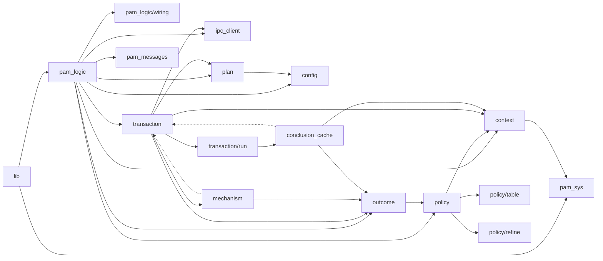
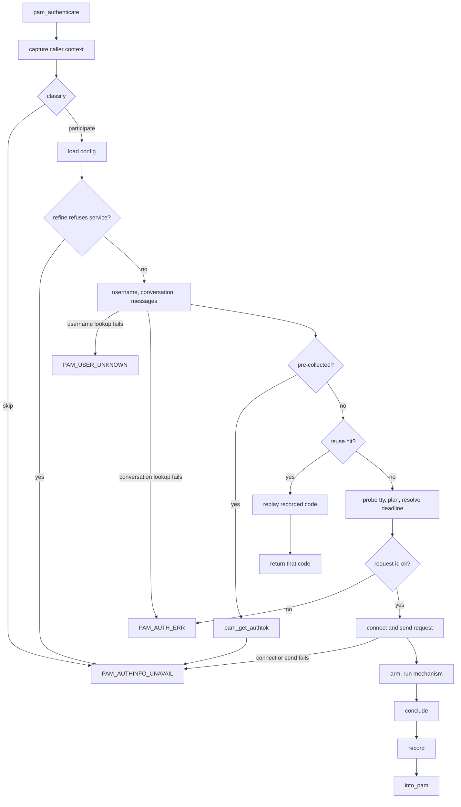
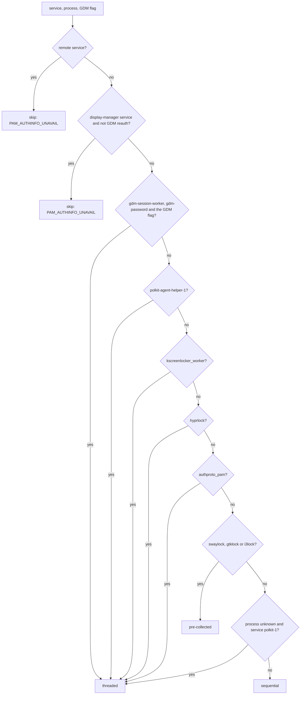
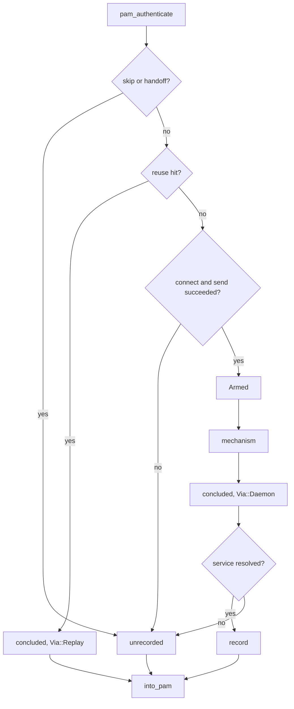

# PAM conversation policy

`client-pam` is a PAM service module. For one `pam_authenticate` call it either asks the paired phone for a verdict through `tapauthd`, or deliberately falls through to whatever the host's stack does next. It runs unprivileged and reaches the daemon only through the Unix-socket IPC in `ipc_client.rs`.

## What the module is

The module is one `auth` line in a service's stack. Debian/Ubuntu ship a `pam-auth-update` profile whose only auth line is `sufficient pam_tapauth.so` (`packaging/debian.pam-config`); merged into `common-auth` it sits beside the stock modules, so a fall-through reaches `pam_unix`. The `required` shape is what the `bypass` e2e covers.

| Line | On `PAM_SUCCESS` | On any other code |
| :--- | :--- | :--- |
| `auth sufficient pam_tapauth.so` | ends the stack: the phone alone completes the login | treated as a failure; the next module runs |
| `auth required pam_tapauth.so` | one required item satisfied; later modules still run | the stack fails |

It never returns `PAM_IGNORE`: Linux-PAM records no failure for that code, so on a `required` line a later `optional pam_permit` could complete the stack. Every skip therefore returns `PAM_AUTHINFO_UNAVAIL`.

The module authenticates the stack's `PAM_USER`. On `su` that is the target account, so the line must sit after `pam_wheel.so`; otherwise a phone grant for `root` replaces the wheel check.

## Code map

Every non-test module under `client-pam/src`, plus the test-only `source_guards.rs`; the three `tests` modules are omitted. "May import" lists the crate-internal modules each file names. The graph below is an overview of call direction, not a complete import list — the table is.

| File | Responsibility | May import |
| :--- | :--- | :--- |
| `lib.rs` | `pam_sm_*` ABI stubs; `guard()` turns a panic into `PAM_AUTH_ERR` | `pam_logic`, `pam_sys` |
| `pam_logic.rs` | `authenticate` (capture, orchestrate, record, convert) and `orchestrate` (classify, config, username, conversation, messages, transaction) | all of the below |
| `pam_logic/wiring.rs` | production `Effects`: `probe_tty`, `connect`, `send_authenticate_request`, `cancel_on_fresh_connection` | `ipc_client`, `transaction` |
| `context.rs` | `CallerContext::capture`: service name, process identity, GDM reauth flag | `pam_sys` |
| `policy.rs` | `Classification`, `SkipPolicy`, `Conversation`, `FailureDirection`, `Participation`, `classify`, `class_permits` | `context` |
| `policy/table.rs` | `RULES`, the ordered rule table, and the test-only `audit` record | `context`, `policy` |
| `policy/refine.rs` | `refine`: the config-dependent second phase that can add one skip | `context`, `policy` |
| `plan.rs` | `Plan`, `Deadline`, `Announcement`, `TtyUse`, `Plannable::plan` | `config` |
| `outcome.rs` | `Outcome` taxonomy and `into_pam`, the only verdict-to-code conversion | `pam_messages`, `pam_sys`, `policy` |
| `transaction.rs` | re-export hub for `run`, `Armed`, `HostIo`, `Concluded`, `Finished`, `StartError`, `Via`, `Effects` | `transaction/*` |
| `transaction/run.rs` | the transaction driver: handoff, reuse lookup, probe, plan, arm, mechanism, conclude | `conclusion_cache`, `config`, `context`, `ipc_client`, `mechanism`, `outcome`, `plan`, `policy` |
| `transaction/lifecycle.rs` | `Armed` (constructed only by `Armed::open`), `Concluded`, `Via`, `Finished`, `StartError` | `context`, `ipc_client`, `mechanism`, `outcome` |
| `transaction/host_io.rs` | `HostIo` (PAM handle, conversation, messages, authtok reader) and `finish`, the single emission site | `outcome`, `pam_messages`, `pam_sys` |
| `conclusion_cache.rs` | the 500 ms reuse record, its gates, and the `pthread_atfork` child handler | `context`, `outcome`, `transaction` |
| `mechanism.rs` | `MechanismEnd` (`Response`/`Reason`/`Error`) and its conversion to `Outcome` | `outcome` |
| `mechanism/threaded.rs` | password on a worker pthread, daemon polled on the calling thread | `mechanism`, `ipc_client`, `outcome`, `pam_sys`, `plan`, `transaction` (types) |
| `mechanism/sequential.rs` | waits on the calling thread, never touches the conversation | `mechanism`, `ipc_client`, `outcome`, `plan`, `transaction` (types) |
| `mechanism/handoff.rs` | pre-collected hosts: `pam_get_authtok` and return, no daemon | `mechanism`, `outcome`, `pam_sys`, `transaction` (types) |
| `config.rs` | `PamConfig`: timeouts, refused services, `effective_refused_services` | — (only `shared`) |
| `ipc_client.rs` | length-prefixed protobuf IPC over the daemon socket | — (`shared` only) |
| `pam_sys.rs` | FFI bindings and safe wrappers: service, user, conversation, authtok | — |
| `pam_messages.rs` | Fluent bundles, locale selection, message loading | — (`shared` only) |
| `logging.rs` | `tracing` initialisation: journald, stderr fallback | — |
| `source_guards.rs` | test-only source scans (see below) | — |



The dashed edges are type references only: `mechanism/*` names `Armed` and `HostIo` from `transaction`, and `conclusion_cache` names `Concluded` and `Via`; neither calls into `transaction`. Every other edge is a call direction.

Two rules a contributor must not break, both enforced by `source_guards.rs`:

* **Only `outcome.rs` produces a `PAM_*` value.** `Outcome::into_pam` is the single conversion; the six exemptions named in `lib.rs` are `guard`'s panic arm and the five constant ABI stubs (`setcred`, `acct_mgmt`, `open_session`, `close_session`, `chauthtok`), and `pam_sys::PAM_AUTHTOK` is an argument, not a code. `only_outcome_rs_returns_pam_constants` scans for `return pam_sys::PAM_*` and for a bare tail-position constant.
* **Only `conclusion_cache.rs` touches the reuse record.** No other module may name `.lock()`, `.try_lock()`, `MutexGuard` or the record static; `cache_owner_is_local` asserts it, and the record's `pub(crate)` surface hands out values, never the lock or the stored struct.

Also enforced: `only_one_get_service_name_call_site` (the service is read only in `context.rs`), `only_one_refine_call_site` (one `policy::refine` call, in `pam_logic.rs`), `no_ruser_read`, `granted_only_from_daemon`, and `test_module_source_contains_no_pam_ignore_return`.

## Request lifecycle


An `opt` marked *early exit* returns from the call; the steps after it do not run. Within a transaction, the tty probe runs after the reuse lookup, and `Armed` exists only once `connect` and `send` have both succeeded.

The same path as a decision graph:



The order matters and is asserted by tests, not by the type system: `classify` runs before the config read, `refine` runs before the username, conversation and messages, and both skips return without touching any of them.

## Flow selection

`policy::classify` walks `RULES` in order; the first matching row decides. The table is data in `client-pam/src/policy/table.rs`: each row carries an id, a `FailureDirection`, a predicate and a `Decision`.

| Rule | Matches | Yields | Skip code |
| :--- | :--- | :--- | :--- |
| `RemoteRefuse` | `PAM_SERVICE` is `sshd` or `sshd-session`, ASCII case-insensitive; process ignored | skip | `PAM_AUTHINFO_UNAVAIL` |
| `DmLoginBypass` | `PAM_SERVICE` is a display-manager name (`DM_PREFIXES`), unless this is a GDM reauthentication | skip | `PAM_AUTHINFO_UNAVAIL` |
| `GdmReauthWorker` | process `gdm-session-worker`, service `gdm-password` (ASCII case-insensitive), `GDM_SESSION_FOR_REAUTH` set | threaded | — |
| `PolkitAgent` | process `polkit-agent-helper-1` | threaded | — |
| `KscreenlockerWorker` | process `kscreenlocker_worker` | threaded | — |
| `Hyprlock` | process `hyprlock` | threaded | — |
| `Xsecurelock` | process `authproto_pam` | threaded | — |
| `PreCollectedLocks` | process `swaylock`, `gtklock` or `i3lock` | pre-collected | — |
| `PolkitServiceWithoutProc` | process unknown, service `polkit-1` (case-sensitive) | threaded | — |
| `DefaultSequential` | anything else | sequential | — |

`DM_PREFIXES`: `sddm`, `gdm`, `gdm3`, `lightdm`, `lxdm`, `slim`, `xdm`, `kdm`, `greetd`, `ly`, `nodm`, `entrance`, `plasmalogin`. A service matches a prefix when it equals it or continues with `-`, after ASCII lowercasing.

Process names are the basename of `/proc/self/exe`, falling back to `/proc/self/comm`; every process rule accepts both the full name and the 15-byte `comm` truncation (`gdm-session-wor`, `polkit-agent-he`, `kscreenlocker_w`). GDM reauthentication requires both `GDM_SESSION_FOR_REAUTH` and the `gdm-password` service — `gdm3-password` is not exempt, it takes the bypass.

`sudo` and `su` match no row: they fall to `DefaultSequential`. With a controlling terminal — the usual case — the operation deadline applies; a tty-less call (`sudo -S` fed from a pipe, a cron job, a unit) finds no `/dev/tty` and takes the clamped `pam_gui_timeout_secs` deadline.



Config cannot reorder or replace any of this. `policy::refine` runs once after the config read and can only turn a participation into the `RemoteRefuse` skip for a name listed in `pam_refused_services`, compared ASCII case-insensitively as a whole string; an existing skip, a selected flow and a deadline are never changed. That second phase exists because `classify` sees the caller's facts only, before any config is loaded.

## The three flows

Each flow is one module under `client-pam/src/mechanism/`. All three produce a `MechanismEnd`; they differ in which thread drives the host's conversation, if any. The rule table chooses between them before any of them runs.

### Threaded

The host's conversation stays answerable while a worker thread is blocked in it, so the password is collected off the main thread while the main thread waits for the phone.

```mermaid
sequenceDiagram
    participant Host
    participant Module
    participant Worker
    participant Daemon
    participant Phone

    Host->>Module: pam_authenticate
    Module->>Daemon: PamAuthenticateRequest
    Module->>Worker: pthread_create, pam_get_authtok
    Daemon->>Phone: ring
    Note over Worker: password dialog on the worker; the main thread polls the daemon and a self-pipe
    alt phone answers first
        Phone-->>Daemon: grant or denial
        Daemon-->>Module: PamAuthenticateResponse
        Module->>Worker: cancel and join
        Module-->>Host: PAM_SUCCESS or PAM_PERM_DENIED
    else user submits a password
        Worker->>Module: self-pipe
        Module->>Daemon: PamCancelRequest gui-password-skip
        Module-->>Host: PAM_AUTHINFO_UNAVAIL
    else dialog is dismissed or fails
        Worker->>Module: self-pipe
        Module->>Daemon: PamCancelRequest gui-password-failed
        Module-->>Host: PAM_AUTHINFO_UNAVAIL
    else deadline expires
        Module->>Worker: cancel and join
        Module-->>Host: PAM_AUTHINFO_UNAVAIL
    end
```

A response that the loop reads is the verdict; the worker is cancelled and joined before the module returns.

| | |
| :--- | :--- |
| Selected by | `GdmReauthWorker`, `PolkitAgent`, `KscreenlockerWorker`, `Hyprlock`, `Xsecurelock`, `PolkitServiceWithoutProc` |
| Threads | `pam_get_authtok` on a worker pthread; the calling thread polls the daemon fd and a self-pipe |
| Daemon sees | the request; a cancel on the live connection when a password is submitted or the dialog fails; no cancel on timeout |
| User sees | the host's password dialog and the phone prompt together; a submitted password wins over a response that becomes readable at the same moment, and otherwise the first of the two ends the wait |
| Phone never answers | `pam_operation_timeout_secs` expires, the worker is cancelled and joined, `PAM_AUTHINFO_UNAVAIL`; the module does not dismiss the host's dialog, and whatever module follows in the stack drives the next prompt |

### Sequential

The host either posts the conversation answer back to the thread that called `pam_authenticate` or parks in a wait with no cancellation point, so a threaded reply could never be abandoned. The module therefore never drives the conversation while waiting: it waits on the calling thread, then falls through to the password module.

```mermaid
sequenceDiagram
    participant Host
    participant Module
    participant Daemon
    participant Phone

    Host->>Module: pam_authenticate
    Module->>Daemon: PamAuthenticateRequest
    Note over Module: waits on the calling thread; the conversation is not driven
    Daemon->>Phone: ring
    alt phone answers
        Phone-->>Daemon: grant or denial
        Daemon-->>Module: PamAuthenticateResponse
        Module-->>Host: PAM_SUCCESS or PAM_PERM_DENIED
    else user presses Enter on /dev/tty
        Module->>Daemon: PamCancelRequest tty-skip
        Module-->>Host: PAM_AUTHINFO_UNAVAIL
    else IPC fails without a terminal
        Module->>Daemon: PamCancelRequest gui-ipc-error on a fresh connection
        Module-->>Host: PAM_AUTHINFO_UNAVAIL
    else deadline expires
        Module-->>Host: PAM_AUTHINFO_UNAVAIL
    end
```

| | |
| :--- | :--- |
| Selected by | `DefaultSequential` |
| Threads | everything on the calling thread; `pam_conv` is never touched |
| Daemon sees | the request; a cancel on terminal Enter (`tty-skip`), or without a terminal on an IPC failure (`gui-ipc-error`, sent on a fresh connection); no cancel on timeout |
| User sees | a wait notice; with a terminal, Enter skips at once; without one, nothing until the deadline or an IPC failure, then the stack's password prompt |
| Phone never answers | the deadline expires, `PAM_AUTHINFO_UNAVAIL`, and the next module prompts for a password |

The terminal and no-terminal shapes are one loop driven by `Profile`; the profile only decides whether an IPC failure is reported as a lost connection or as an error, and whether a poll error ends the wait.

### Pre-collected

The host read the password before calling `pam_authenticate`, and its conversation is a synchronous replay of it. The module reads that password with `pam_get_authtok` on the calling thread and returns at once.

```mermaid
sequenceDiagram
    participant Host
    participant Module

    Host->>Module: pam_authenticate
    Module->>Module: pam_get_authtok on the calling thread
    Note over Module: caches PAM_AUTHTOK for the next module; no daemon contact
    Module-->>Host: PAM_AUTHINFO_UNAVAIL
```

| | |
| :--- | :--- |
| Selected by | `PreCollectedLocks` |
| Threads | the calling thread; one `pam_get_authtok`, no IPC |
| Daemon sees | nothing |
| User sees | only the password prompt the host had already shown |
| Phone never answers | it is never rung; the call returns `PAM_AUTHINFO_UNAVAIL` immediately |

On these hosts the phone is not a credential: nothing is rung and nothing is verified, so a stack with no password module after `pam_tapauth.so` cannot unlock.

## Skips

| Skip | Returns | `sufficient` stack | `required` stack | Why it is safe |
| :--- | :--- | :--- | :--- | :--- |
| Display-manager bypass (`DmLoginBypass`) | `PAM_AUTHINFO_UNAVAIL` | next module prompts for a password | the stack fails | returns before the conversation is touched, so the login manager still populates `PAM_AUTHTOK` and the keyring unlocks |
| Remote refusal (`RemoteRefuse`) | `PAM_AUTHINFO_UNAVAIL` | the next module decides, in practice a password login | the stack fails | returns before the daemon is contacted and before any credential or conversation work, so a phone grant cannot complete a remote login |
| Pre-collected handoff (`PreCollectedLocks`) | `PAM_AUTHINFO_UNAVAIL` | the next module reads the cached `PAM_AUTHTOK` | the stack fails | `pam_get_authtok` caches the token for the next module and the daemon is never contacted, so nothing is rung or verified |

The display-manager bypass exempts a GDM reauthentication (`gdm-password` plus `GDM_SESSION_FOR_REAUTH`), because an unlock runs no session or setcred phase and the keyring reason does not apply there.

The remote refusal covers the built-in names before the config read and any `pam_refused_services` entry immediately after it. A deployment that renames the service must declare the new name.

## Timeouts and deadlines

| Flow | Terminal | Deadline | Value |
| :--- | :--- | :--- | :--- |
| Threaded | either | `Deadline::Operation` | `pam_operation_timeout_secs` (120 s) |
| Sequential | present | `Deadline::Operation` | `pam_operation_timeout_secs` (120 s) |
| Sequential | absent | `Deadline::GuiBounded` | `pam_gui_timeout_secs` (30 s), clamped to the operation timeout |
| Pre-collected | — | none | — |

`Plannable::plan` picks the variant from the `Plannable` shape and `has_tty`; `Deadline::resolve` in `plan.rs` turns it into seconds and saturates at `u32::MAX`. `transaction/run.rs` adds those seconds to the current instant and sends the same value to the daemon, so both sides expire together.

The clamp is `pam_gui_timeout_secs.min(pam_operation_timeout_secs)` and applies only to a sequential host that finds no terminal. Every sequential host attempts the probe (`Plannable::tty_use` is `PollForKey` for `Sequential` and `DoNotOpen` for `Threaded`, decided before any terminal is known); a host without a terminal gets `None` back, and only then does its plan become `GuiBounded`.

On expiry the mechanism returns `MechanismEnd::Reason(UnavailableReason::TimedOut)`, no cancel is sent, and the module returns `PAM_AUTHINFO_UNAVAIL` after one `timed_out` message. A timeout the daemon reports itself is `UnavailableReason::DaemonTimedOut`: the same code, no message.

## Return codes

| `Outcome` | Code | What it means to a stack author |
| :--- | :--- | :--- |
| `Granted` | `PAM_SUCCESS` | the phone granted this call, or this process's own grant was replayed |
| `Denied` | `PAM_PERM_DENIED` | the user denied on the phone |
| `Unavailable` | `PAM_AUTHINFO_UNAVAIL` | the module could not ask: a skip, a timeout, no daemon, no paired device, or the password handoff |
| `Error` | `PAM_AUTH_ERR` | `PamConversation::new` failed, request-id generation failed, the daemon answered `PamOutcome::Error` or a value this build does not know, `pipe2` or `pthread_create` failed, or `guard()` caught a panic |
| `UserUnknown` | `PAM_USER_UNKNOWN` | the username lookup failed |

Only two constructors can produce a grant: `Outcome::granted_from_daemon` (a `PamOutcome::Success` this call received, `GrantVia::PhoneTap`) and `Outcome::replayed` (a copy of this process's own record, `GrantVia::VerdictReplay`). `granted_only_from_daemon` scans for any other construction.

A recorded conclusion answers a further call for the same username and the same service bytes within 500 ms, returning the recorded code without contacting the daemon. The replay carries its provenance (`Via::Replay`, and `GrantVia::VerdictReplay` or `DenyVia::VerdictReplay`) and is never re-recorded.

## State that outlives a call

One process-wide record lives in `conclusion_cache.rs`. A call either ends with a conclusion to store or ends unrecorded.



| Stored | |
| :--- | :--- |
| `username` | the name this call authenticated |
| `service` | `ServiceName::original`, the bytes libpam returned, case preserved |
| `outcome` | the whole verdict, including its provenance |
| `concluded_at` | the instant the module records, immediately before it returns to the host |

The key is `(username, service)` compared with plain string equality, so `sudo` and `SUDO` are distinct services. The window is `VERDICT_REUSE_WINDOW` (500 ms) measured from `concluded_at`; the anchor is the module's return path, not the moment the phone answered.

`record` accepts only a `Via::Daemon` conclusion whose service resolved. Skips, the pre-collected handoff, a failure before the request was sent and an unresolved service store nothing, and a replay can never overwrite the record it came from. Every call that armed a request is recorded, including the module's own timeout and a pre-answer IPC failure: the record holds the verdict, not just a grant, so a later call inside the window receives the same code without ringing the phone.

A forked child inherits neither: the `pthread_atfork` child handler writes a fresh empty record over the inherited slot, so the child starts with no conclusion and no held lock.

## Configuration that affects the conversation

| Key | Default | Effect |
| :--- | :--- | :--- |
| `pam_operation_timeout_secs` | 120 | the deadline for threaded hosts and for a sequential host with a terminal; also sent to the daemon |
| `pam_gui_timeout_secs` | 30 | the deadline for a sequential host without a terminal, clamped to the operation timeout |
| `pam_refused_services` | none beyond the built-ins | adds service names to the remote refusal |

`PamConfig::load` reads them once per call; a missing or unparsable config falls back to the defaults.

`pam_refused_services` is add-only. `effective_refused_services` starts from `["sshd", "sshd-session"]`, trims each configured name, drops invalid entries (empty, non-ASCII, over 255 bytes, containing `/`, whitespace or control characters), deduplicates case-insensitively, and can never remove a built-in.

`use_tpm` does not affect this module: it selects key storage inside `shared`.

## Adding a host or a flow

Adding a host:

1. Add the predicate in `policy/table.rs`, accepting both the full process name and its 15-byte `comm` truncation.
2. Add the `RuleId` variant with its `ALL` and `as_str` arms in `policy.rs`, and the row in `RULES` with its `FailureDirection` and `Decision`.
3. Re-point the `client-pam/src/policy/table.rs:<line>` citations in the audit records below the insertion; `evidence_citations_resolve` fails until each cited line declares its rule's predicate.
4. Add the audit arm in `policy/table.rs`: name, why, and the evidence citation.
5. Add a row to `client-pam/tests/fixtures/callers.csv` with `expected_rule` and `expected_policy`.
6. Add the process key to the `rules_are_process_disjoint` set.
7. Add an `EXPECTED_TTY` entry in `policy.rs` when the flow is threaded or sequential.
8. For an e2e-covered host, add its `case` arm to `scripts/ci/test-pam-conv-thread.sh` and set `e2e=1`.

All but two of these fail loudly: a `RuleId` without its audit arm does not compile, a mis-cited record trips `evidence_citations_resolve`, a rule without a corpus row trips `corpus_covers_every_rule`, a corpus row whose decision or tty disagrees trips `corpus_characterises_the_decision_table`, and an `e2e=1` row without an arm fails the harness. The two silent edits are the `RuleId::ALL` arm — a rule missing from both `ALL` and `RULES` stays green — and the `rules_are_process_disjoint` key set; update both by hand.

A display manager is not a new rule: add a `DM_PREFIXES` entry (and its array length) plus one corpus row per prefix.

Adding a flow:

1. Add the `Conversation` variant in `policy.rs` and the cell in `class_permits`; `class_permits_matches_its_expectation` pins the whole matrix.
2. Add the `Plannable::plan` row for each terminal shape; `plan_table` pins it.
3. Add `mechanism/<name>.rs` returning a `MechanismEnd`, and dispatch it from `transaction/run.rs`.
4. Add the module to the production list in `source_guards.rs`; `the_walker_separates_test_modules_from_production` fails otherwise.
5. Add a corpus row for each host that selects the flow.

The `FailureDirection` of a rule decides which conversations it may select, so choose it before writing the predicate:

| Direction | Permits | Use when |
| :--- | :--- | :--- |
| `DeadlockAvoidance` | threaded or sequential | driving the conversation from the wrong thread would deadlock the host, so the rule picks per process |
| `AlwaysRing` | threaded | the host's conversation stays answerable on a worker, and the phone is always rung |
| `NeverRing` | pre-collected | the host read the password before calling |
| `Keyring` | skips only | the login manager must populate `PAM_AUTHTOK` |
| `RefuseRemote` | skips only | a remote login must never be completed by the phone |

## Known gaps

- An undeclared service rename is not detected: `PAM_RHOST` is not read, so the call falls through to `DefaultSequential` and the phone is rung for a remote login. `svc_sshd_near_miss` pins the behaviour.
- musl is only `cargo check`ed; `pthread_atfork` and the record's mutex are unverified there.
- `cache_lookup_precedes_daemon_contact` compares source byte offsets, so it passes even when the lookup sits behind a branch that never runs. The e2e duplicate shapes are the real coverage.
- The `pthread_atfork` registration-failure branch is not exercised.
- `RuleId::ALL` completeness is not compile-enforced: a rule missing from both `ALL` and `RULES` stays green.
- A panic between `pthread_create` and the join leaks the worker; `guard()` does not close it.
- `pthread_cancel` can deadlock a host that holds an internal libc lock. Accepted: isolating the conversation would need a helper process.
- No mechanism-level test drives a `PamOutcome::Timeout` through a sequential loop; the daemon-timeout e2e uses a threaded host.
- The host-cases suite (`scripts/ci/test-pam-host-cases.sh`) needs root to write `/etc/pam.d`; a non-root run reports one skip per case and fails.
- Nothing asserts where the `su` line sits relative to `pam_wheel.so`.
- The Debian packaged `common-auth` stack is only string-checked; no test drives it.
- No test covers a daemon-side deduplication of two identical requests.
- The Fedora/Arch shared stack (`system-auth`, `password-auth`) is not verified to reach sshd.
- No mutation or fuzz gate covers rule ordering.
