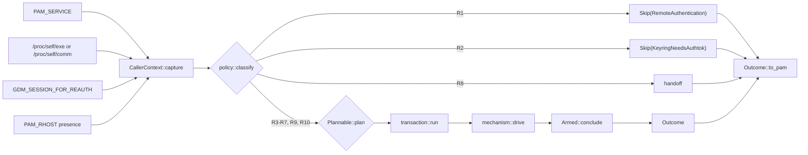

# PAM conversation policy

Status: accepted design document. Scope: `client-pam`. The rule table in §3.3.1 is the normative statement of the module's conversation policy; `client-pam/src/policy.rs` is the executable form it is to have once Appendix B has been applied, and a disagreement between the two is a defect in one of them — §4's inventory and the fixture corpus (§6.1) are what make the disagreement visible. The tree at the time of writing still decides in `pam_logic.rs:406-435`; it does not yet read `PAM_RHOST` and does not refuse remote authentication.

---

## 1. Summary

**Problem.** `client-pam` decides *how* to answer a PAM conversation, *whether* to ring the phone, *how long* to wait and *which* `PAM_*` code to return in one 546-line function (`pam_logic.rs:841-1386`), which itself contains the terminal poll loop (`:1252-1385`), plus two further loops (`:600-697`, `:728-787`). The decision inputs are read from three different places at three different times (`pam_logic.rs:851`, `:898-905`, `:1445`), the decision itself is a `match` with no record of *why* each arm exists (`:406-435`), the timeout rule is an `if` expression with no test at any level (`:1015-1021`), and the return code is produced at 51 distinct sites across three files (§2.3).

**The design.** Five pure or narrow pieces, three mechanisms, and one owner type for the reuse record:

| Piece | File | Responsibility |
| :--- | :--- | :--- |
| `CallerContext` | `context.rs` | The four caller facts — service, process, GDM reauth, remote presence — read exactly once, before credentials/conversation work |
| `classify` | `policy.rs` | One ordered table of ten `Rule`s, each with class, evidence and decision |
| `Plan` | `plan.rs` | `Plannable` (the `Threaded`/`Sequential` carrier) and one total function from it to `{deadline, announcement, tty_use}` |
| `Outcome` | `outcome.rs` | The verdict as data, converted to a `PAM_*` code in one exhaustive match |
| `transaction::run` and `ConclusionCache` | `transaction.rs` | Classification's consumer: reuse lookup and record, request id, plan, connect+send (`Armed`), cancellation; the cache's single owner type |
| `mechanism::{threaded, sequential, handoff}` | `mechanism/*.rs` | The three ways to answer a PAM ABI conversation, each receiving `&mut Armed`, `&Plan` and the resolved deadline, plus only what it needs: `threaded` the PAM handle, `sequential` the tty and the injected cancel closure, `handoff` `&mut HostIo`. `sequential` is **one** loop driven by a `Profile` (§3.7), not the two loops there are today |

`pam_logic.rs` shrinks to orchestration plus daemon response mapping.

**What it buys.**
1. *One place to look* for "why does host X behave like this" — a row with a class, a reason and a citation, not a comment 400 lines away.
2. *One place for ordering*: `Skip` and `Participate` are different types, so a skip cannot acquire a plan, a deadline or a mechanism; the skip rules (R1, R2) resolve before username and conversation work because `authenticate` returns on `Skip` before those calls, and that order is pinned by a call-counter test (`classify_before_side_effects`) rather than by the compiler — the types make the skip unable to *use* the later state, not unable to be placed after it.
3. *One place that can grant*: `Outcome::Granted` is constructible only from a daemon `PamOutcome::Success` (`outcome.rs`), so a mistake anywhere else is availability-only, never a grant. Two `PAM_SUCCESS` values exist without a fresh round trip, and neither weakens that: a **replay** of a conclusion this process itself recorded for the same `(user, service)` inside the 500 ms window, carried as `Via::Replay` and never re-recorded (§3.6); and the five `lib.rs` ABI stubs (`lib.rs:84-135` — `setcred`, `acct_mgmt`, `open_session`, `close_session`, `chauthtok`) that answer a non-authentication entry point with a constant, convert no verdict and never see an `Outcome` (§3.5.1, §3.6). Enforced by a type, a provenance field and two source scans.
4. *Testability where there is none today*: the `(deleted)` strip and `comm` fallback (`:341-356`), the GUI clamp (`:1015-1021`), the `has_tty`-invariance of the threaded plan (comment only, `:911-913`), the two IPC loops' shared check order (§3.7) and the failure-direction taxonomy all become unit assertions.
5. *One edit to add a host*: one rule row, one justification, one fixture row — once step 8 of Appendix B has deleted the old representations (§3.9 states the honest count before and after that step).

**What it costs.** Nine new source files (`context.rs`, `policy.rs`, `plan.rs`, `outcome.rs`, `transaction.rs`, `mechanism/mod.rs` and the three mechanisms), one fixture file, **two** documented ordering changes (the `/dev/tty` probe moves after the cache lookup, and the skip path now performs the `/proc` identity read before returning; §7), one read that is new on **every** path (`capture` performs one `pam_get_item(PAM_RHOST)` before anything else — including on the greeter, cache-hit and pre-collected paths, which today never read the item at all; it is an in-process handle read with no file, no fd and no NSS lookup, and it changes no verdict; §3.2, §7), **two deliberate behaviour changes** (R1 refuses remote authentication, and the `PAM_RUSER` fallback is removed — D7, §3.3.1 and F8), one conversation-loop merge that is new code rather than a move (§3.7), a step-8 deletion of four code representations and five prose host lists, and a fixture corpus that must be maintained or it rots into a tautology (§6.1, §7).

**Scope and invariants.** No change to: the IPC schema (`proto/ipc.proto:29-34`), the daemon's caller-agnostic contract, `PamConfig`, `PamMessages`, `IpcClient`, any `PAM_*` code returned on any path other than the two decided changes above, the contents or members of the four existing failure-direction classes (a fifth, `RefuseRemote`, is added — §3.3.2), or any host's classification. The invariants a step may not break:

* **The IPC schema does not change.** `PamAuthenticateRequest` keeps its four fields (`proto/ipc.proto:29-34`); `RemoteRequest` is consumed in-process and holds presence only — no host string is stored, logged or sent (§3.2, D7).
* **No `dev-*` feature is introduced.** Every step ships with the production feature set; `scripts/ci/check-production-build.sh` stays green at every step (Appendix B), and the fixture corpus is test-only data (§2.9).
* **The 500 ms window's duration and `(username, service)` key are unchanged.** The design makes the assumption behind the window visible (F1) and does not strengthen it (§3.6).
* **The grant invariant holds:** a `Granted` comes only from this call's daemon `PamOutcome::Success` or from a replay of this process's own record (§3.5.2).
* **No remote participation.** The module never rings the phone for a call whose `PAM_RHOST` is present or whose PAM service is `sshd`; it returns `PAM_AUTHINFO_UNAVAIL` before any config read, username lookup, conversation construction or message load (R1, §3.3.1).
* **The eleven flags stay in place, except F8**, which D7 retires (§5). Retirement of any other flag is a separate decision with its own experiment.

---

## 2. Problem and evidence

Each finding below is a property of the current tree, cited. None of them alone justifies a refactor; together they are why a host addition is currently a five-file edit with a silent failure mode.

### 2.1 One function, three responsibilities, no decision record

`authenticate_inner` (`:841`) both *decides* and *executes*. The decision inputs enter at three points — and a fourth fact that decides whether the module should be in a transaction at all is never read:

| input | read at | used at | note |
| :--- | :--- | :--- | :--- |
| PAM service | `:1445` (bypass), `:898` (mode/cache) | `:1448`, `:905`, `:971` | resolved twice |
| process name | `:900` → `process_identity` `:341` | `:905` | not testable as a function |
| `GDM_SESSION_FOR_REAUTH` | `:446` inside `is_gdm_reauth` | `:904` | read via `var_os(...).is_some()`; presence only |
| `/dev/tty` availability | `:914-918` | `:998`, `:1015`, `:1252` | probe occurs before the cache lookup |
| **`PAM_RHOST`** | **nowhere** | — | the module cannot tell a remote login from a local one, so an sshd login rings the phone and waits; R1 (§3.3.1) is the read and the refusal |

The decision itself is `conversation_mode` (`:406-435`): five arms, two of which carry a dual spelling for `TASK_COMM_LEN - 1` truncation (`:408`, `:409`, `:417`), one arm keyed on a *missing* process name (`:432`), and one catch-all. The reason for each arm lives in a 48-line doc comment above it (`:358-405`) that no test can read.

### 2.2 The failure-direction taxonomy exists only in prose

The module's own comments distinguish three kinds of mistake:

* **never ring** — the pre-collected locks: "ringing the phone would be misleading and could only ever end in a timeout" (`:929-931`);
* **deadlock avoidance** — the sequential default: "an unknown host therefore keeps the behaviour that cannot deadlock, at the cost of the existing (shorter) GUI timeout — the failure direction is 'slower', never 'wedged'" (`:360-364`);
* **UX** — the phone is offered, with accepted risks (hyprlock `:377-380`, xsecurelock `:381-386`);
* plus a fourth, orthogonal one: **keyring** — the display-manager bypass exists so the DM's own prompt populates `PAM_AUTHTOK` (`:1420-1429`).

Nothing in the type system or the tests encodes this. A new arm added to `:407` inherits whichever direction its neighbours happen to have; the only test is an enum equality table (`:2499-2659`) that says *what* the mode is, never *whether that direction is the one the host needs*.

A fifth direction is not visible in today's code at all: **this module does not refuse remote authentication**, because it never reads `PAM_RHOST` (§2.1). `RefuseRemote` is the class that gap needs (§3.3.2, R1), and it is added by this design rather than found in the tree.

### 2.3 The return code is produced at 51 sites

Counted mechanically — every syntactic place in production code that produces a PAM status value: a `return`, a tail expression, a `match` arm, an `Err(..)`/`map_err(..)`, a `?` forward, or the default a code-carrying local is initialised with — the crate has 7 such sites in `lib.rs`, 20 in `pam_sys.rs` and 24 in `pam_logic.rs`, so **51** across the three files:

| file | sites |
| :--- | :--- |
| `lib.rs` | `:56` (passthrough), `:63` (panic arm), `:90`, `:101`, `:112`, `:123`, `:134` (the five constant ABI stubs) |
| `pam_sys.rs` | `:49`, `:55`, `:61`, `:64`, `:72`, `:82`, `:84`, `:90`, `:97`, `:103`, `:106`, `:117`, `:122`, `:125`, `:153`, `:167`, `:172`, `:175`, `:200`, `:257` |
| `pam_logic.rs` | `:870`, `:882`, `:955`, `:1008`, `:1064`, `:1069`, `:1094`, `:1100`, `:1110`, `:1130`, `:1184`, `:1199` (the threaded path's default), `:1258`, `:1319`, `:1325`, `:1332`, `:1353`, `:1385`, `:1454`, `:1475`, `:1480`, `:1484`, `:1488`, `:1497` |

Two facts about that count belong to the diagnosis rather than to the arithmetic. First, **seven of the `pam_sys.rs` sites are in code no production caller reaches today** (`set_user` `:82`, `:84`, `:90`; `prompt_user` `:167`, `:172`, `:175`, `:200` — F11): the count includes code that cannot run, which is itself a reason the question "can this path grant?" has no local answer. Second, the decision of *which* code to return and the mapping of the daemon's answer are one `match` (`:1472-1498`), so the pure part cannot be enumerated without a PAM handle. Removing the `PAM_RUSER` fallback (D7, F8) deletes one `pam_sys.rs` site — `:61`, the `PAM_RUSER` read failure; `:64`, the null-item `PAM_USER_UNKNOWN`, is kept by the new null check — leaving 50. Consequences:

* No local answer to "can this path grant?" — the answer requires reading `map_pam_outcome` (`:1465-1500`) and then checking that no other return can produce `PAM_SUCCESS`. A source scanner for `PAM_IGNORE` already exists because of exactly this problem (`:2036-2074`), and it needed a second test to prove the scanner works (`:2082-2120`).
* The user-visible message and the code are decided in the same match (`:1472-1498`), so the message set cannot be enumerated without a PAM handle; the pure part (`Outcome` → code) is untestable in isolation from the emission part (→ `try_info`, which swallows errors, `pam_sys.rs:306-310`).

### 2.4 The deadline rule has no test at any level

```rust
let effective_timeout_secs = if !has_terminal && mode == ConversationMode::Sequential {
    config.pam_gui_timeout_secs.min(config.pam_operation_timeout_secs)
} else {
    config.pam_operation_timeout_secs
};
```

(`:1015-1021`.) It is the one behavioural rule with **zero** coverage at any level; `scripts/ci/test-pam-host-cases.sh:93` sets gui 2 s / op 4 s, so the clamp is *executed* but never *discriminated* — an accidental `max` would still pass every test in the repo. The u32 saturation three lines later (`:1022-1029`) is likewise untested.

### 2.5 Identity reading is not unit-testable

`process_identity` (`:341-356`) reads `/proc/self/exe`, strips `" (deleted)"`, falls back to `/proc/self/comm`; `is_gdm_reauth` (`:444-447`) reads the environment. Neither has a direct caller in the test suite; the table test passes literals instead. The sharpest consequence is that a regression inside `process_identity` "changes behaviour for **every** host and is caught by **no** test".

### 2.6 Host knowledge is duplicated six times

| site | what it holds |
| :--- | :--- |
| `:406-435` | the production allowlist (5 arms, 3 truncated spellings) |
| `:2499-2659` | a hand-written 24-row table test |
| `scripts/ci/test-pam-conv-thread.sh:210,339,469,499` | four binary copies named after hosts |
| `scripts/ci/conv_thread_harness.c:683-697` | a parallel enumeration of strategy names |
| `scripts/ci/test-pam-host-cases.sh:102` | a synthetic `gdm-`-prefixed service name |
| `docs/design-documents/desktop-and-lockscreen-integration-plan.md:73-96` | a quoted `conversation_mode` body that **no longer matches the code** — it lists `swaylock`/`gtklock` as `Threaded`, which `:429` classifies `PreCollected` |

The last row is the drift this document is about: a *plan* document restates a code block, the code moved, and nothing failed. Renaming a host in production requires edits in at least three files; forgetting the shell copy *removes* coverage rather than failing, and forgetting the plan document leaves a second, wrong statement of the policy in the tree.

### 2.7 Two loops duplicate the IPC handling

`run_sequential_event_loop` (`:728-787`) handles only the IPC fd; the terminal branch (`:1252-1385`) handles the IPC fd plus `/dev/tty` and repeats the same POLLIN/POLLHUP/POLLERR sequence, the same "read data first" rule and the same EINTR swallow. The duplicated region is ~60 lines and differs only in what happens on a tty read.

The two loops are not merely similar: they hold the **same check order** twice, and the differences between them are exactly the per-path mappings a merge has to state explicitly. That is the maintenance hazard this document exists to remove, so the merge is in scope (§3.7, D8). The differences are: the no-tty loop collapses hangup, read error and poll error into one `IpcError` (`:765`, `:771`, `:776`, `:782`) and its caller emits one `communication_error` with a cancel (`:1102-1111`); the terminal loop distinguishes read error (`communication_error`, `:1322-1326`) from hangup (`connection_lost`, `:1310-1321`, `:1328-1332`), logs a poll error and keeps waiting (`:1376-1380`), and sends no cancel at all; and only the terminal loop has a tty to skip on (`:1342-1353`).

### 2.8 Corrections to `AGENTS.md` and to earlier descriptions

**CORRECTION 1 (load-bearing).** `AGENTS.md` and `INSTALLATION.md:313-320` describe a `kscreenlocker >= 6.8` gate and list "kscreenlocker ≤ 6.7" as sequential. There is no version parsing anywhere: `grep -nE '6\.8|6\.7|version'` over `pam_logic.rs` returns comment text only (`:55`, `:286`, `:371-376`, `:705`, `:1074`). `Some("kscreenlocker_worker" | "kscreenlocker_w")` is unconditionally `Threaded` (`:409`), and the ≤ 6.7 case is expressed *only* by `kscreenlocker_greet` being absent from the allowlist (`:376`, a comment, not an arm). This document therefore preserves the name-keyed behaviour, states the reason at rule R5, and never repeats the version claim.

**CORRECTION 2 (minor).** The `None if service == "polkit-1"` arm (`:432`) is sometimes described as "keying on an empty/absent-service string". The `None` is the *process* pattern, not the service: the arm is reached when identity resolution produced nothing and the service name is exactly `polkit-1`. The row `svc:polkit-1-no-proc` in §4 table A states this correctly. Used as stated there.

**CORRECTION 3 (minor).** The reuse lookup is sometimes placed "after the PreCollected return at 971". The PreCollected return is `:955`; `:971` is where the cache lookup begins. Used as `955` / `971`.

**CORRECTION 4 (scope of a claim).** `AGENTS.md`'s "two `pam_tapauth.so` lines in one stack are one check" is unconditional; the code is conditional — the record is armed only after a successful connect+send (`:236-244`) and only when the service resolved (`:836`), so a second line after a DM bypass, a pre-collected skip or an IPC failure does ring again. The design preserves the conditional behaviour and states it as the `Armed` invariant (§3.6).

**CORRECTION 5 (scope of a claim).** `AGENTS.md:141` states the sequential timeout as "waits … for `pam_gui_timeout_secs` (default 30s, clamped to `pam_operation_timeout_secs`)" — unconditionally. The clamp is conditional: `pam_logic.rs:1015-1021` computes `pam_gui_timeout_secs.min(pam_operation_timeout_secs)` only when `!has_terminal && mode == ConversationMode::Sequential`, and the `else` arm is `pam_operation_timeout_secs` alone. A sequential host **with** a terminal — the `sudo`/`su` case, the `Sequential`/`has_tty == true` cell of §3.4.1 — is therefore bounded by `pam_operation_timeout_secs` alone, and `pam_gui_timeout_secs` never applies to it. The design reproduces the condition and not the sentence: `Deadline::GuiBounded` is planned only for `Sequential` without a tty (`plan_table`). Appendix B step 8 must therefore rewrite `AGENTS.md:141` — and `AGENTS.md:138`, which names `conversation_mode()`, as `:141` names `run_sequential_event_loop`, both of which the adoption path deletes.

### 2.9 The standing constraints no step may violate

* **The 500 ms reuse window is an assumption, not a property.** `pam_logic.rs:97-100`: "The remaining assumption is that no legitimate host performs an *independent* authentication for the same user and service within 500 ms of a concluded one: the key cannot tell such a request apart from a duplicate." The design makes that assumption visible (F1) and does **not** strengthen it: the duration and the `(username, service)` key are unchanged, and the only change is that a recorded conclusion now carries its provenance, so a replay can never be re-recorded (§3.6, §3.5.2).
* **No `dev-*` feature is introduced.** Every step ships with the production feature set; `scripts/ci/check-production-build.sh` must stay green at every step (Appendix B). Nothing in this design needs `dev-state-override`, `dev-socket-override`, `dev-polkit-bypass` or any other knob, and the fixture corpus is test-only data.
* **The module does not participate in remote authentication.** Today nothing prevents it — §2.1's missing `PAM_RHOST` read is the whole of the evidence — and R1 is the constraint, not a feature: a step that reorders `classify` away from the first position, or that lets a skip reach a daemon connect, breaks it (§3.3.1, §3.6).

---

## 3. Architecture (normative)

### 3.1 Module map and dependency direction

```
lib.rs ──> pam_logic.rs ──> context.rs
                        ├─> policy.rs ──> context.rs
                        ├─> plan.rs   (leaf: `Plannable` + `Plan`)
                        ├─> outcome.rs
                        ├─> transaction.rs ──> policy.rs, plan.rs, outcome.rs
                        │                  └─> mechanism/{threaded,sequential,handoff}.rs
                        └─> config.rs, pam_messages.rs, pam_sys.rs, ipc_client.rs  (unchanged)
```

Dependency direction is one-way: `context` depends on nothing in the crate except `pam_sys`; `outcome` adds only `policy::SkipPolicy` (for `from_skip`); `policy` depends on `context`; `plan` is a leaf (it names no `policy` type); `transaction` on all of them; mechanisms on `transaction`'s `Armed`/`HostIo` and on `pam_sys`/`ipc_client` only. A mechanism cannot name `CallerContext` (§3.7), so the compiler forbids re-branching on caller identity inside a mechanism.

Construction order is part of the design, not an implementation detail. `CallerContext::capture` (`:851` today) runs **before** `PamConfig::load` (`:856`), `pam_sys::get_user` (`:862`), `PamConversation::new` (`:877`), `PamMessages::load_for_user` (`:889`) and before any `/dev/tty` open (`:914-918`); `classify` consumes the context immediately, and only a `Participate` reaches the code that performs the other four. `HostIo` is therefore *constructed after* classification — it borrows the messages those later calls produce and, in production, the conversation — and it never owns an already-open tty: the probe is a closure passed into `transaction::run` and consumed there (§3.4, §3.6). This preserves today's `851`-before-`856/862/877/889` order exactly, including the fact that a display-manager service pays none of *that* work — no config, no username, no conversation, no messages, no `/dev/tty` — though it now pays `capture`'s own reads: `PAM_SERVICE` and `/proc` today happen *after* the bypass (`:898`, `:900`), and `PAM_RHOST` today happens nowhere at all, on any path (§3.2).

### 3.2 `CallerContext` (`context.rs`)

```rust
pub(crate) struct CallerContext {
    service: Option<ServiceName>,
    process: ProcessIdentity,
    gdm_reauth: GdmReauth,
    remote: RemoteRequest,
}

pub(crate) struct ServiceName { original: Box<str>, ascii_lower: Box<str> }
pub(crate) enum ProcessIdentity { Exe(Box<str>), Comm(Box<str>), Unknown }
#[derive(Clone, Copy, PartialEq, Eq)]
pub(crate) enum GdmReauth { Present, Absent }
#[derive(Clone, Copy, PartialEq, Eq)]
pub(crate) enum RemoteRequest { Present, Absent, Unknown }
```

| member | source | today | rule |
| :--- | :--- | :--- | :--- |
| `service` | `pam_sys::get_service_name` (`pam_sys.rs:27-42`) | `:1445` and `:898` | read **once**, at capture |
| `process` | `/proc/self/exe` basename, then `/proc/self/comm` | `:341-356` | delegated to the pure function below |
| `gdm_reauth` | `env::var_os("GDM_SESSION_FOR_REAUTH").is_some()` | `:446` | presence only, read **once** |
| `remote` | `pam_sys::get_rhost_present` (`PAM_RHOST` presence) | never read | presence only, read **once**; feeds R1 |

**The remote fact: what is read, and what is deliberately not.** `pam_sys` gains one presence-only getter modelled on `get_service_name` (`pam_sys.rs:27-42`), not on `get_user` (`:44-73`, which substitutes one item for another):

```rust
pub unsafe fn get_rhost_present(pamh: *mut PamHandle) -> RemoteRequest

/// The raw read and its interpretation, split exactly as `GdmReauth` is.
unsafe fn probe_rhost(pamh: *mut PamHandle) -> Result<bool, c_int>; // Ok(true) ⇔ non-null item
fn remote_from_probe(probe: Result<bool, c_int>) -> RemoteRequest;  // the pure mapping
```

`probe_rhost` returns `Ok(true)` when `pam_get_item(pamh, PAM_RHOST, ..)` succeeds with a non-null item, `Ok(false)` when the item is null, and `Err(rc)` when the call fails; `get_rhost_present` is `remote_from_probe(probe_rhost(pamh))`, so `RemoteRequest::Present`, `Absent` and `Unknown` are each asserted by value without a PAM handle. The getter is **presence-only** and never inspects the string: a literal `"UNKNOWN"` and the empty string are both non-null items and therefore `Present`. `PAM_RHOST` is not in the hand-written `pub use` list (`pam_sys.rs:17-21`) and appears nowhere in `client-pam/src` today; the binding exists because `build.rs:64` allowlists `PAM_.*` into the generated bindings, and the call uses the same `pam_get_item` the crate already binds (`:32`, `:52`, `:59`, `:100`). Only **presence** is read: no host string is stored, logged or sent, and the IPC schema gains no field (§3.10, §1's invariants). Non-UTF-8 is irrelevant for the same reason — a boolean does not need the bytes.

**Why that predicate, and not another.** R1 fires on `remote == Present` **or** `service.is("sshd")`, and the two halves are not redundant:

* `PAM_RHOST` is the semantically exact signal: `pam_set_item(3)` defines it as the "remote requesting host", and OpenSSH sets it (`auth-pam.c`: `pam_set_item(pamh, PAM_RHOST, sshpam_rhost)`). It is the primary signal because it is about *this call*, not about the name of the stack it runs in. Because the check is presence-only, the canonical-hostname case (`PAM_RHOST == "UNKNOWN"`) is still `Present` and R1 still fires: sshd is remote either way.
* The one gap is a caller that sets no `PAM_RHOST` at all. The service-name half covers that case, and it is explicitly a *default*, not a constant: `sshd` is OpenSSH's compiled-in `PAMServiceName`, changeable at build time and effectively renamed by any deployment that runs a different service file. A renamed `PAMServiceName` with a present `PAM_RHOST` is still caught by the remote half, so the residual gap is a renamed service **and** no `PAM_RHOST`. That is why the predicate is a disjunction and not a test of one signal: each half is blind to a case the other sees.
* Both halves produce the same `Skip(RemoteAuthentication)`, so the second is defence in depth for the caller that sets no `PAM_RHOST` at all, and for the service rename that no other signal reports.

The costs are stated in both directions, because a security rule that only names one is not a rule:

* **False positive** (a local caller misdetected as remote — a local process that sets `PAM_RHOST`, or a local service literally named `sshd`): the phone is silenced for a local login. Because the module can never return `PAM_IGNORE` (§3.5.1), on a `required` line that **denies** the local login; on a `sufficient` line it is `ignore` and the rest of the stack decides. That is the price of refusing remotely, and it is why the predicate is two signals rather than a substring match on anything.
* **False negative** (a remote caller not detected — a renamed `PAMServiceName` *and* an unreadable `PAM_RHOST`): the phone is rung and the module waits on every remote login, i.e. it participates in remote authentication, which is the security-relevant direction. An unreadable `PAM_RHOST` (`pam_get_item` fails) is treated as `Unknown` and falls through to normal classification: that is a deliberate false-negative path, not an oversight, and `svc_sshd_custom_absent` in the corpus documents it.

**Folding, rejection and the cache key.** `ascii_lower` is `original.to_ascii_lowercase()` — the function today's code already uses (`:1409`) — and **never** `str::to_lowercase()`: non-ASCII folding maps U+212A KELVIN SIGN to `k`, so `"\u{212a}dm"` would become `kdm`, a non-display-manager service would match R2, and its users would lose the phone prompt silently. `original` holds the bytes returned by `get_service_name`, built only from a UTF-8 `CStr` (`pam_sys.rs:35-38`): a non-UTF-8 service name is **rejected to `None`** (no bypass, no cache) rather than converted with `to_string_lossy`, which would make a lossy string a real cache key and a real prefix candidate. **The reuse cache keys on `original`**, exactly as today (`:972` keys on the raw `String`), so `sudo` and `SUDO` stay distinct keys; `ascii_lower` is used only by `eq_ignore_ascii_case` and `dm_prefixed`. Pinned by corpus rows `service_case_sudo` before `service_case_SUDO` (the second must miss) and `dm_kelvin` (must not match R2).

Two constructors, and only these:

* `CallerContext::capture(pamh)` — the single site in the crate that reads `PAM_SERVICE`, `PAM_RHOST`, `/proc` and the environment. Called first in `authenticate`, before `PamConfig::load`, username lookup, conversation construction or message loading.
* `CallerContext::from_parts(service, process, gdm_reauth, remote)` — for policy tests. `#[cfg(test)]`-only, so a production caller cannot fabricate identity.

**This is the second ordering change, and it is not free.** Because `capture` runs before `classify`, a display-manager call now performs the identity read it never performed: `readlink("/proc/self/exe")` and, if that fails, `read("/proc/self/comm")` happen on `sddm`/`gdm`/`lightdm` logins too, where `guard_display_manager_bypass` (`:851`) today returns before `process_identity` (`:900`). Separately, and on **every** path — the display-manager skip, the pre-collected handoff, a cache hit and every participation — `capture` now performs one `pam_get_item(PAM_RHOST)` that today happens nowhere: the item is not read anywhere in `client-pam/src`. That read is new, not reordered; it is a single in-process handle read (no file, no descriptor, no NSS lookup), and it changes no verdict on any path. A remote call also returns without any of the work the old code did. The direction is availability-only — a read that fails degrades to `Unknown` and R10, and the DM service still skips, so no verdict changes — but the `/proc` read is a real second ordering difference, alongside the tty probe moving past the reuse lookup (§3.4.1). Reading identity before the service decision is acceptable because it is a pure read: no file descriptor is held, no config file is read and no NSS lookup is performed (`pam_messages::load_for_user` stays after the skip return). §7 records it as the second of two orderings, not the first of one, and states the `PAM_RHOST` read separately because it is not an ordering change at all. The `classify_before_side_effects` counter test covers the four calls that must still not happen on the `Skip` path.

Identity resolution is split out so it can be tested:

```rust
fn classify_identity(exe: Option<&Path>, comm: Option<&str>) -> ProcessIdentity
```

Semantics, each clause traceable to `:341-356`:

1. `exe` present: take `file_name()`, convert lossily (`:344`), strip a trailing `" (deleted)"` (`:346`), and if the result is non-empty return `Exe(name)`.
2. otherwise `comm` present: `trim()` and reject empty (`:353-355`), return `Comm(name)`.
3. otherwise `Unknown`.

`Exe`/`Comm` is *provenance only*: every rule matches on the name for both variants, so a real binary literally named `kscreenlocker_w` still matches R5, exactly as today (`:409`). The distinction exists so tests can assert the `(deleted)` strip and the fallback independently, and so the policy table can state which source a spelling is expected from.

Predicates receive the resolved `&str` **name**, never a `Path`: `file_name()` and the `" (deleted)"` strip happen once, inside `classify_identity` (`:342-349`). A predicate that re-derived `file_name()` from a path would drop the strip, so an upgraded or swapped `swaylock (deleted)` would fall through to R10 and ring the phone — the failure F2's evidence does not cover today because no test calls the resolver at all.

Service-name accessors, one per comparison style in use today:

| accessor | comparison | today |
| :--- | :--- | :--- |
| `is(&self, literal)` | exact bytes on `original` | `:432` (`service == "polkit-1"`), and R1's `sshd` |
| `eq_ignore_ascii_case(&self, literal)` | ASCII case-insensitive via `ascii_lower` | `:418`, `:445` |
| `dm_prefixed(&self)` | `ascii_lower == p` or `ascii_lower` starts with `p` and the next byte is `-` | `:1409-1414` |

The `is` accessor is deliberate: `:432` compares the *original* bytes, so `POLKIT-1` with an unreadable `/proc` stays Sequential today and stays Sequential after the change. That inconsistency is flagged (F10) rather than silently fixed. R1's `sshd` comparison is also exact: the service name is a `pam.d` filename and OpenSSH's own default is lowercase.

`CallerContext::is_gdm_reauth()` replaces `is_gdm_reauth(service)` (`:444-447`): `gdm_reauth == Present && service.eq_ignore_ascii_case("gdm-password")`. Both conditions now live in one place, evaluated once per call, and both consumers (R2's exemption, R3's guard) read the same answer. Today the same predicate is evaluated twice (`:1448`, `:418`) against two separately resolved service strings (`:1445`, `:898`).

The environment read is split from its interpretation, for the same reason identity is: `GdmReauth::from_env(value: Option<&OsStr>) -> GdmReauth` is pure and presence-only (`var_os(...).is_some()`, `:446`), and `capture` is its only caller. That is what makes the read itself testable — `gdm_reauth_env_parsing` feeds `None`, `Some("")`, `Some("0")` and `Some("1")` without `set_var` and without racing the rest of the test binary — instead of the corpus pretending a `reauth` column exercises a read it bypasses (§6.1).

### 3.3 `classify` (`policy.rs`)

```rust
pub(crate) enum Classification { Skip(SkipPolicy), Participate(Participation) }

/// Two skips, two policies. `RemoteAuthentication` is R1's: the module must
/// not take part in a remote authentication at all, and the skip happens
/// before any config read, username lookup, conversation construction or
/// message load. `KeyringNeedsAuthtok` is R2's: the display manager's own
/// stack has to populate `PAM_AUTHTOK`, and issuing a second
/// `PAM_PROMPT_ECHO_OFF` on a greeter handle is what the bypass exists to
/// prevent.
///
/// The *other* no-daemon path — R8's pre-collected handoff, which calls
/// `pam_get_authtok` and caches `PAM_AUTHTOK` — is deliberately **not** a
/// skip: it is `Participation { conversation: PreCollected }`, so the handoff
/// can only be reached through a participation and never through this type.
pub(crate) enum SkipPolicy { RemoteAuthentication, KeyringNeedsAuthtok }

pub(crate) struct Participation {
    pub rule: RuleId,
    pub conversation: Conversation,
    pub failure_direction: FailureDirection,
}

#[derive(Clone, Copy, PartialEq, Eq)]
pub(crate) enum Conversation { Threaded, Sequential, PreCollected }

#[derive(Clone, Copy, PartialEq, Eq)]
pub(crate) enum FailureDirection { NeverRing, DeadlockAvoidance, AlwaysRing, Keyring, RefuseRemote }

pub(crate) enum Decision { Skip(SkipPolicy), Participate(Conversation) }

pub(crate) struct Rule {
    pub id: RuleId,
    pub name: &'static str,
    pub class: FailureDirection,
    pub why: &'static str,
    pub evidence: &'static [&'static str],   // file:line references, checked by a test
    pub predicate: fn(&CallerContext) -> bool,
    pub decision: Decision,
}

pub(crate) fn classify(ctx: &CallerContext) -> Classification
```

`classify` walks `RULES` in order, takes the first rule whose `predicate` returns true, and builds the result from that rule's `decision`, `id` and `class`; a `Rule` with `decision: Skip` yields `Classification::Skip`, any other yields `Classification::Participate` with `conversation` from the decision and `failure_direction` from the class. `Skip` and `Participate` are different types. `SkipPolicy` has no `Plan`, no `Conversation` and no `FailureDirection`, so no downstream function can accept a skip where a participation is required, and neither skip can accidentally acquire a deadline. `classify` is total: R10 is unconditional, so it always returns.

**Which rule yields which, and why the two no-daemon paths are not one category.** R1 and R2 are the only skip rules, and they carry different policies because they skip for different reasons: R1 refuses to authenticate a remote caller (its wrong direction is a security cost, §3.2), R2 must not touch the handle because the display manager's own stack has to populate `PAM_AUTHTOK` (`:1420-1429`), and issuing a second `PAM_PROMPT_ECHO_OFF` on a greeter handle is exactly what the bypass exists to prevent (`:851-853`, `:1444-1458`). R8 is the only rule that yields `PreCollected`, and it *must* touch the handle: it calls `pam_get_authtok` on the calling thread and leaves the token for `pam_unix` (`:937-955`). All three avoid the daemon, and that is the only property they share — so the orchestrator dispatches R2 from the `Skip` arm (the bypass outcome), R1 from the same arm with its own policy, and `Participate{PreCollected}` from `mechanism::handoff::perform`, and there is no arm in which a skip can reach the handoff. Pinned by `skip_never_hands_off`, which injects a counting conversation and asserts that a `Skip` performs zero `pam_get_authtok` calls and zero daemon connects.

#### 3.3.1 The rule table

Order is significant at the top and the bottom: R1 must precede everything, R2 must precede everything after it, R10 must be last.

| # | rule | class | predicate (exact) | decision | evidence | why |
| :-- | :--- | :--- | :--- | :--- | :--- | :--- |
| R1 | `remote_refuse` | `RefuseRemote` | `ctx.remote == Present` **or** `service.is("sshd")` | `Skip(RemoteAuthentication)` | external: `pam_set_item(3)` (`PAM_RHOST` is the "remote requesting host"), OpenSSH `auth-pam.c` `pam_set_item(..., PAM_RHOST, sshpam_rhost)`; `sshd` is `PAMServiceName`'s default | the module must not participate in remote authentication: the phone is a possession factor, and ringing it for a login from another machine is participation the module must not offer — it both rings a phone for a login the user is not physically at and makes every remote login wait up to the GUI timeout (§3.2, D7) |
| R2 | `dm_login_bypass` | `Keyring` | `is_dm_service(service)` **and not** (`service.eq_ignore_ascii_case("gdm-password")` **and** `gdm_reauth`) — 13 prefixes, exact or `-`-suffixed, case-insensitive; an absent service never matches | `Skip(KeyringNeedsAuthtok)` | `:1393-1415`, `:1448`, `:1444-1458` | a grant without `PAM_AUTHTOK` breaks `pam_kwallet6`/`pam_gnome_keyring` auto-unlock (`:1420-1429`) |
| R3 | `gdm_reauth_worker` | `DeadlockAvoidance` | `process ∈ {gdm-session-worker, gdm-session-wor}` **and** `service.eq_ignore_ascii_case("gdm-password")` **and** `gdm_reauth` | `Participate{Threaded}` | `:417-421`, `:444-447`, `:1431-1435` | the worker's GLib loop answers on another thread, but only for a reauthentication; a login is bypassed by R2. A reauthentication is a genuine authentication and runs no session/setcred phase, so the keyring reason does not apply (D9) |
| R4 | `polkit_agent` | `DeadlockAvoidance` | `process ∈ {polkit-agent-helper-1, polkit-agent-he}` | `Participate{Threaded}` | `:408`, `:369-370` | the conversation is a plain fd fed by the separate agent process |
| R5 | `kscreenlocker_worker` | `DeadlockAvoidance` | `process ∈ {kscreenlocker_worker, kscreenlocker_w}` | `Participate{Threaded}` | `:409`, `:371-376` | the ≥ 6.8 helper answers on Qt's `QDBusConnectionManager` daemon thread. **No version is parsed**; the name is the only signal available in `/proc`, and `kscreenlocker_greet` is deliberately absent so the pre-6.8 helper stays Sequential (CORRECTION 1) |
| R6 | `hyprlock` | `AlwaysRing` | `process == "hyprlock"` | `Participate{Threaded}` | `:410`, `:377-380` | worker `std::thread` with mutex/condvar: a genuine concurrent race, accepted with an unsynchronised `resetConversation`/`checkWaiting` (F4, D6) |
| R7 | `xsecurelock` | `AlwaysRing` | `process == "authproto_pam"` | `Participate{Threaded}` | `:411`, `:381-386` | answered by the helper's own thread pool; `CallPAMWithRetries` can re-run the module up to three times (F5, D6) |
| R8 | `precollected_locks` | `NeverRing` | `process ∈ {swaylock, gtklock, i3lock}` | `Participate{PreCollected}` | `:429`, `:422-428` | the password predates `pam_authenticate` (`pam.c:51`, `auth.c:61`, `i3lock.c:836`); the phone must not be rung |
| R9 | `polkit_service_without_proc` | `DeadlockAvoidance` | `process == Unknown` **and** `service.is("polkit-1")` (exact bytes) | `Participate{Threaded}` | `:432`, `:430-431` | with `/proc` unreadable, keep the historic polkit behaviour instead of silently changing how it drives its conversation (D5) |
| R10 | `default_sequential` | `DeadlockAvoidance` | unconditional | `Participate{Sequential}` | `:433`, `:360-366` | the safe default: an unknown host keeps the behaviour that cannot deadlock; the cost is the shorter GUI timeout. Failure direction is "slower, never wedged" |

Notes that belong to the table rather than to a comment:

* **R1 precedes every other rule, R2 precedes the rest.** A `swaylock` running under an `sddm` service is *skipped by R2*, not handed off — the service decision outranks the process decision, because the keyring constraint belongs to the service. A remote call is skipped by R1 whatever its process or service is, including a `gdm-` service that R2 would also skip: the two skips differ in policy, so the order is observable in `SkipPolicy` even when both return the same code. Pinned by fixture rows `swaylock_under_sddm`, `i3lock_under_gdm_login` and `remote_under_dm`.
* **R10 is last.** Anything not matched above is Sequential; the predicate is `true`, so a new rule inserted after R10 is dead and `unreachable_rule_rows` (a unit test over the table) fails on any row that can never fire.
* **R3–R9 are order-insensitive**, because their predicates are pairwise disjoint: R4–R8 are keyed on distinct literal sets of process names, R9 requires `Unknown`, and R3 requires `gdm-session-worker`-family **plus** a service and the reauth flag. R10 is the exception at the other end: its predicate is `true`, so it is order-sensitive by construction and must be last. Proven by `rules_are_process_disjoint`, which asserts the process-name key sets are pairwise disjoint and that R9's key is `Unknown`; a duplicate spelling added to two rules fails it. Order is still linear so the table reads top-down, but only R1-before-all, R2-before-the-rest and R10-last are load-bearing, and each has a dedicated test.
* **R1's evidence is external, and the scan says so.** The `evidence` column is checked by a test that resolves each `file:line` in the tree; R1's two entries are the only ones that cite a specification and an out-of-tree program, so the scan treats entries marked `external:` as exempt and requires every other entry to resolve. Writing a fake in-tree citation for R1 would defeat the column's purpose.
* The two GDM `gdm_reauth` consumers (R2's exemption and R3's guard) now read one flag and one service, not two resolutions of each. Pinned by `classify_reads_service_once` (source scan, Appendix B step 2).

#### 3.3.2 The class taxonomy, stated once

| class | meaning | wrong-direction cost |
| :--- | :--- | :--- |
| `RefuseRemote` | the module must not participate in a remote authentication | **under-match (a remote caller classified local):** the phone is rung for an sshd login and the module waits up to the GUI timeout on every remote login — that is participation, the security-relevant direction, and it is the gap R1 closes (§2.1). **over-match (a local caller classified remote):** the phone is never consulted and the module returns `PAM_AUTHINFO_UNAVAIL` — a denial on a `required` line, `ignore` on a shipped `sufficient` line, where a following `optional pam_permit` grants (the ignore/bad mapping is the module's own statement, `lib.rs:24-33`; the packaged `sufficient` line is `client-pam/pam_install.sh:97-101`) |
| `NeverRing` | the phone must not be consulted at all | **under-match:** ringing a user who already chose the password route; the wait can only time out. **over-match (a spurious R8):** the phone is never consulted and the module returns `PAM_AUTHINFO_UNAVAIL` — fail-closed on a `required` line, but `ignore` on a shipped `sufficient` line, where a following `optional pam_permit` grants (same citations) |
| `DeadlockAvoidance` | the conversation must not be driven from a second thread (or not driven at all) | **slower, never wedged, never a grant**: an unknown host loses the in-call password fallback and waits out the shorter GUI timeout, then the stack falls through. A spurious *threading* is the other direction: the conversation is driven from a thread that cannot answer it, and the lock screen freezes |
| `AlwaysRing` | the phone is offered concurrently; the host can answer while we wait | the phone is rung one extra time, or the host's dialog loses its race; never a grant, never a wedge |
| `Keyring` | a grant would be useless without `PAM_AUTHTOK` | **under-match:** the grant lands but `PAM_AUTHTOK` is unset and the keyring stays locked. **over-match:** the login manager's own prompt is skipped and the stack falls through without the phone having been consulted (`PAM_AUTHINFO_UNAVAIL`) |

The prose taxonomy is three *failure* directions (`NeverRing`, `DeadlockAvoidance`, `AlwaysRing`); `Keyring` is orthogonal to them, because it is about the value of a grant rather than about the risk of asking, and `RefuseRemote` is orthogonal for a different reason: it is a scope decision (this call is not ours to answer at all), not a way of asking. R1 is the only rule in `RefuseRemote` and R2 the only rule in `Keyring`, which is why the skip decision has exactly two policies.

Each class can be wrong in both directions; for the skipping classes the *over*-match is the more serious one in the availability sense and the *under*-match is more serious in the security sense. An over-matched `NeverRing` (a host that would have been rung, put in `PreCollected`) hands the next module whatever token it already had and returns `PAM_AUTHINFO_UNAVAIL` without consulting the phone — on a `required` stack that is a fail-closed denial, and on the packaged `sufficient` line (`client-pam/pam_install.sh:97-101`; the `[success=done … default=ignore]` expansion is `pam_logic.rs:797-798`) it is an `ignore`, so a following `optional pam_permit` still grants. An over-matched `Keyring` (a non-DM service put in `Skip`) does the same. An under-matched `RefuseRemote` (the only class whose *under*-match is the security cost) leaves the module ringing a phone for a login nobody is sitting at. None of the three can produce a grant by itself; all three can remove TapAuth from the decision, which is why the corpus carries a near-miss negative for every process rule, all thirteen DM prefixes, and both halves of R1's predicate.

`lib.rs:24-33` is the module's own statement of the ignore/bad mapping (`PAM_AUTHINFO_UNAVAIL` is `bad` on `required` and `ignore` on `sufficient`), and `client-pam/pam_install.sh:97-101` is the packaged `sufficient` line an operator is told to add to `/etc/pam.d/sshd`. On it, whether the stack still grants is decided by its configuration — a following `optional pam_permit` — and not by this module. That is why R1's refusal is only safe as a refusal: it must never be the module's answer on a stack an operator deliberately put it in for remote logins, which is why §3.3.1's R1 note and §3.10 both say the module must not be installed in sshd's stack.

`DeadlockAvoidance` is the only class whose predicate failure is a *hang* risk, which is why its default is Sequential rather than Threaded: the direction of the safe error is "we asked the phone and waited 30 s" instead of "the lock screen froze".

**The class is checked, not decorative.** `classify` copies `rule.class` onto the returned `Participation::failure_direction`, so the taxonomy is part of the value and not only of the table. Two consumers read it: `class_agrees_with_conversation` asserts, over `RULES` and over every corpus row, that the two independently authored axes agree — `RefuseRemote` and `Keyring` never participate (their rules are `Skip`), `NeverRing` is always `PreCollected`, `AlwaysRing` is always `Threaded` — and `transaction::run` carries the same relation as a `debug_assert!` at the point where the class first meets the plan (step 4). A rule whose class and conversation disagree therefore fails a test, rather than being a comment nobody reads. This is the answer to "the taxonomy exists only in prose" (§2.2): a new arm cannot inherit its neighbour's direction silently, because the direction is a table cell the corpus and the assertion both name.

### 3.4 `Plan` (`plan.rs`)

```rust
pub(crate) struct Plan { pub deadline: Deadline, pub announcement: Announcement, pub tty_use: TtyUse }

pub(crate) enum Deadline    { Operation, GuiBounded }
pub(crate) enum Announcement { Wait, WaitSkipHint, WaitThenPassword }
pub(crate) enum TtyUse      { DoNotOpen, PollForKey }

/// The two conversations that have a timed plan. There is deliberately no
/// `PreCollected` variant: `run` dispatches the handoff in step 1 and only the
/// other two arms produce a carrier, so `plan` has no unreachable arm.
pub(crate) enum Plannable { Threaded, Sequential }

impl Plannable {
    pub(crate) fn tty_use(self) -> TtyUse;              // the probe gate, §3.6 step 3
    pub(crate) fn plan(self, has_tty: bool) -> Plan;    // total over Plannable × bool
}
```

`Plan` is config-free so two plans can be compared for equality in a test; the clamp is resolved at one place:

```rust
impl Deadline {
    pub(crate) fn resolve(self, cfg: &PamConfig) -> u32 {
        let secs = match self {
            Deadline::Operation => cfg.pam_operation_timeout_secs,
            Deadline::GuiBounded => cfg.pam_gui_timeout_secs.min(cfg.pam_operation_timeout_secs),
        };
        secs.min(u64::from(u32::MAX)) as u32
    }
}
```

which reproduces `:1015-1029` exactly, including the `min` and the saturation.

#### 3.4.1 The three reachable cells

| `conversation` | `has_tty` | `deadline` | `announcement` | `tty_use` | today |
| :--- | :--- | :--- | :--- | :--- | :--- |
| `Threaded` | `true` | `Operation` | `Wait` | `DoNotOpen` | unreachable (the tty is probed only for Sequential, `:914-918`), but must be **identical** to the `false` cell |
| `Threaded` | `false` | `Operation` | `Wait` | `DoNotOpen` | `:1000-1002`, `:1119-1250` |
| `Sequential` | `true` | `Operation` | `WaitSkipHint` | `PollForKey` | `:998-999`, `:1252-1385` |
| `Sequential` | `false` | `GuiBounded` | `WaitThenPassword` | `DoNotOpen` | `:1015-1021`, `:1088`, `:1078-1113` |
| `PreCollected` | — | *(no `Plannable`, no `Plan`)* | — | — | returns at `:955` before any plan is needed |

The table has five rows and three **cells**: the two `Threaded` rows must produce the same `Plan`, which is the invariance assertion below.

One timing detail the enum does not show, and which the implementation must preserve: **two of the three announcements are emitted before the request is sent, one after.** `:998-1002` emits `waiting_for_tap_skip` and `waiting_for_tap` *before* the request id (`:1005`) and the connect/send (`:1053`), while `:1088` emits `waiting_for_tap_password` *after* the request is on the wire, because an event-loop host must already be blocked when the message arrives. So `transaction::run` emits `Wait` and `WaitSkipHint` immediately after resolving the plan (step 4, before `Armed::open`), and `WaitThenPassword` in step 6, immediately after `Armed::open` and before it calls the sequential mechanism — the same point in time as today's `:1088`, which sits between `send_authenticate_start` and `run_sequential_event_loop`, but now at the one place that owns messaging. A single `match` on `Announcement` in `run`, split across those two points, keeps the order explicit; `announcement_order_matches_today` asserts the emitted sequence against the injected emit log. **The loop emits nothing** (§3.7). `PreCollected` gets no plan in the running transaction: `transaction::run` takes the handoff at step 1, and `plan` accepts only a `Plannable` — `Threaded` or `Sequential`, produced by that same match on the other two arms. There is therefore no `PreCollected` arm to excuse with an `unreachable!()`: in a shipped `cdylib` the panicking form is compiled out, and it would surface as `PAM_AUTH_ERR` through the panic guard (`lib.rs:51-66`) rather than as the documented `PAM_AUTHINFO_UNAVAIL` handoff. `precollected_never_plans` pins the property: for a `PreCollected` participation, `run` performs no probe (the injected counter is zero) and returns `Unavailable(PasswordHandoff)`; the no-connect half is asserted end to end by the `pre-collect` shape's zero daemon accepts (`conv_thread_harness.c:956`).

**The `has_tty` invariance for `Threaded`** exists today only as the comment at `:911-913`. It becomes `threaded_plan_ignores_has_tty`: `Plannable::Threaded.plan(true) == Plannable::Threaded.plan(false)`, asserted directly. This is the assertion that would have caught a probe moved before the mode decision.

**The tty probe rule.** `/dev/tty` is opened only when the conversation is `Sequential` (`:914-918`), and the probe is one `File::open` at one site: `transaction::run` calls a `probe_tty: impl FnOnce() -> Option<File>` parameter, derives `has_tty` from `is_some()`, and moves the `File` itself into `sequential::drive` (which turns it into the profile's `tty` field, §3.7). `PollForKey` is therefore planned only when a `File` exists, which is why the terminal let-else at `:1257` has no arm after the change (§3.5.3). This mirrors the existing injection pattern for `start_authentication`'s `connect`/`send` (`:225-235`), so tests can count calls without touching the real terminal. The probe now happens **after** the reuse lookup rather than before it; the only affected path is a cache hit, which no longer opens `/dev/tty` (§7 lists this and the `/proc` read of §3.2 — two orderings, not one).

Three ordering facts, stated because they are the ones an implementation can get wrong:

* **The probe's gate is `TtyUse`, not a second copy of the mode test.** `Plannable::tty_use()` (a function of the carrier alone) is the one source of the condition; `run` probes iff it returns `PollForKey`, and `plan` consumes the same value. `conversation == Sequential` therefore appears once, and `tty_probe_only_for_sequential` asserts probe-count per conversation, so a probe moved to the top of `run` fails.
* **`HostIo` never owns an open tty.** It carries the handle, the messages and optionally the conversation; the `Option<File>` exists only as `run`'s local, is consumed by the sequential mechanism, and `rule:terminal-let-else`'s "tty vanished" arm disappears with it (§4 table I).
* **Classification precedes the probe, and therefore precedes everything the probe represents.** `Skip` and `PreCollected` return before step 3 (a skip returns from `authenticate`, a handoff returns at step 1), so no display-manager or pre-collected call opens `/dev/tty` at all — which is today's `:851`/`:937`-before-`:914` order, not a new one. `cache_hit_does_not_open_tty` pins the one path where the order does change.

**Why `plan.rs` stays a separate file.** The two properties §6 must assert in isolation are pure functions of the data this module owns: `plan_table` enumerates `Plannable × bool`, `gui_deadline_is_min` and `deadline_saturates_at_u32_max` exercise `Deadline::resolve` against a `PamConfig` literal, and `threaded_plan_ignores_has_tty` is a one-line equality. Folding it into `policy.rs` would put a config-bound computation next to the rule table, whose tests are dominated by caller fixtures, and would hide the `Plannable` guard — the type that keeps `PreCollected` out of `plan`'s domain — in a file that also contains `Conversation::PreCollected`. `Plan` itself is config-free (§3.4) and `plan.rs` is now a dependency leaf (§3.1), so the split costs one small file and buys two testable, policy-independent assertions. The adoption path (Appendix B step 3) therefore adds `plan.rs` rather than extending `policy.rs`; that choice is deliberate, not incidental.

### 3.5 `Outcome` (`outcome.rs`)

```rust
pub(crate) enum Outcome {
    Granted(GrantVia),
    Denied(DenyVia),
    Unavailable(UnavailableReason),
    Error(ErrorReason),
    UserUnknown,
}

pub(crate) enum GrantVia { PhoneTap, VerdictReplay }
pub(crate) enum DenyVia  { PhoneDenial, VerdictReplay }
pub(crate) enum UnavailableReason {
    KeyringBypass, PasswordHandoff, RemoteAuthentication, DaemonUnreachable, DaemonSendFailed,
    DaemonIgnored, DaemonTimedOut, IpcConnectionLost, IpcLoopError, IpcError, ProtocolError,
    TimedOut, Skipped, PasswordChosen, PasswordDismissed,
}
pub(crate) enum ErrorReason { Daemon(Box<str>), ConversationLookup, RequestId, LocalResource }
```

#### 3.5.1 `to_pam` is the only `PAM_*` return site

```rust
impl Outcome {
    pub(crate) fn to_pam(self) -> c_int {
        match self {
            Outcome::Granted(_)        => pam_sys::PAM_SUCCESS,
            Outcome::Denied(_)         => pam_sys::PAM_PERM_DENIED,
            Outcome::Unavailable(_)    => pam_sys::PAM_AUTHINFO_UNAVAIL,
            Outcome::Error(_)          => pam_sys::PAM_AUTH_ERR,
            Outcome::UserUnknown       => pam_sys::PAM_USER_UNKNOWN,
        }
    }

    /// The skip policy's verdict: R1 → `Unavailable(RemoteAuthentication)`,
    /// R2 → `Unavailable(KeyringBypass)`. `authenticate` never matches on a
    /// policy itself; `orchestrate` returns the value this produces.
    pub(crate) fn from_skip(policy: SkipPolicy) -> Outcome;
}
```

The two skip policies map in exactly one place, and `from_skip` is the only mapping: a `Skip` becomes `Finished::Unrecorded(Outcome::from_skip(policy))`, so a `Skip` cannot reach a different code by a second match in the orchestration. `outcome.rs` therefore names `policy::SkipPolicy` and nothing else from `policy` (§3.1).

Five arms, exhaustive, and no wildcard, so a sixth outcome variant is a compile error rather than a silent fallthrough. This replaces the 24 `pam_logic.rs` sites §2.3 enumerates; the 20 `pam_sys.rs` sites stay where they are because they are internal plumbing — the only one whose value is passed through unchanged is `get_user`'s `PAM_USER_UNKNOWN` (`:870`) — and the `lib.rs` arms stay because they are the ABI surface: one panic arm (`lib.rs:63`), five constant stubs (`:90`, `:101`, `:112`, `:123`, `:134`) and the passthrough (`:56`). The scan in §3.5.4 must therefore exempt those six constant sites in `lib.rs` by name, and only by name — every other `PAM_*` value in the crate must come from `to_pam`. After D7 the `pam_sys.rs` count is 19 (§2.3) and `Outcome` gains `Unavailable(RemoteAuthentication)`, so the mapping table in §3.5.3 has one more row and `to_pam` has the same five arms.

#### 3.5.2 The security invariant

> A grant is produced either by this call's daemon `PamOutcome::Success` (`Outcome::granted_from_daemon`) or by replaying a previously recorded `Outcome` for the same `(username, service)` within the 500 ms window (`Outcome::replayed`); a replay is never re-recorded and never refreshes the window.

Four enforcement layers:

1. Exactly two constructors produce a `Granted`, both in `outcome.rs`: `Outcome::granted_from_daemon` (this call's `PamOutcome::Success`) and `Outcome::replayed` (a copy of the recorded `Outcome`, marked `GrantVia::VerdictReplay`). `Granted` has no other constructor inside or outside the module, and the module is private to the crate (`mod outcome;` in `lib.rs` alongside the current `mod pam_logic;`).
2. `granted_from_daemon` is the only function that maps `PamOutcome::Success` to `GrantVia::PhoneTap`. Its `match` is explicit per variant, mirroring the audited shape of `outcome_from_raw` (`:1513-1527`), so a new proto variant forces a decision.
3. `replayed` is a structural copy, not a mapper: its `Granted` arm can only be built from a `Granted` input, and `replay_never_upgrades` asserts exhaustively over every `Outcome` variant that `Outcome::replayed` yields `Granted` iff its input was `Granted`. Since the recorded value was itself produced by `granted_from_daemon`, the transitive property holds — and the copy is wrapped by `Concluded::replay`, the only producer of `Via::Replay`, which `record` refuses (§3.6).
4. `Armed::conclude` is the only path outside `outcome.rs` that can produce a `Granted`/`Denied` (§3.7), and it does so only by handing the daemon response it holds to `granted_from_daemon`. A mechanism returns `MechanismEnd`, never an `Outcome`, so it cannot mint a grant at all. That is a statement about the type boundary, not a seal on the response: `MechanismEnd::Response` accepts any `PamAuthenticateResponse` and prost structs are constructible, so a fabricated response inside a mechanism would be caught only by review or by the `granted_only_from_daemon` scan — the same strength as today's direct `map_pam_outcome` call. Because `conclude` consumes the `Armed`, a conclusion cannot outlive the request that produced it.

**A wrong conversation row is availability-only; a wrong `Skip` is not.** Putting a host in the wrong conversation changes how long it waits and whether its dialog can be answered; it cannot grant, because `Granted` has exactly the two constructors above and one of them requires this call's daemon response. R2 and R3 are not ordinary conversation rows: together they decide whether the phone is consulted at all — R2 silences it, R3's exemption un-silences the `gdm-password` stack — and R1 silences it for every remote call. A wrong `Skip` *silences the phone*: fail-closed for authentication (`PAM_AUTHINFO_UNAVAIL`), but a functional loss of the factor, and on the shipped `sufficient` line a following `optional pam_permit` grants anyway (`client-pam/pam_install.sh:97-101`; the mapping is `lib.rs:24-33`). R3 is the rule where a caller-controlled input turns that silence into a participation, because all three of its inputs are the caller's: the binary basename from `/proc/self/exe` (a renamed copy suffices), the service name passed to `pam_start`, and the process's own `GDM_SESSION_FOR_REAUTH`. It cannot by itself produce a grant — the daemon must still return `SUCCESS` in this call — and it changes only whether the phone is rung *in the caller's own stack*; that is why the exemption is decided (D9) rather than open: a `gdm-password` reauthentication is a genuine authentication of the user at the machine, and the caller who renames itself into R3 gets its own unlock prompt threaded, nothing more. The two paths that return `PAM_SUCCESS` without a fresh daemon response remain the replay above and the `lib.rs` stubs (`setcred`/`acct_mgmt`/`session`/`chauthtok`, `lib.rs:84-135`).

The replay fact is carried twice, deliberately and in two different services: `Concluded.via == Via::Replay` decides *recordability* (§3.6) and `GrantVia::VerdictReplay` decides *message suppression* (§3.5.3, a replay emits nothing). `Concluded::replay` sets both, and `replay_is_via_replay` asserts they cannot disagree.

Two limits are stated here rather than left implicit. The first is the replay above, and the inherited record a fork carries into its child (D4). The second was the **subject** of a grant: `pam_sys::get_user` used to substitute `PAM_RUSER` for a null `PAM_USER` (`pam_sys.rs:58-66`), and that string became the username the daemon prompts for and the key the cache uses. D7 removes the fallback: a null `PAM_USER` now returns `PAM_USER_UNKNOWN` from `get_user` itself (today the same code is produced by the mapping at `:870`), so the phone can no longer be asked about a name the stack will not authenticate. F8 records the change and the one observable difference; there is no remaining name-substitution path.

One bound the design relies on: **the caller is always the subject of its own transaction.** `process` and `gdm_reauth` are caller-chosen (`/proc/self/exe` basename, `comm`, an environment variable), so a process may name itself `swaylock`, `kscreenlocker_worker` or `gdm-session-worker` with `GDM_SESSION_FOR_REAUTH=1`. Every such choice can only change *how its own* `pam_authenticate` is answered: R8 downgrades it to `PAM_AUTHINFO_UNAVAIL` and suppresses its prompt, R5 drives its conversation from a thread, R2's exemption un-silences a real GDM reauthentication. None can obtain a grant for another principal, and none can alter another process's stack, because `pam_start` and the stack belong to the caller. R1's inputs are the caller's too — a process can choose its service name and can set its own `PAM_RHOST` — and the same bound applies: a caller that declares itself remote gets *its own* call skipped, and the only cost is that it denies itself on a `required` line.

#### 3.5.3 Message parity

Today's user-visible messages must remain byte-identical and be emitted on exactly the same paths. Mapping and emission are split:

```rust
impl Outcome {
    /// Pure: which message (if any) this outcome shows.
    pub(crate) fn notice<'a>(&self, msgs: &'a PamMessages) -> Option<Notice<'a>>;
}
pub(crate) struct Notice<'a> { pub style: NoticeStyle, pub text: Cow<'a, str> }
pub(crate) enum NoticeStyle { Info, Error }
```

| invariant | mapping | message | today |
| :--- | :--- | :--- | :--- |
| `PamOutcome::Success` | `Granted(PhoneTap)` | `auth_successful` | `:1472-1476` |
| `PamOutcome::Denied` | `Denied(PhoneDenial)` | `auth_denied` | `:1477-1481` |
| `PamOutcome::Timeout` | `Unavailable(DaemonTimedOut)` | none | `:1482-1485` |
| `PamOutcome::Ignore` | `Unavailable(DaemonIgnored)` | none | `:1486-1489` |
| `PamOutcome::Error` | `Error(Daemon(detail))` | `error_prefix + detail`, `Error` style | `:1490-1498` |
| unknown raw value | `Error(Daemon(...))` via `outcome_from_raw` | as above | `:1513-1527` |
| connect failure | `Unavailable(DaemonUnreachable)` | `cannot_connect`, `Error` style | `:1061-1065` |
| send failure | `Unavailable(DaemonSendFailed)` | `communication_error`, `Error` style | `:1066-1070` |
| sequential response without a payload (defensive) | `Unavailable(ProtocolError)` | none | `:1092-1094` |
| sequential timeout | `Unavailable(TimedOut)` | `timed_out` | `:1096-1101` |
| sequential IPC error or hangup (no tty) | `Unavailable(IpcError)` | `communication_error`, `Error` style | `:762-766`, `:774-777`, `:779-783`; emitted `:1102-1111` |
| threaded timeout | `Unavailable(TimedOut)` | `timed_out` | `:1245-1247` |
| threaded hangup | `Unavailable(IpcConnectionLost)` | `connection_lost`, `Info` style | `:657-661`, `:671-675`; emitted `:1237-1239` |
| threaded read/poll error | `Unavailable(IpcLoopError)` | `communication_error`, `Info` style | `:665-669`, `:688-693`; emitted `:1237-1239` |
| threaded password chosen / dismissed | `Unavailable(PasswordChosen / PasswordDismissed)` | none | `:1199` default |
| terminal skip | `Unavailable(Skipped)` | `skipped` | `:1352-1353` |
| terminal hangup (no data) | `Unavailable(IpcConnectionLost)` | `connection_lost`, `Info` style | `:1328-1332` |
| terminal hangup (partial frame) | `Unavailable(IpcConnectionLost)` | `connection_lost`, `Info` style | `:1312-1319` |
| terminal read error | `Unavailable(IpcLoopError)` | `communication_error`, `Info` style | `:1322-1325` |
| terminal deadline | `Unavailable(TimedOut)` | `timed_out` | `:1384-1385` |
| terminal tty vanished | *(no variant)* | — | `:1257-1258`; unreachable once `PollForKey` requires the probe's `File`, so the arm and the variant are deleted rather than carried (§4 `rule:terminal-let-else`) |
| DM bypass | `Unavailable(KeyringBypass)` | none | `:1451-1454` |
| remote refusal (R1) | `Unavailable(RemoteAuthentication)` | none | new: no message exists today because no remote path exists |
| pre-collected handoff | `Unavailable(PasswordHandoff)` | none (a `warn!` log) | `:944-955` |
| conversation lookup failed | `Error(ConversationLookup)` | none | `:878-883` |
| request-id RNG failed | `Error(RequestId)` | none | `:1005-1008` |
| pipe2 / thread spawn failed | `Error(LocalResource)` | none | `:1123-1130`, `:1174-1184` |
| no username | `UserUnknown` | none | `:868-871`; after D7 a null `PAM_USER` reaches this row instead of the `PAM_RUSER` substitution |

Emission stays where it is today: `pam_conv.try_info` / `try_error`, which swallow a failing conversation (`pam_sys.rs:306-321`). The rule is total: **`transaction::run` emits `outcome.notice(...)` exactly once for every `Finished` it returns — `Concluded` and `Unrecorded` alike — before returning.** For `Concluded` the emission happens after `Armed::conclude`; for `Unrecorded` it happens at the return that produced it, which is what keeps `DaemonUnreachable`'s `cannot_connect` (`:1063`) and `DaemonSendFailed`'s `communication_error` (`:1068`) on the connect-failure and send-failure paths. `authenticate`'s two `Finished` arms only map to a `PAM_*` code (`record(..).to_pam()` and `o.to_pam()`); neither emits, so a message can never be lost by an early return and never doubled. For a replay the call is still made exactly once and returns `None`: `GrantVia::VerdictReplay` suppresses the message (§3.5.2), which is what keeps the cache hit silent. It is one site per return rather than one per mechanism, because a mechanism now returns an exit rather than an `Outcome` (§3.7), and it is the only place that touches a conversation for messaging, so a broken host conversation still cannot change the verdict. Because emission is one site, the *style* must be a property of the reason, not of the caller: `IpcConnectionLost` and `IpcLoopError` are `Info`, `IpcError` is `Error`. That is why the IPC failures are three reasons rather than one — today the threaded and terminal loops choose `connection_lost` or `communication_error` and emit both through `try_info` (`:660`, `:667`, `:673`, `:691`, `:1237-1239`, `:1305-1330`), while the no-tty sequential path collapses every failure into `ExitReason::IpcError` and emits `communication_error` through `try_error` (`:1102-1111`). A payload-free `notice(Outcome)` over a single `IpcError` could recover neither the text nor the style; with the split, `rule:gui-error-message-once` stays a property of the reason and of one exclusive loop exit, not of a string chosen at the failure site.

Two current details preserved by construction: `TimedOut` after an IPC error is **not** shown (`ExitReason` distinguished the two, `:449-451`, so only one message is emitted), and a replay emits no message at all (today's cache hit at `:983-988` emits none).

#### 3.5.4 The two source-scan tests

Modelled on the existing scanner (`:2036-2074`) and its self-test (`:2082-2120`), which strip comments and strings before scanning and prove the detector fires on a planted sample:

| test | asserts | self-test |
| :--- | :--- | :--- |
| `only_outcome_rs_returns_pam_constants` | no `pam_sys::PAM_*` identifier appears in a `return`/tail position outside `outcome.rs`; `lib.rs`'s six `#[no_mangle]` stubs are the only named exemption | `pam_return_scan_detects_a_planted_return` |
| `granted_only_from_daemon` | the only two grant-producing calls are `Outcome::granted_from_daemon` and `Outcome::replayed`; the scan asserts reachability, not a file: `granted_from_daemon` is constructed in `outcome.rs` and reached from `transaction.rs` only through `Armed::conclude`, never from `mechanism/*`; `Outcome::replayed` is reached only from `transaction.rs`'s reuse arm, never from `mechanism/*`. The retired check — "the token `Outcome::Granted` appears only in `outcome.rs`" — is deliberately not used: `replayed` lives in that module too, so a module-scoped token scan passes for exactly the defect it exists to catch | `granted_scan_detects_a_planted_construction` |

Both run **last** in the adoption path (Appendix B step 4d), because they can only pass once every site has been converted. Both must assert the scan covered a known file: the existing test does this for `pam_logic.rs` (`:2046-2049`), and the new scan must do the same for `outcome.rs`, otherwise a moved file makes the scan vacuous.

**Scan scope is part of the test, and the existing scope breaks under this design.** The current scanner walks `client-pam/src` **non-recursively**: `read_dir`, then `filter(|p| p.extension() == Some("rs"))` (`:2037-2044`), with a sanity assertion naming `pam_logic.rs` (`:2046-2049`). `src/mechanism/` is a directory and has no `rs` extension, so it is filtered out; and `pam_logic.rs` survives the migration, so the assertion stays green while the modules that read daemon responses (`mechanism/threaded.rs`, `mechanism/sequential.rs`) and the one that decides `PreCollected` are unscanned. The "never `PAM_IGNORE`" property would therefore become unenforced for half the crate at exactly the step that creates it. Step 6 must therefore change `test_module_source_contains_no_pam_ignore_return` to walk recursively (or to take an explicit file list that names every module), and both the identifier and the numeric-`25` detector must assert that the scan saw `outcome.rs` **and** at least one file under `mechanism/`. The same `recursive` helper is used by `only_outcome_rs_returns_pam_constants` and `granted_only_from_daemon`, so a new module cannot be added to `src/` and stay outside every scan. `granted_only_from_daemon` *replaces* `granted_constructed_only_in_outcome_rs`; the rename is part of step 4d, because the old name asserts a check that no longer exists. What the new scan can and cannot see is part of its specification: it asserts that no module under `mechanism/` names `Outcome::granted_from_daemon` or `Outcome::replayed`, and that the only reach to either is from `transaction.rs`; it cannot see a `PamAuthenticateResponse` fabricated inside a mechanism and handed to `Armed::conclude`, which is a limitation of a source scan and is the reason §3.5.2 states the residual strength as review plus this scan rather than as a type barrier. The in-module half of the grant property is not a scan at all: `replay_never_upgrades` is an exhaustive unit test over every `Outcome` variant (§3.5.2), because no source scan can see an arm inside `replayed`.

### 3.6 `transaction::run` (`transaction.rs`)

```rust
pub(crate) fn run<I, C, S, X>(
    ctx: &CallerContext,
    username: &str,
    participation: &Participation,
    host: &mut HostIo<'_>,
    cfg: &PamConfig,
    probe_tty: impl FnOnce() -> Option<File>,
    connect: C,
    send: S,
    cancel: X,
) -> Finished
where
    I: IpcResponseReader,
    C: FnOnce() -> Result<I, IpcError>,
    S: FnOnce(&mut I) -> Result<(), IpcError>,
    X: Fn(&str, &str); // (reason, request_id)

pub(crate) enum Finished {
    /// A conclusion **with its provenance**. Only `Via::Daemon` may be
    /// recorded; `Via::Replay` is a copy of this process's own record.
    Concluded(Concluded),
    /// No conclusion at all: pre-collected handoff, or a failure before arming.
    Unrecorded(Outcome),
}

/// Token proving a conclusion was reached. `Armed::conclude` is its only
/// producer for a fresh transaction, so a caller cannot record a conclusion
/// without having opened a connection; `Concluded::replay` copies an already
/// recorded one and is the only producer of `Via::Replay`.
pub(crate) struct Concluded {
    pub outcome: Outcome,
    pub username: Box<str>,
    pub service: Option<ServiceName>,
    pub via: Via,
}

/// How the conclusion was reached. `Daemon` required a response this call
/// sent a request for; `Replay` is a cache hit and is never re-recorded.
#[derive(Clone, Copy, PartialEq, Eq)]
pub(crate) enum Via { Daemon, Replay }

impl<I: IpcResponseReader> Armed<I> {
    /// The only production constructor. `connect` and `send` are the same
    /// injection points `start_authentication` has today
    /// (`pam_logic.rs:225-235`), so the connect-failure and send-failure
    /// paths are testable without a daemon; `authenticate` passes
    /// `IpcClient::connect_nonblocking` and the `send_authenticate_start`
    /// closure, a test passes failures.
    pub(crate) fn open<C, S>(connect: C, send: S, request_id: Box<str>) -> Result<Self, StartError>
    where
        C: FnOnce() -> Result<I, IpcError>,
        S: FnOnce(&mut I) -> Result<(), IpcError>;

    /// Consumes the `Armed`: the conclusion cannot outlive the fact that a
    /// request was on the wire, and cannot be minted without one.
    pub(crate) fn conclude(
        self,
        end: MechanismEnd,
        username: &str,
        service: Option<ServiceName>,
    ) -> Concluded;
}

impl Concluded {
    /// The replay constructor. It takes the *recorded* `Outcome` — a value
    /// `Armed::conclude` produced earlier in this process — copies it through
    /// `Outcome::replayed`, and marks the token `Via::Replay`, which `record`
    /// refuses.
    pub(crate) fn replay(recorded: Outcome, username: Box<str>, service: ServiceName) -> Concluded;
}

/// The carrier is generic over the existing reader trait, not tied to the
/// concrete client: the loop tests already drive `&mut T: IpcResponseReader`,
/// and the same seam is what lets `S1`–`S3`, `S5`, `G1`–`G5` and the
/// cancellation tests exist after the split.
pub(crate) struct Armed<I: IpcResponseReader = IpcClient> { ipc: I, request_id: Box<str> }

/// Borrows the handle and the messages the orchestration built; the
/// conversation is optional so a test can build one without a real PAM
/// handle, in which case `emit` is a no-op. `new` is the only production
/// constructor (`conv` is always `Some`); `for_test` is its `#[cfg(test)]`
/// counterpart.
pub(crate) struct HostIo<'a> { pamh: *mut PamHandle, conv: Option<&'a PamConversation<'a>>, msgs: &'a PamMessages }

impl<'a> HostIo<'a> {
    pub(crate) fn new(pamh: *mut PamHandle, conv: &'a PamConversation<'a>, msgs: &'a PamMessages) -> Self;
    pub(crate) fn pamh(&self) -> *mut PamHandle;
    pub(crate) fn emit(&self, notice: Option<Notice<'_>>); // no-op when `conv` is `None`
    #[cfg(test)]
    pub(crate) fn for_test(pamh: *mut PamHandle, conv: Option<&'a PamConversation<'a>>, msgs: &'a PamMessages) -> Self;
}

/// The 500 ms reuse record and its lock, owned by exactly one type.
///
/// `LAST_CONCLUSION` is a private static *inside this module*, so the lock is
/// not reachable from another file and the free functions around it
/// (`cached_from`, `cached_conclusion_for`, `record_conclusion`, today
/// `:162-204`) have no successor.
pub(crate) struct ConclusionCache(/* private */);

impl ConclusionCache {
    fn lookup(&self, username: &str, service: &str, now: Instant) -> Option<(Outcome, Duration)>;
    fn record(&self, concluded: Concluded, at: Instant) -> Outcome;
    /// Today's test seam, kept so the poisoned-lock test survives the type:
    /// `a_poisoned_lock_reads_as_a_cache_miss` (`pam_logic.rs:3104-3128`)
    /// still proves that a poisoned lock is a miss, not a panic.
    #[cfg(test)]
    fn lookup_in(lock: &Mutex<Option<RecordedConclusion>>, username: &str, service: &str, now: Instant) -> Option<(Outcome, Duration)>;
}

/// The two module-level entry points. Each is a one-line forward to the
/// private static's method: `pam_logic` records through `record`, and `run`
/// looks up through `lookup`, so neither needs — or can name — the lock.
pub(crate) fn record(concluded: Concluded, at: Instant) -> Outcome;
pub(crate) fn replay_for(username: &str, service: &str, now: Instant) -> Option<Concluded>;

#[cfg(test)]
/// Builds the test carrier over a socket pair or an in-memory reader; no test
/// opens a real daemon socket.
pub(crate) fn armed_for_test<I: IpcResponseReader>(ipc: I, request_id: &str) -> Armed<I>;
```

**The cache has one owner, and that is a tightening of today's shape.** Today the reuse record is a freestanding `static LAST_CONCLUSION: Mutex<Option<LastConclusion>>` (`:116`) with free functions around it (`cached_from`/`cached_conclusion_for` `:162-185`, `record_conclusion` `:195-204`); nothing structural stops a second file from locking it. The design requires the opposite, because the cache is the one piece of process-wide mutable state in the crate and the only one whose failure mode is a *hang* (§7): it is owned by `ConclusionCache`, its static is private to `transaction.rs`, its API is `lookup`/`record`, and no other module may name the lock. `mechanism/*`, `Plan`, `Outcome` and `authenticate` therefore cannot touch it: `run` (same file) reaches it through the methods, `pam_logic` through the two forwarding functions above. No non-test `pub(crate)` function may hand out the guard or any of the cache's internals — a getter would defeat a `.lock()` scan as surely as a direct call. This is a design requirement rather than a preference because it is what keeps D4's three candidate fixes local (§7, F1's retirement text): (i) `pthread_atfork` and (ii) an atomic/seqlock replace the inside of `ConclusionCache` and touch no other module; (iii) dropping the cache removes the type and its two call sites in `transaction.rs` (`record`, `replay_for`) and `run`'s step 2, still without touching `classify`, `Plan`, `Outcome` or any mechanism. The requirement — one owner, a narrow API, no mechanism access — is what keeps all three local. `cache_owner_is_local` (§6.4, §6.4.1) is the source scan that enforces the last clauses, and it is written with the same positive-control discipline as the `PAM_IGNORE` scan (`:2036`/`:2082`): the detector runs over an in-memory string, never a planted file under `src/`, because a file there races the parallel recursive walk the suite runs concurrently.

**Known latent defect: a fork while another thread holds the lock.** `LAST_CONCLUSION` has no `pthread_atfork` handler today. Two consequences, both inherited by the child: a fork taken while another thread holds the lock leaves the child blocked forever on its first `pam_authenticate` (the lock's owner does not exist in the child), and the child inherits the recorded conclusion itself, so a `lookup` in the child can replay a verdict this process reached *before* the fork. The experiment that makes the defect concrete is `conclusion_cache_survives_fork` (§6.4): a second thread takes the lock and signals a barrier, the main thread waits for that signal and forks, the child — in signal-handler-safe code, `_exit` only, bounded by `alarm` — tries to take the lock and `_exit`s 0, and the **parent** `waitpid`s and asserts exit status 0; a child that blocks is killed by `alarm`, `waitpid` reports a signal, and the test fails instead of hanging the suite. The design intent is to run it under glibc **and** musl, because `pthread_atfork` handling and the mutex implementation differ between them; the gate is **glibc-only today**: no musl target exists in CI and `client-pam` links libpam dynamically, so "built for both, run on both" is a requirement, not a present fact. A musl CI target — with a static or cross libpam — is open item 8 (§9). Fixing the defect needs **no architectural change**: (i) `pthread_atfork` to reinitialise the lock in the child, (ii) replacing `Mutex<Option<..>>` with an atomic/seqlock, and (iii) dropping the cache altogether (F1) are each local under the ownership requirement above; (i) and (ii) replace only the inside of the type, and (iii) deletes the type and its two call sites without touching `classify`, `Plan`, `Outcome` or any mechanism. That is the reason the owner type is a requirement and not a tidiness argument. What the fix must *decide* is whether a child inherits a record at all — (i) and (ii) can keep the inherited record, (iii) removes it — and that decision is not taken here; the defect is documented, the experiment is specified, and the locality is enforced.

`username` is a parameter, not something `run` reads: `pam_sys::get_user` (`:862`) stays in the orchestration, *after* `classify`'s skip return (`:851`, so a skip still returns without a username) and before the request, and is captured once there and passed in — to `run`, and on to `Armed::conclude`, because the token it returns already carries the subject. Reading it inside `transaction` would either duplicate the identity read or move `get_user` ahead of the skip check. Since D7 removed the `PAM_RUSER` fallback, a null `PAM_USER` fails closed at `get_user` (`PAM_USER_UNKNOWN`) instead of substituting a name, so the username `run` receives is always the account libpam set for this stack.

`run` owns, in this order, and nothing else does:

1. **Pre-collected handoff** (only for `Conversation::PreCollected`): `mechanism::handoff::perform(host)` → `MechanismEnd::Reason(PasswordHandoff)`, which `run` wraps as `Unrecorded(Unavailable(PasswordHandoff))`. This is first because today's PreCollected branch (`:937-955`) returns before the cache lookup (`:971`) and before any IPC. The same `match` over `participation.conversation` produces the `Plannable::Threaded`/`Plannable::Sequential` carrier for the probe, plan and mechanism steps of this list, so the `PreCollected` arm returns here and no plan type exists for it (§3.4.1).
2. **The 500 ms reuse lookup** (`ConclusionCache::lookup`, today `reusable_conclusion` `:140-153`), reachable only for `Threaded`/`Sequential` — the same set of paths that can arm a record. Today the lookup is at `:971`, after the PreCollected return at `:955`. A hit returns `Concluded(Concluded::replay(..))` — the type-level equivalent of today's `from_cache: true` (`:126-129`) — and `record` refuses `Via::Replay`, so the fixed window stays anchored to the original conclusion instead of sliding. The window itself is unchanged, and its scope remains an **assumption**, quoted from `:97-100`: "The remaining assumption is that no legitimate host performs an *independent* authentication for the same user and service within 500 ms of a concluded one: the key cannot tell such a request apart from a duplicate." This design makes that assumption easier to see; it does not strengthen it (F1).
3. **The tty probe**, only when `plannable.tty_use() == TtyUse::PollForKey` (`:914-918`), through the injected `probe_tty` — the carrier's `TtyUse` is the single source of the condition, so `conversation == Sequential` is not tested twice (§3.4).
4. **The plan, the deadline, and the pre-request announcement**: `plannable.plan(has_tty)` (§3.4), then `deadline_at = Instant::now() + Duration::from_secs(plan.deadline.resolve(cfg))`, then `host.emit` for `Wait`/`WaitSkipHint` — before the request, which is where today's `:998-1002` sits. `WaitThenPassword` is *not* emitted here; step 6 emits it after the request (§3.4.1). `deadline_at` is therefore computed **before** `Armed::open`, whereas today it is computed after the request is on the wire (`:1079`, `:1188`, `:1271`): the difference is sub-millisecond, but a stalled connect or write now consumes budget instead of running past it. This is the point where the class first meets the plan, so the class/conversation agreement is asserted here: `debug_assert!` that a `NeverRing` participation is `PreCollected` and an `AlwaysRing` one is `Threaded` (§3.3.2).
5. **The request id**: 16 random bytes, hex (`:1005-1010`); failure → `Unrecorded(Error(RequestId))`. Pre-arm, so not recorded — today identical (`verdict` is still `None`).
6. **`Armed::open`**: `Armed::open(connect, send, request_id)` runs the injected `connect` then `send` (production passes `IpcClient::connect_nonblocking` and the `send_authenticate_start` closure, `:1053-1071`; a test passes failures). `Armed` is produced only when both succeed; connect and send failures return `Unrecorded(Unavailable(DaemonUnreachable | DaemonSendFailed))`, and each emits its notice at that return — `cannot_connect` for the first, `communication_error` for the second (`:1063`, `:1068`) — so the two messages survive on the `Unrecorded` path (§3.5.3). On success, a `Sequential` participation also emits `WaitThenPassword` here — after the request is on the wire, before the mechanism blocks (§3.4.1). This is today's load-bearing ordering (`:212-246`) expressed as a type: nothing can hold an `Armed` without a request on the wire, so nothing can record a conclusion the daemon never had a chance to reach. `connect`, `send` and `cancel` are `run`'s parameters: `run` receives them from `authenticate` in production, or from the test (which calls `run` directly with counters and failures).
7. **The mechanism**: `match plannable { Plannable::Threaded => threaded::drive(&mut armed, &plan, deadline_at, host.pamh()), Plannable::Sequential => sequential::drive(&mut armed, &plan, deadline_at, tty, cancel) }`. `deadline_at` was computed once at step 4. Two arms, no `unreachable!`: `PreCollected` never produced a carrier (step 1), so the arm does not exist to be compiled out. Each returns a `MechanismEnd` — the owned daemon response, an `UnavailableReason`, or a local `ErrorReason` — never an `Outcome` (§3.7). `threaded` needs only the PAM handle for its password worker (its loop emits nothing); `sequential` needs no `HostIo` at all, and takes the injected `cancel` closure (§3.7).
8. **Cancellation** on the paths that need it, each best effort (`let _ =`), with two transports. `gui-ipc-error` (`:1106-1108`) and `tty-skip` (`:1347-1351`) are the sequential loop's; `gui-pipe2-fail` (`:1127-1129`) and `gui-thread-spawn-fail` (`:1177-1179`) are `mechanism/threaded.rs`'s, together with the syscalls and the resulting `Error(LocalResource)` conclusion; `gui-password-skip`/`gui-password-failed` (`:641`, `:683`) are the threaded loop's. The transports differ and must be stated: the IPC-failure, tty-skip and syscall-failure cancels open a **fresh** short-timeout connection (`IpcClient::connect(Duration::from_millis(100))`, `:1106`, `:1127`, `:1177`, `:1347`), because the failure means `Armed.ipc` may be unusable; the two in-loop password cancels send on the **live fd** (`ipc.send_cancel(..)`, `:641`, `:683`). `run` sends no cancel of its own; every cancel is sent by the mechanism that observed the exit. Reusing `Armed.ipc` for `gui-ipc-error` would make the cancel a guaranteed no-op: the fd is the one that just reported `POLLHUP`, a read error or a poll error, so a write on it can only fail or be discarded, and the phone would keep buzzing until the daemon's own deadline.
9. **Conclude**: `let concluded = armed.conclude(end, username, ctx.service().cloned());` — the only producer of a `Concluded` for a fresh transaction, and the only path outside `outcome.rs` that can produce `Granted`/`Denied`, because it hands its response to `granted_from_daemon` (§3.5.2 layer 4). `run` then emits `host.emit(concluded.outcome.notice(host.msgs))` **before returning** and returns `Concluded(concluded)` with `via: Via::Daemon`. That is exactly today's `verdict = Some(..)` (`:240-244`), including the paths that arm and then fail locally (`pipe2`, `pthread_create`): those now leave `threaded::drive` as `MechanismEnd::Error(ErrorReason::LocalResource)`, are concluded here, and stay recorded today (`:1130`/`:1184` return after `:1053`). The emission is not conditional on the arm: every `Finished` `run` returns — `Concluded` or `Unrecorded` — has had its `notice` emitted exactly once (§3.5.3), so `authenticate` never emits.

**Recording stays in `authenticate`**, not in `run`:

```rust
pub fn authenticate(pamh) -> c_int {
    let ctx = CallerContext::capture(pamh);      // the identity read happens first
    match orchestrate(pamh, &ctx, &OrchestrationIo::production()) { // returns `Finished`, and nothing else
        Finished::Concluded(c) => {
            // `record` consumes the token (so one conclusion cannot be recorded
            // twice) and hands its `Outcome` back, so `to_pam` is called exactly
            // once and there is no second code channel. Neither arm emits:
            // `run` already emitted the outcome's notice exactly once (§3.5.3).
            transaction::record(c, Instant::now()).to_pam()  // timestamp = the module's return
        }
        Finished::Unrecorded(o) => o.to_pam(),
    }
}

/// The four side-effecting calls `classify` must precede, injected so the
/// counter test can live in `pam_logic.rs` beside `orchestrate` and assert
/// zeros on **both** skip policies (R1 and R2) without a PAM handle. The
/// context is passed in, already captured, so the test can hand
/// `orchestrate` a `from_parts` R1/R2/control context directly.
pub(crate) struct OrchestrationIo {
    pub load_config: fn() -> PamConfig,
    pub get_user: unsafe fn(*mut PamHandle) -> Result<String, c_int>,
    pub new_conversation: unsafe fn(*mut PamHandle) -> Result<PamConversation<'static>, c_int>,
    pub load_messages: fn(&str) -> PamMessages,
}
impl OrchestrationIo { pub(crate) fn production() -> Self; }

pub(crate) fn orchestrate(pamh: *mut PamHandle, ctx: &CallerContext, io: &OrchestrationIo) -> Finished;
```

`orchestrate` returns `Finished` and nothing else: the `Orchestrated` wrapper and its discarded `code` field are gone, and `Outcome::pam_code` is not introduced, so each arm calls `to_pam` once and §3.5.1's "`to_pam` is the only `PAM_*` return site" is literally true rather than true-by-inspection. Its signature is `orchestrate(pamh, ctx: &CallerContext, io: &OrchestrationIo)`: `capture` has already run, so `classify(ctx)` decides before any of `io`'s four calls, and a `Skip` returns `Finished::Unrecorded(Outcome::from_skip(policy))` (§3.5) — the `SkipPolicy` maps to its `Outcome` in `outcome.rs`, not in a match here.

The timestamp is taken after `run` returns, preserving the property documented at `:79-88` and pinned by the e2e `duplicate-after-slow-module` shape. `record(Concluded, Instant)` takes the token **by value** — and returns its `Outcome`, which is why the single `to_pam` call happens after recording — so one conclusion cannot be recorded twice, and it keeps both existing gates inside itself: `Concluded.service` must be `Some(ServiceName)` — `None` records nothing, which is today's `if let (false, Some(service))` at `:836` and the reason `service` is `Option` at `:120-125` (test `an_unresolved_service_is_not_recorded` at `:3016`) — and `Concluded.via` must be `Via::Daemon` (today `from_cache`, test `a_from_cache_verdict_is_not_recorded` at `:2993`). A replay therefore cannot re-record, and a `None` service cannot collapse into the `""` key. The gates are not conventions: `Concluded::replay` is the only producer of `Via::Replay`, `Armed::conclude` the only producer of `Via::Daemon`, and `Concluded`'s fields are private outside `transaction.rs`.

**The record stores an `Outcome`, not a `c_int`.** Today `LastConclusion.code` is the returned code (`:106`). Storing the outcome instead keeps every replay byte-identical (same `to_pam` result) while removing the only way a code could enter the cache other than through `to_pam`. One consequence, stated so it is not discovered later: a recorded `Error(Daemon(msg))` replays without re-emitting the daemon's detail string, which is what happens today too, because a cache hit returns at `:988` before any `map_pam_outcome`.

### 3.7 Mechanisms (`mechanism/`)

```rust
mod mechanism {
    // The interface is closed, and no variant takes `&CallerContext` or `&PamConfig`.
    pub(crate) mod threaded;    // drive<I: IpcResponseReader>(armed: &mut Armed<I>, plan: &Plan, deadline_at: Instant, pamh: *mut PamHandle) -> MechanismEnd
    pub(crate) mod sequential;  // drive<I: IpcResponseReader>(armed: &mut Armed<I>, plan: &Plan, deadline_at: Instant, tty: Option<File>, cancel: impl Fn(&str, &str)) -> MechanismEnd
    pub(crate) mod handoff;     // perform(host: &mut HostIo) -> MechanismEnd
}

/// A mechanism's exit. It carries the daemon's response, an unavailability
/// reason, or a local error reason, never an `Outcome`: only `Armed::conclude`
/// may turn one into a conclusion, so a mechanism cannot mint a conclusion of
/// its own (§3.5.2). `Error` exists for the two local-resource failures the
/// threaded mechanism owns (`pipe2`, `pthread_create`), which must keep
/// returning `PAM_AUTH_ERR` and must keep being recorded. The response is
/// owned, because a mechanism cannot return a borrow of its own local.
pub(crate) enum MechanismEnd {
    Response(PamAuthenticateResponse),
    Reason(UnavailableReason),
    Error(ErrorReason),
}
```

Everything a body needs is reachable from those parameters, and the list is closed: `msgs` is a field of `HostIo` (handoff), `pamh` is passed to `threaded` directly because its loop emits nothing and only the password worker needs the handle, `request_id` is a field of `Armed`, and the deadline is `deadline_at`, which `transaction::run` resolves **once** from `plan.deadline.resolve(cfg)` (step 4) — so a mechanism never reads `PamConfig`, and the clamp keeps its single site (§3.4). `sequential` takes no `HostIo`: the loop neither emits nor prompts. `run` keeps `host` after `handoff` returns, which is what the final `emit` in its last step needs, and why the split in Appendix B step 6 does not require `HostIo` to be split into an owned part and a tail part.

None of the three takes `&CallerContext`. They cannot re-derive identity or re-branch on the host name; the only way to reach a mechanism is with a `Participation` that `classify` produced. That is the structural answer to "the mechanism and the policy disagree". It is also the bound on caller-chosen identity (§3.5.2): a process that names itself `swaylock` changes only how *its own* `pam_authenticate` is answered, never whether another principal is granted.

**`threaded::drive`** — behaviour unchanged, moved. It owns both syscalls and their failure paths, including the two cancels and the `Error(LocalResource)` conclusions:

* `pipe2(O_CLOEXEC)` (`:1123`), error → fresh-connection cancel `gui-pipe2-fail` (`:1127-1129`) + `MechanismEnd::Error(ErrorReason::LocalResource)`, concluded and recorded by `run` (today `:1130`).
* `ThreadContext { pamh, password_entered: AtomicBool, pipe_write_fd }` on the caller's stack (`:468-475`, `:1135-1139`).
* Hand-declared `pthread_create` with the `C-unwind` ABI (`:1152-1163`), `native_password_worker` (`:484-539`): `pam_get_authtok(PAM_AUTHTOK)`, `password_entered` with `Release`, unconditional self-pipe write via raw `SYS_write` on every exit path, EINTR retried, otherwise stop. Spawn failure → fresh-connection cancel `gui-thread-spawn-fail` (`:1177-1179`) + `MechanismEnd::Error(ErrorReason::LocalResource)`, concluded and recorded by `run` (today `:1184`).
* `run_gui_event_loop` (`:600-697`): poll on the IPC fd and the pipe; `password_entered` checked before either `revents` (`:637`), which is the absolute-priority rule; self-pipe readable with the flag clear means the dialog was dismissed (`:683`). Its out-parameter changes from `pending_error: Option<&'a str>` to `pending: Option<UnavailableReason>`, so the loop chooses `IpcConnectionLost` (`:660`, `:673`) or `IpcLoopError` (`:667`, `:691`); both are emitted through `try_info` (`:1237-1239`), so the text and the style follow from the reason rather than from a string chosen at the failure site.
* `cancel_and_join` (`:565-591`) always runs (`:1219-1224`), skipping the cancel for `PasswordEntered`/`PasswordFailed`, treating `ESRCH` as benign (`:576`), `abort()`ing on a failed join (`:585-590`); pipes closed afterwards (`:1225-1226`).
* Deadline from `plan.deadline.resolve(cfg)` (`:1188`).

**`sequential::drive`** — one loop, one profile. The two paths answer the same IPC failure with different text in different styles, so the difference is data, not a second copy of the check order.

* `sequential::drive(armed, plan, deadline_at, tty: Option<File>, cancel)` derives a `Profile` from the plan and the probe (`plan.tty_use` plus the `Option<File>` `run` hands in) and calls the one loop. There is no `drive_tty`/`drive_no_tty`: two functions holding the same check order is the maintenance hazard §2.7 diagnoses. It takes no `HostIo`, because the loop never touches `pam_conv` or `msgs` (point 6 below); `cancel(reason, request_id)` is the injected cancellation seam.

```rust
/// Everything that differs between the terminal and no-terminal paths. The
/// loop reads it; nothing else in the module branches on the tty.
struct Profile {
    tty: Option<File>,          // the probe's File; `None` ⇒ the no-tty path
    ipc_failure: IpcFailureMap, // how an IPC failure is named
    poll_error_stops: bool,     // no-tty ends the loop; tty logs and waits
}

enum IpcFailureMap { Collapse, Distinguish }
```

**The loop's contract, in order.** These are the properties a merge can get wrong, so they are stated rather than left to the diff:

1. **Deadline first, at the top of every iteration.** `deadline_at` is computed **once** in `run` (`Instant::now() + plan.deadline.resolve(cfg)`, §3.6 step 4) and passed in; the loop never recomputes it and never reads `PamConfig`. `now >= deadline_at` ends the loop with `MechanismEnd::Reason(TimedOut)`, which covers both no-tty (`:733-736` returns `ExitReason::Timeout`) and terminal (`:1274-1277` breaks, `:1384-1385` emits) today.
2. **One `poll` over `[ipc]` or `[ipc, tty]`, with the IPC fd always index 0.** The tty fd is appended only when `profile.tty` is `Some` and the tty is still being polled; `fds[0]` is therefore the IPC socket in both shapes, exactly as today (`:742-745`, `:1282-1297`).
3. **EINTR is swallowed; every other `poll` error is a `Profile` decision.** A non-EINTR error stops the loop on the no-tty path (`:779-783`, today's `IpcError`) and is logged with the loop continuing on the terminal path (`:1376-1380`).
4. **`revents` is tested before `read`, and a readable IPC socket is decoded before `POLLHUP`/`POLLERR` is interpreted.** "Read data first: POLLIN can arrive with POLLHUP" (`:754`, `:1304-1305`): a complete frame wins; `Ok(None)` with a hangup in the same `revents` is the hangup case, not a retry.
5. **IPC before tty.** `fds[0]` is examined first, `fds[1]` after (`:1303` before `:1336`); a response or an IPC failure returns without looking at the tty.
6. **The loop never touches `pam_conv` or `msgs`.** No `try_info`/`try_error` anywhere in the mechanism. Messaging lives in `run` and nowhere else: the pre-block announcement (steps 4 and 6 of §3.6) and the one `Outcome::notice` emission per `Finished` (§3.5.3). That is what removes the per-loop string choice: today the no-tty caller picks `communication_error` (`:1109`) and the terminal loop picks between `connection_lost` and `communication_error` (`:1318`, `:1324`, `:1331`), and a merged loop that emitted would have to carry both texts *and* both styles.
7. **Only `Armed::conclude` mints an `Outcome`.** The loop returns `MechanismEnd::{Response, Reason, Error}` (§3.6, §3.5.2 layer 4), so the profile selects a *reason*, never a code.
8. **No client-side cancel on timeout, on either path.** The daemon holds the same deadline and multicasts its own cancel (`:1096-1098`); the merged loop preserves that explicitly, with a comment and `timeout_does_not_cancel`.
9. **Cancellation is a property of the exit, not of the loop.** Two exits cancel: the tty Enter skip (`tty-skip`, `:1347-1351`, which needs only the `Armed`'s request id) and the no-tty IPC-error exit (`gui-ipc-error`, `:1106-1108`). Both go through the injected `cancel(reason, request_id)` closure; production opens a **fresh** 100 ms connection (`IpcClient::connect(Duration::from_millis(100))`), not `Armed.ipc`: on the IPC-error exit the live fd is precisely the one that just failed, so a write on it would be a guaranteed no-op (§3.6 step 8). A test passes a counting closure and asserts which reasons fired, which is the only way `skip_cancels_with_tty_skip` and `ipc_error_cancels_only_without_tty` can see a fresh connection. The terminal path does **not** cancel on an IPC error today — `:1305-1332` returns without a `send_cancel` — and the merged loop keeps that asymmetry rather than "fixing" it: a tty host has already stopped waiting, and adding a cancel there would be a new network message on a path whose behaviour this design preserves. `ipc_error_cancels_only_without_tty` pins both halves; `skip_cancels_with_tty_skip` pins the skip's call.

**The per-profile mapping is the normative part.** It is what keeps the two texts and the two styles, and it is the table an implementation is checked against:

| event | `Collapse` (no tty) | `Distinguish` (tty) | message / style | cancel |
| :--- | :--- | :--- | :--- | :--- |
| IPC readable, frame decoded | `Response(resp)` | `Response(resp)` | — | — |
| IPC readable, `Ok(None)`, `POLLHUP`/`POLLERR` set | `Reason(IpcError)` | `Reason(IpcConnectionLost)` | `communication_error`/`Error` vs `connection_lost`/`Info` | `gui-ipc-error` on the left only |
| IPC readable, decode error | `Reason(IpcError)` | `Reason(IpcLoopError)` | `communication_error`/`Error` vs `communication_error`/`Info` | `gui-ipc-error` on the left only |
| `POLLHUP`/`POLLERR` without `POLLIN` | `Reason(IpcError)` | `Reason(IpcConnectionLost)` | as above | `gui-ipc-error` on the left only |
| `poll` error, not EINTR | `Reason(IpcError)`, loop ends | *(logged, loop continues)* | `communication_error`/`Error` | `gui-ipc-error` on the left only |
| deadline reached | `Reason(TimedOut)` | `Reason(TimedOut)` | `timed_out`/`Info` | none, either path |
| `\n`/`\r` on the tty | *(no tty)* | `Reason(Skipped)` | `skipped`/`Info` | `tty-skip` |
| any other key on the tty | *(no tty)* | *(consumed and discarded, `:1355`)* | — | — |
| tty EOF / read error / HUP | *(no tty)* | *(stop polling the tty, keep waiting on IPC, `:1357-1372`)* | — | — |

The left column is today's `run_sequential_event_loop` (`:732-786`) and its caller's emission (`:1102-1111`); the right column is today's terminal loop (`:1273-1382`) and the `try_info` calls inside it. `read_error_maps_to_ipc_error`, `partial_frame_with_hangup_is_connection_lost`, `enter_skips_other_keys_do_not`, `tty_eof_stops_polling_not_waiting`, `skip_cancels_with_tty_skip`, `timeout_does_not_cancel` and `ipc_error_cancels_only_without_tty` (§6.4) each target one cell, so a mapping transcribed wrongly fails a named test rather than a shape.

**What "the merge changes nothing" means, precisely.** No expression that either loop already evaluated changes meaning; the interface it is called through may change. The check order above is the same order; the mapping table is today's mapping, cell for cell; the reasons are the reasons `Outcome::notice` already maps to the same texts. What is *new* is the loop's single shape, the `Profile` and its two fields, and the `MechanismEnd` return — which is why the merge is gated by the table and the per-cell tests and is not called a move.

**`handoff::perform`** (PreCollected):

* `pam_get_authtok(pamh, PAM_AUTHTOK, ...)` on the calling thread (`:941-943`), token left in `PAM_AUTHTOK` for the next module (`pam_unix` with `try_first_pass`/`use_first_pass`, `:925-927`).
* Failure or null token: log a `warn!` and continue (`:944-949`); success: log `info!` (`:950-953`). Neither changes the outcome.
* Returns `MechanismEnd::Reason(PasswordHandoff)` → `Unavailable(PasswordHandoff)` → `PAM_AUTHINFO_UNAVAIL`. Never contacts the daemon, never reads or writes the reuse record, never records.

### 3.8 Three call paths, end to end



**(a) `kscreenlocker_worker` under service `kscreenlocker` — Threaded.**

1. libpam calls `pam_sm_authenticate` (`lib.rs:70`); `guard` catches panics (`lib.rs:51-66`); `pam_logic::authenticate` (`:812`) runs.
2. `CallerContext::capture(pamh)` → `service = ServiceName("kscreenlocker")`, `process = Exe("kscreenlocker_worker")`, `gdm_reauth = Absent`, `remote = Absent`.
3. `policy::classify(&ctx)`: R1 — `remote` is `Absent` and the service is not `sshd`, no match; R2 — `kscreenlocker` is not one of the 13 DM prefixes (`:1393-1415`), no match; R3 — process does not match; R4, R5 — R5 matches → `Participate { rule: R5, conversation: Threaded, failure_direction: DeadlockAvoidance }`.
4. Orchestration: `PamConfig::load()` (`:856`), `pam_sys::get_user` (`:862`), `PamConversation::new` (`:877`), `PamMessages::load_for_user` (`:889`).
5. `transaction::run`: handoff not applicable; the `PreCollected` arm is absent, so the step-1 match yields `Plannable::Threaded`; reuse lookup misses (`ConclusionCache::lookup`, today `cached_conclusion_for` `:183`); tty not probed (Threaded); `plannable.plan(false)` → `{Operation, Wait, DoNotOpen}`; `plan.announcement` = `Wait` → `try_info(waiting_for_tap)` (`:1001`), emitted here — before the request, exactly as today; request id (`:1005`); `Armed::open(connect, send, request_id)` with the production connect/send closures (`:1053-1058`).
6. `mechanism::threaded::drive`: `pipe2`, `pthread_create(native_password_worker)`, `run_gui_event_loop` until the daemon answers, the phone times out, the user types a password (`password_entered` wins over a simultaneous response, `:634-643`) or dismisses the dialog; `cancel_and_join`; pipes closed; returns `MechanismEnd::Response(resp)`, and `Armed::conclude` maps it to `Granted(PhoneTap)`.
7. `run` emits the notice and returns `Finished::Concluded(Concluded { via: Via::Daemon, .. })`; `authenticate` records it (the `via` gate passes) with `Instant::now()` and returns `Outcome::to_pam()` → `PAM_SUCCESS`.

**(b) `swaylock` under service `swaylock` — PreCollected, no daemon contact.**

1. Same entry (`lib.rs:70` → `:812`).
2. `CallerContext::capture` → `service = ServiceName("swaylock")`, `process = Exe("swaylock")`, `gdm_reauth = Absent`, `remote = Absent`.
3. `policy::classify`: R1 no (not remote); R2 no (not a DM service); R3–R7 no; R8 matches → `Participate { rule: R8, conversation: PreCollected, failure_direction: NeverRing }`.
4. Orchestration: config, username, conversation, messages — identical to (a). The conversation is the host's synchronous replay, and it is only ever touched from this thread.
5. `transaction::run`: the PreCollected arm runs first — `mechanism::handoff::perform(host)` calls `pam_get_authtok` on the calling thread (`:941-943`); the token stays in `PAM_AUTHTOK`; returns `Unrecorded(Unavailable(PasswordHandoff))`.
6. No reuse lookup, no request id, no tty probe, no plan, no `Armed`, no socket, no record. `authenticate` sees `Unrecorded`, records nothing, returns `PAM_AUTHINFO_UNAVAIL`.

**(c) `sshd` (or any call with `PAM_RHOST` set) — `Skip(RemoteAuthentication)`, no daemon contact.**

1. Same entry (`lib.rs:70` → `:812`).
2. `CallerContext::capture` → `service = ServiceName("sshd")`, `process = Exe("sshd")`, `gdm_reauth = Absent`, `remote = Present` (sshd set `PAM_RHOST`) — or `remote = Absent` with the service still `sshd`, which R1's second half catches.
3. `policy::classify`: R1 matches → `Classification::Skip(SkipPolicy::RemoteAuthentication)`; no other rule is consulted.
4. **Nothing else runs.** No `PamConfig::load`, no `pam_sys::get_user`, no `PamConversation::new`, no `PamMessages::load_for_user`, no `/dev/tty` probe, no `transaction::run`, no request id, no socket, no record. `authenticate` maps the skip to `Unavailable(RemoteAuthentication)` → `PAM_AUTHINFO_UNAVAIL`, and `Outcome::notice` shows nothing.
5. On a `required` line that code **denies** the remote login; on a `sufficient` line it is `ignore` and the rest of the stack decides. The module must not be installed in sshd's stack at all (§3.10), because its refusal is what makes the stack's answer "no" rather than "ask the next module".

The difference that matters: in (b) the phone is **not a credential at all**. The user already chose the password route, so a stack with no password module after `pam_tapauth.so` cannot unlock on such a host — true today (`:929-931`) and unchanged.

The three paths side by side, as the same pipeline with different cells filled (the third is (c) above, and it stops at the first arrow):


The dotted edge marks the structural point: (b) leaves the transaction before any of the shared machinery exists, which is why it cannot record and cannot ring; (c) leaves before even orchestration, which is why it cannot read config, resolve a username or touch the conversation.

### 3.9 Adding a host: four code sites and five prose sites today, one row after step 8

*New host `foo-lock` for `foo` (a lock screen that pre-collects):*

| today | after step 8 |
| :--- | :--- |
| add `Some("foo-lock")` to the `PreCollected` arm (`:429`) | add row R8' to the policy table: name, class `NeverRing`, `why`, `evidence`, predicate, `decision: PreCollected` |
| add a line to the doc block (`:358-405`) and to the free comment (`:283-292`) | nothing: `why` and `evidence` are columns of the row |
| add a row to the 24-row table test (`:2499-2659`) | add one fixture row to `client-pam/tests/fixtures/callers.csv` with `e2e=1` |
| copy the harness binary as `foo-lock` (`test-pam-conv-thread.sh:339`) and add a `run_shape` call | nothing: the e2e reads the fixture and performs the copy from the row's `exe`/`id` columns |
| extend the C harness's mode enum if a new strategy were involved (`conv_thread_harness.c:683-697`) | nothing (no new strategy) |
| update `AGENTS.md:139-140`, `INSTALLATION.md:306-321`, `config.toml.example:18`, `shared/src/config/toml_config.rs:116`, `docs/testing/e2e-testing-guide.md:298` | nothing per host: step 8 rewrites all five to point at the rule table |

**The honest count.** Today the same edit costs **four code sites** — the match arm (`:407-434`), the 48-line doc block (`:358-405`), the free comment (`:283-292`) and the 160-line table test (`:2499-2659`) — and **five prose sites** (`AGENTS.md:139-140`, `INSTALLATION.md:306-321`, `config.toml.example:18`, `shared/src/config/toml_config.rs:116`, `docs/testing/e2e-testing-guide.md:298`). Once step 8 has landed it costs **one code site** (a `Rule` row) and **one data site** (a fixture row); the prose sites are pointers written once, not per host, and the fixture row is the only place the host's name is spelled a second time. The document's claim is therefore `4 → 1` code sites and `5 → 2` prose sites — the two survivors being the fixture row and the `AGENTS.md` pointer line, which is edited only when the new host introduces a new *behaviour* rather than a new name. Before step 8 the count is strictly worse than today (two old rows *plus* two new ones), which is why step 8 is not optional.

A renamed binary or an unknown host needs **no edit**: it falls to R10 `default_sequential`, unchanged behaviour, and the fixture's `unknown_binary` row asserts that. A *new* remote service needs no edit either: R1 keys on `PAM_RHOST` first, and the `sshd` service-name half exists only for a caller that sets no `PAM_RHOST` at all (and for a renamed `PAMServiceName`, which is that same gap) (§3.2). The residual failure mode is unchanged and deliberate: an unknown host is slower (shorter GUI timeout), never wedged, never granted.

### 3.10 What this design does not touch

`config.rs`, `pam_messages.rs`, `ipc_client.rs` and the proto are untouched. `PamConfig` is still loaded per call (`:856`), still unparsed-fail-soft (`config.rs:62-92`), still the only source of both timeouts. The IPC request stays four fields (`proto/ipc.proto:29-34`) — no service name, no process name, no conversation mode and no remote flag is sent, which is what keeps the daemon caller-agnostic; `RemoteRequest` never leaves the module. `client-pam` still has no `ble` feature (`client-pam/Cargo.toml:46-53`), and no `dev-*` feature is added or removed.

**The module must not be installed in sshd's stack.** R1 returns `PAM_AUTHINFO_UNAVAIL` before anything else, and because the module can never return `PAM_IGNORE` (§3.5.1), that code on a `required` sshd line **denies** every remote login; on a `sufficient` line it is `ignore` and the rest of the stack decides, which is the only shape in which installing it remotely is even neutral. The repository contradicts this in three places, and the contradiction is recorded rather than fixed because fixing it is a packaging decision:

* `client-pam/pam_install.sh:97-101` tells the user to edit `/etc/pam.d/sshd` and to add `auth sufficient pam_tapauth.so` "near the top";
* `client-pam/pam_uninstall.sh:72-73` names `sshd` among the files a user may have edited;
* `packaging/pam-config.example:2-5` gives `system-auth`/`sudo` as the examples, while `packaging/debian.pam-config:1-6` (a `pam-auth-update` profile) and `packaging/tapauth.spec:114-123` (an authselect profile) insert the module into the *shared* `common-auth`/`system-auth`/`password-auth` stacks that sshd may include. Whether each distro's sshd actually includes the shared stack was **not verified** per distro, and it is an open item (§9), not an assumption.

---

## 4. Edge-case disposition table

The tables below are the inventory: A–I list 82 `pam_logic` behaviour ids — 78 of today's plus the four R1 adds — and J lists 28 entry-layer ids, each of the 110 appearing exactly once. Column meanings:

* **current site** — the site in today's tree, as `file:line`. In tables A–I all sites are `client-pam/src/pam_logic.rs` unless prefixed; in table J all sites are `client-pam/src/{lib.rs,pam_sys.rs,pam_messages.rs,logging.rs}`.
* **new home** — the module that owns the behaviour after the change, with the rule id where applicable.
* **class** — the failure-direction class of §3.3.2; `mech` marks a row with no policy consequence (loop, IPC or ABI mechanics).
* **preserved / flagged** — `preserved` when the behaviour is unchanged; `new` for a behaviour this design adds; `removed` for one it deletes; `flagged Fn` when §5 records it as a possible workaround that this design keeps.
* **pinned by** — test short codes from the legend below; `—` means no test exists today and §6 says what closes it.

**Test legend.** `U1` `conversation_mode_is_an_allowlist_with_a_sequential_default` (`:2499`); `U2` `display_manager_prefix_matching` (`:2665`); `U3` the 15 `verdict_reuse_tests` (`:2807-3157`); `U4` `test_map_pam_outcome_matrix` (`:1550`); `U5` `test_module_source_contains_no_pam_ignore_return` (`:2036`); `G1`–`G5` the five `gui_loop_tests` (`:2174-2335`); `S1`–`S3` the three `sequential_loop` tests (`:2372-2411`); `S4` `test_sequential_wait_is_announced_before_it_blocks` (`:2434`); `S5` `test_wait_announcement_is_single_line` (`:2469`); `C1` `cancel_and_join_reaps_a_worker_blocked_in_a_cancellation_point` (`:2732`); `I1`–`I7` the seven cases of `scripts/ci/test-pam-host-cases.sh`; `E1`–`E13` the thirteen shapes of `scripts/ci/test-pam-conv-thread.sh`. New tests are named where they do not exist yet.

### A. Caller identity and conversation selection (24 rows)

| id | current site (file:line) | new home | class | preserved / flagged | pinned by (test) |
| :--- | :--- | :--- | :--- | :--- | :--- |
| `rule:remote-rhost-present` | *(not read today)* | `policy.rs` R1 + `context.rs` | RefuseRemote | **new** (D7) | —; corpus `rhost_present`, e2e `remote` shape |
| `rule:remote-sshd-service` | *(not special-cased today)* | `policy.rs` R1 (defence in depth) | RefuseRemote | **new** (D7) | —; corpus `svc_sshd`, `svc_sshd_custom_absent` |
| `rule:remote-rhost-unreadable` | *(not read today)* | `context.rs` → `RemoteRequest::Unknown`, falls through | RefuseRemote | **new**; documented false-negative path | —; corpus `rhost_unreadable` |
| `rule:remote-precedes-dm` | *(not read today)* | `policy.rs` R1 before R2 | RefuseRemote | **new**; the two skips differ in `SkipPolicy` | —; corpus `remote_under_dm` |
| `proc:polkit-agent-helper-1` | 408 | `policy.rs` R4 | DeadlockAvoidance | preserved | U1 |
| `proc:polkit-agent-he` | 408 | `policy.rs` R4 (truncated key) | DeadlockAvoidance | preserved, flagged F2 | U1 |
| `proc:kscreenlocker_worker` | 409 | `policy.rs` R5 | DeadlockAvoidance | preserved (name-keyed; no version, CORRECTION 1) | U1, E1–E7 |
| `proc:kscreenlocker_w` | 409 | `policy.rs` R5 (truncated key) | DeadlockAvoidance | preserved, flagged F2 | U1 |
| `proc:hyprlock` | 410 | `policy.rs` R6 | AlwaysRing | preserved, flagged F4 | U1 |
| `proc:authproto_pam` | 411 | `policy.rs` R7 | AlwaysRing | preserved, flagged F5 | U1 |
| `proc:gdm-session-worker` | 417 | `policy.rs` R3 | DeadlockAvoidance | preserved | U1, E11, E12 |
| `proc:gdm-session-wor` | 417 | `policy.rs` R3 (truncated key) | DeadlockAvoidance | preserved, flagged F2 | U1 |
| `svc:gdm-password` | 418 | `policy.rs` R3 guard, `context.rs` | DeadlockAvoidance | preserved | U1, E11 |
| `env:GDM_SESSION_FOR_REAUTH` | 446 | `context.rs` capture (read once) | DeadlockAvoidance | preserved | E11, E12; unit: new `gdm_reauth_requires_service` |
| `svc:polkit-1-no-proc` | 432 | `policy.rs` R9 | DeadlockAvoidance | preserved, flagged F3, F10 | U1 |
| `proc:swaylock` | 429 | `policy.rs` R8 | NeverRing | preserved, flagged F3 | U1, E4 |
| `proc:gtklock` | 429 | `policy.rs` R8 | NeverRing | preserved, flagged F3 | U1 |
| `proc:i3lock` | 429 | `policy.rs` R8 | NeverRing | preserved, flagged F3 | U1 |
| `proc:kscreenlocker_greet` | 376 | `policy.rs` R10 fallthrough (named in a comment) | DeadlockAvoidance | preserved, flagged F7 | U1 |
| `proc:xfce4-screensaver-dialog` | 394 | `policy.rs` R10 fallthrough | DeadlockAvoidance | preserved, flagged F7 | U1 |
| `proc:mate-screensaver-dialog` | 394 | `policy.rs` R10 fallthrough | DeadlockAvoidance | preserved, flagged F7 | U1 |
| `rule:exe-name-deleted-suffix` | 346 | `context.rs::classify_identity` | mech | preserved | —; new `strip_deleted_suffix` |
| `rule:comm-truncation-fallback` | 352 | `context.rs::classify_identity` | mech | preserved, flagged F2, F3 | —; new `comm_fallback_trims_and_rejects_empty` |
| `rule:identity-exe-first` | 342 | `context.rs::classify_identity` | mech | preserved | —; new `exe_wins_over_comm` |

### B. Display-manager bypass (17 rows)

| id | current site (file:line) | new home | class | preserved / flagged | pinned by (test) |
| :--- | :--- | :--- | :--- | :--- | :--- |
| `svc:sddm` | 1395 | `policy.rs` R2 | Keyring | preserved | U2, I4 |
| `svc:gdm` | 1396 | `policy.rs` R2 | Keyring | preserved | U2, E12 |
| `svc:gdm3` | 1397 | `policy.rs` R2 | Keyring | preserved | U2 |
| `svc:lightdm` | 1398 | `policy.rs` R2 | Keyring | preserved | U2 |
| `svc:lxdm` | 1399 | `policy.rs` R2 | Keyring | preserved | —; corpus row `dm_lxdm` (U2 does not enumerate this prefix) |
| `svc:slim` | 1400 | `policy.rs` R2 | Keyring | preserved | —; corpus row `dm_slim` |
| `svc:xdm` | 1401 | `policy.rs` R2 | Keyring | preserved | —; corpus row `dm_xdm` |
| `svc:kdm` | 1402 | `policy.rs` R2 | Keyring | preserved | —; corpus row `dm_kdm` |
| `svc:greetd` | 1403 | `policy.rs` R2 | Keyring | preserved | U2 |
| `svc:ly` | 1404 | `policy.rs` R2 (shortest prefix) | Keyring | preserved | —; corpus rows `dm_ly`, `dm_ly_not` (`lyfoo` must not match) |
| `svc:nodm` | 1405 | `policy.rs` R2 | Keyring | preserved | —; corpus row `dm_nodm` |
| `svc:entrance` | 1406 | `policy.rs` R2 | Keyring | preserved | —; corpus row `dm_entrance` |
| `svc:plasmalogin` | 1407 | `policy.rs` R2 | Keyring | preserved | U2 |
| `rule:dm-prefix-match` | 1411 | `policy.rs::is_dm_service` | Keyring | preserved | U2 |
| `svc:dm-bypass` | 1448 | `policy.rs` R2 | Keyring | preserved | U2, I4, E12 |
| `rule:dm-bypass-precedes-identity` | 851 | `policy.rs` R2 first + `Classification::Skip` type | Keyring | preserved (compile-enforced) | I4 (zero accepts), E12 |
| `rule:dm-bypass-service-unknown` | 1445 | `context.rs` (single read) + R2 no-match | Keyring | preserved | —; new fixture `service_unknown` |

**Coverage gap in the current test.** `display_manager_prefix_matching` (`:2665-2697`) enumerates ten service strings, of which six distinct prefixes appear (`gdm`, `gdm3`, `sddm`, `lightdm`, `greetd`, `plasmalogin`). Seven of the thirteen literals in `DM_PREFIXES` (`:1394-1408`) — `lxdm`, `slim`, `xdm`, `kdm`, `ly`, `nodm`, `entrance` — are never exercised, and because the predicate is a single `any()` over the array (`:1410-1414`), a typo in any of the seven would pass every test in the repo. Step 0's corpus adds one row per prefix, so the gap closes before any refactor lands.

Note on `rule:dm-bypass-precedes-identity`: today the precedence is a line order inside one function. After the change the *decision* is a type: `Skip` carries no `Participate`, so a skip cannot acquire a plan, a deadline or a mechanism. The **ordering** is a separate guarantee and it is not the compiler's: `authenticate` could still load config, user or conversation before matching on `classify`, which is why `classify_before_side_effects` (§6.4) counts those calls rather than relying on the types. Host-cases case 4a is the end-to-end discriminator (it asserts the stub daemon saw **zero** accepts).

### C. Pre-collected handoff (3 rows)

| id | current site (file:line) | new home | class | preserved / flagged | pinned by (test) |
| :--- | :--- | :--- | :--- | :--- | :--- |
| `rule:precollected-skip` | 937 | `transaction.rs` handoff arm | NeverRing | preserved | E4 |
| `rule:precollected-token-missing` | 944 | `mechanism/handoff.rs` | NeverRing | preserved | E4 (happy path); missing-token path unpinned, §6.5 |
| `rule:precollected-cache-not-recorded` | 963 | `Finished::Unrecorded` | NeverRing | preserved | E4 (one process, no second accept) |

### D. Verdict reuse (5 rows)

| id | current site (file:line) | new home | class | preserved / flagged | pinned by (test) |
| :--- | :--- | :--- | :--- | :--- | :--- |
| `rule:verdict-reuse-window` | 89 | `transaction.rs` (constant unchanged) | mech | preserved, **flagged F1** | U3 (15), E6–E10 |
| `rule:verdict-reuse-key` | 146 | `transaction.rs` (`reusable_conclusion` unchanged) | mech | preserved, **flagged F1** | U3, E8, E9 |
| `rule:verdict-cache-needs-service` | 971 | `transaction.rs` + `Concluded.service` | mech | preserved | U3 (`an_unresolved_service_is_not_recorded`) |
| `rule:verdict-not-recorded-from-cache` | 836 | `Concluded.via = Via::Replay` + `record`'s gate | mech | preserved | U3 (`a_from_cache_verdict_is_not_recorded`), new `replay_is_via_replay` |
| `rule:verdict-arm-after-send` | 240 | `Armed::open` | mech | preserved (type-enforced) | U3 (`a_failed_connect_records_nothing...`), new `armed_requires_both_connect_and_send` |

### E. Deadline, announcement, tty probe (6 rows)

| id | current site (file:line) | new home | class | preserved / flagged | pinned by (test) |
| :--- | :--- | :--- | :--- | :--- | :--- |
| `rule:tty-only-sequential` | 914 | `transaction.rs` probe + `plan.rs::TtyUse` | DeadlockAvoidance | preserved, one ordering change (§7) | —; new `tty_probe_only_for_sequential`, `cache_hit_does_not_open_tty` |
| `rule:text-info-terminal` | 998 | `plan.rs::Announcement::WaitSkipHint`, emitted by `transaction.rs` step 4 | mech | preserved | I1, `announcement_order_matches_today` |
| `rule:text-info-threaded` | 1000 | `plan.rs::Announcement::Wait`, emitted by `transaction.rs` step 4 | mech | preserved | E1, E5 |
| `rule:text-info-sequential` | 1088 | `plan.rs::Announcement::WaitThenPassword`, emitted by `transaction.rs` step 6 | mech | preserved | `announcement_order_matches_today`, S5, I1 |
| `rule:gui-timeout-min` | 1015 | `plan.rs::Deadline::GuiBounded::resolve` | DeadlockAvoidance | preserved | —; new `gui_deadline_is_min` |
| `rule:timeout-clamp-u32` | 1022 | `plan.rs::Deadline::resolve` | mech | preserved | —; new `deadline_saturates_at_u32_max` |

### F. Terminal poll loop (5 rows)

| id | current site (file:line) | new home | class | preserved / flagged | pinned by (test) |
| :--- | :--- | :--- | :--- | :--- | :--- |
| `rule:enter-key-skip` | 1342 | `mechanism/sequential.rs` | mech | preserved | —; new `enter_skips_other_keys_do_not` |
| `rule:non-enter-key-discarded` | 1355 | `mechanism/sequential.rs` | mech | preserved | —; same test |
| `rule:tty-eof-stop-polling` | 1359 | `mechanism/sequential.rs` | mech | preserved | —; new `tty_eof_stops_polling_not_waiting` |
| `rule:tty-error-stop-polling` | 1363 | `mechanism/sequential.rs` | mech | preserved | —; same test family |
| `rule:tty-hup-stop-polling` | 1368 | `mechanism/sequential.rs` | mech | preserved | —; same test family |

### G. Threaded worker and cancellation (13 rows)

| id | current site (file:line) | new home | class | preserved / flagged | pinned by (test) |
| :--- | :--- | :--- | :--- | :--- | :--- |
| `rule:password-beats-response` | 637 | `mechanism/threaded.rs` (gui loop) | AlwaysRing | preserved | G2 (password breakout), G4 (response) |
| `rule:cancel-gui-password-failed` | 683 | `mechanism/threaded.rs` | AlwaysRing | preserved | G3 |
| `rule:cancel-gui-ipc-error` | 1106 | `mechanism/sequential.rs` (the `Collapse` profile, §3.7) | mech | preserved | S3, I3 |
| `rule:cancel-tty-skip` | 1350 | `mechanism/sequential.rs` | mech | preserved | —; new `skip_cancels_with_tty_skip` |
| `rule:cancel-pipe2-fail` | 1127 | `mechanism/threaded.rs` | mech | preserved | — (pipe2 failure not injectable; unobservable) |
| `rule:cancel-thread-spawn-fail` | 1177 | `mechanism/threaded.rs` | mech | preserved | — (spawn failure not injectable; unobservable) |
| `rule:no-cancel-on-timeout` | 1096 | `mechanism/sequential.rs` | mech | preserved | —; new `timeout_does_not_cancel` |
| `rule:join-skips-cancel` | 1222 | `mechanism/threaded.rs::cancel_and_join` | mech | preserved | G2, G3 |
| `rule:join-aborts` | 585 | `mechanism/threaded.rs::cancel_and_join` | mech | preserved, flagged F6 | — (abort path deliberately untested) |
| `rule:cancel-esrch-benign` | 576 | `mechanism/threaded.rs::cancel_and_join` | mech | preserved, flagged F6 | — |
| `rule:pipe-cloexec` | 1123 | `mechanism/threaded.rs` | mech | preserved | G1–G5 (pipes created) |
| `rule:worker-token-check` | 501 | `mechanism/threaded.rs::native_password_worker` | AlwaysRing | preserved | G2 |
| `rule:worker-unconditional-pipe-write` | 519 | `mechanism/threaded.rs::native_password_worker` | mech | preserved, flagged F6 | G2, G3 |

### H. Outcome mapping (4 rows)

| id | current site (file:line) | new home | class | preserved / flagged | pinned by (test) |
| :--- | :--- | :--- | :--- | :--- | :--- |
| `rule:unknown-outcome-fails-closed` | 1525 | `outcome.rs::from_daemon` | mech | preserved | U4, `test_unknown_outcome_raw_values_fail_closed` |
| `rule:ignore-outcome-to-unavail` | 1486 | `outcome.rs::to_pam` | mech | preserved | U4 |
| `rule:no-pam-ignore-anywhere` | 804 | `outcome.rs::to_pam` + scan | mech | preserved | U5, new `only_outcome_rs_returns_pam_constants` |
| `rule:gui-error-message-once` | 449 | `outcome.rs::notice` (one notice per outcome) | mech | preserved | —; new `notice_matrix_one_message_per_outcome` |

### I. IPC and loop edge handling (5 rows)

| id | current site (file:line) | new home | class | preserved / flagged | pinned by (test) |
| :--- | :--- | :--- | :--- | :--- | :--- |
| `rule:terminal-let-else` | 1257 | `transaction.rs` (probe → `Option<File>` consumed before the loop) | mech | preserved as a non-panicking defuse; after the change the `Option` is destructured once, so the arm disappears rather than moving | —; covered by construction, `tty_probe_only_for_sequential` |
| `rule:terminal-ipc-hangup` | 1312 | `mechanism/sequential.rs` | mech | preserved | —; new `partial_frame_with_hangup_is_connection_lost` |
| `rule:terminal-ipc-read-error` | 1322 | `mechanism/sequential.rs` | mech | preserved | —; new `read_error_maps_to_ipc_error` |
| `rule:sequential-ipc-hangup` | 762 | `mechanism/sequential.rs` (the `Collapse` profile, §3.7) | mech | preserved | S3, `ipc_error_cancels_only_without_tty` |
| `rule:gui-loop-poll-error` | 688 | `mechanism/threaded.rs` | mech | preserved | G5 |

**Count: 24 + 17 + 3 + 5 + 6 + 5 + 13 + 4 + 5 = 82. All 82 behaviour ids are listed above, once each, across A–I** (78 of today's, plus the four R1 adds: `rule:remote-rhost-present`, `rule:remote-sshd-service`, `rule:remote-rhost-unreadable`, `rule:remote-precedes-dm`).

### Notes on individual rows

Four rows need more than a table cell:

* `rule:terminal-let-else` (`:1257`) is defensive and unreachable by construction. It does not *move*: the `Option<File>` produced by the injected probe is destructured once before the loop, so the "tty vanished between probe and use" arm cannot be expressed. Deleting an unreachable arm is not a behaviour change, and the reason (a probe cannot return a file that later fails to exist as a value) is recorded at the call site.
* `rule:cancel-pipe2-fail` (`:1127`) and `rule:cancel-thread-spawn-fail` (`:1177`) stay untested: neither a `pipe2` failure nor a `pthread_create` failure is injectable without changing the mechanism's signature, and both paths end in `PAM_AUTH_ERR` with a best-effort cancel on a fresh 100 ms connection whose only observable is the daemon log. They are preserved verbatim inside `mechanism/threaded.rs` (the syscalls, the cancels and the `Error(LocalResource)` conclusion all belong there) and listed here rather than silently omitted.
* `rule:join-aborts` (`:585`) deliberately has no test: the only way to exercise `pthread_join` failing is to corrupt a live thread handle, and the designed response is `std::process::abort()` — untestable inside the process it kills. The test that exists (`C1`, `:2732`) proves the *successful* path reaps a blocked worker.
* `rule:precollected-token-missing` (`:944`) is preserved but unpinned: `E4` exercises the success path (the token reaches the next module). The missing-token path needs a harness whose conversation refuses `PAM_PROMPT_ECHO_OFF`; that is a new e2e shape, listed in §6.5 as outstanding rather than claimed.

### J. Entry layer (28 rows) — `lib.rs`, `pam_sys.rs`, `pam_messages.rs`, `logging.rs`

Every row here is **unchanged** by this design except one: `user:ruser-fallback` is deleted by D7, and its row records what replaces it. They are listed for completeness, and because two of them (F8, F9) are flagged workarounds — F8's is now retired rather than kept.

| id | current site (file:line) | new home | class | preserved / flagged | pinned by (test) |
| :--- | :--- | :--- | :--- | :--- | :--- |
| `args:all-ignored` | `lib.rs:70-75` | unchanged (`pam_sm_authenticate` signature) | mech | preserved: this design changes no ABI surface | — |
| `rc:panic-guard` | `lib.rs:51-66` | unchanged: `guard` stays the only panic boundary | mech | preserved | `guard_returns_auth_err_on_panic` |
| `rc:setcred-stub` | `lib.rs:84-91` | unchanged: setcred is not part of a conversation decision | mech | preserved | I5 (stack shape) |
| `rc:acct-mgmt-stub` | `lib.rs:95-102` | unchanged | mech | preserved | I5 |
| `rc:open-session-stub` | `lib.rs:106-113` | unchanged | mech | preserved | I5 |
| `rc:close-session-stub` | `lib.rs:117-124` | unchanged | mech | preserved | I5 |
| `rc:chauthtok-stub` | `lib.rs:128-135` | unchanged | mech | preserved | — |
| `user:null-handle-sys-err` | `pam_sys.rs:48-50` | unchanged | mech | preserved (still re-mapped to `UserUnknown`) | U4-adjacent: `no_username_maps_to_user_unknown` (new, trivial) |
| `user:raw-rc-passthrough` | `pam_sys.rs:52-56` | unchanged | mech | preserved | same |
| `user:ruser-fallback` | `pam_sys.rs:58-66` | **deleted (D7)**: a null `PAM_USER` now returns `PAM_USER_UNKNOWN` instead of substituting `PAM_RUSER` | **security-relevant** | **removed**, F8's status is "decided: removed" | —; new `null_user_does_not_fall_back_to_ruser` |
| `user:non-utf8` | `pam_sys.rs:68-73` | unchanged | mech | preserved | — |
| `setuser:dead-code` | `pam_sys.rs:79-92` | unchanged | mech | **dead code, kept**: deleting it is an unrelated change and would be its own commit | — |
| `conv:null-handle` | `pam_sys.rs:95-98` | unchanged; mapped by `outcome.rs::Error(ConversationLookup)` | mech | preserved | — |
| `conv:null-item` | `pam_sys.rs:105-107` | unchanged | mech | preserved | — |
| `conv:null-fn` | `pam_sys.rs:120-123` | unchanged | mech | preserved | — |
| `msg:interior-nul` | `pam_sys.rs:125` | unchanged | mech | preserved | — |
| `msg:text-info` | `pam_sys.rs:280-282` | unchanged; driven by `Outcome::notice` | mech | preserved | `announcement_order_matches_today`, S5 |
| `msg:error-msg` | `pam_sys.rs:286-288` | unchanged (its `#[allow(dead_code)]` at 285 is stale: `try_error` calls it at 317) | mech | preserved; stale attribute noted, not removed | — |
| `msg:echo-off-dead` | `pam_sys.rs:292-294` | unchanged | mech | **dead code, kept**, flagged F11 | — |
| `msg:echo-on-dead` | `pam_sys.rs:298-300` | unchanged | mech | **dead code, kept**, flagged F11 | — |
| `msg:try-swallow` | `pam_sys.rs:306-310` | unchanged: emission still swallows a broken conversation | mech | preserved | I2 (`conv_error_still_verdicts`) |
| `locale:env-detect` | `pam_messages.rs:148-150` | unchanged | mech | preserved, flagged F9 (same call chain) | — |
| `locale:user-file-override` | `pam_messages.rs:161-188` | unchanged | mech | preserved, **flagged F9** | — |
| `locale:en-fallback` | `pam_messages.rs:34-56` | unchanged | mech | preserved | — |
| `log:stderr-level` | `logging.rs:15-18` | unchanged | mech | preserved | — |
| `log:journald-level` | `logging.rs:26-27` | unchanged | mech | preserved | — |
| `log:journal-stream` | `logging.rs:30-43` | unchanged | mech | preserved | — |
| `log:no-journald` | `logging.rs:44-48` | unchanged | mech | preserved | — |

**Count: args 1 + rc 6 + user 4 + setuser 1 + conv 3 + msg 6 + locale 3 + log 4 = 28. All 28 entry ids are listed above, once each.** One of them (`user:ruser-fallback`) changes behaviour; the total is therefore 82 + 28 = **110**, of which **105 are preserved, 4 are new** (the four `rule:remote-*` rows in table A) **and one is removed**.

---

## 5. Flagged workarounds

This section records what looks like a workaround, what experiment or evidence would settle it, and what the design would look like if it were retired. **Only F8 is retired by this design (D7); the other ten are kept in place**, and each retirement is a separate decision with its own gate (D3). `F1`–`F11` are the ids used throughout this document, and the ids are stable: a resolved flag keeps its number and changes only its status.

| flag | subject | class | status in this design |
| :--- | :--- | :--- | :--- |
| F1 | 500 ms verdict-reuse window | mech (security-adjacent) | kept unchanged; documented as an assumption |
| F2 | three 15-character truncated process spellings | DeadlockAvoidance | kept; exposed as data in the rule table |
| F3 | four-layer identity degradation incl. R9 | DeadlockAvoidance | kept (D5); made unit-testable |
| F4 | `hyprlock` threaded despite an unsynchronised race | AlwaysRing | kept (D6); risk stated at the rule |
| F5 | `authproto_pam` threaded despite up to three rings | AlwaysRing | kept (D6); documented at the rule |
| F6 | `pthread_cancel` + `C-unwind` + raw `SYS_write` + hand-declared FFI | mech | kept; moved, not rewritten |
| F7 | `xfce4`/`mate` screen savers documented-only | DeadlockAvoidance | kept; they become named *fixture rows* instead of comments |
| F8 | `PAM_RUSER` fallback when `PAM_USER` is null | **security-relevant** | **decided: removed (D7)** |
| F9 | `load_for_user` NSS lookup + home read on every call | mech | kept; ordering preserved |
| F10 | R9's case-sensitive `polkit-1` comparison | DeadlockAvoidance | kept byte-for-byte; inconsistency recorded |
| F11 | dead public API kept alive by `#[allow(dead_code)]` | mech | kept; deletion is out of scope |

### F1 — The 500 ms verdict-reuse window is a stand-in, and its scope is an assumption

**Why it looks like a workaround.** It says so. `pam_logic.rs:60-61`: "The real fix is the upstream busy-guard change; until then the duplicate is answered here." The invariant it relies on is named as an assumption in the source, `:97-100`:

> "The remaining assumption is that no legitimate host performs an *independent* authentication for the same user and service within 500 ms of a concluded one: the key cannot tell such a request apart from a duplicate."

**What would settle it.** (i) An upstream kscreenlocker release whose `PamAuthenticator::promptInternal()` keeps its busy guard until the queued heartbeat's request is observed and dropped; then the window can be removed for that host. (ii) A check of the other hosts that re-enter (the four e2e duplicate shapes only prove the mechanism, not that every host needs it). (iii) A measurement of the real duplicate-gap distribution across supported hosts, to check that 500 ms is the right order of magnitude and that 500 ms cannot collide with a human retry (today: "the observed duplicate gap is 0.37 ms", `:73-77`).

**If retired.** The whole cache disappears: `VERDICT_REUSE_WINDOW`, the record type behind the private static, the static itself, `lookup`/`record`, the two forwarding functions (`transaction::record`, `transaction::replay_for`), `Concluded` and the `Via::Replay` arm of `Finished`; so does the `(username, service)` key and its documented scope limit. (i) and (ii) change only `ConclusionCache`'s inside; (iii) also removes its two call sites in `transaction.rs` and `authenticate`, because §3.6 requires the cache to be reachable only through those methods — that is the locality requirement (D4), and this paragraph is the first thing that depends on it. No other module changes. The transaction becomes strictly per-call, and `transaction::run` loses step 2. The e2e shapes `duplicate`, `duplicate-unavailable`, `duplicate-cross-user`, `duplicate-cross-service`, `duplicate-after-slow-module` and the host-cases case 6 would change their expected accept counts, which is precisely why retirement must be a separate change: those five shapes are the only tests that can see the difference.

### F2 — Three process names exist only because `/proc/self/comm` truncates at 15 bytes

**Why it looks like a workaround.** `polkit-agent-he` (`:408`), `kscreenlocker_w` (`:409`), `gdm-session-wor` (`:417`) are not names any host uses; they exist to match `TASK_COMM_LEN - 1`, which the comment states at `:337-340`. `process_identity` prefers the untruncated `/proc/self/exe`, so the short spelling is only reachable when `/proc/self/exe` is unreadable — i.e. exactly in the sandboxes where identity is already degraded.

**What would settle it.** A check of whether any deployed host can even reach the `comm` path: `/proc/self/exe` is readable process-private and does not require privileges on any supported kernel; the comment says "unreadable in some sandboxes" without naming one. An experiment: run the e2e harness from a namespace with `/proc/self/exe` hidden (mount a tmpfs over `/proc/self/exe`, or `chroot` without `/proc`) and see whether `pam_get_item` still works. If the path is unreachable in practice, the three spellings are dead weight; if it is reachable, they are load-bearing.

**If retired.** R4/R5/R3 lose one key each, the rule table becomes one name per host, `classify_identity`'s `Comm` variant becomes unreachable and is deleted with it, and the three fixture rows that name a truncated spelling are deleted too. The behaviour change is confined to a host whose `/proc/self/exe` is unreadable *and* whose name is one of the three long ones: it falls to R10 instead of its host rule, i.e. it becomes slower, never wedged — but that is precisely the population the spellings exist for, so retirement follows the experiment rather than the tidiness argument.

### F3 — Four layers of identity degradation

**Why it looks like a workaround.** `:341-356` implements exe-first, `(deleted)`-strip, comm-fallback; `:432` adds a fifth decision (`process == None` plus a service name) so that an unreadable `/proc` does not silently change polkit's behaviour. Each layer is individually defensible; together they mean four different spellings of "we do not know who called".

**What would settle it.** A test of whether `/proc/self/exe` and `/proc/self/comm` can both fail while `pam_get_item` succeeds on a supported platform. If they cannot, R9 is unreachable and can be retired; if they can, R9 is the only thing keeping polkit correct in that case, and the identity chain needs a comment stating which sandbox was observed.

**If retired.** R9 disappears; an unreadable `/proc` falls to R10 `Sequential` for polkit too, which is the safe direction (slower, never wedged) but changes how polkit drives its conversation on that host. That is a behaviour change users of that host would notice as "the password field appears only after the TapAuth timeout", so retirement needs the experiment, not the reasoning.

### F4 — `hyprlock` is threaded despite an unsynchronised race

**Why it looks like a workaround.** `:377-380` accepts a known defect: "`resetConversation` and `checkWaiting` are not synchronised, so more than one waiter would be unsafe." The module protects itself with the mandatory join (`:547-554`), so it never has two waiters of its own; the risk is a host-side race during the overlap.

**What would settle it.** A hyprlock build with a synchronised conversation, or an instrumented run that proves the overlap window cannot be entered from the module's call pattern (one worker at a time, joined before return). The e2e cannot settle it: no shape runs under the name `hyprlock`.

**If retired.** R6 is deleted or demoted to R10. Demotion costs the user the concurrent password field on hyprlock (the phone wait still runs, the dialog just answers only after it), which is the `AlwaysRing` → `DeadlockAvoidance` trade, not a correctness fix.

### F5 — `authproto_pam` is threaded despite up to three phone rings

**Why it looks like a workaround.** `:381-386`: xsecurelock's `CallPAMWithRetries` (`helpers/authproto_pam.c:109-132`) re-runs `pam_authenticate` for every status except `ABORT`, `MAXTRIES`, `NEW_AUTHTOK_REQD` and `SUCCESS`. The comment ends "Documented, not fixed here." The 500 ms window absorbs only the retries that land within 500 ms of a conclusion; a retry after that rings again.

**What would settle it.** A run under the real xsecurelock helper measuring the retry gap for a denial and for a timeout, and whether the 500 ms window covers them. The e2e never runs under this name.

**If retired.** Two options: demote to R10 (the helper's retries then wait out a full GUI timeout each, which is worse for the user), or keep R7 and add a host-specific "do not retry" signal that the PAM ABI does not offer. Neither is available without host cooperation, which is why it stays.

### F6 — `pthread_cancel`, `C-unwind`, raw `SYS_write` and hand-declared FFI

**Why it looks like a workaround.** A single-threaded design would need none of it. `:566-571` names the architectural alternative: "fully isolating the conversation pipe would require a separate helper process, as Howdy does with its Python subprocess", and calls the current arrangement "an accepted architectural trade-off". The raw `SYS_write` exists only to avoid a cancellation point inside the worker (`:505-518`), and `pthread_create` is hand-declared to keep the `C-unwind` ABI (`:1149-1163`).

**What would settle it.** A prototype of the helper-process design measured on the four hosts the e2e can run (polkit's fd, kscreenlocker ≥ 6.8, GDM reauth, the control), asserting the same three things the e2e asserts today: the conversation runs off the calling thread, a grant returns before the conversation finishes, and a password typed into the dialog abandons the wait. Cost/benefit: a helper process buys isolation from `pthread_cancel`-inside-libc-lock, and costs IPC to the worker, a second kill path and a new process to audit.

**If retired.** `mechanism/threaded.rs` becomes a client of a helper process; `cancel_and_join`, `ThreadContext`, `native_password_worker`, the self-pipe and the hand-declared `pthread_create` all disappear. Test coverage would need the e2e's `grant` and `sufficient` shapes to still pass, which is the retirement gate.

### F7 — Two screen savers are kept out of the allowlist by a comment

**Why it looks like a workaround.** `xfce4-screensaver-dialog` and `mate-screensaver-dialog` (`:394-398`) are named only in prose; the code has no arm for them, and their protection is "nobody added them to the Threaded list yet". A future edit adding either to R4–R7 would be caught only by the unit table, which asserts `Sequential` (`:2562-2585`); nothing in the *mechanism* enforces it.

**What would settle it.** A measurement of what the dialog's conversation does while `pam_authenticate` is blocked: the comment says `g_cond_wait`, a bare futex with no cancellation handshake, so a cancelled worker could never be reaped. An experiment: run the e2e harness under those names with a hand-written conversation that parks in `g_cond_wait` and see whether the module's join returns.

**If retired.** Nothing changes in code today — the design already keeps them at R10 by default. What the design *does* change is that they become explicit fixture rows (`xfce4_screensaver_dialog`, `mate_screensaver_dialog` with `expected_rule=R10`), so a future edit that promotes either must edit a row that says *why not*, instead of editing a comment-adjacent table.

### F8 — `PAM_RUSER` fallback (decided: removed)

**What it was.** `pam_sys.rs:58-66`: when `PAM_USER` is null, `get_user` read `PAM_RUSER` and returned *that* as the username. `PAM_RUSER` is the remote user (e.g. the client of `rlogind`/`sshd`), which is not necessarily the account being authenticated. The module then used that string for three things: the daemon request's `username` (`:1058`, the daemon's dedup key), the verdict cache key (`:146`), and the message locale's NSS lookup (`pam_messages.rs:165`). Nothing in the module documented why the fallback existed; it is not mentioned in `AGENTS.md`.

**Why it was security-relevant and not UX.** In a stack where `PAM_USER` was null and `PAM_RUSER` was set to something other than the target account, the phone prompt was raised for a *different* account than the one the stack would authenticate, and the cache key was wrong with it. A phone confirmation attached to the wrong name is exactly the factor this module exists to supply, spent on an account the stack will not authenticate.

**Status: removed (D7).** `get_user` (`pam_sys.rs:44-73`) has exactly one caller, `pam_logic.rs:863`; the crate never calls `pam_start`/`pam_set_item` (`set_user` at `pam_sys.rs:79-92` is dead code), so nothing else in the crate depended on the fallback. sshd sets `PAM_USER` at `pam_start` and does not set `PAM_RUSER`; `su` and `sudo` set both. The only trigger was therefore an application that leaves `PAM_USER` unset *and* sets `PAM_RUSER` — a contract violation — and the one legitimate remote case it served is gone with R1. Deletion has no ordering constraint: the fallback is removed, a null `PAM_USER` returns `PAM_USER_UNKNOWN` (already a code the module returns, `:868-871`), and the test `null_user_does_not_fall_back_to_ruser` (§6.4) pins it.

**The one observable change.** A call with a null `PAM_USER` and a non-null `PAM_RUSER` used to ring the phone for the wrong name; it now fails closed with `PAM_USER_UNKNOWN` and no transaction. That is the whole behaviour change, it is a fail-closed one, and it removes the "does not grant by itself" hedge this flag used to carry: the wrong-name prompt no longer exists, so there is nothing left to qualify.

### F9 — `PamMessages::load_for_user` does an NSS lookup and a home-directory read on every call

**Why it looks like a workaround.** `pam_logic.rs:889` calls it before the verdict cache is consulted (`:971`), so a duplicate transaction answered locally still pays for it. `pam_messages.rs:154-159` resolves the locale via `load_user_locale` (`:161-188`), which does `nix::unistd::User::from_name` (an NSS lookup, possibly LDAP/SSSD, running as root) and then opens `~/.config/tapauth/locale` with `O_NOFOLLOW | O_NONBLOCK`, size-caps it at 16 bytes and validates it against the compiled-in locale list. The file read is defensively written; the *cost* is the odd part: a per-call directory lookup and NSS query, as root, for a string used only for messages.

**What would settle it.** A measurement of `load_for_user`'s wall time on a host with a network NSS backend and a cold cache, versus the 500 ms window it sits inside: if the lookup can exceed 500 ms, it can push a duplicate outside the window (the same failure mode the module's own comment describes for a slow later module, `:84-88`). Experiment: time 1000 calls on a host with `sss` configured.

**If retired.** Move `load_for_user` after the reuse lookup (it is needed only when a message is about to be shown), or cache it per `(username, locale)` in the process for the duration of the loaded object. Both change an ordering, so both need the `duplicate-after-slow-module` shape to stay green; neither changes a single verdict.

### F10 — R9's `polkit-1` comparison is case-sensitive while every other service comparison is not

**Why it looks like a workaround.** `:432` is `None if service == "polkit-1"` — exact bytes. `:418` and `:445` use `eq_ignore_ascii_case`. So `POLKIT-1` with an unreadable `/proc` takes R10 (Sequential) while `polkit-1` takes R9 (Threaded). The service name comes from the host's `pam.d` filename, so in practice it is lowercase; the inconsistency is harmless today and invisible.

**What would settle it.** Nothing to measure; this is a decision. Either the comparison is deliberately exact (in which case say so at the rule) or it is an oversight (in which case make it case-insensitive and add a fixture row).

**If retired.** R9 uses `eq_ignore_ascii_case`; the fixture gains a `POLKIT-1` row. This design keeps the exact comparison, because behaviour preservation outranks tidiness, and records the choice at R9 and here.

### F11 — Dead public API kept alive by `#[allow(dead_code)]`

**Why it looks like a workaround.** `PamConversation::prompt_hidden` / `prompt_visible` (`pam_sys.rs:291-300`) are never called: real password collection goes through `pam_get_authtok` (`:942`, worker at `:492`). `IpcClient::send_authenticate` (`ipc_client.rs:115-137`) has no caller outside its own file; only `send_authenticate_start` is used (`:1058`). `pam_sys::set_user` (`pam_sys.rs:79-92`) has no caller. The `#[allow(dead_code)]` on `PamConversation::error` (`:285`) is stale — `try_error` calls it (`:317`).

**What would settle it.** Nothing to measure: deletion is a pure code change. It is listed because the adoption path touches these files' callers, and the answer to "why not delete them here" needs to be written down rather than rediscovered.

**If retired.** Delete `send_authenticate`, `set_user`, `prompt_hidden`, `prompt_visible` and the stale attribute. This design keeps them: deleting public API is an unrelated change, and `set_user` in particular is the natural place a future `pam_end`/identity fix would live.

---

## 6. Test strategy

### 6.1 One fixture corpus, two consumers

`client-pam/tests/fixtures/callers.csv`, columns in this exact order (eleven):

```
id,service,exe,comm,env,rhost,tty,expected_rule,expected_policy,why,e2e
```

| column | domain | meaning |
| :--- | :--- | :--- |
| `id` | `[a-z0-9_]+` | stable row id, also the e2e shape label |
| `service` | a PAM service name, or the literal `-` for "unresolved" | fed to `CallerContext` as `Some`/`None` |
| `exe` | a `/proc/self/exe` basename, `-` for "unreadable", `~` for the literal empty string | the first argument of `classify_identity`; `~` is distinct from `-` because an empty name is a different input from a missing one, and a CSV has no other way to spell it |
| `comm` | a `/proc/self/comm` basename, same `-`/`~` convention | the second argument; a row with both set pins the `exe`-beats-`comm` precedence |
| `env` | `-` (variable unset), `0`, `1` (a value `GDM_SESSION_FOR_REAUTH` holds) | fed to `GdmReauth::from_env`, so the *presence of the variable* is an input rather than a pre-computed bool; `0` is as present as `1` |
| `rhost` | `-` (`Absent`), `1` (`Present`), `!` (`Unknown`: `pam_get_item` failed) | fed to `CallerContext::from_parts` as `RemoteRequest`; three states, because R1 fires on `Present` only and the `Unknown` case is the documented false-negative path (§3.2) |
| `tty` | `0` \| `1` | the `has_tty` input to `plan` |
| `expected_rule` | `R1`..`R10` | which rule must fire; two rules can yield a skip (R1, R2) |
| `expected_policy` | `skip_remote`, `skip_keyring`, `threaded`, `sequential`, `precollected` | the resulting conversation, or which skip policy fired (`skip_remote` = R1 → `Unavailable(RemoteAuthentication)`, `skip_keyring` = R2 → `Unavailable(KeyringBypass)`) |
| `why` | free text, no commas | the one-line justification a reader consults |
| `e2e` | `0` \| `1` | whether the shell harness must run this row as a shape |

Two consumers:

**(a) Rust, inline `#[cfg(test)]`.** A ~40-line reader: split on `\n`, skip the header and blank lines, `split(',')` into exactly 11 fields, `assert_eq!(fields.len(), 11, "row {line}: a field contains a comma")`, then assert `classify(&from_parts(...))` yields the row's `expected_rule` **and** its `expected_policy` (`SkipPolicy` or `Conversation`) — and, per row, `classify_identity(exe, comm)` and `GdmReauth::from_env(env)` first, so a precedence or parse regression fails at the column that caused it. §6.2's `plan` comparison is this same reader's second assertion, not a second oracle. No new dependency; the comma rule is the parser (a `why` with a comma is a parse error, not a quoted field). The crate is `cdylib`-only (`Cargo.toml:7`), so this must be an inline module, not an integration test.

**(b) Shell, `scripts/ci/test-pam-conv-thread.sh`.** For each `e2e=1` row: copy the harness to `$TMP_DIR/$exe` (the row's `exe` column; e2e rows always set it), write a private service file named `$service`, export `GDM_SESSION_FOR_REAUTH` to the row's value when `env` is `0` or `1` (presence is what the module reads, so `0` must be *set*, not unset) and use `env -u` only when `env=-`, and assert the harness's own per-mode checks (`on_main`, `accepted`). The existing 13 shapes become rows with `e2e=1`; the script keeps a **named `case "$id"` arm per executed row** with that shape's hand-written assertions, because the *markers* (token handoff, accept counts) are not expressible in the CSV. The CSV decides *which names and services run*; the `case` arm decides *what that shape asserts about the daemon* — and a row with no arm is a hard failure, not a silent pass. A row with `rhost=1` needs a harness that can set `PAM_RHOST` (the remote shape, §6.6), so the CSV's `rhost` column is consumed by the Rust reader for every row and by the shell only for `e2e=1` rows.

### 6.2 The corpus must contain these negative and degradation rows

| id | service | exe | comm | env | rhost | tty | expected | why |
| :--- | :--- | :--- | :--- | :--- | :--- | :--- | :--- | :--- |
| `rhost_present` | `login` | `sh` | `-` | `-` | `1` | 0 | `R1` / skip_remote | the primary remote signal: a local-looking process with `PAM_RHOST` set is refused |
| `rhost_absent` | `login` | `sh` | `-` | `-` | `-` | 0 | `R10` / sequential | absence must not be read as presence: this is R1's negative |
| `rhost_unreadable` | `login` | `sh` | `-` | `-` | `!` | 0 | `R10` / sequential | `Unknown` falls through to normal classification; the documented false-negative path |
| `svc_sshd` | `sshd` | `sshd` | `-` | `-` | `-` | 0 | `R1` / skip_remote | the service-name half fires when `PAM_RHOST` is absent |
| `svc_sshd_session` | `sshd-session` | `sshd-session` | `-` | `-` | `-` | 0 | `R10` / sequential | R1's service comparison is byte-exact: `sshd-session` is not `sshd`, because OpenSSH's `PAMServiceName` default is the exact string |
| `svc_sshd_upper` | `SSHD` | `sshd` | `-` | `-` | `-` | 0 | `R10` / sequential | R1's service half is case-sensitive; the `PAM_RHOST` half is what must catch an upper-case service |
| `svc_sshd_custom_absent` | `my-sshd` | `sshd` | `-` | `-` | `!` | 0 | `R10` / sequential | a renamed `PAMServiceName` with an unreadable `PAM_RHOST` is **not** detected — the false negative, pinned as a row so it cannot be mistaken for coverage |
| `remote_under_dm` | `gdm` | `gdm-session-worker` | `-` | `-` | `1` | 0 | `R1` / skip_remote | R1 precedes R2, and the policy (not the code) says which skip fired |
| `unknown_binary` | `sudo` | `totally-unknown` | `-` | `-` | `-` | 0 | `R10` / sequential | the default must be Sequential; a widened allowlist fails here |
| `renamed_binary` | `sudo` | `kscreenlocker_worker2` | `-` | `-` | `-` | 0 | `R10` / sequential | a near-miss name must not match R5 |
| `reauth_zero_value` | `gdm-password` | `gdm-session-worker` | `-` | `0` | `-` | 0 | `R3` / threaded | `GdmReauth` is presence-only, so a set variable holding `0` is `Present`: on `gdm-password` with the worker that is R3, not the R2 login bypass |
| `reauth_wrong_service` | `sudo` | `gdm-session-worker` | `-` | `1` | `-` | 0 | `R10` / sequential | the flag alone must not promote a non-`gdm-password` service |
| `mixed_case_gdm` | `GDM-Password` | `gdm-session-worker` | `-` | `1` | `-` | 0 | `R3` / threaded | case-insensitive service match |
| `proc_unreadable_polkit` | `polkit-1` | `-` | `-` | `-` | `-` | 0 | `R9` / threaded | the `/proc`-unreadable polkit rule |
| `proc_unreadable_polkit_upper` | `POLKIT-1` | `-` | `-` | `-` | `-` | 0 | `R10` / sequential | R9 is byte-exact (F10); this row documents the inconsistency |
| `proc_unreadable_other` | `sudo` | `-` | `-` | `-` | `-` | 0 | `R10` / sequential | an unreadable `/proc` on a non-polkit service stays Sequential |
| `empty_process_name` | `sudo` | `~` | `~` | `-` | `-` | 0 | `R10` / sequential | an empty name is `Unknown`, not a match on the empty prefix |
| `comm_only_fallback` | `kde` | `-` | `kscreenlocker_worker` | `-` | `-` | 0 | `R5` / threaded | `exe` unreadable falls back to `comm` |
| `exe_beats_comm` | `kde` | `kscreenlocker_worker` | `sh` | `-` | `-` | 0 | `R5` / threaded | `exe` wins when both are readable — the precedence `classify_identity` owns |
| `exe_deleted_suffix` | `sudo` | `swaylock (deleted)` | `sh` | `-` | `-` | 0 | `R8` / precollected | the `" (deleted)"` strip, then the basename match |
| `swaylock_under_sddm` | `sddm` | `swaylock` | `-` | `-` | `-` | 0 | `R2` / skip_keyring | R2 precedes R8: service outranks process |
| `i3lock_under_gdm_login` | `gdm-password` | `i3lock` | `-` | `-` | `-` | 0 | `R2` / skip_keyring | same, on the other bypass shape |
| `gdm_login_bypass` | `gdm-password` | `gdm-session-worker` | `-` | `-` | `-` | 0 | `R2` / skip_keyring | login is bypassed; only reauth is threaded |
| `kscreenlocker_truncated` | `kde` | `kscreenlocker_w` | `-` | `-` | `-` | 0 | `R5` / threaded | the 15-char `comm` truncation (F2) |
| `kscreenlocker_greet` | `kde` | `kscreenlocker_greet` | `-` | `-` | `-` | 0 | `R10` / sequential | the deliberately absent pre-6.8 helper (no version parsing) |
| `gdmfoo_not_dm` | `gdmfoo` | `swaylock` | `-` | `-` | `-` | 0 | `R8` / precollected | `gdmfoo` is not a DM service even with a DM-looking prefix |
| `sddmfoo_not_dm` | `sddmfoo` | `sh` | `-` | `-` | `-` | 0 | `R10` / sequential | same |
| `service_unknown` | `-` | `kscreenlocker_worker` | `-` | `-` | `-` | 0 | `R5` / threaded | an unresolved service does not change a process-keyed rule, and disables the cache |
| `service_unknown_polkit` | `-` | `-` | `-` | `-` | `-` | 0 | `R10` / sequential | unresolved service *and* unreadable `/proc` is still R10 — R9 requires the literal `polkit-1` |
| `sequential_with_tty` | `tty` | `login` | `-` | `-` | `-` | 1 | `R10` / sequential + `WaitSkipHint` | the terminal cell |
| `sequential_no_tty` | `xfce4-screensaver` | `xfce4-screensaver-dialog` | `-` | `-` | `-` | 0 | `R10` / sequential + `GuiBounded` | the clamp cell, and the screen-saver regression (F7); the service must not be a DM prefix or R2 would skip first |
| `threaded_no_tty` | `kde` | `kscreenlocker_worker` | `-` | `-` | `-` | 0 | `R5` / threaded + `Wait` | the thread cell |
| `threaded_with_tty_unreachable` | `kde` | `kscreenlocker_worker` | `-` | `-` | `-` | 1 | `R5` / threaded, plan identical | the `has_tty`-invariance assertion |
| `swaylock_with_reauth_set` | `gdm-password` | `swaylock` | `-` | `1` | `-` | 0 | `R8` / precollected | R2's predicate excludes a `gdm-password` call carrying the reauth flag, so the process rule R8 applies and the phone is never rung |
| `dm_kelvin` | `<K>dm` (U+212A) | `sh` | `-` | `-` | `-` | 0 | `R10` / sequential | folding is ASCII-only: a Unicode `to_lowercase` would turn this into `kdm` and skip a non-DM service (F10-adjacent) |
| `dm_ly_not` | `lyfoo` | `sh` | `-` | `-` | `-` | 0 | `R10` / sequential | the shortest prefix (`ly`) matches only exactly or with a `-` boundary |
| `dm_ly_dash` | `ly-` | `sh` | `-` | `-` | `-` | 0 | `R2` / skip_keyring | a bare prefix plus `-` is a match; `""` is not |
| `service_case_sudo` | `sudo` | `sh` | `-` | `-` | `-` | 0 | `R10` / sequential, caches under `sudo` | first half of the case-key pair |
| `service_case_SUDO` | `SUDO` | `sh` | `-` | `-` | `-` | 0 | `R10` / sequential, **must miss** the `sudo` entry | the cache keys on `original`, so `SUDO` and `sudo` are distinct keys (today `:972`) |

`plan` is asserted from the participating `expected_policy` values (`threaded`, `sequential`, `precollected`) × `tty`, so the corpus covers the three reachable plan cells without a fourth column; the two `skip_*` values assert `Skip` and its policy instead. The corpus also carries one row per display-manager prefix (`dm_sddm` … `dm_plasmalogin`, thirteen in all) plus `dm_ly_not` (`lyfoo` must **not** be a DM), because `U2` exercises only six of the thirteen (`:2666-2682`).

### 6.3 What becomes impossible to regress

| property | today | after |
| :--- | :--- | :--- |
| `(deleted)` strip / comm fallback / exe precedence | no test | `classify_identity` unit tests + corpus rows |
| GUI clamp `min(gui, op)` | no test at any level | `gui_deadline_is_min` + the `sequential_no_tty` row |
| `has_tty` invariance for threaded hosts | a comment (`:911-913`) | `threaded_plan_ignores_has_tty` |
| R1 before R2, and the two skips' distinct policies | not stated | `SkipPolicy` is two-valued at the call site (`RemoteAuthentication` / `KeyringNeedsAuthtok`) + `remote_under_dm` row |
| R2 precedence over R8 | line order in one function | type (`Skip` vs `Participate`) + `swaylock_under_sddm` row |
| R3–R9 order-insensitivity | not stated | `rules_are_process_disjoint` |
| a `Granted` outside `outcome.rs` | not checkable | `granted_only_from_daemon` |
| a `PAM_*` return outside `outcome.rs` | not checkable | `only_outcome_rs_returns_pam_constants` |
| service resolution occurring twice | not checkable | `only_one_get_service_name_call_site` |
| the reuse cache being locked from another module | not checkable (a static plus free functions) | `cache_owner_is_local` (§6.4.1) |
| a rule in `RULES` with no fixture | possible, and the mirror-image check would miss it | `corpus_covers_every_rule` **iterates `RULES`** and requires every `name` to appear as some row's `expected_rule` — iterating the corpus cannot see a rule added without a fixture, which is the one case that matters |
| rule order: a swap that changes a host's class | not stated | `rule_permutation_moves_named_rows` **[new]** builds the table twice and asserts *by value* the full changed-set: with R2 moved after R8, `swaylock_under_sddm` **and** `i3lock_under_gdm_login` both become `R8`/precollected and every other row is unchanged; with R1 moved after R2, `remote_under_dm` becomes `R2`/skip_keyring and its policy changes from `RemoteAuthentication` to `KeyringNeedsAuthtok`, and every other row is unchanged. R10 is deliberately not a permutation case: its predicate is unconditional, so moving it before R2/R3/R9 makes **every** non-R1 row `R10`/sequential — a changed-set with no informative complement. Its position is asserted by `unreachable_rule_rows` instead: any rule placed after an unconditional R10 is dead. "The result changes" is not the assertion — a named row with a named value, and the complement of unmoved rows, is |
| an `exe`/`comm` precedence or an unset-vs-set env value | not expressible: one `process` column, one `reauth` bool | the `exe`/`comm` pair and the three-token `env` column (`-` unset; `0`/`1` set and therefore present); rows `exe_beats_comm`, `comm_only_fallback`, `exe_deleted_suffix`, `empty_process_name`, `reauth_zero_value` |
| a remote caller being rung | not expressible: the fact is never read | the tri-state `rhost` column and rows `rhost_present`, `rhost_absent`, `rhost_unreadable`, `svc_sshd`, `svc_sshd_custom_absent`, `remote_under_dm` |
| the `PAM_IGNORE` scan silently skipping a new directory | the scan reads a **single** `read_dir` of `src/` and filters `extension() == "rs"` (`:2037-2042`), so `src/mechanism/` is invisible and the scan stays green | make it recursive, and assert coverage of `outcome.rs` **and** at least one `mechanism/*.rs`, with the `:2082` positive control re-aimed at a file inside the new directory |
| 7 of the 13 display-manager prefixes | never exercised by `U2` (§4 table B) | one corpus row per prefix, plus `dm_ly_not` / `gdmfoo` / `sddmfoo` negatives |
| the two sequential loops' check order drifting apart | only end-to-end shapes | one loop, one profile, and the per-cell mapping tests of §6.4 |

### 6.4 The new tests, and the §4 rows they close

Every row marked `—` in §4 is closed by one of these. They live in the module whose behaviour they pin, so a failure names the layer. A test that does not exist in today's suite (41 unit tests) is marked **[new]**; everything unmarked exists at the cited line and is retargeted, not rewritten. Each new test names, in its own doc comment, the **wrong implementation it exists to catch** — a test that cannot fail for a specific defect is not accepted as coverage.

| test | module | closes | fails when |
| :--- | :--- | :--- | :--- |
| `strip_deleted_suffix`, `comm_fallback_trims_and_rejects_empty`, `exe_wins_over_comm` | `context.rs` | A: `exe-name-deleted-suffix`, `comm-truncation-fallback`, `identity-exe-first` | the strip is dropped, `trim()` is dropped, or `comm` is consulted before `exe` |
| `gdm_reauth_requires_service` | `context.rs` | A: `env:GDM_SESSION_FOR_REAUTH` (service half) | the flag alone promotes a non-`gdm-password` service |
| `gdm_reauth_env_parsing` **[new]** | `context.rs` | A: `env:GDM_SESSION_FOR_REAUTH` (the value half; `None` → `Absent`; `Some("")`, `Some("0")` and `Some("1")` → `Present`), without `set_var` | the implementation reads the value instead of presence, so `""` or `"0"` becomes `Absent`; presence-only is the specified behaviour, and there is no value parse |
| `remote_presence_is_a_boolean` **[new]** | `pam_sys.rs` | A: `rule:remote-rhost-present`, `rule:remote-rhost-unreadable` | `remote_from_probe` is asserted by value in all three states (`Ok(true)` → `Present`, `Ok(false)` → `Absent`, `Err(_)` → `Unknown`), and `probe_rhost` on a null handle returns `Err`. The string is never inspected: a non-null item is `Present`, so `""` and `"UNKNOWN"` are both `Present`, and only a null item is `Absent`. A non-null fake handle is UB to hand to `pam_get_item`, so `Present`/`Absent` are proved end to end by the e2e `remote` shape, not at unit level (§6.5) |
| `remote_rules` **[new]** | `policy.rs` | A: the four `rule:remote-*` rows | R1 fires on `Absent`/`Unknown`, or `sshd` with no `PAM_RHOST` escapes it |
| `rules_are_process_disjoint`, `unreachable_rule_rows`, `corpus_covers_every_rule` (iterating `RULES`), `rule_permutation_moves_named_rows` **[new]**, `class_agrees_with_conversation` **[new]** | `policy.rs` | the order claims of §3.3.1, §6.3, and §3.3.2's class/conversation agreement | a rule becomes unreachable, a rule has no fixture, a swap moves a named row to an unnamed outcome, or a class is paired with a conversation it does not permit (`RefuseRemote`/`Keyring` ⇒ `Skip`) |
| `classify_before_side_effects` **[new]** | `pam_logic.rs` | step 2's ordering: `PamConfig::load`, `get_user`, `PamConversation::new`, `load_for_user` count zero on a `Skip` | `classify` is moved below any of the four calls; the counters are the only assertion that fails. It calls `orchestrate(pamh, &from_parts(...), &io)` with a `from_parts` context: R1 (`remote == Present`) and R2 (a DM service) assert all four counters zero, and an R10 context is the non-zero control (all four are reached) |
| `plan_table`, `threaded_plan_ignores_has_tty`, `precollected_never_plans` | `plan.rs` | E: `gui-timeout-min`; §3.4.1 | a `Threaded` plan depends on `has_tty`, or a `PreCollected` participation reaches the probe |
| `gui_deadline_is_min`, `deadline_saturates_at_u32_max` | `plan.rs` | E: `gui-timeout-min`, `timeout-clamp-u32` | `min` becomes `max`, the clamp applies to a tty host, or the saturation is dropped |
| `notice_matrix_one_message_per_outcome`, `replay_notice_is_silent`, `outcome_to_pam_table` | `outcome.rs` | H: `gui-error-message-once`; every code pair | a reason gains a second message, loses its message, or maps to a different code — including `Unavailable(RemoteAuthentication)` mapping to anything but `PAM_AUTHINFO_UNAVAIL`. `replay_notice_is_silent` asserts `Granted(VerdictReplay).notice(...) == None` and `Denied(VerdictReplay).notice(...) == None`: the total-emission rule reaches `notice` on a replay, so this is what keeps the cache hit silent |
| `skip_policy_maps_to_outcome` **[new]** | `outcome.rs` | §3.3/§3.5.1: `Outcome::from_skip` is the only mapping of a `SkipPolicy` | an implementation returns `Skip(KeyringNeedsAuthtok)` for R1 and still passes `remote_under_dm` (which only checks the rule id). Calls `Outcome::from_skip` directly: R1 → `Unavailable(RemoteAuthentication)`, R2 → `Unavailable(KeyringBypass)`; then the same over every corpus row's `expected_policy` |
| `reuse_key_is_case_sensitive` **[new]** | `transaction.rs` | §3.2/§3.6: the cache key is `original`, not `ascii_lower` | `record("sudo")` then `lookup("SUDO")` hits (or the reverse); this is the only test that pins `original` as the key — the `service_case_*` corpus rows only prove `classify` is identical for both spellings |
| `only_outcome_rs_returns_pam_constants`, `granted_only_from_daemon` (+ self-tests) | `outcome.rs` | H: `no-pam-ignore-anywhere`; §3.5.4 | a `PAM_*` value is produced outside `outcome.rs`, or a mechanism reaches `granted_from_daemon` directly |
| `tty_probe_only_for_sequential`, `cache_hit_does_not_open_tty` | `transaction.rs` | E: `tty-only-sequential`; the §7 ordering change | the probe moves to the top of `run`, or a cache hit opens `/dev/tty` |
| `announcement_order_matches_today` **[new]** | `transaction.rs` | §3.4.1: `Wait`/`WaitSkipHint` before `Armed::open`, `WaitThenPassword` after; replaces `S4`, which cannot survive the move | the announcement is emitted after the request, or `WaitThenPassword` before it; the injected emit log is the only assertion that fails |
| `armed_requires_both_connect_and_send` | `transaction.rs` | D: `verdict-arm-after-send` | `Armed` can be built with a failed send |
| `skip_never_hands_off` **[new]**, `replay_is_via_replay` **[new]** | `transaction.rs` | §3.3 (a skip performs zero `pam_get_authtok` calls), §3.5.2 (`Via::Replay` and `GrantVia::VerdictReplay` cannot disagree) | a `Skip` reaches `handoff::perform`, or a replay is recorded |
| `conclusion_cache_survives_fork` **[new]** | `transaction.rs` | §3.6 / D4: the known latent defect's experiment | the child cannot lock the cache after the parent forked while another thread held it. Body: a second thread takes the lock and signals a barrier, the main thread forks, the child `_exit`s 0 after taking the lock (signal-handler-safe, `alarm`-bounded), the parent `waitpid`s and asserts status 0; an `alarm` kill or a non-zero status is the failure. The design intent is glibc **and** musl; the gate is glibc-only today (musl is open item 8, §9) |
| `cache_owner_is_local` **[new]** | `transaction.rs` | §3.6 / D4: the locality requirement | a `lock()`/`try_lock()`/`LAST_CONCLUSION` reference appears outside `transaction.rs`, a non-test `pub(crate)` function returns the guard or the cache's internals, or the scan does not cover `transaction.rs`. Positive control runs the detector over an in-memory string (as `pam_logic.rs:2082` does), never a planted file under `src/`, which would race the parallel recursive walk; `#[cfg(test)]` code is exempt explicitly |
| `enter_skips_other_keys_do_not`, `tty_eof_stops_polling_not_waiting`, `timeout_does_not_cancel`, `partial_frame_with_hangup_is_connection_lost`, `read_error_maps_to_ipc_error`, `skip_cancels_with_tty_skip`, `ipc_error_cancels_only_without_tty` **[new]** | `mechanism/sequential.rs` | F: all five; G: `cancel-tty-skip`, `no-cancel-on-timeout`; I: three; the §3.7 mapping table | one cell of the mapping table is transcribed wrongly: a tty hangup maps to `IpcLoopError`, a no-tty hangup maps to `IpcConnectionLost`, a poll error stops the tty loop, a timeout cancels, the tty path cancels on IPC error, or the no-tty path stops cancelling |
| `null_user_does_not_fall_back_to_ruser` **[new]** | `pam_sys.rs` | J: `user:ruser-fallback` (D7) | a null `PAM_USER` with a non-null `PAM_RUSER` returns the remote name instead of `PAM_USER_UNKNOWN`. The getter feeds the pure `user_from_item(item: Option<&CStr>) -> Result<String, c_int>`, which is asserted separately: `None` → `Err(PAM_USER_UNKNOWN)`, non-UTF-8 → the same. The second case this test must not break is the other direction: `PAM_USER` set **and** `PAM_RUSER` set returns `PAM_USER`, never the RUSER. A source scan `no_ruser_read` fails if `PAM_RUSER` appears in non-test `client-pam/src` **or if the numeric item value `8` appears**, like the existing `PAM_IGNORE` numeric detector; its positive control is an in-memory string |
| `evidence_citations_resolve` **[new]** | `policy.rs` | §3.3.1's `evidence` column | a `file:line` entry no longer resolves after a module move; every entry not marked `external:` must resolve, and the scan reports which file it checked so a relocated table cannot make it vacuous |
| `unrecorded_paths_emit_their_notice` **[new]** | `transaction.rs` | §3.5.3: `DaemonUnreachable` → `cannot_connect` and `DaemonSendFailed` → `communication_error` on the `Unrecorded` path | moving the `notice` emission inside the `Concluded` arm only: the connect-failure and send-failure arms then return `Unrecorded` with no message, and this test is the only one that fails |
| `only_one_get_service_name_call_site` | `pam_logic.rs` | §3.2 (single read) | a second `get_service_name` call site appears |

The `conclusion_cache_survives_fork` test is the one that turns D4's defect from a paragraph into an assertion. It asserts the *fixed* behaviour, so it fails against today's `Mutex` — which is why it ships `#[ignore]`d, with the reason naming the defect and the three candidate fixes, and why Appendix B step 5 gates on the 15 named `verdict_reuse_tests` being present and on the module containing **exactly one** `#[ignore]`, named `conclusion_cache_survives_fork` (so the attribute cannot be reused for a dropped case). With (i) `pthread_atfork` or (ii) an atomic cell the child locks (or observes) immediately and the test passes; (iii) removes the cache and the test is deleted with it. That is what makes it the experiment that tells the three fixes apart rather than a test written after the fact. The gate is glibc-only today; musl is open item 8 (§9).

### 6.4.1 The three source scans, as they must be written

The `PAM_IGNORE` scanner is the design's precedent, and it has a hole the refactor opens deliberately: it lists **one** directory level (`pam_logic.rs:2037-2042` reads `src/`, filters `extension() == "rs"`), so a new `src/mechanism/` tree is not scanned and the test stays green while the coverage it claims evaporates. Requirements, all four:

* **Recursive.** Walk `src/` including subdirectories; the test asserts it covered `outcome.rs` **and** at least one `mechanism/*.rs`, i.e. the same "an empty or relocated scan must not pass silently" rule at `:2040-2044`, re-aimed at the files the split creates.
* **Positive control, with no planted file.** `pam_ignore_scan_covers_mechanism_modules` **[new]** asserts the recursive walker's **returned file list** contains `outcome.rs` and `mechanism/sequential.rs` (coverage), and runs the **detector** on an in-memory string `"return pam_sys::PAM_IGNORE;"` that it must report, mirroring `test_pam_ignore_scan_detects_a_real_return` (`:2082`). No scratch file is written under `src/`: it would race the parallel recursive walk and leave debris when the suite fails.
* **Scoped to the code it names.** `only_outcome_rs_returns_pam_constants` must skip `outcome.rs` by path, not by file *name*, or a future `mechanism/outcome.rs` exempts itself.
* **One for the cache.** `cache_owner_is_local` walks the same file set and asserts that no module other than `transaction.rs` names the lock (no `.lock()`, no `try_lock()`, no `LAST_CONCLUSION`), and that no non-test `pub(crate)` function returns the guard or any of the cache's internals — a getter would defeat a `.lock()` scan. `#[cfg(test)]` code is exempt explicitly. Its positive control runs the detector over an in-memory string (as `pam_logic.rs:2082` does) and requires it to be reported; it never plants a file under `src/`, because that races the parallel recursive walk the suite runs concurrently. It asserts the scan covered `transaction.rs` so a moved cache cannot make it vacuous.

**The "no host name outside `policy.rs`" scanner is rejected, not scoped** (§8). It flags the evidence comments that are the design's justification record, it tests spelling rather than behaviour (`concat!("sway", "lock")` defeats it), and it contradicts the corpus, which must contain host names. The durable substitute is narrower and testable: **no `std::fs`, `std::env` or `/proc` access inside `mechanism/*`** — "a mechanism performs no host inspection" — which is the one invariant the signature (no `&CallerContext`) cannot enforce, because a mechanism could still re-read `/proc/self/comm`. If a scanner is added it carries a positive control like the one above.

**Table code must satisfy clippy, not just `cargo test`.** `client-pam/src/lib.rs:2-7` denies `indexing_slicing`, `unwrap_used`, `expect_used` and `panic` crate-wide, but existing test modules opt out with `#[allow(clippy::…)]` (`lib.rs:138`, `pam_logic.rs:1538`), so `unwrap()` inside such a module does pass clippy. The rule for this design is therefore: **new test modules must carry the same crate-root allow list, and `cargo clippy --all-targets -- -D warnings` is in every gate.** Table code still uses `RULES.iter().find(..)` and `first()`/`get()` as a style requirement, not because clippy would otherwise reject it.

### 6.5 What remains untestable without real hosts

| item | why | mitigation |
| :--- | :--- | :--- |
| kscreenlocker ≤ 6.7 vs ≥ 6.8 | the version is not visible in `/proc` (CORRECTION 1); no host in CI | manual matrix (`docs/testing/e2e-testing-guide.md`), and the rule comment states the name-only limitation |
| the `hyprlock` unsynchronised race (F4) | needs a hyprlock build under load; no e2e shape | documented at R6; D6 accepts the risk |
| xsecurelock's up-to-three retries (F5) | needs the real helper; no e2e shape | documented at R7; D6 accepts the risk |
| an actual deadlock on a cheap-to-drive host | by definition a hang; not observable in CI without a watchdog | the `control` e2e shape and the 15 s harness timeout (`test-pam-conv-thread.sh:240`) catch the wrong-direction case for the names it runs |
| a renamed `PAMServiceName` with an unreadable `PAM_RHOST` | needs a deployed sshd with a renamed service **and** a failed item read | `svc_sshd_custom_absent` pins the code path; whether such a host exists is an open item (§9) |
| whether a local application calls `pam_authenticate` with `PAM_RHOST` set | needs a survey of real stacks; no such app is known | the false-positive risk is stated at R1 and in §7; the corpus cannot settle it |
| `PAM_RHOST` `Present`/`Absent` at unit level | `pam_get_item` on a non-null fake handle is UB, and a null handle can only produce `Err` | `remote_from_probe` asserts the three-state mapping by value; `Present` is proved end to end only by the e2e `remote` shape and `Absent` by the `rhost_absent` corpus row |
| musl fork behaviour | no musl target exists in CI, and `client-pam` links libpam dynamically, so the module is not built for musl today | the owner requirement is recorded as design intent; the gate is glibc-only (open item 8, §9) |
| a fresh process always missing the cache | the window is per-process and `pam_end` unloads the module | not testable in-process; the e2e already isolates by process |
| `pipe2` failure, `pthread_create` failure and a failed join in `threaded::drive` (`:1123`, `:1152`, `:1219`) | no injection seam; the failure paths need a syscall to fail | converted verbatim in 4c-i and listed in its commit message (Appendix B step 4); a `pipe2`/`pthread_create` shim is out of scope |

### 6.6 The e2e layer must not lose coverage

The 13 shapes are the only place where mode selection meets a real libpam. Appendix B step 7 replaces *how the names are chosen*, not *what is asserted*: every shape keeps its assertions (token marker, accept counts, `on_main`, `accepted == 0`, `text_info == 0`) **in a `case "$id"` arm keyed by the row id**, the script asserts a minimum of **14** executed shapes (the 13 plus `remote`), and a row whose `id` has no arm fails the run — the count alone cannot catch a row added without assertions. Three shapes are the load-bearing ones for this design: `pre-collect` (`accepted == 0`, proving R8 never contacts the daemon), `grant` (the conversation runs off the calling thread, proving R5 and the threaded mechanism) and the new `remote` shape (corpus row **`rhost_present`**, service **`login`**, `e2e=1`; `pam_set_item(PAM_RHOST, …)` before `pam_authenticate`, asserting `accepted == 0` **and** `text_info == 0`, which is what proves R1 resolved before orchestration). The row must not be named `sshd`: with an `sshd` service, `accepted == 0` would pass on the service-name half and the `PAM_RHOST` half would get no end-to-end proof. `accepted == 0` is the ordering-independent half: it holds however the conversation is sequenced. The harness counts `PAM_TEXT_INFO`/`PAM_ERROR_MSG` in a `conv_text_info` atomic (step 7 adds it; today those styles return immediately without a counter), so the message half is an assertion rather than a claim; without that counter the message sentence would have to be dropped. If any shape is dropped, the corresponding rule or mechanism has no end-to-end proof.

---

## 7. Risks

The direction of error is stated once here so it can be applied to every risk in the table: for the `DeadlockAvoidance` class, a wrong decision is **slower, never wedged, never a grant** — the module waits out the shorter GUI timeout and the stack falls through to password. For `AlwaysRing` a wrong decision rings the phone one extra time. For `Keyring` a wrong decision costs a locked keyring after a successful login. For `RefuseRemote` a wrong decision has no benign direction at all: it either rings a phone for a login nobody is at, or it denies a local login. Only a defect in the `Granted` invariant could produce a grant, and that is the one property enforced by type and by source scan.

| risk | likelihood | impact | mitigation |
| :--- | :--- | :--- | :--- |
| R1's **false positive**: a local caller sets `PAM_RHOST`, or runs under a service literally named `sshd` | low — no such local application is known (§9) | the phone is silenced for a local login, and because the module never returns `PAM_IGNORE` a `required` line **denies** it | the predicate is two signals rather than a substring match (§3.2); `rhost_absent` is a corpus negative; the cost is stated at R1 so it is a decision, not a surprise; an operator who needs such a stack removes the module from it |
| R1's **false negative**: a renamed `PAMServiceName` with an unreadable `PAM_RHOST` | low, and unverified (§9) | the module participates in a remote authentication: the phone rings and the login waits | `svc_sshd_custom_absent` pins the path; the package must not be installed in any remote stack (§3.10), so the case is a defence-in-depth gap rather than the primary control |
| The packaging profiles contradict R1 | high (they exist today) | `pam-auth-update`/authselect profiles insert the module into shared stacks sshd may include, where a `required` shape denies remote logins | recorded in §3.10 as a documentation/packaging contradiction with an open item; the design's own statement is "not in sshd's stack", and the install script's sshd example (`client-pam/pam_install.sh:97-101`) is recorded as open item 1, not edited by step 8 |
| The fork defect: a child inherits a held lock and a recorded verdict | low (needs a fork while another thread locks) | a child's first `pam_authenticate` blocks forever, or replays its parent's verdict | documented in §3.6 with the experiment (`conclusion_cache_survives_fork`, glibc today; musl is open item 8) and the three local fixes; the owner type keeps the fix inside one file (D4) |
| The merged sequential loop's mapping drifts | medium (one loop, two profiles) | a hangup in a tty host becomes `IpcLoopError`, or a no-tty hangup becomes `IpcConnectionLost`; the message and the style change with it | the mapping table in §3.7 is normative and each cell has a named test; the profile has two fields, not two code paths |
| A reader must re-learn where to add a host | high (first encounter) | a host edit lands in the wrong layer | one rule table with `why` + `evidence`; corpus row mandatory (`corpus_covers_every_rule`, iterating `RULES`); the document has one worked example (§3.9). Honest count: code sites 4 → 1 and prose sites 5 → 2 **only after step 8**; between steps 1 and 7 the old match, doc block, comment block, table test and five prose lists are still live (4 → 4), so a host added then costs more than today |
| Step 8 is skipped, or a wrapper survives it | medium (the last step is the one cut under schedule pressure) | the permanent end state is five copies of the host list plus a sixth (the corpus), i.e. the design is the same complexity behind an interface | step 8's gate is mechanical (grep + the unchanged suites), and the corpus test reads only `classify` afterwards, so a surviving wrapper has no oracle; Appendix B's preamble states the count before and after so "it is fine as is" is visible as a decision |
| The corpus cannot pin the reads it exists to freeze | certain (by construction) | a `(deleted)` strip, env-parse or `PAM_RHOST`-presence regression passes the corpus | `classify_identity`, `GdmReauth::from_env` and `remote_from_probe` take the value as a parameter or are unit-tested against a fake handle; the reads themselves are covered only by e2e shapes and by `remote_presence_is_a_boolean` for the new one; recorded in §6.5 |
| `cargo test` green while the crate-root lints are red | high (first table test) | CI fails late, or a merge accepts code that cannot build | `lib.rs:2-7` denies `indexing_slicing`/`unwrap_used`/`expect_used`/`panic` crate-wide; existing test modules carry the same allow list (`lib.rs:138`, `pam_logic.rs:1538`), and new ones must too; every Appendix B gate names `cargo clippy --all-targets -- -D warnings`; table code uses `iter().find()`/`first()` |
| The fixture corpus rots into a tautology (expectations regenerated from the code they test) | medium | the characterisation harness stops characterising | step 0 writes it from the *old* code and the old code's comments; later steps must not edit a row without saying so in the commit message; `corpus_covers_every_rule` and the per-rule `evidence` citations make a silent update visible |
| The design changes **two** orderings | certain (by design) | (1) a cache hit no longer opens `/dev/tty`; (2) a skip now performs the `/proc` identity read before returning. Separately, `capture` adds one `pam_get_item(PAM_RHOST)` on **every** path — greeter, cache hit, hand-off and participation — which today reads the item nowhere; it is a single in-process handle read (no file, no fd, no NSS) and changes no verdict | both orderings stated at §3.4.1 and §3.2, and pinned: `cache_hit_does_not_open_tty` for the first, `classify_before_side_effects` plus host-cases 4a for the second. The `PAM_RHOST` read is stated separately in §1/§3.2 because it is a new read, not a reordering. None changes a return code on any path: a skip still returns before `PamConfig::load`/`get_user`/`load_for_user` |
| `deadline_at` is computed **before** `Armed::open` | certain; sub-millisecond on every healthy path | a stalled connect or write now consumes budget, where today the deadline starts after the request is on the wire (`:1079`, `:1188`, `:1271`) | stated in §3.6 step 4; the deadline value is unchanged, so only a path that stalls in connect/send sees a shorter remaining wait — and those paths already fail into `DaemonUnreachable`/`DaemonSendFailed` |
| Increased file count (9 new source files plus one data file) | certain | a 3 188-line file becomes ten modules; navigation cost on first reading | dependency direction is one-way and drawn in §3.1; no file is a facade over another |
| The `Outcome` reason set drifts from the message set | medium | a new reason with no message, or a message on a path that had none | one `notice` match, one table test (`notice_matrix_one_message_per_outcome`) enumerating every reason |
| The source scans are string heuristics and can be defeated | low | a `PAM_*` return hides behind a re-export, a cache lock appears outside `transaction.rs`, or a scan silently stops covering a new directory | the existing scanner's precedent (`:2036-2074`) strips comments and strings and has a self-test (`:2082`); its `read_dir` is single-level (`:2037-2042`), so all three scans must recurse and assert coverage; each gets the same self-test treatment |
| Step 4 becomes a big-bang in practice | medium | one 24-site diff — the 24 `pam_logic.rs` return sites being converted out of a 51-site total (7 `lib.rs` + 20 `pam_sys.rs` + 24 `pam_logic.rs`, §2.3) — that cannot be read as a whole | four sub-steps with an oracle written first (Appendix B step 4), and 4c itself split one mechanism per commit because as a single commit it is atomic and cannot be reverted alone |
| Step 6 becomes a rewrite that cannot be read as a diff | medium | a semantics change hides inside a split, or the loop merge ships without its mapping table | the split's diff is a move plus the signature change, the loop's contract and mapping table are written down *before* the code (§3.7), and each mapping cell has a named test |
| `pub(crate)` widening of `Concluded`/`Outcome` lets a future caller construct a grant | low | a second grant site appears | `granted_only_from_daemon` scan + the reason set has no "assume success" member |
| A host's real behaviour differs from every comment about it | unknown | wrong class, wrong direction | every class decision is a documented decision; the two host behaviours still unverified (hyprlock's race, xsecurelock's retries) are accepted risks under D6, and the rest are open items in §9 |

## 8. Rejected alternatives and why

**(a) A `dyn Trait` per conversation mechanism.** Rejected. The set of mechanisms is closed by the PAM ABI: there are exactly three ways to answer a conversation — from another thread (the host's conversation is answerable concurrently), not at all (the host already collected the token), or on the calling thread after the wait. That is a closed sum, not an extension point. A trait object would add a vtable, a lifetime parameter on the trait object borrowed from `HostIo`, and test doubles for a set that cannot grow, while the *actual* extension point is policy rows (which hosts belong to which of the three), and that is a data table, not a trait. The enum also lets the compiler see `PreCollected` needs no `Plan`, which a trait cannot express.

**(b) A data-driven rules DSL or configuration file.** Rejected. Rules need code: the GDM predicate is a two-condition conjunction, R9 is a missing-identity conjunct, R2 is a prefix match with a `-`-boundary rule and a reauth exemption, R1 is a two-signal disjunction. A config file would have to embed a predicate language, and — decisively — a configuration file is *runtime mutable state*, so an operator (or anything that can write `/etc/tapauth`) could change a **security-relevant allowlist** at runtime: adding a name to the Threaded list on a host that deadlocks under a driven conversation, removing one from the bypass list so a display-manager login grants without `PAM_AUTHTOK`, or deleting R1 so a remote login rings the phone. The allowlist must ship inside the signed binary, not in a file the daemon rewrites.

**(c) A five-field orthogonal `Policy` struct (participation × conversation × announce × deadline × tty) instead of a sum.** Rejected. The fields are not independent: `Skip` cannot announce, cannot poll a tty and has no deadline; `PreCollected` has no deadline, no announcement and no tty use. An orthogonal struct admits 2×3×3×2×2 = 72 states, of which only five classify outcomes (two skips, threaded, sequential, precollected) and three plan cells are reachable, and every invariant ("if conversation is PreCollected then tty_use must be DoNotOpen") becomes a runtime check or a `debug_assert`, i.e. exactly the class of bug this design exists to remove. The sum (`Skip(SkipPolicy)` | `Participate{Threaded|Sequential|PreCollected}`) makes the illegal states unrepresentable, and `plan` narrows the remaining 2×3 = 6 cells to the 3 reachable ones by construction of `has_tty`.

**(d) Moving host detection — or the remote predicate — into `shared/`.** Rejected. The daemon is deliberately caller-agnostic: `PamAuthenticateRequest` carries four fields and no service, process, remote flag or conversation mode (`proto/ipc.proto:29-34`), and the daemon's dedup key is `username` alone. Host knowledge in `shared/` would (i) put a Linux-lock-screen allowlist into the crate the Android app also links, (ii) create a second consumer with no use for it, and (iii) invite a future change that sends host identity to the daemon, which is a privacy and a compat change to the wire format. `RemoteRequest` is the same argument in miniature: it is a local fact about *this* PAM call, and sending it would be a new field for a decision the daemon must not make. The only cross-crate artefacts that arguably belong to PAM live in `shared/src/config/toml_config.rs:107-117` as *prose*, which is a documentation leak, not a code seam.

**(e) Keeping `pam_logic.rs` as one file and adding only tests.** Rejected: the tests that are missing (the clamp, the `(deleted)` strip, the `has_tty` invariance, the two loops' check order) are missing *because* the code has no seam to test through — that is the diagnosis in §2.4–§2.7, not an oversight. Adding tests without the split would require the same injection points the split introduces, with the added cost of testing through a 546-line function.

**(f) Folding `plan.rs` into `policy.rs`.** Rejected, and recorded because it is the one file split a reader will reasonably challenge. The argument for folding is real: a Threaded host sends the reader to `policy.rs` for the rule and `plan.rs` for the deadline, where today it is one match arm plus an inline `if` (`:1015`). It is rejected for three reasons. (1) The two files answer different questions and are tested by different tables: `classify` is a first-match over host predicates with a corpus of literal-input rows, `plan` is a total function over `Participation × has_tty` with three cells and an arithmetic clamp — merging them means one test module with two oracles, which is what step 8 removes elsewhere. (2) `plan` has no `why` and no rule: it is the one decision that is not policy, and putting the deadline arithmetic beside `Evidence`/`FailureDirection` invites a future "add a field to the rule row" change where no field belongs. (3) The fold saves one file out of ten and one `use`; it does not reduce the number of edit sites for a new host, which is the property this design is for. The cost is accepted: §7 lists "increased file count" as a certainty, and the mitigation is the one-way dependency in §3.1, not a mega-module. The fold is a `git mv` plus `pub(crate) use` that changes no test, so it stays a reversible style choice — it is simply not the one taken.

**(g) A "no host name outside `policy.rs`" source scanner.** Rejected. It flags the evidence comments that are the justification record, it tests spelling rather than behaviour (`concat!("sway", "lock")` defeats it), and it contradicts the corpus, which must contain host names. Scoping it to `src/` does not help: the same three reasons hold. The durable substitute is narrower and testable: **no `std::fs`, `std::env` or `/proc` access inside `mechanism/*`** — "a mechanism performs no host inspection" — the one invariant the signature (no `&CallerContext`) cannot enforce, because a mechanism could still re-read `/proc/self/comm`.

**(h) Modelling a reuse hit as `Unrecorded` rather than as a provenance field.** Rejected, though it is the simpler shape. `Unrecorded(Outcome)` would say "no conclusion was reached", which is false for a hit: a conclusion *was* reached, by an earlier call in this process, and it is the thing being replayed. `Concluded { via: Via::Replay }` keeps the recording path aware of the hit and makes `record` refuse it, so the fixed window stays anchored to the original conclusion instead of sliding; an `Unrecorded` hit could not reach the recording path at all and would carry the same property only by accident. The field also gives the refusal its own test surface (`replay_is_via_replay`, `a_from_cache_verdict_is_not_recorded`).

**(i) Two `Skip` variants — `Skip::Defer` and `Skip::Handoff` — instead of `Skip` versus `Participation{PreCollected}`.** Rejected. Both would collapse a distinction the types already draw: a skip is the handle-untouched path (R1, R2) and a pre-collected participation *must* touch the handle (`pam_get_authtok` on the calling thread, §3.7). Putting `pam_get_authtok` inside the branch whose whole invariant is "no plan, no handle, no deadline" would be the one change guaranteed to defeat the invariant. What the two-variant reading is right about is that the *names* once hid the difference, which is why `SkipPolicy`'s doc comment names R8 as the other path, §3.3 states which rule yields which, and `skip_never_hands_off` pins it. The two skip *policies* the design does have (R1, R2) are a different distinction: both preserve the handle-untouched invariant and differ only in why.

**(j) Fixing the fork defect inside this work.** Rejected as scope, and now documented instead of deferred silently (D4). The defect is real: `LAST_CONCLUSION` is a `Mutex` with no `pthread_atfork` handler, so a fork while another thread holds the lock leaves the child's first `pam_authenticate` blocked forever, and the child also inherits the record (a replay). But the fix requires a decision this work does not inform — an atfork reinit, an atomic/seqlock cell, or dropping the cache (F1) — and, more importantly, the *observable* answer differs between them (whether a child inherits a record at all). What the design does instead is make the fix local by construction: one owner type, a private static, a two-method API, a source scan (`cache_owner_is_local`) and the experiment (`conclusion_cache_survives_fork`). (i) and (ii) are then an internal change to `ConclusionCache`; (iii) removes the type and its two call sites in `transaction.rs`/`authenticate` and touches no mechanism, rule or `Outcome`.

**(k) One big-bang pull request instead of the staged adoption path.** Rejected. A single diff would move the decision, the return codes, the record and the mechanisms at once, and no step could be reverted alone; the corpus could not be written against the old code, which is the only way the characterisation harness can be trusted. Appendix B's nine steps exist so that each behaviour change has a gate that fails for the specific mistake it introduces, and so the wide diff (step 4) is split into four commits with an oracle written first.

**(l) Keeping the old representations and adding the table beside them.** Rejected: it is the state the repository is in today, and it is why a host edit costs four code sites and five prose sites. If the wrappers in steps 1–3 survive, the corpus becomes a second oracle next to the 24-row table test, and the "one rule row" claim is false with no gate that says so. Step 8 is therefore a step, not a clean-up: it is the only design element that makes the edit-site claim true, and its gate is mechanical (the corpus reads only `classify`; `grep` with a positive control; e2e and host cases unchanged).

**(m) A service-name-only remote predicate (no `PAM_RHOST`).** Rejected. It is coarser in the direction that matters: it misses every remote caller whose stack is not named `sshd` — a renamed `PAMServiceName`, a wrapper service, a `login`-style remote stack — and it fires for a *local* process whose service happens to be named `sshd`. `PAM_RHOST` is the semantically exact signal (`pam_set_item(3)`: the remote requesting host) and is set by the program that actually knows the peer, so it is primary and the service name is the fallback for the caller that sets no `PAM_RHOST` at all. The reverse — `PAM_RHOST` only — leaves that caller uncovered, which is why both signals are in R1; a literal `UNKNOWN` is not a gap, because presence-only makes it `Present`.

**(n) Keeping the two sequential loops and merging them later.** Rejected (D8). Two loops holding the same check order is the maintenance hazard §2.7 diagnoses: the next change to "read data first" or to the EINTR rule has to be made twice, and the two copies already disagree on two deliberate points (the failure mapping and the cancel). A later merge would be a rewrite against a moved tree; doing it now, as part of the split that creates `mechanism/sequential.rs`, keeps the diff in one place, and the mapping table plus the per-cell tests are what make the check order assertable. The cost is stated honestly: the merge is new code, not a move.

**(o) Passing `&PamConfig` (or the `Participation`) into the mechanisms.** Rejected. If a mechanism received config it could re-derive the deadline, and the clamp would have two sites; if it received the participation it could re-branch on the caller's classification, which is exactly the "mechanism and policy disagree" failure the signature exists to prevent. `run` resolves `plan.deadline.resolve(cfg)` once and passes the `Instant`; a mechanism sees `&Armed`, `&Plan`, `deadline_at`, and only what it needs beyond that (`threaded` the PAM handle, `sequential` the tty and the cancel closure, `handoff` `&mut HostIo`), and nothing else.

**(p) Letting each mechanism emit its own user-visible message.** Rejected. Two mechanisms emitting is two places where the text and the style are chosen, and the no-tty path's `communication_error`/`Error` versus the terminal path's `connection_lost`/`Info` would become a property of *where the code lives* rather than of the reason. One emission site (`Outcome::notice`, §3.5.3) plus reasons that carry text and style is what keeps `rule:gui-error-message-once` a property of the outcome, and it is what allows the merged loop to carry no message strings at all.

## 9. Decisions

The nine decisions the repository owner took on this document. Each records the decision, why, and what it changes here.

**D1 — Placement.** The document stays at `docs/design-documents/pam-conversation-policy.md`, flat rather than under a subsystem directory, and `AGENTS.md`'s PAM subsection gains exactly one pointer bullet. Rationale and the convention evidence are in Appendix A; the obligation that comes with it is that `AGENTS.md` remains the only index and that this document must not become a second host list.

**D2 — Genre and authority.** This is an accepted design document with normative force: §3.3.1's rule table is the statement of the module's conversation policy that the code must implement; `client-pam/src/policy.rs` is the executable form it is to have. A disagreement between them is a defect in one of them. §4's inventory and the fixture corpus are what make such a disagreement visible, and Appendix B is the adoption path by which the tree reaches this design: at the time of writing the tree still implements `pam_logic.rs:406-435` and does not read `PAM_RHOST`, so the rule table is the target, not a description of the shipped module.

**D3 — The flags stay in this document.** §5 is the single record of F1–F11; there is no companion file. Ids are stable — F1–F11 keep their numbers, and only a flag whose status the owner changes has its status line changed (F8: decided, removed).

**D4 — The fork defect is documented now, with a locality requirement.** The defect is recorded as a known latent defect with its experiment (§3.6); the fix is not in this work, and the design makes it local by requiring a single owner type (`ConclusionCache`) with a two-method API, a private static, and a source scan that no other module names the lock. This is a *tightening* of today's shape (a static plus free functions), not a preservation of it. Consequence: `transaction.rs` gains the type; §6.4 gains the fork test and the scan; §8 rejects fixing the defect here (alternative j) and §9 lists which fix to choose as an open item.

**D5 — R9 (polkit with `/proc` unreadable) stays.** It is the only rule that fires on missing identity, it is cheap, and retiring it would change polkit's behaviour on a host whose `/proc` is hidden — safe for deadlock purposes (`Sequential` cannot wedge) but a user-visible regression, because the password field would appear only after the GUI timeout. Revisit only if F3's experiment shows `/proc/self/exe` cannot be unreadable while libpam still works.

**D6 — `hyprlock` (F4) and `authproto_pam` (F5) stay as they are.** "Keep it and see if it works": demoting either is a UX regression with no correctness gain — hyprlock loses the concurrent password field, xsecurelock's retries would each wait out a full GUI timeout — and both accepted risks are stated at their rules (R6, R7) and in F4/F5. Revisit if a hyprlock crash or a triple-ring report is attributed to the module.

**D7 — Remote authentication is refused, and the `PAM_RUSER` fallback is removed.** R1 (`remote_refuse`) is the new first rule: `remote == Present || service.is("sshd")` → `Skip(RemoteAuthentication)`, before any config read, username lookup, conversation construction or message load. The predicate, its two signals, and both wrong-direction costs are stated in §3.2; only presence is read, so no host string is stored, logged or sent and the IPC schema is unchanged. Consequences: a fifth class (`RefuseRemote`) and a second `SkipPolicy` variant; a new skip means the module must not be installed in sshd's stack, and §3.10 records the packaging contradiction (the install script's sshd example, the uninstall script, and the shared-stack profiles) as an open item rather than silently fixing it. The `PAM_RUSER` fallback is deleted in the same decision, unconditionally: `get_user`'s only caller is `pam_logic.rs:863`, nothing in the crate depends on the fallback, and with R1 in place the one legitimate remote case it served is gone. A null `PAM_USER` now returns `PAM_USER_UNKNOWN` — already a code the module returns (`:870`) — which is fail-closed; the one observable change is that a null `PAM_USER` with a non-null `PAM_RUSER` used to ring the phone for the wrong name and now fails without a transaction.

**D8 — The two sequential loops are merged into one profile-driven loop.** The change is in scope, not deferred: two loops holding the same check order is the maintenance hazard this document exists to remove, and the merge lands as part of step 6, not as a later optional step. §3.7 states the loop's contract (deadline first, IPC fd at index 0, `revents` before `read`, readable IPC decoded before hangup, EINTR swallowed), states that **no one** drives the PAM conversation from the loop, and gives the normative per-profile mapping table that keeps the two texts and the two styles. The safety property is precise: no expression either loop already evaluated changes meaning; the interface it is called through may change (`tty: Option<File>`, `MechanismEnd`), and the merge itself is new code gated by that table and its per-cell tests. The old "optional merge, separately gated" shape, and the question of whether to take it, are gone: the merge is part of the design.

**D9 — A `gdm-password` reauthentication participates.** R3 is decided, not open: a reauthentication is a genuine authentication of the user at the machine, it runs no session/setcred phase, so the keyring reason for R2 does not apply, and the unlock prompt is exactly where the phone should be offered. The three inputs are caller-chosen (the binary basename, the service name, the process's own `GDM_SESSION_FOR_REAUTH`), so a caller can turn a skip into a participation — accepted, because it is **not a grant** (the daemon must still return `SUCCESS` in this call). Stated at the strength §3.5.2 uses: R2 guarantees a skip, and R3's exemption converts that guaranteed `PAM_AUTHINFO_UNAVAIL` into a call that can return `PAM_SUCCESS`, in the caller's own stack, for the caller's own principal, and only with a daemon `SUCCESS`.

### Open items

Only what is genuinely unknown. Each names the evidence that would close it.

1. **Do the distro shared-stack profiles actually reach sshd's stack?** `packaging/debian.pam-config` and `packaging/tapauth.spec:114-123` insert the module into `common-auth`/`system-auth`/`password-auth`; whether each distro's `/etc/pam.d/sshd` includes the shared stack was not verified per distro. Closing it needs a check on each packaged target (Debian/Ubuntu `common-auth`, Fedora `system-auth`/`password-auth`, Arch `system-auth`) and decides whether the packaging contradiction is a live denial or a documentation bug.
2. **Do renamed `PAMServiceName` deployments exist?** Unverified. If they do, R1's service half misses them and only `PAM_RHOST` catches the call; the corpus row `svc_sshd_custom_absent` documents the gap.
3. **Does any local application leave `PAM_USER` unset?** Unverified. D7 makes it fail closed (`PAM_USER_UNKNOWN`), so the cost of being wrong is a local login without the phone, not a wrong-name prompt.
4. **Does any local application set `PAM_RHOST`?** Unverified, and it is the false-positive population behind R1 (§7). One survey of the stacks this module supports would close it.
5. **Which fork fix, and does a child inherit the record?** D4 documents the defect and requires the locality; the choice among `pthread_atfork`, an atomic/seqlock cell and dropping the cache (F1) is open, and with it whether a child may replay a parent's conclusion.
6. **There is no mutation/fuzz gate over rule ordering.** `rule_permutation_moves_named_rows` replays two named permutations (R2 moved after R8, R1 moved after R2); R10's own position is covered only by `unreachable_rule_rows`, and no `cargo-mutants` run generates further permutations, so an ordering bug outside those cases is unsearched-for.
7. **The skip path's log line has no home.** Step 2 collapses the two debug reads into one "emitted before any decision", which leaves no post-classification line naming the resolved conversation, and the bypass `info!` (`:1450-1453`) is not accounted for by any module in the new shape. The rule table's `why`/`evidence` is not a substitute for an operator-visible log line.
8. **Musl is not a buildable target today.** No musl target exists in CI, and `client-pam` links libpam dynamically, so the fork experiment's "glibc and musl" requirement cannot be met. Closing it needs a musl CI target with a static or cross-built libpam; until then `conclusion_cache_survives_fork` is gated on glibc only (§6.4, §6.5).

---

## Appendix A. Placement

**Decided path:** `docs/design-documents/pam-conversation-policy.md`, flat (D1).

Against the observed conventions of the neighbouring documents:

| convention | evidence | fit |
| :--- | :--- | :--- |
| kebab-case filenames, no numeric or date prefix | all 8 files in `docs/design-documents/protocol/` | `pam-conversation-policy.md` fits |
| line 1 is a sentence-case `#` title, no front-matter | e.g. `protocol/user-authentication-flow.md:1` `# User authentication interaction flow` | `# PAM conversation policy` fits |
| `##` prose sections, sometimes hand-numbered | all files | this document numbers §1–§9 plus two appendices |
| Mermaid `flowchart` fences for diagrams | `protocol/user-authentication-flow.md:7` (fence opens; `flowchart TD` at `:8`) | §3.8 uses two small mermaid diagrams |
| tables for matrices and per-case expectations | `docs/testing/e2e-testing-guide.md:283-299` | §3.3.1, §3.4.1, §3.7, §4 |
| one directory per topic under `docs/design-documents/`, with flat files alongside | `docs/design-documents/` holds `protocol/` (eight files on one topic) and two flat files, `desktop-and-lockscreen-integration-plan.md` and this document | the flat path has a direct precedent; `protocol/` is the only *directory*, and it groups a topic rather than a component |

The flat path is chosen for three reasons. First, `protocol/` is a *topic*, not a component: it holds eight documents that all describe the wire protocol, and the directory exists to group them — while the one other component-level document already in the tree sits flat beside it. This is one file about one component, and a `pam/` directory holding one file adds a navigation level for no grouping benefit. Second, the document is client-side but not "client" in the repo's sense — there is no `client/` directory today, and creating a directory to hold a single file is the same bet with a wider name. Third, the file is discoverable by name: a reader looking for "why does my lock screen behave like this" searches for `pam`, and `pam-conversation-policy.md` is the top hit; `pam/pam-conversation-policy.md` is the same string with a redundant level.

**Alternative, if more client-side documents are expected:** `docs/design-documents/client/pam-conversation-policy.md`. Choose it the moment a second client-side document exists (a GUI/IPC document, a packaging document), because at that point `client/` is a real grouping and the flat file becomes the odd one out. The migration is a `git mv` plus one link update.

**The `AGENTS.md` pointer.** `AGENTS.md` is the only index of design documents (no `mkdocs.yml`, no `docs/README.md`, no root `README.md`), so its PAM subsection carries exactly one line naming this document (D1). That line points at the document; it does not restate the rule table, and the document does not restate the host list as authority — §3.3.1 and `policy.rs` do, and the fixture corpus is what fails when a host is added without a row.

**Two obligations that come with the placement.** (i) `AGENTS.md` stays the only index; a second index would drift. (ii) The document must not become a second source of truth for the host list: §3.3.1's table carries the same ten rules as the code, so the document states that the code is authoritative, that a disagreement between the table and `policy.rs` is a defect in one of them (the status line), and that the fixture corpus — not the prose — is what fails when a host is added without a row.

---

## Appendix B. Adoption path

Nine ordered steps (numbered 0–8), one PR each, with no data migration because no on-disk state changes. Steps 0–3 are pure additions plus call-site swaps; step 4 is the only one with a wide diff; step 6 is the only one that moves code between files; step 8 is the only one that deletes. Every step keeps production feature sets unchanged: no `dev-*` feature is added or removed at any point (the shipped-build scanner `scripts/ci/check-production-build.sh` must stay green throughout).

The order is load-bearing, not editorial. Step 0 writes the oracle from the *old* code; step 2 turns R1 on and retires F8 (the only two behaviour changes in the whole path); step 5 introduces the cache's owner type before any fork fix is contemplated; step 6 merges the two loops only once every exit already returns an `Outcome`/`MechanismEnd`; step 8 deletes the representations the earlier steps kept for comparison. A step that is taken out of order either loses its gate (the corpus cannot be written against code that has already moved) or hides a regression (the old wrapper is the fallback a reader compares against).

**Shippable alone is not the same as revertible alone.** Steps 3, 7 and 8 are revertible on their own at any later point. Steps 0, 1 and 2 are revertible inside a window (step 2 depends on step 1's wrappers, and its own three commits revert in reverse order). Steps 4 → 5 → 6 form a chain: 4 is revertible until 5 lands, and 5 and 6 revert only as a stack, because 5 changes the type `run` returns and 6 changes the signature `run` calls. The paragraph above is the honest version of that claim.

**Every gate below includes two commands that are easy to leave out.** `cargo clippy --manifest-path client-pam/Cargo.toml --all-targets -- -D warnings` — the crate root carries `#![deny(clippy::unwrap_used, clippy::expect_used, clippy::panic, clippy::indexing_slicing)]` (`client-pam/src/lib.rs:2-7`); existing test modules carry the same allow list (`lib.rs:138`, `pam_logic.rs:1538`), and new test modules must too. Table code uses iterators and `first()`. And `cargo fmt --all -- --check`.

**The headline claim, stated honestly.** "A new host is one rule row plus one fixture row" holds only **after step 8**: code sites go 4 → 1 (only `RULES`) and prose sites 5 → 2 (the rule's `why`, and `AGENTS.md`). Before step 8 the old representations are still live, so a host added between steps 1 and 7 costs the same four code sites (4 → 4) and five prose sites (5 → 5), *plus* the new rule row and fixture row — strictly worse than today. Step 8 exists because of that sentence.

### Step 0 — Fixture corpus and characterisation test over today's functions

**What changes.** Add `client-pam/tests/fixtures/callers.csv` (§6.1) and one inline `#[cfg(test)]` module that reads it and asserts the *current* functions reproduce every row. The header is the final eleven-column one (`id,service,exe,comm,env,rhost,tty,expected_rule,expected_policy,why,e2e`); every row written at this step sets `rhost=-`, because today's code never reads `PAM_RHOST` — the column exists so step 2 can add the six remote rows without a schema change, and the parser asserts eleven fields from the first commit. The crate is `crate-type = ["cdylib"]` only (`client-pam/Cargo.toml:7`), so an integration test in `tests/` cannot import the crate: the reader is an inline test using `concat!(env!("CARGO_MANIFEST_DIR"), "/tests/fixtures/callers.csv")`. The fixture directory therefore holds data, not a test target.

**What it pins, and what it does not.** The difference is where the remaining risk lives, so it is stated rather than assumed:

* **Pinned**: `conversation_mode`/`classify` over *literal* inputs — the service string, `classify_identity(exe, comm)` fed from the row's two columns, and `GdmReauth` fed from the row's `env` value. That is the whole decision table.
* **Not pinned**: the reads that produce those inputs — `read_link("/proc/self/exe")`, the `/proc/self/comm` fallback with its `(deleted)` strip, `env::var_os("GDM_SESSION_FOR_REAUTH")`, and (from step 2) the `PAM_RHOST` item. No unit test can characterise a `/proc` read portably, and a lib test that calls `set_var` races every other lib test that reads the environment (the reuse-window tests, `load_for_user`, `init_logging`), so it must not be written.

**Production seams this step does introduce.** `classify_identity(exe: Option<&str>, comm: Option<&str>) -> ProcessIdentity` and `GdmReauth::from_env(value: Option<&str>) -> GdmReauth` are two pure functions added here, with the `fs`/`env` reads staying at the call sites. They are additive: no call site changes, and `conversation_mode`'s signature is untouched.

**The one test that does pin the read.** `gdm_reauth_env_parsing` **[new]** in `context.rs`: a table over `None`, `Some("")`, `Some("0")`, `Some("1")` asserting `None` → `Absent` and the other three → `Present`, because `from_env` takes a value the caller already read and is presence-only. The real read keeps its end-to-end cover and gains no unit test: e2e `gdm-password reauth` (exports `GDM_SESSION_FOR_REAUTH=1`) and `gdm-password login` (the same service and binary under `env -u`) are the two shapes that differ *only* in that variable, so they are the env read's behavioural proof; every e2e shape is also the `/proc` read's proof, because each harness copy is *named* after the host it impersonates.

**Why this is first.** It is the characterisation harness: it pins the decision table *before* anything moves, so every later step can be checked against a corpus written by reading the old code, not the new one. The reads are the deliberate exception (above): e2e shapes cover them, `remote_presence_is_a_boolean` covers the new one against a fake handle, and §6.5 records the rest as a standing limit.

**Regression gate.** `cargo test --manifest-path client-pam/Cargo.toml` green with the corpus test; `scripts/ci/test-pam-conv-thread.sh` (13 shapes) green unchanged; `scripts/ci/test-pam-host-cases.sh` (7 cases, root) green unchanged; `scripts/ci/check-production-build.sh` green.

**Rollback.** Revert the PR; the corpus and the two pure functions go, no call site depended on them, so nothing can regress.

### Step 1 — `CallerContext` + `classify` as pure functions, wired in; old predicates become wrappers

**What changes.** Add `context.rs` and `policy.rs`. `authenticate_inner` builds a `CallerContext` once at the top and calls `classify`; `guard_display_manager_bypass`, `conversation_mode`, `process_identity` and `is_gdm_reauth` become thin wrappers over the new types, kept `pub(crate)` and kept tested by their existing tests. The corpus test from step 0 switches its oracle from the old predicates to `classify` and must stay green without edits to any row.

**Regression gate.** The corpus test (now against `classify`) green with the *same* expectations; `U1` (`:2499`) and `U2` (`:2665`) still compile and pass through the wrappers; e2e 13 shapes; host-cases 7 cases (case 4a in particular, which discriminates the bypass *path*, not just its code).

**Rollback.** Revert; the wrappers mean no call site has to change back.

### Step 2 — Single service/reauth resolution; R1; the `PAM_RUSER` removal

**What changes**, in three commits:

* **2a — one resolution.** Delete `guard_display_manager_bypass`'s own `get_service_name` call (`:1445`) and `authenticate_inner`'s second one (`:898`); both consumers read `ctx.service`. Delete `:904`'s separate `is_gdm_reauth` call in favour of `ctx.is_gdm_reauth()`. `authenticate` becomes: capture → classify → `Skip` returns `SkipPolicy`'s outcome → otherwise config/username/conversation/messages.
* **2b — R1 and the second skip policy.** Add `RemoteRequest` to `CallerContext` (its getter was added in step 1 with the other captures, and was unused until now), the `RefuseRemote` class, `SkipPolicy::RemoteAuthentication`, `Rule` R1 at the head of `RULES`, and the six remote corpus rows (`rhost_present`, `rhost_absent`, `rhost_unreadable`, `svc_sshd`, `svc_sshd_custom_absent`, `remote_under_dm`). `remote_presence_is_a_boolean` and `remote_rules` are the unit halves; the e2e `remote` shape is step 7's.
* **2c — F8.** Delete `pam_sys::get_user`'s `PAM_RUSER` fallback (`pam_sys.rs:58-66`) and split the value read into the pure `user_from_item(item: Option<&CStr>) -> Result<String, c_int>`, so a null `PAM_USER` returns `PAM_USER_UNKNOWN` from that function. Its own commit, because it is the one behaviour deletion in the path and its gate is a negative test plus a source scan (`null_user_does_not_fall_back_to_ruser`, `no_ruser_read`) rather than a corpus row.

Commits 2b and 2c are independent of each other: R1 does not need the fallback gone, and the fallback is harmless once R1 refuses remote calls. They are ordered 2b before 2c only because 2b is the larger diff and the corpus rows make 2c's purpose obvious.

**Observable deltas, stated so each can be checked against the tree.** (i) A DM service still does not load `PamConfig`: today that follows from the bypass at `:851` returning before `PamConfig::load` at `:856`; afterwards it follows from `classify` running **before** `PamConfig::load` (`:856`), `pam_sys::get_user` (`:862`), `PamConversation::new` (`:877`), `PamMessages::load_for_user` (`:889`) and any `/dev/tty` open (`:914-918`, which lives inside `transaction::run` and is reached only by a `Participate`), so the property survives the reordering and is now stated once. The order is part of the step, not an implementation choice: classify after `:856`/`:862`/`:877`/`:889` would add a config read, two PAM item lookups, an NSS lookup and a root-side home read to every DM login, and would change an observable code — DM service with a null user is `PAM_AUTHINFO_UNAVAIL` today (returns at `:851`) and `PAM_USER_UNKNOWN` after `:870`. (ii) `get_service_name` is called once, not twice. (iii) The two debug log lines (`:1446`, `:906-910`) collapse to one, emitted before any decision. (iv) No return code changes on any path **for a call R1 does not refuse**, and (i) is why: the step's gate includes a counter test on the `Skip` path *and* on the `Participate` path, so a classify moved below the username lookup fails rather than shipping a different code. (v) The one intended return-code change in 2b is the remote call: it used to run a full transaction and now returns `PAM_AUTHINFO_UNAVAIL` before orchestration. 2b's gate pins that with the `remote` corpus rows and `remote_rules`, and the e2e `remote` shape (step 7) asserts zero daemon accepts.

**Regression gate.** Five parts, each able to fail on the claim it guards:

* *One read.* New source scan `only_one_get_service_name_call_site` (same stripped-source technique **and** the same positive-control discipline as `:2036`/`:2082`, so a moved or emptied scan cannot pass silently).
* *The skip.* Host-cases case 4a (`required_arch_gdm_stack_not_success`, synthetic service `gdm-tapauth-host`, zero accepts, `:102`) discriminates the skip; case 4b (`tapauth-host-arch-gdm`, an accept) is its control. **Neither sets `GDM_SESSION_FOR_REAUTH`**, so neither exercises the reauth exemption — they are not evidence for it. Case 4a is a skip test and nothing more.
* *The exemption.* e2e `gdm-password reauth` (`gdm-session-worker` on `gdm-password` with `GDM_SESSION_FOR_REAUTH=1`, threaded) and `gdm-password login` (the same service and binary under `env -u`, no token) are the two shapes that separate R3 from R2; plus corpus `gdm_reauth_requires_service`, `reauth_zero_value` and `gdm_login_bypass`.
* *The remote refusal.* `remote_rules` **[new]** over the six rows (2b), and `null_user_does_not_fall_back_to_ruser` **[new]** plus the `no_ruser_read` scan as 2c's gate: a null `PAM_USER` with a non-null `PAM_RUSER` must return `PAM_USER_UNKNOWN` and never reach a connector, while a set `PAM_USER` with a set `PAM_RUSER` still returns `PAM_USER`. Neither test can pass by accident: the first fails if R1's predicate is inverted or the service half is missing, the second fails if the fallback survives in any form.
* *The ordering.* `classify_before_side_effects` **[new]** runs over `OrchestrationIo`: on **both** skip paths (R1's remote call and R2's DM service), call counters around `PamConfig::load`, `get_user`, `PamConversation::new` and `load_for_user` must all read zero. Host-cases 4a passes whether `capture` lands before or after `PamConfig::load` — only a call-count assertion fails on that regression, so without this test part (i) of the observable deltas is unenforced.

**Rollback.** Revert; wrappers from step 1 still exist.

### Step 3 — `Plan` extracted and consumed; the clamp becomes tested

**What changes.** Add `plan.rs`. `Participation::plan(has_tty)` replaces the four scattered decisions: the announcement conditionals (`:998-1002`, `:1088`), the deadline expression (`:1015-1021`), the saturation (`:1022-1029`) and the tty-probe pre-condition (`:914-918`). The tty probe becomes an injected `probe_tty` closure (same pattern as `connect`/`send` at `:225-235`) called only when the conversation is `Sequential`.

**Regression gate.** New `plan_table` test over the three cells; `threaded_plan_ignores_has_tty`; `gui_deadline_is_min` (gui < op, gui > op, equal, and `operation == 0`); `deadline_saturates_at_u32_max`; `tty_probe_only_for_sequential`; `cache_hit_does_not_open_tty` (the ordering change, §7). Integration: host-cases case 1 (`ttyless_wait_announced_before_blocking`) and case 7 (`fast_path_does_not_announce_the_wait`) pin the two announcements; e2e `duplicate-after-slow-module` pins that the deadline did not grow. Every unit test named in this gate is **[new]**.

**Rollback.** Revert; the old expressions return verbatim.

### Step 4 — `Outcome` + `to_pam`, tail first; the source scan goes on last

**What changes.** Add `outcome.rs` with `Outcome`, the reason sets, `from_daemon`, `notice`, `to_pam`. Four sub-steps, each its own commit:

* **4a** — add `outcome.rs` plus a table test covering every reason (code and message), with no call-site change. Diff is additive.
* **4b** — convert the daemon-mapping tail: `map_pam_outcome` (`:1465-1500`) and `outcome_from_raw` (`:1513-1527`) become `from_daemon` returning an `Outcome`; the three call sites (`:1093`, `:1242`, `:1308`) call `.to_pam()`.
* **4c** — convert the mechanism returns, **in four commits, not one**: 4c-i `threaded::drive`, 4c-ii `sequential::drive`, 4c-iii the terminal loop and its exit reasons, 4c-iv `transaction::run`'s own signature. Each of the first three returns `Outcome` while `run` still maps it once with `.to_pam()` at that loop's single call site, so each reverts alone; the boundary is one expression. 4c-iv deletes those three `.to_pam()` calls and changes `run`'s type.
* **4d** — convert the pre-arm early returns (`:870`, `:882`, `:955`, `:1008`, `:1064`, `:1069`, `:1454`), enable `only_outcome_rs_returns_pam_constants` and `granted_only_from_daemon`, and update the two prose enumerations of the return codes that this step invalidates: `lib.rs:1-40` (the module header listing every path's code) and `authenticate`'s doc block (`:789-811`). They are the crate's only public statement of the per-path contract, no other step touches them, and leaving them stale would make the header contradict `to_pam`.

**Why 4c is split, in plain terms.** As one commit 4c converts 12 returns *and* `transaction::run`'s signature: it cannot be reverted without first reverting 4d, and 4a's table test pins `reason → code`, not *which* reason each of the 12 sites picks — so a line-by-line reading against the oracle is a promise, not a gate. The split is the gate: one mechanism per commit, each touching the returns inside one module, each revertible alone. The 24 `pam_logic.rs` sites of §2.3 decompose as 4b 5 + 4c 12 + 4d 7. The per-site reasons are asserted by the loop tests that name them — `G1`–`G5` and `S1`–`S3` for the loop exits, `I2` (`conv_error_still_verdicts`) for the threaded error path, `S5` for the skip and tty exits. The three sites no test can drive are listed in 4c-i's commit message and converted verbatim, so a reader checks them against 4a's table by hand: pipe2 failure (`:1123`), thread spawn failure (`:1152`), and the join/abort path (`:1219`). Adding a fault-injection seam for `pipe2` is out of scope and is recorded in §6.5 rather than invented here.

**Regression gate.** 4a: the table test plus `skip_policy_maps_to_outcome` **[new]** (`Outcome::from_skip`'s two mappings); 4a cannot fail on any call site. 4b: table test + `test_map_pam_outcome_matrix` retargeted + `test_unknown_outcome_raw_values_fail_closed` (`:1616`) + `test_undecodable_wire_outcome_never_grants` (`:1652`) + `unrecorded_paths_emit_their_notice` **[new]** (the `cannot_connect`/`communication_error` pair on the `Unrecorded` path). 4c-i/ii/iii: the loop tests that name that module's exits (`G1`–`G5` for threaded, `I2` for its error path, `S1`–`S3` and `S5` for sequential), plus `C1` (`:2732`), and a diff whose only non-`.to_pam()` change is inside the one module. 4c-iv: the same tests now driving `run`'s new return type. 4d: plus `U5` (`:2036`) and the two new scans, and host-cases 1–7 as the end-to-end code check (numeric PAM results 9/0 per stack).

**Rollback.** Revert 4d, then 4c-iv, then 4c-i/ii/iii **independently**, then 4b; 4a can stay. Each of 4c-i/ii/iii is a single-module revert because `run`'s boundary is one `.to_pam()`.

### Step 5 — `Armed` / `Finished` replaces the `Option<Verdict>` plumbing; `ConclusionCache` owns the record

**What changes.** `start_authentication` (`:212-246`) becomes `Armed::open`, which returns `Armed` only when connect *and* send succeeded. `Armed::conclude(self, end: MechanismEnd, username, service) -> Concluded` **consumes** the `Armed` and is the sole producer of a fresh `Concluded`; `Finished::{Concluded(Concluded), Unrecorded(Outcome)}` replaces `Option<Verdict>`; `record(concluded: Concluded, at: Instant)` takes the token **by value**, so a caller can neither record without having opened a connection nor record one conclusion twice. `Concluded` carries the username, the service, the `Outcome` and the `Via` provenance (§3.6); `Concluded::replay` is the only producer of `Via::Replay`.

**Why by value — `record(&Verdict, Instant)` would be weaker than what it replaces.** That signature carries neither `Armed` nor a token: any caller could build a `Verdict` and record it, while `armed_only_inside_open` (which only asserts *where a type is constructed*) stays green. The source scan it retires (`:3035-3040`) at least looked at the production text for an arming statement outside the helper. With `record(Concluded, …)` the property becomes a move error: a `Concluded` comes either from `Armed::conclude`, which consumes the `Armed` that only `Armed::open` produces, or from `Concluded::replay`, which is private to `transaction.rs`'s cache-hit path and is the type-level `from_cache: true` — never from a bare `Verdict`. `record` keeps both existing gates inside itself: `service` is `Some` (today `:836`) and `via` is `Daemon` — the latter is the replay gate that `from_cache: true` used to carry, now a field with exactly one writer per value.

**Fifteen tests change in this PR, not three.** Every test in `verdict_reuse_tests` (`:2807-3157`) drives `start_authentication(&mut Option<Verdict>, …)`, so the signature change reaches all 15; they are retargeted **in place**, one-for-one — same test name, same scenario, same assertion, only the plumbing (`Armed::open`, `Option<Verdict>` → `Finished`) differs. The gate for that claim is mechanical and by name: all 15 named tests must still be present, and the module must contain **exactly one** `#[ignore]`, named `conclusion_cache_survives_fork`. A rewritten suite that silently drops a case is the failure mode this rule exists for, so presence is asserted rather than hoped for; the fork test's own ignore is expected and does not satisfy "no ignore" as a gate.

**The cache gets its owner in this step.** `LAST_CONCLUSION` and its free functions (`cached_from`, `cached_conclusion_for`, `record_conclusion`) become the private static inside `ConclusionCache`, with `lookup`/`record` as the only API, `lookup_in` as the `#[cfg(test)]` seam that keeps `a_poisoned_lock_reads_as_a_cache_miss` (`pam_logic.rs:3104-3128`) working, and `transaction::record`/`transaction::replay_for` as the only module-level forwards (§3.6, D4). The step adds five tests: `cache_owner_is_local` (no `lock()`/`try_lock()`/`LAST_CONCLUSION` outside `transaction.rs`, with an in-memory positive control), `conclusion_cache_survives_fork` — the experiment — and `reuse_key_is_case_sensitive`, `armed_requires_both_connect_and_send`, `replay_notice_is_silent`. The fork test **ships `#[ignore]`d**, with the reason naming the defect and the three candidate fixes, because it asserts the *fixed* behaviour and the defect is not fixed in this path; the step's gate asserts all 15 named reuse tests are present and the module contains exactly one ignored test, named `conclusion_cache_survives_fork`, so the ignore cannot be reused for a dropped case. When a fix lands, the attribute comes off and the test is that fix's acceptance test.

**Regression gate.** The verdict tests that pin arming and recording are retargeted, not rewritten: `a_failed_connect_records_nothing_and_the_retry_dials_again` (`:2923`), `a_from_cache_verdict_is_not_recorded` (`:2993`), `an_unresolved_service_is_not_recorded` (`:3016`); plus `cache_lookup_precedes_daemon_contact` (`:3157`), `reuse_key_is_case_sensitive` **[new]**, `armed_requires_both_connect_and_send` **[new]**, and `replay_notice_is_silent` **[new]**. `the_verdict_record_is_armed_only_inside_the_helper` (`:3041`) is **deleted**, not renamed: the by-value `Concluded` makes its source scan redundant, and a replacement that asserts "the type is constructed here" would be strictly weaker than the type. Integration: e2e `duplicate`, `duplicate-unavailable`, `duplicate-cross-user`, `duplicate-cross-service`, `duplicate-after-slow-module` (exact accept counts 2/1/2/2/2) and host-cases case 6 (`double_invocation_never_ignore`: exactly one accept, one 2 s wait).

**Rollback.** Revert; `Option<Verdict>` returns, the fifteen retargeted tests go back to their old signatures, and the deleted source-scan test returns (it is the same assertion).

### Step 6 — Mechanisms split into modules, and the sequential loop merged

**What changes.** Move code into `mechanism/threaded.rs` (`:484-697`, `:1119-1250`), `mechanism/sequential.rs` (`:728-787`, `:1252-1385`), `mechanism/handoff.rs` (`:937-955`); `pam_logic.rs` keeps `authenticate`, the orchestration and the `Outcome` construction.

**This is not a pure move, and the document does not call it one.** The precise safety property is: **no expression that a loop already evaluated changes meaning; the interface it is called through may change.** Three things change beyond the module boundary: (a) each body's tail stops calling `map_pam_outcome(&resp, …)` and `try_info`/`try_error` and returns a `MechanismEnd` instead — but that relocation already happened in steps 4b/4c, so the diff *here* is the signature change only; (b) the eight positional parameters (`&mut ipc`, `pipe_read`, `deadline`, `&ctx`, `&request_id`, `&msgs`, `&mut auth_response`, `&mut pending_error`) collapse to `(&mut Armed, &Plan, deadline_at, pamh)` for `threaded`, `(&mut Armed, &Plan, deadline_at, tty: Option<File>, cancel)` for `sequential`, and `(&mut HostIo)` for `handoff`; (c) the two sequential loops become one (§3.7, D8). (c) is new code, and it is gated by the mapping table rather than by the move argument. The four worries the signature change raises are each answered by that mapping, and none of them forces a design choice in 6's first commit:

* `msgs` — a field of `HostIo` (`conv` is `Option`, `Some` in production and only read by `emit`; `None` makes `emit` a no-op). `handoff` receives `&mut HostIo`; `run`'s last step still emits through it, and **`HostIo` is not split into an owned part and a tail part**, which is the alternative that was considered and not taken.
* `request_id` — a field of `Armed`, which every mechanism already receives.
* the resolved deadline — `run` computes `deadline_at` once from `plan.deadline.resolve(cfg)` and passes it, so the clamp keeps one site and a mechanism never sees `PamConfig`. `sequential::drive` takes no `HostIo` at all, because its contract forbids touching the conversation.
* the response→`Outcome` mapping and the message — `MechanismEnd` (§3.7), chosen because §3.5.3 already makes `Outcome::notice` the only emitter.

**Where the big-bang risk hides.** A move that also renames types or redesigns a borrow cannot be read as a diff, and neither can a merge smuggled in with one. The split's gate: the *split's* diff is a move plus signature adaptation only — and the unchanged loop bodies therefore pass with **unmodified assertions, mechanical `use` changes only** (a module move necessarily rewrites the import block: `use super::{Armed, HostIo, Plan}`, `use crate::pam_sys::…` written from the new depth, and every moved `#[cfg(test)]` module's `use super::*`). The tests whose *assertions* must not change: `G1`–`G5`, `S1`–`S3`, `S5`, `C1` (`:2732`), `I1`–`I3`. `S4` (`test_sequential_wait_is_announced_before_it_blocks`, `:2434`) is deliberately **not** in that list: it greps for the literal `"run_sequential_event_loop(&mut ipc"` (`:2453`) and panics once the call is deleted, so its coverage moves to `announcement_order_matches_today` (§6.4), which asserts the same ordering against the emitted call log rather than a source string. "The 8 loop tests pass unmodified" cannot hold once they move, which is why the requirement is stated as unmodified assertions plus mechanical `use` edits. The seam that makes that achievable is part of this step: `Armed<I: IpcResponseReader>` and `threaded::drive`/`sequential::drive` are generic over the existing reader trait, `threaded::drive` takes the handle rather than `HostIo`, `sequential::drive` takes the injected `cancel` closure, `HostIo::for_test` takes `Option<&PamConversation>` (`emit` no-ops when `None`), and the tests construct `Armed<UnixStream>` through `armed_for_test`; **no test opens a socket**.

**Regression gate.** `G1`–`G5`, `S1`–`S3`, `S5`, `C1` with unmodified assertions and `use`-only mechanical edits; `I1`–`I3`; e2e `sufficient`, `grant`, `pre-collect`, `bypass`, `gdm-password reauth` (the five shapes that exercise a mechanism end to end); host-cases 1–7; and the three scans from §6.4.1 that must now cover `mechanism/*.rs`. The step also carries `announcement_order_matches_today` **[new]** as `S4`'s replacement, and the merge half has its own gate: the mapping table's seven testable cells, one test each (`enter_skips_other_keys_do_not`, `tty_eof_stops_polling_not_waiting`, `timeout_does_not_cancel`, `partial_frame_with_hangup_is_connection_lost`, `read_error_maps_to_ipc_error`, `skip_cancels_with_tty_skip`, `ipc_error_cancels_only_without_tty` — all **[new]** except the first two), plus e2e `duplicate` (which measures the fixed window through the sequential path) and `sufficient`, and host-cases 1 and 7. A wrong mapping fails a named cell, not a shape; a wrong cancel call fails the counted closure.

**Rollback.** The split reverts as one commit (the old single file returns with the same bodies). The merge reverts as its own commit: the two loop functions return inside `mechanism/sequential.rs`, the `Profile` and the mapping table go with them, and no call site outside the module changes. Splitting the step into two commits — split, then merge — is what makes that possible, and it is why the merge is not folded into the file move.

### Step 7 — The e2e harness reads the shared fixture instead of hard-coded binary copies

**What changes.** `scripts/ci/test-pam-conv-thread.sh` iterates the rows of `callers.csv` with `e2e=1`, copying the harness to the row's `exe` name and passing the row's `service`, `env` and `rhost`, instead of four hard-coded copies at `:210`, `:339`, `:469`, `:499`. The `remote` shape is the one new shape in this step: it runs corpus row **`rhost_present`** (service `login`, `e2e=1`, never `sshd`) with `pam_set_item(PAM_RHOST, "UNKNOWN")` before `pam_authenticate`, asserting zero accepts and zero informational messages (§6.6). The non-`sshd` service is part of the specification: an `sshd` row would let the service half explain `accepted == 0` and leave the `PAM_RHOST` half unproved. The harness gains the counter the message half needs: `atomic_int conv_text_info`, incremented for every `PAM_TEXT_INFO`/`PAM_ERROR_MSG` in the conversation callback (today those styles return immediately), so the `remote` arm can assert `text_info == 0` alongside `accepted == 0`; `accepted == 0` is the ordering-independent half. The shell parses with `IFS=, read` (no new dependency on the test host). Each executed row must have a named `case "$id"` arm carrying that shape's assertions (§6.1b), and a row with no arm fails the run: a count assertion alone (`executed == number of e2e=1 rows`, and `>= 14`) passes for a row added without assertions, so it is necessary and not sufficient.

**Regression gate.** All 14 shapes (the 13 plus `remote`) execute and pass; a dropped row fails the count assertion; a row without a `case` arm fails; `scripts/ci/test-pam-host-cases.sh` untouched and green (it uses a synthetic service name, `:102`, not a process name).

**Rollback.** Revert; the hard-coded copies return.

### Step 8 — Delete the superseded representations

Steps 1–7 keep the old code alive so a reader can compare old and new side by side. That is a migration aid, not an end state: until this step the "one rule row" claim is false, and a host edit still has to be made in four code sites and five prose sites. This is the step that turns the claim true.

**What is deleted.**

* `conversation_mode` (`pam_logic.rs:406`) — the wrapper, and with it the match at `:407-434`, which is `is_dm_service`'s duplicate representation. `classify` is the only decision after this.
* `guard_display_manager_bypass` (`:1444`) — both of its jobs (the skip decision, and returning before `PamConfig::load`) live in `classify` plus step 2's ordering.
* the doc block (`:358-405`) and the comment block (`:283-292`) — the rule table's `why`/`evidence` is the justification record now, and a second prose copy of it is what drifts.
* the 150-line table test (`:2501-2650`), together with the `U1`/`U2` halves that only exercised the wrappers. The corpus is the oracle (§6), its rows were authored against the *old* functions in step 0, and the prefixes `U2` covered unevenly are corpus rows (`dm_sddm` … `dm_plasmalogin`, `dm_ly_not`). Deleting the second oracle is safe **because** it was written first, not because it is redundant.
* every `evidence` citation that pointed into a deleted block is re-pointed at the surviving module (`policy.rs`, `context.rs`, `transaction.rs`, `mechanism/*`): an `evidence` entry is a `file:line` the rule table must be able to defend, and a citation to a line this step deletes would make the column decorative. `evidence_citations_resolve` (§6.4) is the check, and it runs in this step's gate.

**The prose host lists are half the deletion, and they are edited in this same step.** All five enumerate hosts today; after this step each *points at* the rule table instead of restating it:

| file | today | after |
| :--- | :--- | :--- |
| `AGENTS.md:138-141` | Threaded/PreCollected host lists, plus the `kscreenlocker ≥ 6.8` claim (`:139-140`); `conversation_mode()` and `run_sequential_event_loop` named as live symbols (`:138`, `:141`); the GUI clamp stated as unconditional (`:141`) | one sentence: hosts are classified by the rule table in `client-pam/src/policy.rs`. The design-document link already exists by then (D1, Appendix A); this step edits only the host lists and the two symbol names. Both deleted symbols are replaced by name (`classify`, `mechanism/sequential.rs`), and the clamp is stated the way CORRECTION 5 has it — `Sequential` without a tty only |
| `INSTALLATION.md:306-321` | a per-host behaviour table (`betterlockscreen`, `i3lock-color`, `light-locker`, `slock`, …) | keep the *support* statements (which hosts are not supported and why) and the four-outcome summary; delete the enumerations that duplicate rules, point at the table |
| `config.toml.example:14-18` | "polkit, kscreenlocker >= 6.8, hyprlock, xsecurelock, GDM unlock" inside a timeout's doc comment; `:18` spells the version claim in ASCII `>=` | state the *shape* ("hosts whose conversation can be driven from a worker thread") and point at `policy.rs` |
| `shared/src/config/toml_config.rs:110-117` | the same list in a config field's doc; `:115` spells it in ASCII `>=` | the same rewrite (it is a documentation leak today, not a code seam) |
| `docs/testing/e2e-testing-guide.md:298` | the `kscreenlocker_worker` row of the manual matrix | keep the manual *procedure* (it is a test recipe, not a policy statement) and cite the rule id instead of restating the class |

**A sixth surface, discovered while writing this document, is already stale.** `docs/design-documents/desktop-and-lockscreen-integration-plan.md:73-96` quotes a `conversation_mode` body and a per-mode table that no longer match the code (`swaylock`/`gtklock` appear as `Threaded`; `:429` classifies them `PreCollected`). It is a *plan* document, not a live policy statement, so this step marks the quoted block superseded and points it at §3.3.1 instead of maintaining it. It is excluded from the 5 → 2 prose count below because it restates a code block rather than declaring the policy; leaving it unmarked is exactly the drift this step exists to stop, and it is why a second copy of a host list is a liability even in a document nobody reads daily.

**And the wrong claim dies with them.** `AGENTS.md` and the two config doc comments say `kscreenlocker ≥ 6.8`, but the version is not visible in `/proc` (CORRECTION 1): `classify` matches the `kscreenlocker_worker` *name*. The prose must therefore read as name-only — "`kscreenlocker_worker` (the name kscreenlocker ≥ 6.8 uses; ≤ 6.7's helper is a different name and falls to sequential)" — or drop the version clause. Until this step the claim is factually wrong in three files, so it is not optional.

**Gate.**

1. The corpus test reads **only** `classify`: the wrappers are gone, so it cannot be green through one.
2. `grep` proves the old symbols are gone: `! grep -rn "conversation_mode\|guard_display_manager_bypass\|is_dm_service" client-pam/src`, and the same for the deleted doc-block sentence, run with a positive control (the same grep must find a planted string in a scratch file) so an empty result cannot pass silently — the `:2040-2044` discipline.
3. `evidence_citations_resolve` passes: every `evidence` entry not marked `external:` resolves in the post-step tree, and the scan names the file it checked; a citation left pointing at a deleted line range fails here.
4. The same e2e and host-case suite as step 0, green unchanged: 14 shapes, 7 host cases. A pure deletion must not change behaviour; any red here means steps 1–7 left a wrapper with behaviour the new path does not reproduce, which is exactly the finding this step exists to produce. The prose gate must match **both** spellings of the version claim, because the files disagree: `grep -rnE 'kscreenlocker[^0-9]{0,20}(≥|>=)[[:space:]]*6\.8' AGENTS.md INSTALLATION.md config.toml.example shared/src/config/toml_config.rs docs/testing/e2e-testing-guide.md` must print nothing after the rewrite. It matches the `≥` form — `AGENTS.md:137`, `AGENTS.md:139` (`kscreenlocker_worker` ≥ 6.8), `INSTALLATION.md:313` — *and* the ASCII `>=` form that `config.toml.example:18` and `shared/src/config/toml_config.rs:115` use, where a gate that greps only `≥` passes while both files still carry the claim. Run it with a positive control (the same pattern must find a planted line in a scratch file) so a zero cannot come from a broken invocation.
5. `cargo test` plus `cargo clippy --all-targets -- -D warnings` (no dead code left, no `unwrap` in the new table code).

**Rollback.** Revert the commit: the wrappers, the prose blocks and the table test return verbatim. Nothing else depends on the deletion — no later step consumes it, and no on-disk state is involved — so it reverts alone.

### Ordering rationale

Steps 0–3 are additive and each keeps the old functions alive as wrappers, so a reader can compare old and new side by side. Step 0 comes first because the corpus must be written against the old code to be a characterisation harness at all. Step 2 is where the two behaviour changes land (R1 in 2b, F8 in 2c), so each can be reverted and reasoned about separately from the structural work. Step 4 is the only wide diff, and it is split into four commits with an oracle written first — and 4c further into one commit per mechanism, because as one commit it would be atomic and un-revertible. Step 5 is narrow but load-bearing (the arming invariant and the cache's owner), so it comes after the outcome work has stabilised the return paths and before any fork fix is contemplated. Step 6 first splits the modules (a move, gated by unmodified assertions) and then merges the two loops (new code, gated by the mapping table), in that order, because the merge is only readable as a diff once the loop bodies are already in one file. Step 7 removes the last duplicate enumeration in CI, and comes after 1–3 because it consumes the fixture those steps define. Step 8 deletes the representations 1–3 kept for comparison, and is last for two reasons: it is the only step that makes a step-1 regression invisible to a reader (the old wrappers are the fallback a reader compares against), and the prose lists can only be safely rewritten once the table is provably the sole decision (steps 2–5) and the corpus is the only oracle (step 7).

---

