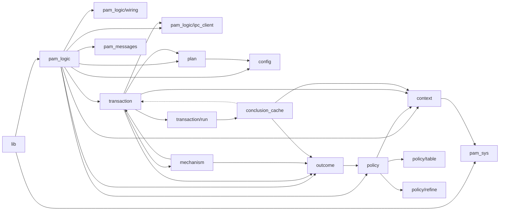
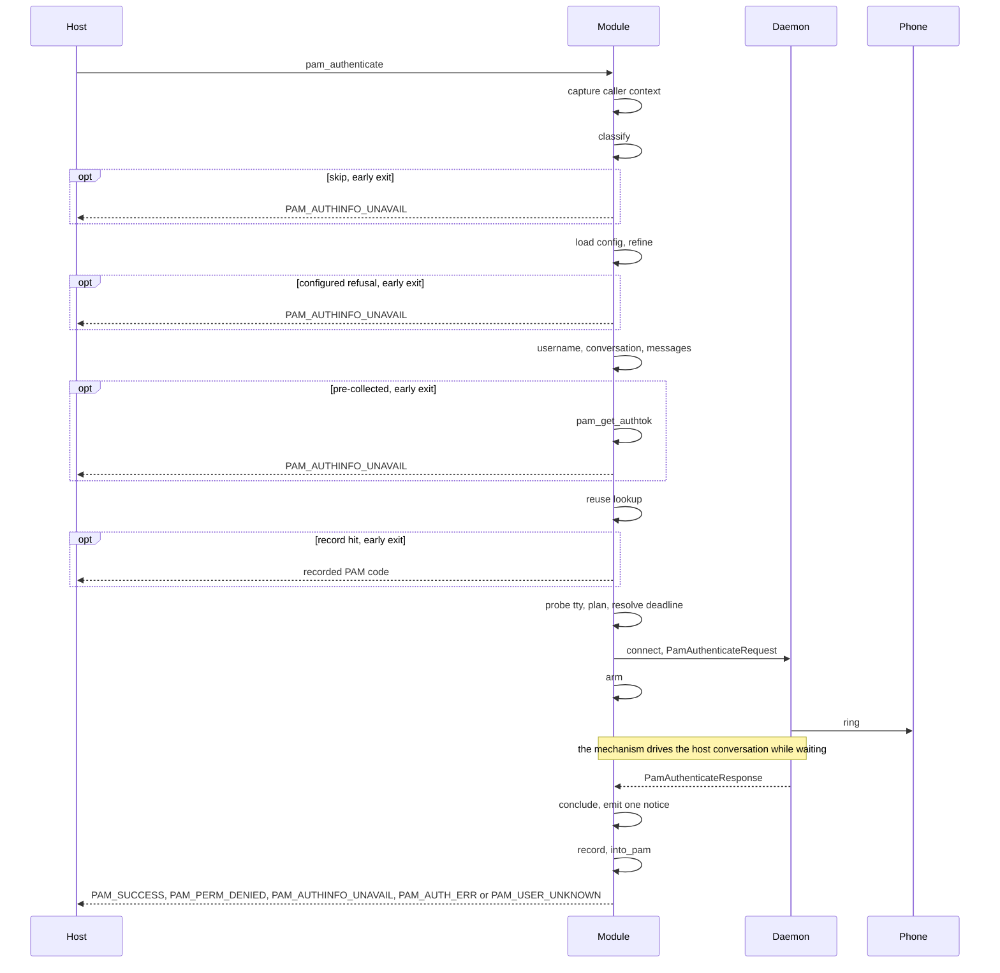
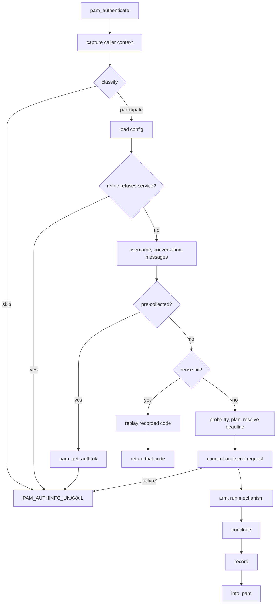
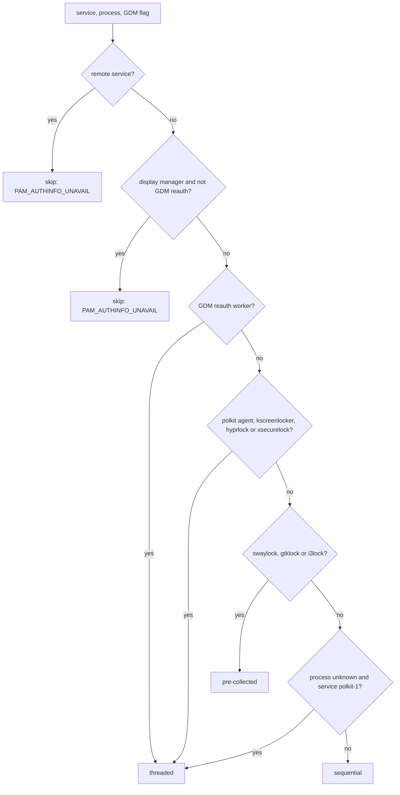

# PAM conversation policy

`client-pam` is a PAM service module. For one `pam_authenticate` call it either asks the paired phone for a verdict through `tapauthd`, or deliberately falls through to whatever the host's stack does next. It runs unprivileged and reaches the daemon only through the Unix-socket IPC in `ipc_client.rs`.

## What the module is

The module is one `auth` line in a service's stack. Debian/Ubuntu ship a `pam-auth-update` profile whose only auth line is `sufficient pam_tapauth.so` (`packaging/debian.pam-config`); the `required` shape is what the `bypass` e2e covers.

| Line | On `PAM_SUCCESS` | On any other code |
| :--- | :--- | :--- |
| `auth sufficient pam_tapauth.so` | ends the stack: the phone alone completes the login | treated as a failure; the next module runs |
| `auth required pam_tapauth.so` | one required item satisfied; later modules still run | the stack fails |

It never returns `PAM_IGNORE`: Linux-PAM records no failure for that code, so on a `required` line a later `optional pam_permit` could complete the stack. Every skip therefore returns `PAM_AUTHINFO_UNAVAIL`.

The module authenticates the stack's `PAM_USER`. On `su` that is the target account, so the line must sit after `pam_wheel.so`; otherwise a phone grant for `root` replaces the wheel check.

## Code map

Every production file under `client-pam/src`. "May import" lists the crate-internal modules each file names; nothing may import upwards.

| File | Responsibility | May import |
| :--- | :--- | :--- |
| `lib.rs` | `pam_sm_*` ABI stubs; `guard()` turns a panic into `PAM_AUTH_ERR` | `pam_logic`, `pam_sys` |
| `pam_logic.rs` | `authenticate` (capture, orchestrate, record, convert) and `orchestrate` (classify, config, username, conversation, messages, transaction) | all of the below |
| `pam_logic/wiring.rs` | production `Effects`: `probe_tty`, `connect`, `send_authenticate_request`, `cancel_on_fresh_connection` | `ipc_client`, `transaction` |
| `context.rs` | `CallerContext::capture`: service name, process identity, GDM reauth flag | `pam_sys` |
| `policy.rs` | `Classification`, `SkipPolicy`, `Conversation`, `FailureDirection`, `Participation`, `classify`, `class_permits` | `context` |
| `policy/table.rs` | `RULES`, the ordered rule table, and the test-only `audit` record | `context`, `policy` |
| `policy/refine.rs` | `refine`: the config-dependent second phase that can add one skip | `context`, `policy` |
| `plan.rs` | `Plan`, `Deadline`, `Announcement`, `TtyUse`, `Plannable::plan` | `config` |
| `outcome.rs` | `Outcome` taxonomy and `into_pam`, the only verdict-to-code conversion | `pam_messages`, `pam_sys`, `policy` |
| `transaction.rs` | re-export hub for `run`, `Armed`, `Concluded`, `Finished`, `Via`, `Effects` | `transaction/*` |
| `transaction/run.rs` | the transaction driver: handoff, reuse lookup, probe, plan, arm, mechanism, conclude | `conclusion_cache`, `config`, `context`, `ipc_client`, `mechanism`, `outcome`, `plan`, `policy` |
| `transaction/lifecycle.rs` | `Armed` (constructed only by `open`), `Concluded`, `Via`, `Finished`, `StartError` | `context`, `ipc_client`, `mechanism`, `outcome` |
| `transaction/host_io.rs` | `HostIo` (PAM handle, conversation, messages, authtok reader) and `finish`, the single emission site | `outcome`, `pam_messages`, `pam_sys` |
| `conclusion_cache.rs` | the 500 ms reuse record, its gates, and the `pthread_atfork` child handler | `context`, `outcome`, `transaction` |
| `mechanism.rs` | `MechanismEnd` (`Response`/`Reason`/`Error`) and its conversion to `Outcome` | `outcome` |
| `mechanism/threaded.rs` | password on a worker pthread, daemon polled on the calling thread | `mechanism`, `ipc_client`, `outcome`, `pam_sys`, `plan`, `transaction` |
| `mechanism/sequential.rs` | waits on the calling thread, never touches the conversation | `mechanism`, `ipc_client`, `outcome`, `plan`, `transaction` |
| `mechanism/handoff.rs` | pre-collected hosts: `pam_get_authtok` and return, no daemon | `mechanism`, `outcome`, `pam_sys`, `transaction` |
| `config.rs` | `PamConfig`: timeouts, refused services, `effective_refused_services` | — (only `shared`) |
| `ipc_client.rs` | length-prefixed protobuf IPC over the daemon socket | — (`shared` only) |
| `pam_sys.rs` | FFI bindings and safe wrappers: service, user, conversation, authtok | — |
| `pam_messages.rs` | Fluent bundles, locale selection, message loading | — (`shared` only) |
| `logging.rs` | `tracing` initialisation: journald, stderr fallback | — |
| `source_guards.rs` | test-only source scans (see below) | — |

The dashed edge is a type reference only: `conclusion_cache` names `Concluded` and `Via` from `transaction` but calls nothing in it. Every other edge is a call direction.

Two rules a contributor must not break, both enforced by `source_guards.rs`:

* **Only `outcome.rs` produces a `PAM_*` value.** `Outcome::into_pam` is the single conversion; the six `pam_sm_*` stubs in `lib.rs` are named exemptions, and `pam_sys::PAM_AUTHTOK` is an argument, not a code. `only_outcome_rs_returns_pam_constants` scans for `return pam_sys::PAM_*` and for a bare tail-position constant.
* **Only `conclusion_cache.rs` touches the reuse record.** No other module may name `.lock()`, `.try_lock()`, `MutexGuard` or the record static; `cache_owner_is_local` asserts it, and the record's `pub(crate)` surface hands out values, never the lock or the stored struct.

Also enforced: `only_one_get_service_name_call_site` (the service is read only in `context.rs`), `only_one_refine_call_site` (one `policy::refine` call, in `pam_logic.rs`), `no_ruser_read`, `granted_only_from_daemon`, and `test_module_source_contains_no_pam_ignore_return`.

## Request lifecycle

An `opt` marked *early exit* returns from the call; the steps after it do not run. Within a transaction, the tty probe runs after the reuse lookup, and `Armed` exists only once `connect` and `send` have both succeeded.

The same path as a decision graph:

The order matters and is asserted by tests, not by the type system: `classify` runs before the config read, `refine` runs before the username, conversation and messages, and both skips return without touching any of them.

## Flow selection

`policy::classify` walks `RULES` in order; the first matching row decides. The table is data in `client-pam/src/policy/table.rs`: each row carries an id, a `FailureDirection`, a predicate and a `Decision`.

| Rule | Matches | Yields | On skip |
| :--- | :--- | :--- | :--- |
| `RemoteRefuse` | `PAM_SERVICE` is `sshd` or `sshd-session`, ASCII case-insensitive; process ignored | skip | `PAM_AUTHINFO_UNAVAIL` |
| `DmLoginBypass` | `PAM_SERVICE` is a display-manager name (`DM_PREFIXES`), unless this is a GDM reauthentication | skip | `PAM_AUTHINFO_UNAVAIL` |
| `GdmReauthWorker` | process `gdm-session-worker`, service `gdm-password`, `GDM_SESSION_FOR_REAUTH` set | threaded | — |
| `PolkitAgent` | process `polkit-agent-helper-1` | threaded | — |
| `KscreenlockerWorker` | process `kscreenlocker_worker` | threaded | — |
| `Hyprlock` | process `hyprlock` | threaded | — |
| `Xsecurelock` | process `authproto_pam` | threaded | — |
| `PreCollectedLocks` | process `swaylock`, `gtklock` or `i3lock` | pre-collected | — |
| `PolkitServiceWithoutProc` | process unknown, service `polkit-1` (case-sensitive) | threaded | — |
| `DefaultSequential` | anything else | sequential | — |

`DM_PREFIXES`: `sddm`, `gdm`, `gdm3`, `lightdm`, `lxdm`, `slim`, `xdm`, `kdm`, `greetd`, `ly`, `nodm`, `entrance`, `plasmalogin`. A service matches a prefix when it equals it or continues with `-`, after ASCII lowercasing.

Process names are the basename of `/proc/self/exe`, falling back to `/proc/self/comm`; every process rule accepts both the full name and the 15-byte `comm` truncation (`gdm-session-wor`, `polkit-agent-he`, `kscreenlocker_w`). GDM reauthentication requires both `GDM_SESSION_FOR_REAUTH` and the `gdm-password` service.

Config cannot reorder or replace any of this. `policy::refine` runs once after the config read and can only turn a participation into the `RemoteRefuse` skip for a name listed in `pam_refused_services`; an existing skip, a selected flow and a deadline are never changed. That second phase exists because `classify` sees the caller's facts only, before any config is loaded.
