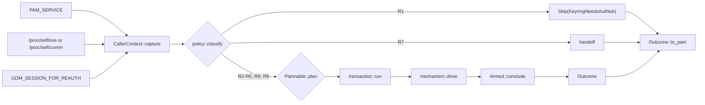

# PAM conversation policy

A typed decision seam for `client-pam`.

Status: design proposal. Scope: `client-pam` only. No source file is modified by this document.

---

## 1. Executive summary

**Problem.** `client-pam` decides *how* to answer a PAM conversation, *whether* to ring the phone, *how long* to wait and *which* `PAM_*` code to return in one 546-line function (`pam_logic.rs:841-1386`), which itself contains the terminal poll loop (`:1252-1385`), plus two further loops (`:600-697`, `:728-787`). The decision inputs are read from three different places at three different times (`pam_logic.rs:851`, `:898-905`, `:1445`), the decision itself is a `match` with no record of *why* each arm exists (`:406-435`), the timeout rule is an `if` expression with no test at any level (`:1015-1021`), and the return code is produced at 37 distinct sites across three files. Adding a host means editing a match arm, a table test, three shell binary names and a C enum; forgetting any of them fails silently.

**Proposed shape.** Five pure or narrow pieces and three mechanisms:

| Piece | File | Responsibility |
| :--- | :--- | :--- |
| `CallerContext` | `context.rs` | The three caller facts, read exactly once, before credentials/conversation work |
| `classify` | `policy.rs` | One ordered table of nine `Rule`s, each with class, evidence and decision |
| `Plan` | `plan.rs` | `Plannable` (the `Threaded`/`Sequential` carrier) and one total function from it to `{deadline, announcement, tty_use}` |
| `Outcome` | `outcome.rs` | The verdict as data, converted to a `PAM_*` code in one exhaustive match |
| `transaction::run` | `transaction.rs` | Reuse lookup, request id, plan, connect+send (`Armed`), cancellation, recording |
| `mechanism::{threaded, sequential, handoff}` | `mechanism/*.rs` | The three ways to answer a PAM ABI conversation, each receiving `&mut Armed`, `&Plan`, the resolved deadline and `&mut HostIo` |

`pam_logic.rs` shrinks to orchestration plus daemon response mapping.

**What it buys.**
1. *One place to look* for "why does host X behave like this" — a row with a class, a reason and a citation, not a comment 400 lines away.
2. *One place for ordering*: `Skip` and `Participate` are different types, so a skip cannot acquire a plan, a deadline or a mechanism; the display-manager bypass resolves before username and conversation work because `authenticate` returns on `Skip` before those calls, and that order is pinned by a call-counter test (`classify_before_side_effects`) rather than by the compiler — the types make the skip unable to *use* the later state, not unable to be placed after it.
3. *One place that can grant*: `Outcome::Granted` is constructible only from a daemon `PamOutcome::Success` (`outcome.rs`), so a mistake anywhere else is availability-only, never a grant. The one `PAM_SUCCESS` the module can produce without a fresh round trip is a **replay** of a conclusion this process itself recorded for the same `(user, service)` inside the 500 ms window; a replay is carried as `Via::Replay` and is never re-recorded (§3.6). Enforced by a type, a provenance field and two source scans.
4. *Testability where there is none today*: the `(deleted)` strip and `comm` fallback (`:341-356`), the GUI clamp (`:1015-1021`), the `has_tty`-invariance of the threaded plan (comment only, `:911-913`) and the failure-direction taxonomy all become unit assertions.
5. *One edit to add a host*: one rule row, one justification, one fixture row — once step 8 has deleted the old representations (§3.9 states the honest count before and after that step).

**What it costs.** Nine new source files (`context.rs`, `policy.rs`, `plan.rs`, `outcome.rs`, `transaction.rs`, `mechanism/mod.rs` and the three mechanisms), one fixture file, **two** documented ordering changes (the `/dev/tty` probe moves after the cache lookup, and the DM path now performs the `/proc` identity read before the skip; §8.1), one optional and separately-gated loop merge (§6 step 6b), a step-8 deletion of four code representations and five prose host lists, and a fixture corpus that must be maintained or it rots into a tautology (§8).

**What is NOT proposed.** No change to: the IPC schema (`proto/ipc.proto:29-34`), the daemon's caller-agnostic contract, `PamConfig`, `PamMessages`, `IpcClient`, any `PAM_*` code returned on any path, the 500 ms window's duration or key, the failure-direction classes' contents or members, or any host's classification. The eleven accumulated-workaround flags are documented and *left in place* (§5); retirement is a separate decision with its own experiment.

---

## 2. Diagnosis

Each finding below is a property of the current tree, cited. None of them alone justifies a refactor; together they are why a host addition is currently a five-file edit with a silent failure mode.

### 2.1 One function, three responsibilities, no decision record

`authenticate_inner` (`:841`) both *decides* and *executes*. The decision inputs enter at three points:

| input | read at | used at | note |
| :--- | :--- | :--- | :--- |
| PAM service | `:1445` (bypass), `:898` (mode/cache) | `:1448`, `:905`, `:971` | resolved twice |
| process name | `:900` → `process_identity` `:341` | `:905` | not testable as a function |
| `GDM_SESSION_FOR_REAUTH` | `:446` inside `is_gdm_reauth` | `:904` | read via `var_os(...).is_some()`; presence only |
| `/dev/tty` availability | `:914-918` | `:998`, `:1015`, `:1252` | probe occurs before the cache lookup |

The decision itself is `conversation_mode` (`:406-435`): five arms, two of which carry a dual spelling for `TASK_COMM_LEN - 1` truncation (`:408`, `:409`, `:417`), one arm keyed on a *missing* process name (`:432`), and one catch-all. The reason for each arm lives in a 40-line doc comment above it (`:358-405`) that no test can read.

### 2.2 The failure-direction taxonomy exists only in prose

The module's own comments distinguish three kinds of mistake:

* **never ring** — the pre-collected locks: "ringing the phone would be misleading and could only ever end in a timeout" (`:929-931`);
* **deadlock avoidance** — the sequential default: "an unknown host therefore keeps the behaviour that cannot deadlock, at the cost of the existing (shorter) GUI timeout — the failure direction is 'slower', never 'wedged'" (`:360-364`);
* **UX** — the phone is offered, with accepted risks (hyprlock `:377-380`, xsecurelock `:381-386`);
* plus a fourth, orthogonal one: **keyring** — the display-manager bypass exists so the DM's own prompt populates `PAM_AUTHTOK` (`:1420-1429`).

Nothing in the type system or the tests encodes this. A new arm added to `:407` inherits whichever direction its neighbours happen to have; the only test is an enum equality table (`:2499-2659`) that says *what* the mode is, never *whether that direction is the one the host needs*.

### 2.3 The return code is produced at 37 sites

Survey 02 §3 counts 7 arms in `lib.rs`, 10 helper arms in `pam_sys.rs` (three of which never reach the host) and 20 boundary arms in `pam_logic.rs`. Consequences:

* No local answer to "can this path grant?" — the answer requires reading `map_pam_outcome` (`:1465-1500`) and then checking that no other return can produce `PAM_SUCCESS`. A source scanner for `PAM_IGNORE` already exists because of exactly this problem (`:2036-2074`), and it needed a second test to prove the scanner works (`:2082-2120`).
* The user-visible message and the code are decided in the same match (`:1472-1498`), so the message set cannot be enumerated without a PAM handle; the pure part (`Outcome` → code) is untestable in isolation from the emission part (→ `try_info`, which swallows errors, `pam_sys.rs:306-310`).

### 2.4 The deadline rule has no test at any level

```rust
let effective_timeout_secs = if !has_terminal && mode == ConversationMode::Sequential {
    config.pam_gui_timeout_secs.min(config.pam_operation_timeout_secs)
} else {
    config.pam_operation_timeout_secs
};
```

(`:1015-1021`.) Survey 04 §7 lists it as the one behavioural rule with **zero** coverage; `scripts/ci/test-pam-host-cases.sh:93` sets gui 2 s / op 4 s, so the clamp is *executed* but never *discriminated* — an accidental `max` would still pass every test in the repo. The u32 saturation three lines later (`:1022-1029`) is likewise untested.

### 2.5 Identity reading is not unit-testable

`process_identity` (`:341-356`) reads `/proc/self/exe`, strips `" (deleted)"`, falls back to `/proc/self/comm`; `is_gdm_reauth` (`:444-447`) reads the environment. Neither has a direct caller in the test suite; the table test passes literals instead. The sharpest consequence is that a regression inside `process_identity` "changes behaviour for **every** host and is caught by **no** test".

### 2.6 Host knowledge is duplicated four to five times

| site | what it holds |
| :--- | :--- |
| `:406-435` | the production allowlist (5 arms, 4 truncated spellings) |
| `:2499-2659` | a hand-written 24-row table test |
| `scripts/ci/test-pam-conv-thread.sh:210,339,469,499` | four binary copies named after hosts |
| `scripts/ci/conv_thread_harness.c:683-697` | a parallel enumeration of strategy names |
| `scripts/ci/test-pam-host-cases.sh:102` | a synthetic `gdm-`-prefixed service name |

Renaming a host in production requires edits in at least three files; forgetting the shell copy *removes* coverage rather than failing.

### 2.7 Two loops duplicate the IPC handling

`run_sequential_event_loop` (`:728-787`) handles only the IPC fd; the terminal branch (`:1252-1385`) handles the IPC fd plus `/dev/tty` and repeats the same POLLIN/POLLHUP/POLLERR sequence, the same "read data first" rule and the same EINTR swallow. The duplicated region is ~60 lines and differs only in what happens on a tty read.

### 2.8 Corrections to `AGENTS.md` and to earlier descriptions

**CORRECTION 1 (load-bearing).** `AGENTS.md` and `INSTALLATION.md:313-320` describe a `kscreenlocker >= 6.8` gate and list "kscreenlocker ≤ 6.7" as sequential. There is no version parsing anywhere: `grep -nE '6\.8|6\.7|version'` over `pam_logic.rs` returns comment text only (`:55`, `:286`, `:371-376`, `:705`, `:1074`). `Some("kscreenlocker_worker" | "kscreenlocker_w")` is unconditionally `Threaded` (`:409`), and the ≤ 6.7 case is expressed *only* by `kscreenlocker_greet` being absent from the allowlist (`:376`, a comment, not an arm). This document therefore preserves the name-keyed behaviour, states the reason at rule R4, and never repeats the version claim.

**CORRECTION 2 (minor).** The `None if service == "polkit-1"` arm (`:432`) is sometimes described as "keying on an empty/absent-service string". The `None` is the *process* pattern, not the service: the arm is reached when identity resolution produced nothing and the service name is exactly `polkit-1`. The CSV row `svc:polkit-1-no-proc` states this correctly. Used as stated there.

**CORRECTION 3 (minor).** The reuse lookup is sometimes placed "after the PreCollected return at 971". The PreCollected return is `:955`; `:971` is where the cache lookup begins. Used as `955` / `971`.

**CORRECTION 4 (scope of a claim).** `AGENTS.md`'s "two `pam_tapauth.so` lines in one stack are one check" is unconditional; the code is conditional — the record is armed only after a successful connect+send (`:236-244`) and only when the service resolved (`:836`), so a second line after a DM bypass, a pre-collected skip or an IPC failure does ring again. The design preserves the conditional behaviour and states it as the `Armed` invariant (§3.6).

### 2.9 Two standing constraints no step may violate

* **The 500 ms reuse window is an assumption, not a property.** `pam_logic.rs:97-100`: "The remaining assumption is that no legitimate host performs an *independent* authentication for the same user and service within 500 ms of a concluded one: the key cannot tell such a request apart from a duplicate." The design makes that assumption visible (F1) and does **not** strengthen it: the duration and the `(username, service)` key are unchanged, and the only change is that a recorded conclusion now carries its provenance, so a replay can never be re-recorded (§3.6, §3.5.2).
* **No `dev-*` feature is introduced.** Every step ships with the production feature set; `scripts/ci/check-production-build.sh` must stay green at every step (§6). Nothing in this design needs `dev-state-override`, `dev-socket-override`, `dev-polkit-bypass` or any other knob, and the fixture corpus is test-only data.

---

## 3. Proposed architecture

### 3.1 Module map and dependency direction

```
lib.rs ──> pam_logic.rs ──> context.rs
                        ├─> policy.rs ──> context.rs
                        ├─> plan.rs   (leaf: `Plannable` + `Plan`)
                        ├─> outcome.rs
                        ├─> transaction.rs ──> policy.rs, plan.rs, outcome.rs
                        │                  └─> mechanism/{threaded,sequential,handoff}.rs
                        └─> config.rs, pam_messages.rs, pam_sys.rs, ipc_client.rs  (unchanged)
```

Dependency direction is one-way: `context` and `outcome` depend on nothing in the crate except `pam_sys`; `policy` depends on `context`; `plan` is a leaf (it names no `policy` type); `transaction` on all of them; mechanisms on `transaction`'s `Armed`/`HostIo` and on `pam_sys`/`ipc_client` only. A mechanism cannot name `CallerContext` (§3.7), so the compiler forbids re-branching on caller identity inside a mechanism.

Construction order is part of the design, not an implementation detail. `CallerContext::capture` (`:851` today) runs **before** `PamConfig::load` (`:856`), `pam_sys::get_user` (`:862`), `PamConversation::new` (`:877`), `PamMessages::load_for_user` (`:889`) and before any `/dev/tty` open (`:914-918`); `classify` consumes the context immediately, and only a `Participate` reaches the code that performs the other four. `HostIo` is therefore *constructed after* classification — it borrows the conversation and the messages those later calls produce — and it never owns an already-open tty: the probe is a closure passed into `transaction::run` and consumed there (§3.4, §3.6). This preserves today's `851`-before-`856/862/877/889` order exactly, including the fact that a display-manager service pays none of *that* work — no config, no username, no conversation, no messages, no `/dev/tty` — though it now pays `capture`'s own reads, of which `PAM_SERVICE` and `/proc` today happen *after* the bypass (`:898`, `:900`; §3.2).

### 3.2 `CallerContext` (`context.rs`)

```rust
pub(crate) struct CallerContext {
    service: Option<ServiceName>,
    process: ProcessIdentity,
    gdm_reauth: GdmReauth,
}

pub(crate) struct ServiceName { original: Box<str>, ascii_lower: Box<str> }
pub(crate) enum ProcessIdentity { Exe(Box<str>), Comm(Box<str>), Unknown }
#[derive(Clone, Copy, PartialEq, Eq)]
pub(crate) enum GdmReauth { Present, Absent }
```

| member | source | today | rule |
| :--- | :--- | :--- | :--- |
| `service` | `pam_sys::get_service_name` (`pam_sys.rs:27-42`) | `:1445` and `:898` | read **once**, at capture |
| `process` | `/proc/self/exe` basename, then `/proc/self/comm` | `:341-356` | delegated to the pure function below |
| `gdm_reauth` | `env::var_os("GDM_SESSION_FOR_REAUTH").is_some()` | `:446` | presence only, read **once** |

**Folding, rejection and the cache key.** `ascii_lower` is `original.to_ascii_lowercase()` — the function today's code already uses (`:1409`) — and **never** `str::to_lowercase()`: non-ASCII folding maps U+212A KELVIN SIGN to `k`, so `"\u{212a}dm"` would become `kdm`, a non-display-manager service would match R1, and its users would lose the phone prompt silently. `original` holds the bytes returned by `get_service_name`, built only from a UTF-8 `CStr` (`pam_sys.rs:35-38`): a non-UTF-8 service name is **rejected to `None`** (no bypass, no cache) rather than converted with `to_string_lossy`, which would make a lossy string a real cache key and a real prefix candidate. **The reuse cache keys on `original`**, exactly as today (`:972` keys on the raw `String`), so `sudo` and `SUDO` stay distinct keys; `ascii_lower` is used only by `eq_ignore_ascii_case` and `dm_prefixed`. Pinned by corpus rows `sudo` before `SUDO` (the second must miss) and `dm_kelvin` (must not match R1).

Two constructors, and only these:

* `CallerContext::capture(pamh)` — the single site in the crate that reads `PAM_SERVICE`, `/proc` and the environment. Called first in `authenticate`, before `PamConfig::load`, username lookup, conversation construction or message loading.
* `CallerContext::from_parts(service, process, gdm_reauth)` — for policy tests. `#[cfg(test)]`-only, so a production caller cannot fabricate identity.

**This is the second ordering change, and it is not free.** Because `capture` runs before `classify`, a display-manager call now performs the identity read it never performed: `readlink("/proc/self/exe")` and, if that fails, `read("/proc/self/comm")` happen on `sddm`/`gdm`/`lightdm` logins too, where `guard_display_manager_bypass` (`:847`) today returns before `process_identity` (`:900`). The direction is availability-only — a read that fails degrades to `Unknown` and R9, and the DM service still skips, so no verdict changes — but it is a real second ordering difference, alongside the tty probe moving past the reuse lookup (§3.4.1). Reading identity before the service decision is acceptable because it is a pure read: no file descriptor is held, no config file is read and no NSS lookup is performed (`pam_messages::load_for_user` stays after the skip return). §8.1 records it as the second of two orderings, not the first of one, and the `classify_before_side_effects` counter test covers the four calls that must still not happen on the `Skip` path.

Identity resolution is split out so it can be tested:

```rust
fn classify_identity(exe: Option<&Path>, comm: Option<&str>) -> ProcessIdentity
```

Semantics, each clause traceable to `:341-356`:

1. `exe` present: take `file_name()`, convert lossily (`:344`), strip a trailing `" (deleted)"` (`:346`), and if the result is non-empty return `Exe(name)`.
2. otherwise `comm` present: `trim()` and reject empty (`:353-355`), return `Comm(name)`.
3. otherwise `Unknown`.

`Exe`/`Comm` is *provenance only*: every rule matches on the name for both variants, so a real binary literally named `kscreenlocker_w` still matches R4, exactly as today (`:409`). The distinction exists so tests can assert the `(deleted)` strip and the fallback independently, and so the policy table can state which source a spelling is expected from.

Predicates receive the resolved `&str` **name**, never a `Path`: `file_name()` and the `" (deleted)"` strip happen once, inside `classify_identity` (`:342-349`). A predicate that re-derived `file_name()` from a path would drop the strip, so an upgraded or swapped `swaylock (deleted)` would fall through to R9 and ring the phone — the failure F2's evidence does not cover today because no test calls the resolver at all.

Service-name accessors, one per comparison style in use today:

| accessor | comparison | today |
| :--- | :--- | :--- |
| `is(&self, literal)` | exact bytes on `original` | `:432` (`service == "polkit-1"`) |
| `eq_ignore_ascii_case(&self, literal)` | ASCII case-insensitive via `ascii_lower` | `:418`, `:445` |
| `dm_prefixed(&self)` | `ascii_lower == p` or `ascii_lower` starts with `p` and the next byte is `-` | `:1409-1414` |

The `is` accessor is deliberate: `:432` compares the *original* bytes, so `POLKIT-1` with an unreadable `/proc` stays Sequential today and stays Sequential after the change. That inconsistency is flagged (F10) rather than silently fixed.

`CallerContext::is_gdm_reauth()` replaces `is_gdm_reauth(service)` (`:444-447`): `gdm_reauth == Present && service.eq_ignore_ascii_case("gdm-password")`. Both conditions now live in one place, evaluated once per call, and both consumers (R1's exemption, R2's guard) read the same answer. Today the same predicate is evaluated twice (`:1448`, `:418`) against two separately resolved service strings (`:1445`, `:898`).

The environment read is split from its interpretation, for the same reason identity is: `GdmReauth::from_env(value: Option<&OsStr>) -> GdmReauth` is pure and presence-only (`var_os(...).is_some()`, `:446`), and `capture` is its only caller. That is what makes the read itself testable — `gdm_reauth_env_parsing` feeds `None`, `Some("")`, `Some("0")` and `Some("1")` without `set_var` and without racing the rest of the test binary — instead of the corpus pretending a `reauth` column exercises a read it bypasses (§7.1).

### 3.3 `classify` (`policy.rs`)

```rust
pub(crate) enum Classification { Skip(SkipPolicy), Participate(Participation) }

/// A skip that must not touch the host's conversation at all. The *other*
/// no-daemon path — R7's pre-collected handoff, which calls
/// `pam_get_authtok` and caches `PAM_AUTHTOK` — is deliberately **not** a
/// skip: it is `Participation { conversation: PreCollected }`, so the handoff
/// can only be reached through a participation and never through this type.
pub(crate) enum SkipPolicy { KeyringNeedsAuthtok }

pub(crate) struct Participation {
    pub rule: RuleId,
    pub conversation: Conversation,
    pub failure_direction: FailureDirection,
}

#[derive(Clone, Copy, PartialEq, Eq)]
pub(crate) enum Conversation { Threaded, Sequential, PreCollected }

#[derive(Clone, Copy, PartialEq, Eq)]
pub(crate) enum FailureDirection { NeverRing, DeadlockAvoidance, AlwaysRing, Keyring }

pub(crate) enum Decision { Skip(SkipPolicy), Participate(Conversation) }

pub(crate) struct Rule {
    pub id: RuleId,
    pub name: &'static str,
    pub class: FailureDirection,
    pub why: &'static str,
    pub evidence: &'static [&'static str],   // file:line references, checked by a test
    pub predicate: fn(&CallerContext) -> bool,
    pub decision: Decision,
}

pub(crate) fn classify(ctx: &CallerContext) -> Classification
```

`classify` walks `RULES` in order, takes the first rule whose `predicate` returns true, and builds the result from that rule's `decision`, `id` and `class`; a `Rule` with `decision: Skip` yields `Classification::Skip`, any other yields `Classification::Participate` with `conversation` from the decision and `failure_direction` from the class. `Skip` and `Participate` are different types. `SkipPolicy` has no `Plan`, no `Conversation` and no `FailureDirection`, so no downstream function can accept a skip where a participation is required, and the bypass cannot accidentally acquire a deadline. `classify` is total: R9 is unconditional, so it always returns.

**Which rule yields which, and why the two no-daemon paths are not one category.** R1 is the only rule that yields `Skip`, and it must not touch the handle: the display manager's own stack has to populate `PAM_AUTHTOK` (`:1420-1429`), and issuing a second `PAM_PROMPT_ECHO_OFF` on a greeter handle is exactly what the bypass exists to prevent (`:851-853`, `:1444-1458`). R7 is the only rule that yields `PreCollected`, and it *must* touch the handle: it calls `pam_get_authtok` on the calling thread and leaves the token for `pam_unix` (`:937-955`). Both avoid the daemon, and that is the only property they share — so the orchestrator dispatches them from two different `match` arms (`Skip` → the bypass outcome; `Participate{PreCollected}` → `mechanism::handoff::perform`), and there is no arm in which a skip can reach the handoff. Pinned by `skip_never_hands_off`, which injects a counting conversation and asserts that a `Skip` performs zero `pam_get_authtok` calls and zero daemon connects.

#### 3.3.1 The rule table

Order is significant only at the two ends; R1 must precede everything, R9 must be last.

| # | rule | class | predicate (exact) | decision | evidence | why |
| :-- | :--- | :--- | :--- | :--- | :--- | :--- |
| R1 | `dm_login_bypass` | `Keyring` | `is_dm_service(service)` **and not** (`service.eq_ignore_ascii_case("gdm-password")` **and** `gdm_reauth`) — 13 prefixes, exact or `-`-suffixed, case-insensitive; an absent service never matches | `Skip(KeyringNeedsAuthtok)` | `:1393-1415`, `:1448`, `:1444-1458` | a grant without `PAM_AUTHTOK` breaks `pam_kwallet6`/`pam_gnome_keyring` auto-unlock (`:1420-1429`) |
| R2 | `gdm_reauth_worker` | `DeadlockAvoidance` | `process ∈ {gdm-session-worker, gdm-session-wor}` **and** `service.eq_ignore_ascii_case("gdm-password")` **and** `gdm_reauth` | `Participate{Threaded}` | `:417-421`, `:444-447`, `:1431-1435` | the worker's GLib loop answers on another thread, but only for a reauthentication; a login is bypassed by R1 |
| R3 | `polkit_agent` | `DeadlockAvoidance` | `process ∈ {polkit-agent-helper-1, polkit-agent-he}` | `Participate{Threaded}` | `:408`, `:369-370` | the conversation is a plain fd fed by the separate agent process |
| R4 | `kscreenlocker_worker` | `DeadlockAvoidance` | `process ∈ {kscreenlocker_worker, kscreenlocker_w}` | `Participate{Threaded}` | `:409`, `:371-376` | ≥ 6.8 answers on Qt's `QDBusConnectionManager` daemon thread. **No version is parsed**; the name is the only signal available in `/proc`, and `kscreenlocker_greet` is deliberately absent so the pre-6.8 helper stays Sequential |
| R5 | `hyprlock` | `AlwaysRing` | `process == "hyprlock"` | `Participate{Threaded}` | `:410`, `:377-380` | worker `std::thread` with mutex/condvar: a genuine concurrent race, accepted with an unsynchronised `resetConversation`/`checkWaiting` (F4) |
| R6 | `xsecurelock` | `AlwaysRing` | `process == "authproto_pam"` | `Participate{Threaded}` | `:411`, `:381-386` | answered by the helper's own thread pool; `CallPAMWithRetries` can re-run the module up to three times (F5) |
| R7 | `precollected_locks` | `NeverRing` | `process ∈ {swaylock, gtklock, i3lock}` | `Participate{PreCollected}` | `:429`, `:422-428` | the password predates `pam_authenticate` (`pam.c:51`, `auth.c:61`, `i3lock.c:836`); the phone must not be rung |
| R8 | `polkit_service_without_proc` | `DeadlockAvoidance` | `process == Unknown` **and** `service.is("polkit-1")` (exact bytes) | `Participate{Threaded}` | `:432`, `:430-431` | with `/proc` unreadable, keep the historic polkit behaviour instead of silently changing how it drives its conversation |
| R9 | `default_sequential` | `DeadlockAvoidance` | unconditional | `Participate{Sequential}` | `:433`, `:360-366` | the safe default: an unknown host keeps the behaviour that cannot deadlock; the cost is the shorter GUI timeout. Failure direction is "slower, never wedged" |

Notes that belong to the table rather than to a comment:

* **R1 precedes every other rule.** A `swaylock` running under an `sddm` service is *skipped*, not handed off — the service decision outranks the process decision, because the keyring constraint belongs to the service. Pinned by fixture rows `swaylock_under_sddm`, `i3lock_under_gdm_login`.
* **R9 is last.** Anything not matched above is Sequential; the predicate is `true`, so a new rule inserted after R9 is dead and `unreachable_rule_rows` (a unit test over the table) fails on any row that can never fire.
* **R2–R8 are order-insensitive**, because their predicates are pairwise disjoint: R3–R7 are keyed on distinct literal sets of process names, R8 requires `Unknown`, and R2 requires `gdm-session-worker`-family **plus** a service and the reauth flag. Proven by `rules_are_process_disjoint`, which asserts the process-name key sets are pairwise disjoint and that R8's key is `Unknown`; a duplicate spelling added to two rules fails it. Order is still linear so the table reads top-down, but only R1-before-all and R9-last are load-bearing, and each has a dedicated test.
* The two GDM `gdm_reauth` consumers (R1's exemption and R2's guard) now read one flag and one service, not two resolutions of each. Pinned by `classify_reads_service_once` (source scan, §6 step 2).

#### 3.3.2 The class taxonomy, stated once

| class | meaning | wrong-direction cost |
| :--- | :--- | :--- |
| `NeverRing` | the phone must not be consulted at all | **under-match:** ringing a user who already chose the password route; the wait can only time out. **over-match (a spurious R7):** the phone is never consulted and the module returns `PAM_AUTHINFO_UNAVAIL` — fail-closed on a `required` line, but `ignore` on a shipped `sufficient` line, where a following `optional pam_permit` grants (`lib.rs:24-33`) |
| `DeadlockAvoidance` | the conversation must not be driven from a second thread (or not driven at all) | **slower, never wedged, never a grant**: an unknown host loses the in-call password fallback and waits out the shorter GUI timeout, then the stack falls through |
| `AlwaysRing` | the phone is offered concurrently; the host can answer while we wait | the phone is rung one extra time, or the host's dialog loses its race; never a grant, never a wedge |
| `Keyring` | a grant would be useless without `PAM_AUTHTOK` | **under-match:** the grant lands but `PAM_AUTHTOK` is unset and the keyring stays locked. **over-match:** the login manager's own prompt is skipped and the stack falls through without the phone having been consulted (`PAM_AUTHINFO_UNAVAIL`) |

The prose taxonomy is three *failure* directions (`NeverRing`, `DeadlockAvoidance`, `AlwaysRing`); `Keyring` is the fourth enum member and is orthogonal to them, because it is about the value of a grant rather than about the risk of asking. R1 is the only rule in that class, which is why the skip decision is a single-variant `SkipPolicy`.

Each class can be wrong in both directions; for the two skipping classes the *over*-match is the more serious one, because it removes the factor instead of adding a wait. An over-matched `NeverRing` (a host that would have been rung, put in `PreCollected`) hands the next module whatever token it already had and returns `PAM_AUTHINFO_UNAVAIL` without consulting the phone — on a `required` stack that is a fail-closed denial, and on the packaged `sufficient` line (`[success=done … default=ignore]`, `lib.rs:24-33`) it is an `ignore`, so a following `optional pam_permit` still grants. An over-matched `Keyring` (a non-DM service put in `Skip`) does the same: `PAM_AUTHINFO_UNAVAIL` with no prompt, and the same caveat about a `sufficient` line. Neither can produce a grant by itself; both can remove TapAuth from the decision, which is why the corpus carries a near-miss negative for every process rule and all thirteen DM prefixes.

Two of the four rows therefore now state both directions, and both are losses of the factor rather than added latency: a spurious `NeverRing` never consults the phone, and `Keyring`'s wrong direction is the grant itself. `lib.rs:24-33` is the citation for the `sufficient` case: there `PAM_AUTHINFO_UNAVAIL` is `ignore`, so whether the stack still grants is decided by its configuration — a following `optional pam_permit` — and not by this module.

`DeadlockAvoidance` is the only class whose predicate failure is a *hang* risk, which is why its default is Sequential rather than Threaded: the direction of the safe error is "we asked the phone and waited 30 s" instead of "the lock screen froze".

**The class is checked, not decorative.** `classify` copies `rule.class` onto the returned `Participation::failure_direction`, so the taxonomy is part of the value and not only of the table. Two consumers read it: `class_agrees_with_conversation` asserts, over `RULES` and over every corpus row, that the two independently authored axes agree — `Keyring` never participates, `NeverRing` is always `PreCollected`, `AlwaysRing` is always `Threaded` — and `transaction::run` carries the same relation as a `debug_assert!` at the point where the class first meets the plan (step 4). A rule whose class and conversation disagree therefore fails a test, rather than being a comment nobody reads. This is the answer to "the taxonomy exists only in prose" (§2.2): a new arm cannot inherit its neighbour's direction silently, because the direction is a table cell the corpus and the assertion both name.

### 3.4 `Plan` (`plan.rs`)

```rust
pub(crate) struct Plan { pub deadline: Deadline, pub announcement: Announcement, pub tty_use: TtyUse }

pub(crate) enum Deadline    { Operation, GuiBounded }
pub(crate) enum Announcement { Wait, WaitSkipHint, WaitThenPassword }
pub(crate) enum TtyUse      { DoNotOpen, PollForKey }

/// The two conversations that have a timed plan. There is deliberately no
/// `PreCollected` variant: `run` dispatches the handoff in step 1 and only the
/// other two arms produce a carrier, so `plan` has no unreachable arm.
pub(crate) enum Plannable { Threaded, Sequential }

impl Plannable {
    pub(crate) fn tty_use(self) -> TtyUse;              // the probe gate, §3.6 step 3
    pub(crate) fn plan(self, has_tty: bool) -> Plan;    // total over Plannable × bool
}
```

`Plan` is config-free so two plans can be compared for equality in a test; the clamp is resolved at one place:

```rust
impl Deadline {
    pub(crate) fn resolve(self, cfg: &PamConfig) -> u32 {
        let secs = match self {
            Deadline::Operation => cfg.pam_operation_timeout_secs,
            Deadline::GuiBounded => cfg.pam_gui_timeout_secs.min(cfg.pam_operation_timeout_secs),
        };
        secs.min(u64::from(u32::MAX)) as u32
    }
}
```

which reproduces `:1015-1029` exactly, including the `min` and the saturation.

#### 3.4.1 The three reachable cells

| `conversation` | `has_tty` | `deadline` | `announcement` | `tty_use` | today |
| :--- | :--- | :--- | :--- | :--- | :--- |
| `Threaded` | `true` | `Operation` | `Wait` | `DoNotOpen` | unreachable (the tty is probed only for Sequential, `:914-918`), but must be **identical** to the `false` cell |
| `Threaded` | `false` | `Operation` | `Wait` | `DoNotOpen` | `:1000-1002`, `:1119-1250` |
| `Sequential` | `true` | `Operation` | `WaitSkipHint` | `PollForKey` | `:998-999`, `:1252-1385` |
| `Sequential` | `false` | `GuiBounded` | `WaitThenPassword` | `DoNotOpen` | `:1015-1021`, `:1088`, `:1078-1113` |
| `PreCollected` | — | *(no `Plannable`, no `Plan`)* | — | — | returns at `:955` before any plan is needed |

The table has five rows and three **cells**: the two `Threaded` rows must produce the same `Plan`, which is the invariance assertion below.

One timing detail the enum does not show, and which the implementation must preserve: **two of the three announcements are emitted before the request is sent, one after.** `:998-1002` emits `waiting_for_tap_skip` and `waiting_for_tap` *before* the request id (`:1005`) and the connect/send (`:1053`), while `:1088` emits `waiting_for_tap_password` *after* the request is on the wire, because an event-loop host must already be blocked when the message arrives. So `transaction::run` emits `Wait` and `WaitSkipHint` immediately after resolving the plan (step 4, before `Armed::open`), and `mechanism::sequential::drive` emits `WaitThenPassword` as its first action (after the request). A single `match` on `Announcement` at each of the two sites, with `Wait`/`WaitSkipHint` unreachable in the mechanism, keeps the split explicit; `announcement_order_matches_today` asserts the emitted sequence against the injected conversation's call log. `PreCollected` gets no plan in the running transaction: `transaction::run` takes the handoff at step 1, and `plan` accepts only a `Plannable` — `Threaded` or `Sequential`, produced by that same match on the other two arms. There is therefore no `PreCollected` arm to excuse with an `unreachable!()`: in a shipped `cdylib` the panicking form is compiled out, and it would surface as `PAM_AUTH_ERR` through the panic guard (`lib.rs:51-66`) rather than as the documented `PAM_AUTHINFO_UNAVAIL` handoff. `precollected_never_plans` pins the property: for a `PreCollected` participation, `run` performs no probe (the injected counter is zero), no connect (the injected connector is never called) and returns `Unavailable(PasswordHandoff)`; the e2e shape `pre-collect` independently asserts zero daemon accepts (`conv_thread_harness.c:956`).

**The `has_tty` invariance for `Threaded`** exists today only as the comment at `:911-913`. It becomes `threaded_plan_ignores_has_tty`: `Plannable::Threaded.plan(true) == Plannable::Threaded.plan(false)`, asserted directly. This is the assertion that would have caught a probe moved before the mode decision.

**The tty probe rule.** `/dev/tty` is opened only when the conversation is `Sequential` (`:914-918`), and the probe is one `File::open` at one site: `transaction::run` calls a `probe_tty: impl FnOnce() -> Option<File>` parameter, derives `has_tty` from `is_some()`, and moves the `File` itself into `sequential::drive_tty`. `PollForKey` is therefore planned only when a `File` exists, which is why the terminal let-else at `:1257` has no arm after the change (§3.5.3). This mirrors the existing injection pattern for `start_authentication`'s `connect`/`send` (`:225-235`), so tests can count calls without touching the real terminal. The probe now happens **after** the reuse lookup rather than before it; the only affected path is a cache hit, which no longer opens `/dev/tty` (§8 lists this and the `/proc` read of §3.2 — two orderings, not one).

Three ordering facts, stated because they are the ones an implementation can get wrong:

* **The probe's gate is `TtyUse`, not a second copy of the mode test.** `Plannable::tty_use()` (a function of the carrier alone) is the one source of the condition; `run` probes iff it returns `PollForKey`, and `plan` consumes the same value. `conversation == Sequential` therefore appears once, and `tty_probe_only_for_sequential` asserts probe-count per conversation, so a probe moved to the top of `run` fails.
* **`HostIo` never owns an open tty.** It carries the handle, the conversation and the messages; the `Option<File>` exists only as `run`'s local, is consumed by the sequential mechanism, and `rule:terminal-let-else`'s "tty vanished" arm disappears with it (§4 table I).
* **Classification precedes the probe, and therefore precedes everything the probe represents.** `Skip` and `PreCollected` return before step 3 (a skip returns from `authenticate`, a handoff returns at step 1), so no display-manager or pre-collected call opens `/dev/tty` at all — which is today's `:851`/`:937`-before-`:914` order, not a new one. `cache_hit_does_not_open_tty` pins the one path where the order does change.

**Why `plan.rs` stays a separate file.** The two properties §7 must assert in isolation are pure functions of the data this module owns: `plan_table` enumerates `Plannable × bool`, `gui_deadline_is_min` and `deadline_saturates_at_u32_max` exercise `Deadline::resolve` against a `PamConfig` literal, and `threaded_plan_ignores_has_tty` is a one-line equality. Folding it into `policy.rs` would put a config-bound computation next to the rule table, whose tests are dominated by caller fixtures, and would hide the `Plannable` guard — the type that keeps `PreCollected` out of `plan`'s domain — in a file that also contains `Conversation::PreCollected`. `Plan` itself is config-free (§3.4) and `plan.rs` is now a dependency leaf (§3.1), so the split costs one small file and buys two testable, policy-independent assertions. The migration (§6 step 3) therefore adds `plan.rs` rather than extending `policy.rs`; that choice is deliberate, not incidental.

### 3.5 `Outcome` (`outcome.rs`)

```rust
pub(crate) enum Outcome {
    Granted(GrantVia),
    Denied(DenyVia),
    Unavailable(UnavailableReason),
    Error(ErrorReason),
    UserUnknown,
}

pub(crate) enum GrantVia { PhoneTap, VerdictReplay }
pub(crate) enum DenyVia  { PhoneDenial, VerdictReplay }
pub(crate) enum UnavailableReason {
    KeyringBypass, PasswordHandoff, DaemonUnreachable, DaemonSendFailed,
    DaemonIgnored, DaemonTimedOut, IpcConnectionLost, IpcLoopError, IpcError, ProtocolError,
    TimedOut, Skipped, PasswordChosen, PasswordDismissed,
}
pub(crate) enum ErrorReason { Daemon(Box<str>), ConversationLookup, RequestId, LocalResource }
```

#### 3.5.1 `to_pam` is the only `PAM_*` return site

```rust
impl Outcome {
    pub(crate) fn to_pam(self) -> c_int {
        match self {
            Outcome::Granted(_)        => pam_sys::PAM_SUCCESS,
            Outcome::Denied(_)         => pam_sys::PAM_PERM_DENIED,
            Outcome::Unavailable(_)    => pam_sys::PAM_AUTHINFO_UNAVAIL,
            Outcome::Error(_)          => pam_sys::PAM_AUTH_ERR,
            Outcome::UserUnknown       => pam_sys::PAM_USER_UNKNOWN,
        }
    }
}
```

Five arms, exhaustive, and no wildcard, so a sixth outcome variant is a compile error rather than a silent fallthrough. This replaces 20 boundary return sites; the 10 `pam_sys` helper arms stay where they are because they are internal error plumbing that never reaches the host, and the `lib.rs` arms stay because they are the ABI surface: one panic arm (`lib.rs:63`), five constant stubs (`:90`, `:101`, `:112`, `:123`, `:134`) and the passthrough (`:56`). The scan in §3.5.4 must therefore exempt those six constant sites in `lib.rs` by name, and only by name — every other `PAM_*` value in the crate must come from `to_pam`.

#### 3.5.2 The security invariant

> A grant is produced either by this call's daemon `PamOutcome::Success` (`Outcome::granted_from_daemon`) or by replaying a previously recorded `Outcome` for the same `(username, service)` within the 500 ms window (`Outcome::replayed`); a replay is never re-recorded and never refreshes the window.

Four enforcement layers:

1. Exactly two constructors produce a `Granted`, both in `outcome.rs`: `Outcome::granted_from_daemon` (this call's `PamOutcome::Success`) and `Outcome::replayed` (a copy of the recorded `Outcome`, marked `GrantVia::VerdictReplay`). `Granted` has no other constructor inside or outside the module, and the module is private to the crate (`mod outcome;` in `lib.rs` alongside the current `mod pam_logic;`).
2. `granted_from_daemon` is the only function that maps `PamOutcome::Success` to `GrantVia::PhoneTap`. Its `match` is explicit per variant, mirroring the audited shape of `outcome_from_raw` (`:1513-1527`), so a new proto variant forces a decision.
3. `replayed` is a structural copy, not a mapper: its `Granted` arm can only be built from a `Granted` input, and `replay_never_upgrades` asserts exhaustively over every `Outcome` variant that `Outcome::replayed` yields `Granted` iff its input was `Granted`. Since the recorded value was itself produced by `granted_from_daemon`, the transitive property holds — and the copy is wrapped by `Concluded::replay`, the only producer of `Via::Replay`, which `record` refuses (§3.6).
4. `Armed::conclude` is the only path outside `outcome.rs` that can produce a `Granted`/`Denied` (§3.7), and it does so only by handing the daemon response it holds to `granted_from_daemon`. A mechanism returns `MechanismEnd::{Response(PamAuthenticateResponse), Reason(UnavailableReason)}`, never an `Outcome`, so it cannot mint a grant at all and cannot produce a response it did not receive. Because `conclude` consumes the `Armed`, a conclusion cannot outlive the request that produced it.

The consequence to state plainly in review: **a wrong conversation row is availability-only; a wrong `Skip` is not.** Putting a host in the wrong conversation changes how long it waits and whether its dialog can be answered; it cannot grant, because `Granted` has exactly the two constructors above and one of them requires this call's daemon response. R1 and R2 are not ordinary conversation rows: together they decide whether the phone is consulted at all — R1 silences it, R2's exemption un-silences the `gdm-password` stack. A wrong `Skip` *silences the phone* — fail-closed for authentication (`PAM_AUTHINFO_UNAVAIL`), but a functional loss of the factor, and on the shipped `sufficient` line a following `optional pam_permit` grants anyway (`lib.rs:24-33`). R2 is the one rule where a caller-controlled input turns that silence into a participation, because all three of its inputs are the caller's: the binary basename from `/proc/self/exe` (a renamed copy suffices), the service name passed to `pam_start`, and the process's own `GDM_SESSION_FOR_REAUTH`. It cannot by itself produce a grant — the daemon must still return `SUCCESS` in this call — but it removes R1's deliberate silence on the `gdm-password` stack, a choice kept unchanged here (`:444-447`) and not a timing knob. The two paths that return `PAM_SUCCESS` without a fresh daemon response remain the replay above and the `lib.rs` stubs (`setcred`/`acct_mgmt`/`session`/`chauthtok`, `lib.rs:84-135`).

The replay fact is carried twice, deliberately and in two different services: `Concluded.via == Via::Replay` decides *recordability* (§3.6) and `GrantVia::VerdictReplay` decides *message suppression* (§3.5.3, a replay emits nothing). `Concluded::replay` sets both, and `replay_is_via_replay` asserts they cannot disagree.

Two limits are stated here rather than left implicit. The first is the replay above. The second is the **subject** of a grant: `pam_sys::get_user` substitutes `PAM_RUSER` for a null `PAM_USER` (`pam_sys.rs:58-66`), and that string becomes the username the daemon prompts for and the key the cache uses. No policy row can grant, but a row's caller can influence *whose name* the phone displays. That is F8 and OQ6; this design flags it and does not change it.

One bound the design relies on and had not stated: **the caller is always the subject of its own transaction.** `process` and `gdm_reauth` are caller-chosen (`/proc/self/exe` basename, `comm`, an environment variable), so a process may name itself `swaylock`, `kscreenlocker_worker` or `gdm-session-worker` with `GDM_SESSION_FOR_REAUTH=1`. Every such choice can only change *how its own* `pam_authenticate` is answered: R7 downgrades it to `PAM_AUTHINFO_UNAVAIL` and suppresses its prompt, R4 drives its conversation from a thread, R1's exemption un-silences a real GDM reauthentication. None can obtain a grant for another principal, and none can alter another process's stack, because `pam_start` and the stack belong to the caller.

#### 3.5.3 Message parity

Today's user-visible messages must remain byte-identical and be emitted on exactly the same paths. Mapping and emission are split:

```rust
impl Outcome {
    /// Pure: which message (if any) this outcome shows.
    pub(crate) fn notice<'a>(&self, msgs: &'a PamMessages) -> Option<Notice<'a>>;
}
pub(crate) struct Notice<'a> { pub style: NoticeStyle, pub text: Cow<'a, str> }
pub(crate) enum NoticeStyle { Info, Error }
```

| invariant | mapping | message | today |
| :--- | :--- | :--- | :--- |
| `PamOutcome::Success` | `Granted(PhoneTap)` | `auth_successful` | `:1472-1476` |
| `PamOutcome::Denied` | `Denied(PhoneDenial)` | `auth_denied` | `:1477-1481` |
| `PamOutcome::Timeout` | `Unavailable(DaemonTimedOut)` | none | `:1482-1485` |
| `PamOutcome::Ignore` | `Unavailable(DaemonIgnored)` | none | `:1486-1489` |
| `PamOutcome::Error` | `Error(Daemon(detail))` | `error_prefix + detail`, `Error` style | `:1490-1498` |
| unknown raw value | `Error(Daemon(...))` via `outcome_from_raw` | as above | `:1513-1527` |
| connect failure | `Unavailable(DaemonUnreachable)` | `cannot_connect`, `Error` style | `:1061-1065` |
| send failure | `Unavailable(DaemonSendFailed)` | `communication_error`, `Error` style | `:1066-1070` |
| sequential response without a payload (defensive) | `Unavailable(ProtocolError)` | none | `:1092-1094` |
| sequential timeout | `Unavailable(TimedOut)` | `timed_out` | `:1096-1101` |
| sequential IPC error or hangup (no tty) | `Unavailable(IpcError)` | `communication_error`, `Error` style | `:762-766`, `:774-777`, `:779-783`; emitted `:1102-1111` |
| threaded timeout | `Unavailable(TimedOut)` | `timed_out` | `:1245-1247` |
| threaded hangup | `Unavailable(IpcConnectionLost)` | `connection_lost`, `Info` style | `:657-661`, `:671-675`; emitted `:1237-1239` |
| threaded read/poll error | `Unavailable(IpcLoopError)` | `communication_error`, `Info` style | `:665-669`, `:688-693`; emitted `:1237-1239` |
| threaded password chosen / dismissed | `Unavailable(PasswordChosen / PasswordDismissed)` | none | `:1199` default |
| terminal skip | `Unavailable(Skipped)` | `skipped` | `:1352-1353` |
| terminal hangup (no data) | `Unavailable(IpcConnectionLost)` | `connection_lost`, `Info` style | `:1328-1332` |
| terminal hangup (partial frame) | `Unavailable(IpcConnectionLost)` | `connection_lost`, `Info` style | `:1312-1319` |
| terminal read error | `Unavailable(IpcLoopError)` | `communication_error`, `Info` style | `:1322-1325` |
| terminal deadline | `Unavailable(TimedOut)` | `timed_out` | `:1384-1385` |
| terminal tty vanished | *(no variant)* | — | `:1257-1258`; unreachable once `PollForKey` requires the probe's `File`, so the arm and the variant are deleted rather than carried [§4 row needs update: `rule:terminal-let-else`] |
| DM bypass | `Unavailable(KeyringBypass)` | none | `:1451-1454` |
| pre-collected handoff | `Unavailable(PasswordHandoff)` | none (a `warn!` log) | `:944-955` |
| conversation lookup failed | `Error(ConversationLookup)` | none | `:878-883` |
| request-id RNG failed | `Error(RequestId)` | none | `:1005-1008` |
| pipe2 / thread spawn failed | `Error(LocalResource)` | none | `:1123-1130`, `:1174-1184` |
| no username | `UserUnknown` | none | `:868-871` |

Emission stays where it is today: `pam_conv.try_info` / `try_error`, which swallow a failing conversation (`pam_sys.rs:306-321`). `transaction::run` calls `host.emit(outcome.notice(host.msgs))` after `Armed::conclude` (step 9) — one site, not one per mechanism, because a mechanism now returns an exit rather than an `Outcome` (§3.7) — and that callsite is the only place that touches a conversation for messaging, so a broken host conversation still cannot change the verdict. Because emission is one site, the *style* must be a property of the reason, not of the caller: `IpcConnectionLost` and `IpcLoopError` are `Info`, `IpcError` is `Error`. That is why the IPC failures are three reasons rather than one — today the threaded and terminal loops choose `connection_lost` or `communication_error` and emit both through `try_info` (`:660`, `:667`, `:673`, `:691`, `:1237-1239`, `:1305-1330`), while the no-tty sequential path collapses every failure into `ExitReason::IpcError` and emits `communication_error` through `try_error` (`:1102-1111`). A payload-free `notice(Outcome)` over a single `IpcError` could recover neither the text nor the style; with the split, `rule:gui-error-message-once` stays a property of the reason and of one exclusive loop exit, not of a string chosen at the failure site.

Two current details preserved by construction: `TimedOut` after an IPC error is **not** shown (`ExitReason` distinguished the two, `:449-451`, so only one message is emitted), and a replay emits no message at all (today's cache hit at `:983-988` emits none).

#### 3.5.4 The two source-scan tests

Modelled on the existing scanner (`:2036-2074`) and its self-test (`:2082-2120`), which strip comments and strings before scanning and prove the detector fires on a planted sample:

| test | asserts | self-test |
| :--- | :--- | :--- |
| `only_outcome_rs_returns_pam_constants` | no `pam_sys::PAM_*` identifier appears in a `return`/tail position outside `outcome.rs`; `lib.rs`'s six `#[no_mangle]` stubs are the only named exemption | `pam_return_scan_detects_a_planted_return` |
| `granted_only_from_daemon` | the only two grant-producing calls are `Outcome::granted_from_daemon` and `Outcome::replayed`; the scan asserts reachability, not a file: `granted_from_daemon` is constructed in `outcome.rs` and reached from `transaction.rs` only through `Armed::conclude`, never from `mechanism/*`; `Outcome::replayed` is reached only from `transaction.rs`'s reuse arm, never from `mechanism/*`. The retired check — "the token `Outcome::Granted` appears only in `outcome.rs`" — is deliberately not used: `replayed` lives in that module too, so a module-scoped token scan passes for exactly the defect it exists to catch | `granted_scan_detects_a_planted_construction` |

Both run **last** in the migration (§6 step 4d), because they can only pass once every site has been converted. Both must assert the scan covered a known file: the existing test does this for `pam_logic.rs` (`:2046-2049`), and the new scan must do the same for `outcome.rs`, otherwise a moved file makes the scan vacuous.

**Scan scope is part of the test, and the existing scope breaks under this design.** The current scanner walks `client-pam/src` **non-recursively**: `read_dir`, then `filter(|p| p.extension() == Some("rs"))` (`:2037-2044`), with a sanity assertion naming `pam_logic.rs` (`:2046-2049`). `src/mechanism/` is a directory and has no `rs` extension, so it is filtered out; and `pam_logic.rs` survives the migration, so the assertion stays green while the modules that read daemon responses (`mechanism/threaded.rs`, `mechanism/sequential.rs`) and the one that decides `PreCollected` are unscanned. The "never `PAM_IGNORE`" property would therefore become unenforced for half the crate at exactly the step that creates it. Step 6 must therefore change `test_module_source_contains_no_pam_ignore_return` to walk recursively (or to take an explicit file list that names every module), and both the identifier and the numeric-`25` detector must assert that the scan saw `outcome.rs` **and** at least one file under `mechanism/`. The same `recursive` helper is used by `only_outcome_rs_returns_pam_constants` and `granted_only_from_daemon`, so a new module cannot be added to `src/` and stay outside every scan. `granted_only_from_daemon` *replaces* `granted_constructed_only_in_outcome_rs` — §6 step 4d and §7 still print the old identifier, and the rename is part of that step, because the old name asserts the check that no longer exists. The in-module half of the grant property is not a scan at all: `replay_never_upgrades` is an exhaustive unit test over every `Outcome` variant (§3.5.2), because no source scan can see an arm inside `replayed`.

### 3.6 `transaction::run` (`transaction.rs`)

```rust
pub(crate) fn run(
    ctx: &CallerContext,
    username: &str,
    participation: &Participation,
    host: &mut HostIo<'_>,
    cfg: &PamConfig,
    probe_tty: impl FnOnce() -> Option<File>,
) -> Finished;

pub(crate) enum Finished {
    /// A conclusion **with its provenance**. Only `Via::Daemon` may be
    /// recorded; `Via::Replay` is a copy of this process's own record.
    Concluded(Concluded),
    /// No conclusion at all: pre-collected handoff, or a failure before arming.
    Unrecorded(Outcome),
}

/// Token proving a conclusion was reached. `Armed::conclude` is its only
/// producer for a fresh transaction, so a caller cannot record a conclusion
/// without having opened a connection; `Concluded::replay` copies an already
/// recorded one and is the only producer of `Via::Replay`.
pub(crate) struct Concluded {
    pub outcome: Outcome,
    pub username: Box<str>,
    pub service: Option<ServiceName>,
    pub via: Via,
}

/// How the conclusion was reached. `Daemon` required a response this call
/// sent a request for; `Replay` is a cache hit and is never re-recorded.
#[derive(Clone, Copy, PartialEq, Eq)]
pub(crate) enum Via { Daemon, Replay }

impl Armed {
    /// Consumes the `Armed`: the conclusion cannot outlive the fact that a
    /// request was on the wire, and cannot be minted without one.
    pub(crate) fn conclude(
        self,
        end: MechanismEnd,
        username: &str,
        service: Option<ServiceName>,
    ) -> Concluded;
}

impl Concluded {
    /// The replay constructor. It takes the *recorded* `Outcome` — a value
    /// `Armed::conclude` produced earlier in this process — copies it through
    /// `Outcome::replayed`, and marks the token `Via::Replay`, which `record`
    /// refuses.
    pub(crate) fn replay(recorded: Outcome, username: Box<str>, service: ServiceName) -> Concluded;
}

pub(crate) struct Armed { ipc: IpcClient, request_id: Box<str> }
pub(crate) struct HostIo<'a> { pamh: *mut PamHandle, conv: &'a PamConversation<'a>, msgs: &'a PamMessages }
```

`username` is a parameter, not something `run` reads: `pam_sys::get_user` (`:862`) stays in the orchestration, *after* `classify`'s skip return (`:847`, so the display-manager path still returns without a username) and before the request, and is captured once there and passed in — to `run`, and on to `Armed::conclude`, because the token it returns already carries the subject. Reading it inside `transaction` would either duplicate the identity read or move `get_user` ahead of the skip check; a second read after the request was addressed to the first is also the one case where a wrong name is not an availability cost (F8).

`run` owns, in this order, and nothing else does:

1. **Pre-collected handoff** (only for `Conversation::PreCollected`): `mechanism::handoff::perform(host)` → `MechanismEnd::Reason(PasswordHandoff)`, which `run` wraps as `Unrecorded(Unavailable(PasswordHandoff))`. This is first because today's PreCollected branch (`:937-955`) returns before the cache lookup (`:971`) and before any IPC. The same `match` over `participation.conversation` produces the `Plannable::Threaded`/`Plannable::Sequential` carrier for steps 3, 4 and 7, so the `PreCollected` arm returns here and no plan type exists for it (§3.4.1).
2. **The 500 ms reuse lookup** (`reusable_conclusion`, `:140-153`), reachable only for `Threaded`/`Sequential` — the same set of paths that can arm a record. Today the lookup is at `:971`, after the PreCollected return at `:955`. A hit returns `Concluded(Concluded::replay(..))` — the type-level equivalent of today's `from_cache: true` (`:126-129`) — and `record` refuses `Via::Replay`, so the fixed window stays anchored to the original conclusion instead of sliding. The window itself is unchanged, and its scope remains an **assumption**, quoted from `:97-100`: "The remaining assumption is that no legitimate host performs an *independent* authentication for the same user and service within 500 ms of a concluded one: the key cannot tell such a request apart from a duplicate." This design makes that assumption easier to see; it does not strengthen it (F1).
3. **The tty probe**, only when `plannable.tty_use() == TtyUse::PollForKey` (`:914-918`), through the injected `probe_tty` — the carrier's `TtyUse` is the single source of the condition, so `conversation == Sequential` is not tested twice (§3.4).
4. **The plan, and the pre-request announcement**: `plannable.plan(has_tty)` (§3.4), then `host.emit` for `Wait`/`WaitSkipHint` — before the request, which is where today's `:998-1002` sits. `WaitThenPassword` is *not* emitted here; `sequential::drive` emits it after the request (§3.4.1). This is the point where the class first meets the plan, so the class/conversation agreement is asserted here: `debug_assert!` that a `NeverRing` participation is `PreCollected` and an `AlwaysRing` one is `Threaded` (§3.3.2).
5. **The request id**: 16 random bytes, hex (`:1005-1010`); failure → `Unrecorded(Error(RequestId))`. Pre-arm, so not recorded — today identical (`verdict` is still `None`).
6. **`Armed::open`**: `IpcClient::connect_nonblocking()` then `send_authenticate_start(...)` (`:1053-1071`). `Armed` is produced only when both succeed; connect and send failures return `Unrecorded(Unavailable(DaemonUnreachable | DaemonSendFailed))`. This is today's load-bearing ordering (`:212-246`) expressed as a type: nothing can hold an `Armed` without a request on the wire, so nothing can record a conclusion the daemon never had a chance to reach.
7. **The mechanism**: `match plannable { Plannable::Threaded => threaded::drive(&mut armed, &plan, deadline_at, host), Plannable::Sequential => sequential::drive(&mut armed, &plan, deadline_at, host) }`, where `deadline_at = Instant::now() + Duration::from_secs(plan.deadline.resolve(cfg))` is computed once at step 4. Two arms, no `unreachable!`: `PreCollected` never produced a carrier (step 1), so the arm does not exist to be compiled out. Each returns a `MechanismEnd` — the owned daemon response or an `UnavailableReason` — never an `Outcome` (§3.7).
8. **Cancellation** on the paths that need it, using the same helper and the same reasons (`gui-ipc-error`, `pipe2-fail`, `thread-spawn-fail`, `tty-skip`, `gui-password-skip`, `gui-password-failed`), each best effort (`let _ =`, `:1106-1108`, `:1127-1129`, `:1177-1179`, `:1347-1351`, `:641`, `:683`).
9. **Conclude**: `let concluded = armed.conclude(end, username, ctx.service().cloned());` — the only producer of a `Concluded` for a fresh transaction, and the only path outside `outcome.rs` that can produce `Granted`/`Denied`, because it hands its response to `granted_from_daemon` (§3.5.2 layer 4). It emits `host.emit(concluded.outcome.notice(host.msgs))` and returns `Concluded(concluded)` with `via: Via::Daemon`. That is exactly today's `verdict = Some(..)` (`:240-244`), including the paths that arm and then fail locally (pipe2, thread spawn) — those are recorded today (`:1130`/`:1184` return after `:1053`) and must stay recorded.

**Recording stays in `authenticate`**, not in `run`:

```rust
pub fn authenticate(pamh) -> c_int {
    match orchestrate(pamh) {                    // returns `Finished`, and nothing else
        Finished::Concluded(c) => {
            // `record` consumes the token (so one conclusion cannot be recorded
            // twice) and hands its `Outcome` back, so `to_pam` is called exactly
            // once and there is no second code channel.
            record(c, Instant::now()).to_pam()   // timestamp = the module's return, not the conclusion
        }
        Finished::Unrecorded(o) => o.to_pam(),
    }
}
```

`orchestrate` returns `Finished` and nothing else: the `Orchestrated` wrapper and its discarded `code` field are gone, and `Outcome::pam_code` is not introduced, so each arm calls `to_pam` once and §3.5.1's "`to_pam` is the only `PAM_*` return site" is literally true rather than true-by-inspection.

The timestamp is taken after `run` returns, preserving the property documented at `:79-88` and pinned by the e2e `duplicate-after-slow-module` shape. `record(Concluded, Instant)` takes the token **by value** — and returns its `Outcome`, which is why the single `to_pam` call happens after recording — so one conclusion cannot be recorded twice, and it keeps both existing gates inside itself: `Concluded.service` must be `Some(ServiceName)` — `None` records nothing, which is today's `if let (false, Some(service))` at `:836` and the reason `service` is `Option` at `:120-125` (test `an_unresolved_service_is_not_recorded` at `:3016`) — and `Concluded.via` must be `Via::Daemon` (today `from_cache`, test `a_from_cache_verdict_is_not_recorded` at `:2993`). A replay therefore cannot re-record, and a `None` service cannot collapse into the `""` key. The gates are not conventions: `Concluded::replay` is the only producer of `Via::Replay`, `Armed::conclude` the only producer of `Via::Daemon`, and `Concluded`'s fields are private outside `transaction.rs`.

**The record stores an `Outcome`, not a `c_int`.** Today `LastConclusion.code` is the returned code (`:106`). Storing the outcome instead keeps every replay byte-identical (same `to_pam` result) while removing the only way a code could enter the cache other than through `to_pam`. One consequence, stated so it is not discovered in review: a recorded `Error(Daemon(msg))` replays without re-emitting the daemon's detail string, which is what happens today too, because a cache hit returns at `:988` before any `map_pam_outcome`.

### 3.7 Mechanisms (`mechanism/`)

```rust
mod mechanism {
    pub(crate) mod threaded;    // pub(crate) fn drive(armed: &mut Armed, plan: &Plan, deadline_at: Instant, host: &mut HostIo) -> MechanismEnd
    pub(crate) mod sequential;  // pub(crate) fn drive(armed: &mut Armed, plan: &Plan, deadline_at: Instant, host: &mut HostIo) -> MechanismEnd
    pub(crate) mod handoff;     // pub(crate) fn perform(host: &mut HostIo) -> MechanismEnd
}

/// A mechanism's exit. It carries the daemon's response or a reason, never an
/// `Outcome`: only `Armed::conclude` may turn one into a conclusion, so a
/// mechanism cannot mint a grant it did not receive (§3.5.2). The response is
/// owned, because a mechanism cannot return a borrow of its own local.
pub(crate) enum MechanismEnd {
    Response(PamAuthenticateResponse),
    Reason(UnavailableReason),
}
```

Everything a body needs is reachable from those four parameters, and the list is closed: `msgs` and `pam_conv` are fields of `HostIo`, `request_id` is a field of `Armed`, and the deadline is `deadline_at`, which `transaction::run` resolves **once** from `plan.deadline.resolve(cfg)` (step 4) — so a mechanism never reads `PamConfig`, and the clamp keeps its single site (§3.4). `host` is passed as `&mut`, not consumed, so `run` can still use `pam_conv` and `msgs` after the mechanism returns — which is what the final `host.emit(concluded.outcome.notice(host.msgs))` in step 9 needs, and why the move in step 6 does not require `HostIo` to be split into an owned part and a tail part (§6 step 6).

None of the three takes `&CallerContext`. They cannot re-derive identity or re-branch on the host name; the only way to reach a mechanism is with a `Participation` that `classify` produced. That is the structural answer to "the mechanism and the policy disagree". It is also the bound on caller-chosen identity (§3.5.2): a process that names itself `swaylock` changes only how *its own* `pam_authenticate` is answered, never whether another principal is granted.

**`threaded::drive`** — behaviour unchanged, moved:

* `pipe2(O_CLOEXEC)` (`:1123`), error → cancel `gui-pipe2-fail` + `Error(LocalResource)` (`:1130`).
* `ThreadContext { pamh, password_entered: AtomicBool, pipe_write_fd }` on the caller's stack (`:468-475`, `:1135-1139`).
* Hand-declared `pthread_create` with the `C-unwind` ABI (`:1152-1163`), `native_password_worker` (`:484-539`): `pam_get_authtok(PAM_AUTHTOK)`, `password_entered` with `Release`, unconditional self-pipe write via raw `SYS_write` on every exit path, EINTR retried, otherwise stop.
* `run_gui_event_loop` (`:600-697`): poll on the IPC fd and the pipe; `password_entered` checked before either `revents` (`:637`), which is the absolute-priority rule; self-pipe readable with the flag clear means the dialog was dismissed (`:683`). Its out-parameter changes from `pending_error: Option<&'a str>` to `pending: Option<UnavailableReason>`, so the loop chooses `IpcConnectionLost` (`:660`, `:673`) or `IpcLoopError` (`:667`, `:691`); both are emitted through `try_info` (`:1237-1239`), so the text and the style follow from the reason rather than from a string chosen at the failure site.
* `cancel_and_join` (`:565-591`) always runs (`:1219-1224`), skipping the cancel for `PasswordEntered`/`PasswordFailed`, treating `ESRCH` as benign (`:576`), `abort()`ing on a failed join (`:585-590`); pipes closed afterwards (`:1225-1226`).
* Deadline from `plan.deadline.resolve(cfg)` (`:1188`).

**`sequential::drive`** — two functions behind one entry, because the two paths answer the same IPC failure with different text and different style. This is the **normative required** shape; step 6b's merge stays optional (OQ7).

* `sequential::drive` is a dispatch on `plan.tty_use`: `PollForKey` → `drive_tty`, `DoNotOpen` → `drive_no_tty`.
* **`drive_tty`** — the required shape for a host with a terminal (`:1252-1385`):
  * No conversation access at all (`:715-719`); the announcement is emitted from `plan.announcement` right before blocking (`:1088`).
  * Polls the IPC fd always and `/dev/tty` only under `PollForKey` (`:1270`, `:1293-1297`). `PollForKey` is planned only when the probe returned a `File`, which `run` moves into this function (§3.4.1), so an "opened but missing" case does not exist and there is no `TtyVanished` (§3.5.3).
  * Check order preserved: **IPC first, then tty** (`:1303` before `:1336`), "read data first, POLLIN can arrive with POLLHUP" (`:1304-1305`), EINTR swallowed (`:1376-1380`).
  * Skip only on `\n`/`\r` (`:1342-1343`); other keys consumed and discarded (`:1355`); EOF, hard read error, HUP/ERR each stop polling the tty but keep waiting on the IPC (`:1357-1372`).
  * IPC hangup → `MechanismEnd::Reason(IpcConnectionLost)` (`connection_lost`, `Info`); IPC read or poll error → `MechanismEnd::Reason(IpcLoopError)` (`communication_error`, `Info`) (`:1305-1330`).
  * **No client-side cancel on timeout** (`:1096-1098`): the daemon holds the same deadline and multicasts its own cancel. Preserved explicitly, with a comment and a test.
  * Cancellation only on the IPC-error path (`gui-ipc-error`, `:1106-1108`).
* **`drive_no_tty`** — the required shape for a host without one, today's `run_sequential_event_loop` (`:728-787`):
  * Same no-conversation rule; `WaitThenPassword` is the first message (`:1088`).
  * Polls the IPC fd only, with the same read-data-first order and EINTR swallow.
  * **Every** non-response, non-deadline exit is `MechanismEnd::Reason(IpcError)`, emitted `communication_error` in `Error` style through `try_error` (`:1102-1111`). A hangup on this path is therefore *not* `IpcConnectionLost`: today's loop collapses hangup, read error and poll error into one `ExitReason::IpcError` (`:762-766`, `:774-777`, `:779-783`), and the one message is `communication_error`, not `connection_lost`.
  * No client-side cancel on timeout, and cancellation only on the IPC-error path, as above.
* Step 6b — merging the two loops into one parameterised by `tty_use`, sharing an extracted IPC-poll helper — stays **optional** and separately gated (OQ7). If the helper is extracted it returns the failure kind and each caller maps it to its own reason; that mapping is what keeps the two messages distinct, so the helper must not choose the message.

**`handoff::perform`** (PreCollected):

* `pam_get_authtok(pamh, PAM_AUTHTOK, ...)` on the calling thread (`:941-943`), token left in `PAM_AUTHTOK` for the next module (`pam_unix` with `try_first_pass`/`use_first_pass`, `:925-927`).
* Failure or null token: log a `warn!` and continue (`:944-949`); success: log `info!` (`:950-953`). Neither changes the outcome.
* Returns `MechanismEnd::Reason(PasswordHandoff)` → `Unavailable(PasswordHandoff)` → `PAM_AUTHINFO_UNAVAIL`. Never contacts the daemon, never reads or writes the reuse record, never records.

### 3.8 Two call paths, end to end



**(a) `kscreenlocker_worker` under service `kscreenlocker` — Threaded.**

1. libpam calls `pam_sm_authenticate` (`lib.rs:70`); `guard` catches panics (`lib.rs:51-66`); `pam_logic::authenticate` (`:812`) runs.
2. `CallerContext::capture(pamh)` → `service = ServiceName("kscreenlocker")`, `process = Exe("kscreenlocker_worker")`, `gdm_reauth = Absent`.
3. `policy::classify(&ctx)`: R1 — `kscreenlocker` is not one of the 13 DM prefixes (`:1393-1415`), no match; R2 — process does not match; R3, R4 — R4 matches → `Participate { rule: R4, conversation: Threaded, failure_direction: DeadlockAvoidance }`.
4. Orchestration: `PamConfig::load()` (`:856`), `pam_sys::get_user` (`:862`), `PamConversation::new` (`:877`), `PamMessages::load_for_user` (`:889`).
5. `transaction::run`: handoff not applicable; the `PreCollected` arm is absent, so the step-1 match yields `Plannable::Threaded`; reuse lookup misses (`cached_conclusion_for`, `:183`); tty not probed (Threaded); `plannable.plan(false)` → `{Operation, Wait, DoNotOpen}`; `plan.announcement` = `Wait` → `try_info(waiting_for_tap)` (`:1001`), emitted here — before the request, exactly as today; request id (`:1005`); `Armed::open` = `connect_nonblocking` + `send_authenticate_start` (`:1053-1058`).
6. `mechanism::threaded::drive`: `pipe2`, `pthread_create(native_password_worker)`, `run_gui_event_loop` until the daemon answers, the phone times out, the user types a password (`password_entered` wins over a simultaneous response, `:634-643`) or dismisses the dialog; `cancel_and_join`; pipes closed; returns `MechanismEnd::Response(resp)`, and `Armed::conclude` maps it to `Granted(PhoneTap)`.
7. `run` emits the notice and returns `Finished::Concluded(Concluded { via: Via::Daemon, .. })`; `authenticate` records it (the `via` gate passes) with `Instant::now()` and returns `Outcome::to_pam()` → `PAM_SUCCESS`.

**(b) `swaylock` under service `swaylock` — PreCollected, no daemon contact.**

1. Same entry (`lib.rs:70` → `:812`).
2. `CallerContext::capture` → `service = ServiceName("swaylock")`, `process = Exe("swaylock")`, `gdm_reauth = Absent`.
3. `policy::classify`: R1 no (not a DM service); R2–R6 no; R7 matches → `Participate { rule: R7, conversation: PreCollected, failure_direction: NeverRing }`.
4. Orchestration: config, username, conversation, messages — identical to (a). The conversation is the host's synchronous replay, and it is only ever touched from this thread.
5. `transaction::run`: the PreCollected arm runs first — `mechanism::handoff::perform(host)` calls `pam_get_authtok` on the calling thread (`:941-943`); the token stays in `PAM_AUTHTOK`; returns `Unrecorded(Unavailable(PasswordHandoff))`.
6. No reuse lookup, no request id, no tty probe, no plan, no `Armed`, no socket, no record. `authenticate` sees `Unrecorded`, records nothing, returns `PAM_AUTHINFO_UNAVAIL`.

The difference that matters for review: in (b) the phone is **not a credential at all**. The user already chose the password route, so a stack with no password module after `pam_tapauth.so` cannot unlock on such a host — true today (`:929-931`) and unchanged.

The two paths side by side, as the same pipeline with different cells filled:

```mermaid
flowchart TD
  subgraph A["(a) kscreenlocker_worker / kscreenlocker — Threaded"]
    A1["capture: service=kscreenlocker<br/>process=Exe kscreenlocker_worker<br/>reauth=Absent"] --> A2["classify: R4<br/>DeadlockAvoidance"]
    A2 --> A3["username / conv / messages"]
    A3 --> A4["reuse lookup: miss"]
    A4 --> A5["plan: Operation, Wait, DoNotOpen"]
    A5 --> A6["Armed::open<br/>connect + send"]
    A6 --> A7["mechanism::threaded::drive<br/>pipe2, pthread, gui loop, join"]
    A7 --> A8["Armed::conclude: Granted"]
    A8 --> A9["Concluded(Daemon): record, PAM_SUCCESS"]
  end
  subgraph B["(b) swaylock / swaylock — PreCollected"]
    B1["capture: service=swaylock<br/>process=Exe swaylock<br/>reauth=Absent"] --> B2["classify: R7<br/>NeverRing"]
    B2 --> B3["username / conv / messages"]
    B3 --> B4["mechanism::handoff::perform<br/>pam_get_authtok on this thread"]
    B4 --> B5["Unavailable(PasswordHandoff)"]
    B5 --> B6["Unrecorded: no record<br/>PAM_AUTHINFO_UNAVAIL"]
  end
  B3 -.->|"no reuse lookup, no probe,<br/>no plan, no Armed, no socket"| B4
```



The dotted edge marks the structural point: (b) leaves the transaction before any of the shared machinery exists, which is why it cannot record and cannot ring.

### 3.9 Adding a host: four code sites and five prose sites today, one row after step 8

*New host `foo-lock` for `foo` (a lock screen that pre-collects):*

| today | after step 8 |
| :--- | :--- |
| add `Some("foo-lock")` to the `PreCollected` arm (`:429`) | add row R7' to the policy table: name, class `NeverRing`, `why`, `evidence`, predicate, `decision: PreCollected` |
| add a line to the doc block (`:358-405`) and to the free comment (`:283-292`) | nothing: `why` and `evidence` are columns of the row |
| add a row to the 24-row table test (`:2499-2659`) | add one fixture row to `client-pam/tests/fixtures/callers.csv` with `e2e=1` |
| copy the harness binary as `foo-lock` (`test-pam-conv-thread.sh:339`) and add a `run_shape` call | nothing: the e2e reads the fixture and performs the copy from the row's `exe`/`id` columns |
| extend the C harness's mode enum if a new strategy were involved (`conv_thread_harness.c:683-697`) | nothing (no new strategy) |
| update `AGENTS.md:139-140`, `INSTALLATION.md:306-321`, `config.toml.example:18`, `shared/src/config/toml_config.rs:116`, `docs/testing/e2e-testing-guide.md:298` | nothing per host: step 8 rewrites all five to point at the rule table |

**The honest count.** Today the same edit costs **four code sites** — the match arm (`:407-434`), the 48-line doc block (`:358-405`), the free comment (`:283-292`) and the 160-line table test (`:2499-2659`) — and **five prose sites** (`AGENTS.md:139-140`, `INSTALLATION.md:306-321`, `config.toml.example:18`, `shared/src/config/toml_config.rs:116`, `docs/testing/e2e-testing-guide.md:298`). Once step 8 has landed it costs **one code site** (a `Rule` row) and **one data site** (a fixture row); the prose sites are pointers written once, not per host, and the fixture row is the only place the host's name is spelled a second time. The document's claim is therefore `4 → 1` code sites and `5 → 2` prose sites — the two survivors being the fixture row and the `AGENTS.md` pointer line, which is edited only when the new host introduces a new *behaviour* rather than a new name. Before step 8 the count is strictly worse than today (two old rows *plus* two new ones), which is why step 8 is not optional.

A renamed binary or an unknown host needs **no edit**: it falls to R9 `default_sequential`, unchanged behaviour, and the fixture's `unknown_binary` row asserts that. The residual failure mode is unchanged and deliberate: an unknown host is slower (shorter GUI timeout), never wedged, never granted.

### 3.10 What this design does not touch

`config.rs`, `pam_messages.rs`, `ipc_client.rs` and the proto are untouched. `PamConfig` is still loaded per call (`:856`), still unparsed-fail-soft (`config.rs:62-92`), still the only source of both timeouts. The IPC request stays four fields (`proto/ipc.proto:29-34`) — no service name, no process name, no conversation mode is sent, which is what keeps the daemon caller-agnostic. `client-pam` still has no `ble` feature (`client-pam/Cargo.toml:46-53`), and no `dev-*` feature is added or removed.

---

## 4. Edge-case disposition table

Every row of `edge-cases-pam-logic.csv` (78 ids) and `edge-cases-entry.csv` (28 ids) appears below exactly once. Column meanings:

* **current site** — the CSV's `file_line`. In tables A–I all sites are `client-pam/src/pam_logic.rs` unless prefixed; in table J all sites are `client-pam/src/{lib.rs,pam_sys.rs,pam_messages.rs,logging.rs}`.
* **new home** — the module that owns the behaviour after the change, with the rule id where applicable.
* **class** — the failure-direction class of §3.3.2; `mech` marks a row with no policy consequence (loop, IPC or ABI mechanics).
* **preserved / flagged** — `preserved` when the behaviour is unchanged; `flagged Fn` when §5 records it as a possible workaround that this design keeps.
* **pinned by** — test short codes from the legend below; `—` means no test exists today and §7 says what closes it.

**Test legend.** `U1` `conversation_mode_is_an_allowlist_with_a_sequential_default` (`:2499`); `U2` `display_manager_prefix_matching` (`:2665`); `U3` the 15 `verdict_reuse_tests` (`:2807-3157`); `U4` `test_map_pam_outcome_matrix` (`:1550`); `U5` `test_module_source_contains_no_pam_ignore_return` (`:2036`); `G1`–`G5` the five `gui_loop_tests` (`:2174-2335`); `S1`–`S3` the three `sequential_loop` tests (`:2372-2411`); `S4` `test_sequential_wait_is_announced_before_it_blocks` (`:2434`); `S5` `test_wait_announcement_is_single_line` (`:2469`); `C1` `cancel_and_join_reaps_a_worker_blocked_in_a_cancellation_point` (`:2732`); `I1`–`I7` the seven cases of `scripts/ci/test-pam-host-cases.sh`; `E1`–`E13` the thirteen shapes of `scripts/ci/test-pam-conv-thread.sh`. New tests are named where they do not exist yet.

### A. Caller identity and conversation selection (20 rows)

| id | current site (file:line) | new home | class | preserved / flagged | pinned by (test) |
| :--- | :--- | :--- | :--- | :--- | :--- |
| `proc:polkit-agent-helper-1` | 408 | `policy.rs` R3 | DeadlockAvoidance | preserved | U1 |
| `proc:polkit-agent-he` | 408 | `policy.rs` R3 (truncated key) | DeadlockAvoidance | preserved, flagged F2 | U1 |
| `proc:kscreenlocker_worker` | 409 | `policy.rs` R4 | DeadlockAvoidance | preserved (name-keyed; no version, CORRECTION 1) | U1, E1–E7 |
| `proc:kscreenlocker_w` | 409 | `policy.rs` R4 (truncated key) | DeadlockAvoidance | preserved, flagged F2 | U1 |
| `proc:hyprlock` | 410 | `policy.rs` R5 | AlwaysRing | preserved, flagged F4 | U1 |
| `proc:authproto_pam` | 411 | `policy.rs` R6 | AlwaysRing | preserved, flagged F5 | U1 |
| `proc:gdm-session-worker` | 417 | `policy.rs` R2 | DeadlockAvoidance | preserved | U1, E11, E12 |
| `proc:gdm-session-wor` | 417 | `policy.rs` R2 (truncated key) | DeadlockAvoidance | preserved, flagged F2 | U1 |
| `svc:gdm-password` | 418 | `policy.rs` R2 guard, `context.rs` | DeadlockAvoidance | preserved | U1, E11 |
| `env:GDM_SESSION_FOR_REAUTH` | 446 | `context.rs` capture (read once) | DeadlockAvoidance | preserved | E11, E12; unit: new `gdm_reauth_requires_service` |
| `svc:polkit-1-no-proc` | 432 | `policy.rs` R8 | DeadlockAvoidance | preserved, flagged F3, F10 | U1 |
| `proc:swaylock` | 429 | `policy.rs` R7 | NeverRing | preserved, flagged F3 | U1, E4 |
| `proc:gtklock` | 429 | `policy.rs` R7 | NeverRing | preserved, flagged F3 | U1 |
| `proc:i3lock` | 429 | `policy.rs` R7 | NeverRing | preserved, flagged F3 | U1 |
| `proc:kscreenlocker_greet` | 376 | `policy.rs` R9 fallthrough (named in a comment) | DeadlockAvoidance | preserved, flagged F7 | U1 |
| `proc:xfce4-screensaver-dialog` | 394 | `policy.rs` R9 fallthrough | DeadlockAvoidance | preserved, flagged F7 | U1 |
| `proc:mate-screensaver-dialog` | 394 | `policy.rs` R9 fallthrough | DeadlockAvoidance | preserved, flagged F7 | U1 |
| `rule:exe-name-deleted-suffix` | 346 | `context.rs::classify_identity` | mech | preserved | —; new `strip_deleted_suffix` |
| `rule:comm-truncation-fallback` | 352 | `context.rs::classify_identity` | mech | preserved, flagged F2, F3 | —; new `comm_fallback_trims_and_rejects_empty` |
| `rule:identity-exe-first` | 342 | `context.rs::classify_identity` | mech | preserved | —; new `exe_wins_over_comm` |

### B. Display-manager bypass (17 rows)

| id | current site (file:line) | new home | class | preserved / flagged | pinned by (test) |
| :--- | :--- | :--- | :--- | :--- | :--- |
| `svc:sddm` | 1395 | `policy.rs` R1 | Keyring | preserved | U2, I4 |
| `svc:gdm` | 1396 | `policy.rs` R1 | Keyring | preserved | U2, E12 |
| `svc:gdm3` | 1397 | `policy.rs` R1 | Keyring | preserved | U2 |
| `svc:lightdm` | 1398 | `policy.rs` R1 | Keyring | preserved | U2 |
| `svc:lxdm` | 1399 | `policy.rs` R1 | Keyring | preserved | —; corpus row `dm_lxdm` (U2 does not enumerate this prefix) |
| `svc:slim` | 1400 | `policy.rs` R1 | Keyring | preserved | —; corpus row `dm_slim` |
| `svc:xdm` | 1401 | `policy.rs` R1 | Keyring | preserved | —; corpus row `dm_xdm` |
| `svc:kdm` | 1402 | `policy.rs` R1 | Keyring | preserved | —; corpus row `dm_kdm` |
| `svc:greetd` | 1403 | `policy.rs` R1 | Keyring | preserved | U2 |
| `svc:ly` | 1404 | `policy.rs` R1 (shortest prefix) | Keyring | preserved | —; corpus rows `dm_ly`, `dm_ly_not` (`lyfoo` must not match) |
| `svc:nodm` | 1405 | `policy.rs` R1 | Keyring | preserved | —; corpus row `dm_nodm` |
| `svc:entrance` | 1406 | `policy.rs` R1 | Keyring | preserved | —; corpus row `dm_entrance` |
| `svc:plasmalogin` | 1407 | `policy.rs` R1 | Keyring | preserved | U2 |
| `rule:dm-prefix-match` | 1411 | `policy.rs::is_dm_service` | Keyring | preserved | U2 |
| `svc:dm-bypass` | 1448 | `policy.rs` R1 | Keyring | preserved | U2, I4, E12 |
| `rule:dm-bypass-precedes-identity` | 851 | `policy.rs` R1 first + `Classification::Skip` type | Keyring | preserved (compile-enforced) | I4 (zero accepts), E12 |
| `rule:dm-bypass-service-unknown` | 1445 | `context.rs` (single read) + R1 no-match | Keyring | preserved | —; new fixture `service_unknown` |

**Coverage gap in the current test.** `display_manager_prefix_matching` (`:2665-2697`) enumerates ten service strings, of which six distinct prefixes appear (`gdm`, `gdm3`, `sddm`, `lightdm`, `greetd`, `plasmalogin`). Seven of the thirteen literals in `DM_PREFIXES` (`:1394-1408`) — `lxdm`, `slim`, `xdm`, `kdm`, `ly`, `nodm`, `entrance` — are never exercised, and because the predicate is a single `any()` over the array (`:1410-1414`), a typo in any of the seven would pass every test in the repo. Step 0's corpus adds one row per prefix, so the gap closes before any refactor lands.

Note on `rule:dm-bypass-precedes-identity`: today the precedence is a line order inside one function. After the change the *decision* is a type: `Skip` carries no `Participate`, so a skip cannot acquire a plan, a deadline or a mechanism. The **ordering** is a separate guarantee and it is not the compiler's: `authenticate` could still load config, user or conversation before matching on `classify`, which is why `classify_before_side_effects` (§7) counts those calls rather than relying on the types. Host-cases case 4a is the end-to-end discriminator (it asserts the stub daemon saw **zero** accepts).

### C. Pre-collected handoff (3 rows)

| id | current site (file:line) | new home | class | preserved / flagged | pinned by (test) |
| :--- | :--- | :--- | :--- | :--- | :--- |
| `rule:precollected-skip` | 937 | `transaction.rs` handoff arm | NeverRing | preserved | E4 |
| `rule:precollected-token-missing` | 944 | `mechanism/handoff.rs` | NeverRing | preserved | E4 (happy path); missing-token path unpinned, §7 |
| `rule:precollected-cache-not-recorded` | 963 | `Finished::Unrecorded` | NeverRing | preserved | E4 (one process, no second accept) |

### D. Verdict reuse (5 rows)

| id | current site (file:line) | new home | class | preserved / flagged | pinned by (test) |
| :--- | :--- | :--- | :--- | :--- | :--- |
| `rule:verdict-reuse-window` | 89 | `transaction.rs` (constant unchanged) | mech | preserved, **flagged F1** | U3 (15), E6–E10 |
| `rule:verdict-reuse-key` | 146 | `transaction.rs` (`reusable_conclusion` unchanged) | mech | preserved, **flagged F1** | U3, E8, E9 |
| `rule:verdict-cache-needs-service` | 971 | `transaction.rs` + `Concluded.service` | mech | preserved | U3 (`an_unresolved_service_is_not_recorded`) |
| `rule:verdict-not-recorded-from-cache` | 836 | `Concluded.via = Via::Replay` + `record`'s gate | mech | preserved | U3 (`a_from_cache_verdict_is_not_recorded`), new `replay_is_via_replay` |
| `rule:verdict-arm-after-send` | 240 | `Armed::open` | mech | preserved (type-enforced) | U3 (`a_failed_connect_records_nothing...`), new `armed_requires_both_connect_and_send` |

### E. Deadline, announcement, tty probe (6 rows)

| id | current site (file:line) | new home | class | preserved / flagged | pinned by (test) |
| :--- | :--- | :--- | :--- | :--- | :--- |
| `rule:tty-only-sequential` | 914 | `transaction.rs` probe + `plan.rs::TtyUse` | DeadlockAvoidance | preserved, one ordering change (§8) | —; new `tty_probe_only_for_sequential`, `cache_hit_does_not_open_tty` |
| `rule:text-info-terminal` | 998 | `plan.rs::Announcement::WaitSkipHint` | mech | preserved | I1, S4 |
| `rule:text-info-threaded` | 1000 | `plan.rs::Announcement::Wait` | mech | preserved | E1, E5 |
| `rule:text-info-sequential` | 1088 | `plan.rs::Announcement::WaitThenPassword` | mech | preserved | S4, S5, I1 |
| `rule:gui-timeout-min` | 1015 | `plan.rs::Deadline::GuiBounded::resolve` | DeadlockAvoidance | preserved | —; new `gui_deadline_is_min` |
| `rule:timeout-clamp-u32` | 1022 | `plan.rs::Deadline::resolve` | mech | preserved | —; new `deadline_saturates_at_u32_max` |

### F. Terminal poll loop (5 rows)

| id | current site (file:line) | new home | class | preserved / flagged | pinned by (test) |
| :--- | :--- | :--- | :--- | :--- | :--- |
| `rule:enter-key-skip` | 1342 | `mechanism/sequential.rs` | mech | preserved | —; new `enter_skips_other_keys_do_not` |
| `rule:non-enter-key-discarded` | 1355 | `mechanism/sequential.rs` | mech | preserved | —; same test |
| `rule:tty-eof-stop-polling` | 1359 | `mechanism/sequential.rs` | mech | preserved | —; new `tty_eof_stops_polling_not_waiting` |
| `rule:tty-error-stop-polling` | 1363 | `mechanism/sequential.rs` | mech | preserved | —; same test family |
| `rule:tty-hup-stop-polling` | 1368 | `mechanism/sequential.rs` | mech | preserved | —; same test family |

### G. Threaded worker and cancellation (13 rows)

| id | current site (file:line) | new home | class | preserved / flagged | pinned by (test) |
| :--- | :--- | :--- | :--- | :--- | :--- |
| `rule:password-beats-response` | 637 | `mechanism/threaded.rs` (gui loop) | AlwaysRing | preserved | G2 (password breakout), G4 (response) |
| `rule:cancel-gui-password-failed` | 683 | `mechanism/threaded.rs` | AlwaysRing | preserved | G3 |
| `rule:cancel-gui-ipc-error` | 1106 | `transaction.rs` cancel helper | mech | preserved | S3, I3 |
| `rule:cancel-tty-skip` | 1350 | `mechanism/sequential.rs` | mech | preserved | —; new `skip_cancels_with_tty_skip` |
| `rule:cancel-pipe2-fail` | 1127 | `transaction.rs` | mech | preserved | — (pipe2 failure not injectable; unobservable) |
| `rule:cancel-thread-spawn-fail` | 1177 | `transaction.rs` | mech | preserved | — (spawn failure not injectable; unobservable) |
| `rule:no-cancel-on-timeout` | 1096 | `mechanism/sequential.rs` | mech | preserved | —; new `timeout_does_not_cancel` |
| `rule:join-skips-cancel` | 1222 | `mechanism/threaded.rs::cancel_and_join` | mech | preserved | G2, G3 |
| `rule:join-aborts` | 585 | `mechanism/threaded.rs::cancel_and_join` | mech | preserved, flagged F6 | — (abort path deliberately untested) |
| `rule:cancel-esrch-benign` | 576 | `mechanism/threaded.rs::cancel_and_join` | mech | preserved, flagged F6 | — |
| `rule:pipe-cloexec` | 1123 | `mechanism/threaded.rs` | mech | preserved | G1–G5 (pipes created) |
| `rule:worker-token-check` | 501 | `mechanism/threaded.rs::native_password_worker` | AlwaysRing | preserved | G2 |
| `rule:worker-unconditional-pipe-write` | 519 | `mechanism/threaded.rs::native_password_worker` | mech | preserved, flagged F6 | G2, G3 |

### H. Outcome mapping (4 rows)

| id | current site (file:line) | new home | class | preserved / flagged | pinned by (test) |
| :--- | :--- | :--- | :--- | :--- | :--- |
| `rule:unknown-outcome-fails-closed` | 1525 | `outcome.rs::from_daemon` | mech | preserved | U4, `test_unknown_outcome_raw_values_fail_closed` |
| `rule:ignore-outcome-to-unavail` | 1486 | `outcome.rs::to_pam` | mech | preserved | U4 |
| `rule:no-pam-ignore-anywhere` | 804 | `outcome.rs::to_pam` + scan | mech | preserved | U5, new `only_outcome_rs_returns_pam_constants` |
| `rule:gui-error-message-once` | 449 | `outcome.rs::notice` (one notice per outcome) | mech | preserved | —; new `notice_matrix_one_message_per_outcome` |

### I. IPC and loop edge handling (5 rows)

| id | current site (file:line) | new home | class | preserved / flagged | pinned by (test) |
| :--- | :--- | :--- | :--- | :--- | :--- |
| `rule:terminal-let-else` | 1257 | `transaction.rs` (probe → `Option<File>` consumed before the loop) | mech | preserved as a non-panicking defuse; after the change the `Option` is destructured once, so the arm disappears rather than moving | —; covered by construction, `tty_probe_only_for_sequential` |
| `rule:terminal-ipc-hangup` | 1312 | `mechanism/sequential.rs` | mech | preserved | —; new `partial_frame_with_hangup_is_connection_lost` |
| `rule:terminal-ipc-read-error` | 1322 | `mechanism/sequential.rs` | mech | preserved | —; new `read_error_maps_to_ipc_error` |
| `rule:sequential-ipc-hangup` | 762 | `mechanism/sequential.rs` (`drive_no_tty`; the two-function shape is required, 6b's merge optional) | mech | preserved | S3 |
| `rule:gui-loop-poll-error` | 688 | `mechanism/threaded.rs` | mech | preserved | G5 |

**Count: 20 + 17 + 3 + 5 + 6 + 5 + 13 + 4 + 5 = 78. 78/78 `pam-logic` ids covered.**

### Notes on individual rows

Four rows need more than a table cell:

* `rule:terminal-let-else` (`:1257`) is defensive and unreachable by construction. It does not *move*: the `Option<File>` produced by the injected probe is destructured once before the loop, so the "tty vanished between probe and use" arm cannot be expressed. Deleting an unreachable arm is not a behaviour change, and the reason (a probe cannot return a file that later fails to exist as a value) is recorded at the call site.
* `rule:cancel-pipe2-fail` (`:1127`) and `rule:cancel-thread-spawn-fail` (`:1177`) stay untested: neither a `pipe2` failure nor a `pthread_create` failure is injectable without changing the mechanism's signature, and both paths end in `PAM_AUTH_ERR` with a best-effort cancel whose only observable is the daemon log. They are preserved verbatim and listed here rather than silently omitted.
* `rule:join-aborts` (`:585`) deliberately has no test: the only way to exercise `pthread_join` failing is to corrupt a live thread handle, and the designed response is `std::process::abort()` — untestable inside the process it kills. The test that exists (`C1`, `:2732`) proves the *successful* path reaps a blocked worker.
* `rule:precollected-token-missing` (`:944`) is preserved but unpinned: `E4` exercises the success path (the token reaches the next module). The missing-token path needs a harness whose conversation refuses `PAM_PROMPT_ECHO_OFF`; that is a new e2e shape, listed in §7.4 as outstanding rather than claimed.

### J. Entry layer (28 rows) — `lib.rs`, `pam_sys.rs`, `pam_messages.rs`, `logging.rs`

Every row here is **unchanged** by this design; the reason is stated per row. They are listed for completeness, and because two of them (F8, F9) are flagged workarounds this design deliberately does not touch.

| id | current site (file:line) | new home | class | preserved / flagged | pinned by (test) |
| :--- | :--- | :--- | :--- | :--- | :--- |
| `args:all-ignored` | `lib.rs:70-75` | unchanged (`pam_sm_authenticate` signature) | mech | preserved: this design changes no ABI surface | — |
| `rc:panic-guard` | `lib.rs:51-66` | unchanged: `guard` stays the only panic boundary | mech | preserved | `guard_returns_auth_err_on_panic` |
| `rc:setcred-stub` | `lib.rs:84-91` | unchanged: setcred is not part of a conversation decision | mech | preserved | I5 (stack shape) |
| `rc:acct-mgmt-stub` | `lib.rs:95-102` | unchanged | mech | preserved | I5 |
| `rc:open-session-stub` | `lib.rs:106-113` | unchanged | mech | preserved | I5 |
| `rc:close-session-stub` | `lib.rs:117-124` | unchanged | mech | preserved | I5 |
| `rc:chauthtok-stub` | `lib.rs:128-135` | unchanged | mech | preserved | — |
| `user:null-handle-sys-err` | `pam_sys.rs:48-50` | unchanged | mech | preserved (still re-mapped to `UserUnknown`) | U4-adjacent: `no_username_maps_to_user_unknown` (new, trivial) |
| `user:raw-rc-passthrough` | `pam_sys.rs:52-56` | unchanged | mech | preserved | same |
| `user:ruser-fallback` | `pam_sys.rs:58-66` | unchanged | **security-relevant** | preserved, **flagged F8** | — |
| `user:non-utf8` | `pam_sys.rs:68-73` | unchanged | mech | preserved | — |
| `setuser:dead-code` | `pam_sys.rs:79-92` | unchanged | mech | **dead code, kept**: deleting it is an unrelated change and would need its own review | — |
| `conv:null-handle` | `pam_sys.rs:95-98` | unchanged; mapped by `outcome.rs::Error(ConversationLookup)` | mech | preserved | — |
| `conv:null-item` | `pam_sys.rs:105-107` | unchanged | mech | preserved | — |
| `conv:null-fn` | `pam_sys.rs:120-123` | unchanged | mech | preserved | — |
| `msg:interior-nul` | `pam_sys.rs:125` | unchanged | mech | preserved | — |
| `msg:text-info` | `pam_sys.rs:280-282` | unchanged; driven by `Outcome::notice` | mech | preserved | S4, S5 |
| `msg:error-msg` | `pam_sys.rs:286-288` | unchanged (its `#[allow(dead_code)]` at 285 is stale: `try_error` calls it at 317) | mech | preserved; stale attribute noted, not removed | — |
| `msg:echo-off-dead` | `pam_sys.rs:292-294` | unchanged | mech | **dead code, kept**, flagged F11 | — |
| `msg:echo-on-dead` | `pam_sys.rs:298-300` | unchanged | mech | **dead code, kept**, flagged F11 | — |
| `msg:try-swallow` | `pam_sys.rs:306-310` | unchanged: emission still swallows a broken conversation | mech | preserved | I2 (`conv_error_still_verdicts`) |
| `locale:env-detect` | `pam_messages.rs:148-150` | unchanged | mech | preserved, flagged F9 (same call chain) | — |
| `locale:user-file-override` | `pam_messages.rs:161-188` | unchanged | mech | preserved, **flagged F9** | — |
| `locale:en-fallback` | `pam_messages.rs:34-56` | unchanged | mech | preserved | — |
| `log:stderr-level` | `logging.rs:15-18` | unchanged | mech | preserved | — |
| `log:journald-level` | `logging.rs:26-27` | unchanged | mech | preserved | — |
| `log:journal-stream` | `logging.rs:30-43` | unchanged | mech | preserved | — |
| `log:no-journald` | `logging.rs:44-48` | unchanged | mech | preserved | — |

**Count: 7 + 5 + 4 + 5 + 3 + 4 = 28. 28/28 entry ids covered.**

---

## 5. Flagged workarounds

This section records what looks like a workaround, what experiment or evidence would settle it, and what the design would look like if it were retired. **Nothing here is retired by this proposal.** Each flag is a decision to be taken separately, with its own gate. `F1`–`F11` are the ids used throughout this document.

| flag | subject | class | status in this design |
| :--- | :--- | :--- | :--- |
| F1 | 500 ms verdict-reuse window | mech (security-adjacent) | kept unchanged; documented as an assumption |
| F2 | three 15-character truncated process spellings | DeadlockAvoidance | kept; exposed as data in the rule table |
| F3 | four-layer identity degradation incl. R8 | DeadlockAvoidance | kept; made unit-testable |
| F4 | `hyprlock` threaded despite an unsynchronised race | AlwaysRing | kept; risk stated at the rule |
| F5 | `authproto_pam` threaded despite up to three rings | AlwaysRing | kept; documented at the rule |
| F6 | `pthread_cancel` + `C-unwind` + raw `SYS_write` + hand-declared FFI | mech | kept; moved, not rewritten |
| F7 | `xfce4`/`mate` screen savers documented-only | DeadlockAvoidance | kept; they become named *fixture rows* instead of comments |
| F8 | `PAM_RUSER` fallback when `PAM_USER` is null | **security-relevant** | kept; flagged, not changed |
| F9 | `load_for_user` NSS lookup + home read on every call | mech | kept; ordering preserved |
| F10 | R8's case-sensitive `polkit-1` comparison | DeadlockAvoidance | kept byte-for-byte; inconsistency recorded |
| F11 | dead public API kept alive by `#[allow(dead_code)]` | mech | kept; deletion is out of scope |

### F1 — The 500 ms verdict-reuse window is a stand-in, and its scope is an assumption

**Why it looks like a workaround.** It says so. `pam_logic.rs:60-61`: "The real fix is the upstream busy-guard change; until then the duplicate is answered here." The invariant it relies on is named as an assumption in the source, `:97-100`:

> "The remaining assumption is that no legitimate host performs an *independent* authentication for the same user and service within 500 ms of a concluded one: the key cannot tell such a request apart from a duplicate."

**What would settle it.** (i) An upstream kscreenlocker release whose `PamAuthenticator::promptInternal()` keeps its busy guard until the queued heartbeat's request is observed and dropped; then the window can be removed for that host. (ii) A survey of the other hosts that re-enter (the four e2e duplicate shapes only prove the mechanism, not that every host needs it). (iii) A measurement of the real duplicate-gap distribution across supported hosts, to check that 500 ms is the right order of magnitude and that 500 ms cannot collide with a human retry (today: "the observed duplicate gap is 0.37 ms", `:73-77`).

**If retired.** `VERDICT_REUSE_WINDOW`, `LastConclusion`, `LAST_CONCLUSION`, `reusable_conclusion`, `cached_from`, `cached_conclusion_for`, `record_conclusion`, `Concluded` and the `Via::Replay` arm of `Finished` all disappear; so does the `(username, service)` key and its documented scope limit. The transaction becomes strictly per-call, and `transaction::run` loses step 2. The e2e shapes `duplicate`, `duplicate-unavailable`, `duplicate-cross-user`, `duplicate-cross-service`, `duplicate-after-slow-module` and the host-cases case 6 would change their expected accept counts, which is precisely why retirement must be a separate change: those five shapes are the only tests that can see the difference.

### F2 — Three process names exist only because `/proc/self/comm` truncates at 15 bytes

**Why it looks like a workaround.** `polkit-agent-he` (`:408`), `kscreenlocker_w` (`:409`), `gdm-session-wor` (`:417`) are not names any host uses; they exist to match `TASK_COMM_LEN - 1`, which the comment states at `:337-340`. `process_identity` prefers the untruncated `/proc/self/exe`, so the short spelling is only reachable when `/proc/self/exe` is unreadable — i.e. exactly in the sandboxes where identity is already degraded.

**What would settle it.** A check of whether any deployed host can even reach the `comm` path: `/proc/self/exe` is readable process-private and does not require privileges on any supported kernel; the comment says "unreadable in some sandboxes" without naming one. An experiment: run the e2e harness from a namespace with `/proc/self/exe` hidden (mount a tmpfs over `/proc/self/exe`, or `chroot` without `/proc`) and see whether `pam_get_item` still works. If the path is unreachable in practice, the three spellings are dead weight; if it is reachable, they are load-bearing.

**If retired.** R3/R4/R2 lose one key each, the rule table becomes one name per host, `classify_identity`'s `Comm` variant becomes unreachable and is deleted with it, and the three fixture rows that name a truncated spelling are deleted too. The behaviour change is confined to a host whose `/proc/self/exe` is unreadable *and* whose name is one of the three long ones: it falls to R9 instead of its host rule, i.e. it becomes slower, never wedged — but that is precisely the population the spellings exist for, so retirement follows the experiment rather than the tidiness argument.

### F3 — Four layers of identity degradation

**Why it looks like a workaround.** `:341-356` implements exe-first, `(deleted)`-strip, comm-fallback; `:432` adds a fifth decision (`process == None` plus a service name) so that an unreadable `/proc` does not silently change polkit's behaviour. Each layer is individually defensible; together they mean four different spellings of "we do not know who called".

**What would settle it.** A test of whether `/proc/self/exe` and `/proc/self/comm` can both fail while `pam_get_item` succeeds on a supported platform. If they cannot, R8 is unreachable and can be retired; if they can, R8 is the only thing keeping polkit correct in that case, and the identity chain needs a comment stating which sandbox was observed.

**If retired.** R8 disappears; an unreadable `/proc` falls to R9 `Sequential` for polkit too, which is the safe direction (slower, never wedged) but changes how polkit drives its conversation on that host. That is a behaviour change users of that host would notice as "the password field appears only after the TapAuth timeout", so retirement needs the experiment, not the reasoning.

### F4 — `hyprlock` is threaded despite an unsynchronised race

**Why it looks like a workaround.** `:377-380` accepts a known defect: "`resetConversation` and `checkWaiting` are not synchronised, so more than one waiter would be unsafe." The module protects itself with the mandatory join (`:547-554`), so it never has two waiters of its own; the risk is a host-side race during the overlap.

**What would settle it.** A hyprlock build with a synchronised conversation, or an instrumented run that proves the overlap window cannot be entered from the module's call pattern (one worker at a time, joined before return). The e2e cannot settle it: no shape runs under the name `hyprlock`.

**If retired.** R5 is deleted or demoted to R9. Demotion costs the user the concurrent password field on hyprlock (the phone wait still runs, the dialog just answers only after it), which is the `AlwaysRing` → `DeadlockAvoidance` trade, not a correctness fix.

### F5 — `authproto_pam` is threaded despite up to three phone rings

**Why it looks like a workaround.** `:381-386`: xsecurelock's `CallPAMWithRetries` (`helpers/authproto_pam.c:109-132`) re-runs `pam_authenticate` for every status except `ABORT`, `MAXTRIES`, `NEW_AUTHTOK_REQD` and `SUCCESS`. The comment ends "Documented, not fixed here." The 500 ms window absorbs only the retries that land within 500 ms of a conclusion; a retry after that rings again.

**What would settle it.** A run under the real xsecurelock helper measuring the retry gap for a denial and for a timeout, and whether the 500 ms window covers them. The e2e never runs under this name.

**If retired.** Two options: demote to R9 (the helper's retries then wait out a full GUI timeout each, which is worse for the user), or keep R6 and add a host-specific "do not retry" signal that the PAM ABI does not offer. Neither is available without host cooperation, which is why it stays.

### F6 — `pthread_cancel`, `C-unwind`, raw `SYS_write` and hand-declared FFI

**Why it looks like a workaround.** A single-threaded design would need none of it. `:566-571` names the architectural alternative: "fully isolating the conversation pipe would require a separate helper process, as Howdy does with its Python subprocess", and calls the current arrangement "an accepted architectural trade-off". The raw `SYS_write` exists only to avoid a cancellation point inside the worker (`:505-518`), and `pthread_create` is hand-declared to keep the `C-unwind` ABI (`:1149-1163`).

**What would settle it.** A prototype of the helper-process design measured on the four hosts the e2e can run (polkit's fd, kscreenlocker ≥ 6.8, GDM reauth, the control), asserting the same three things the e2e asserts today: the conversation runs off the calling thread, a grant returns before the conversation finishes, and a password typed into the dialog abandons the wait. Cost/benefit: a helper process buys isolation from `pthread_cancel`-inside-libc-lock, and costs IPC to the worker, a second kill path and a new process to audit.

**If retired.** `mechanism/threaded.rs` becomes a client of a helper process; `cancel_and_join`, `ThreadContext`, `native_password_worker`, the self-pipe and the hand-declared `pthread_create` all disappear. Test coverage would need the e2e's `grant` and `sufficient` shapes to still pass, which is the retirement gate.

### F7 — Two screen savers are kept out of the allowlist by a comment

**Why it looks like a workaround.** `xfce4-screensaver-dialog` and `mate-screensaver-dialog` (`:394-398`) are named only in prose; the code has no arm for them, and their protection is "nobody added them to the Threaded list yet". A future edit adding either to R3–R6 would be caught only by the unit table, which asserts `Sequential` (`:2562-2585`); nothing in the *mechanism* enforces it.

**What would settle it.** A measurement of what the dialog's conversation does while `pam_authenticate` is blocked: the comment says `g_cond_wait`, a bare futex with no cancellation handshake, so a cancelled worker could never be reaped. An experiment: run the e2e harness under those names with a hand-written conversation that parks in `g_cond_wait` and see whether the module's join returns.

**If retired.** Nothing changes in code today — the design already keeps them at R9 by default. What the design *does* change is that they become explicit fixture rows (`xfce4_screensaver_dialog`, `mate_screensaver_dialog` with `expected_rule=R9`), so a future edit that promotes either must edit a row that says *why not*, instead of editing a comment-adjacent table.

### F8 — `PAM_RUSER` fallback (potentially security-relevant)

**Why it looks like a workaround.** `pam_sys.rs:58-66`: when `PAM_USER` is null, `get_user` reads `PAM_RUSER` and returns *that* as the username. `PAM_RUSER` is the remote user (e.g. the client of `rlogind`/`sshd`), which is not necessarily the account being authenticated. The module then uses that string for three things: the daemon request's `username` (`:1058`, the daemon's dedup key), the verdict cache key (`:146`), and the message locale's NSS lookup (`pam_messages.rs:165`). Nothing in the module documents why the fallback exists; it is not mentioned in `AGENTS.md`.

**Why it is flagged as security-relevant and not UX.** In a stack where `PAM_USER` is null and `PAM_RUSER` is set to something other than the target account, the phone prompt is raised for a *different* account than the one the stack will authenticate. That does not grant by itself — the daemon's grant is about a pairing key and a user string, and the PAM stack still decides with subsequent modules — but it means the human confirmation is attached to the wrong name, and the cache key is wrong too. The correct default is arguably `PAM_USER_UNKNOWN`.

**What would settle it.** (i) A check of whether any supported host calls `pam_authenticate` with `PAM_USER` unset — the PAM API contract says an application should set it, and `pam_start` sets it from the service's user; `PAM_USER` null is therefore an application contract violation, not a mode to support. (ii) If no host does, the fallback is dead and should return `PAM_USER_UNKNOWN`; if a host does, the value should at least be cross-checked against `PAM_USER`'s expected account or the fallback restricted to `r-` services.

**If retired.** Delete `:58-66` and return `Err(PAM_USER_UNKNOWN)` when `PAM_USER` is null. Behaviour change: an application that never set `PAM_USER` and relied on the fallback now gets `PAM_USER_UNKNOWN` instead of a phone prompt. That is a fail-closed change, which is why it needs its own decision and its own test (`PAM_RUSER` unset/null and `PAM_USER` set must still work).

### F9 — `PamMessages::load_for_user` does an NSS lookup and a home-directory read on every call

**Why it looks like a workaround.** `pam_logic.rs:889` calls it before the verdict cache is consulted (`:971`), so a duplicate transaction answered locally still pays for it. `pam_messages.rs:154-159` resolves the locale via `load_user_locale` (`:161-188`), which does `nix::unistd::User::from_name` (an NSS lookup, possibly LDAP/SSSD, running as root) and then opens `~/.config/tapauth/locale` with `O_NOFOLLOW | O_NONBLOCK`, size-caps it at 16 bytes and validates it against the compiled-in locale list. The file read is defensively written; the *cost* is the odd part: a per-call directory lookup and NSS query, as root, for a string used only for messages.

**What would settle it.** A measurement of `load_for_user`'s wall time on a host with a network NSS backend and a cold cache, versus the 500 ms window it sits inside: if the lookup can exceed 500 ms, it can push a duplicate outside the window (the same failure mode the module's own comment describes for a slow later module, `:84-88`). Experiment: time 1000 calls on a host with `sss` configured.

**If retired.** Move `load_for_user` after the reuse lookup (it is needed only when a message is about to be shown), or cache it per `(username, locale)` in the process for the duration of the loaded object. Both change an ordering, so both need the `duplicate-after-slow-module` shape to stay green; neither changes a single verdict.

### F10 — R8's `polkit-1` comparison is case-sensitive while every other service comparison is not

**Why it looks like a workaround.** `:432` is `None if service == "polkit-1"` — exact bytes. `:418` and `:445` use `eq_ignore_ascii_case`. So `POLKIT-1` with an unreadable `/proc` takes R9 (Sequential) while `polkit-1` takes R8 (Threaded). The service name comes from the host's `pam.d` filename, so in practice it is lowercase; the inconsistency is harmless today and invisible.

**What would settle it.** Nothing to measure; this is a decision. Either the comparison is deliberately exact (in which case say so at the rule) or it is an oversight (in which case make it case-insensitive and add a fixture row).

**If retired.** R8 uses `eq_ignore_ascii_case`; the fixture gains a `POLKIT-1` row. This design keeps the exact comparison, because behaviour preservation outranks tidiness, and records the choice at R8 and here.

### F11 — Dead public API kept alive by `#[allow(dead_code)]`

**Why it looks like a workaround.** `PamConversation::prompt_hidden` / `prompt_visible` (`pam_sys.rs:291-300`) are never called: real password collection goes through `pam_get_authtok` (`:942`, worker at `:492`). `IpcClient::send_authenticate` (`ipc_client.rs:115-137`) has no caller outside its own file; only `send_authenticate_start` is used (`:1058`). `pam_sys::set_user` (`pam_sys.rs:79-92`) has no caller. The `#[allow(dead_code)]` on `PamConversation::error` (`:285`) is stale — `try_error` calls it (`:317`).

**What would settle it.** Nothing to measure: deletion is a pure code change. It is listed because the migration touches these files' callers, and a reviewer will ask why they were not deleted.

**If retired.** Delete `send_authenticate`, `set_user`, `prompt_hidden`, `prompt_visible` and the stale attribute. This design keeps them: deleting public API is an unrelated change, and `set_user` in particular is the natural place a future `pam_end`/identity fix would live.

---

## 6. Migration plan

Nine ordered steps (numbered 0–8), one PR each, with no data migration because no on-disk state changes. Steps 0–3 are pure additions plus call-site swaps; step 4 is the only one with a wide diff; step 6 is the only one that moves code between files; step 8 is the only one that deletes. Every step keeps production feature sets unchanged: no `dev-*` feature is added or removed at any point (the shipped-build scanner `scripts/ci/check-production-build.sh` must stay green throughout).

**Shippable alone is not the same as revertible alone.** Steps 3, 7 and 8 are revertible on their own at any later point. Steps 0, 1 and 2 are revertible inside a window (step 2 depends on step 1's wrappers). Steps 4 → 5 → 6 form a chain: 4 is revertible until 5 lands, and 5 and 6 revert only as a stack, because 5 changes the type `run` returns and 6 changes the signature `run` calls. The table's revert graph is the honest version of that claim.

**Every gate below includes two commands that are easy to leave out.** `cargo clippy --manifest-path client-pam/Cargo.toml --all-targets -- -D warnings` — the crate root carries `#![deny(clippy::unwrap_used, clippy::expect_used, clippy::panic, clippy::indexing_slicing)]` (`client-pam/src/lib.rs:2-7`), so `RULES[0]` or `rows.iter().unwrap()` in a test passes `cargo test` and fails clippy; table code uses iterators and `first()`. And `cargo fmt --all -- --check`.

**The headline claim, stated honestly.** "A new host is one rule row plus one fixture row" holds only **after step 8**: code sites go 4 → 1 (only `RULES`) and prose sites 5 → 2 (the rule's `why`, and `AGENTS.md`). Before step 8 the old representations are still live, so a host added between steps 1 and 7 costs the same four code sites (4 → 4) and five prose sites (5 → 5), *plus* the new rule row and fixture row — strictly worse than today. Step 8 exists because of that sentence.

### Step 0 — Fixture corpus and characterisation test over today's functions

**What changes.** Add `client-pam/tests/fixtures/callers.csv` (§7) and one inline `#[cfg(test)]` module that reads it and asserts the *current* functions reproduce every row. The crate is `crate-type = ["cdylib"]` only (`client-pam/Cargo.toml:7`), so an integration test in `tests/` cannot import the crate: the reader is an inline test using `concat!(env!("CARGO_MANIFEST_DIR"), "/tests/fixtures/callers.csv")`. The fixture directory therefore holds data, not a test target.

**What it pins, and what it does not.** The difference is where the remaining risk lives, so it is stated rather than assumed:

* **Pinned**: `conversation_mode`/`classify` over *literal* inputs — the service string, `classify_identity(exe, comm)` fed from the row's two columns, and `GdmReauth` fed from the row's `env` value. That is the whole decision table.
* **Not pinned**: the two reads that produce those inputs — `read_link("/proc/self/exe")`, the `/proc/self/comm` fallback with its `(deleted)` strip, and `env::var_os("GDM_SESSION_FOR_REAUTH")`. No unit test can characterise a `/proc` read portably, and a lib test that calls `set_var` races every other lib test that reads the environment (the reuse-window tests, `load_for_user`, `init_logging`), so it must not be written.

**Production seams this step does introduce.** `classify_identity(exe: Option<&str>, comm: Option<&str>) -> ProcessIdentity` and `GdmReauth::from_env(value: Option<&str>) -> GdmReauth` are two pure functions added here, with the `fs`/`env` reads staying at the call sites. They are additive: no call site changes, and `conversation_mode`'s signature is untouched.

**The one test that does pin the read.** `gdm_reauth_env_parsing` **[new]** in `context.rs`: a table over `None`, `Some("")`, `Some("0")`, `Some("1")` asserting `Absent/Absent/Present`, because `from_env` takes a value the caller already read. The real read keeps its end-to-end cover and gains no unit test: e2e `gdm-password reauth` (exports `GDM_SESSION_FOR_REAUTH=1`) and `gdm-password login` (the same service and binary under `env -u`) are the two shapes that differ *only* in that variable, so they are the env read's behavioural proof; every e2e shape is also the `/proc` read's proof, because each harness copy is *named* after the host it impersonates.

**Why this is first.** It is the characterisation harness: it pins the decision table *before* anything moves, so every later step can be checked against a corpus written by reading the old code, not the new one. The two reads are the deliberate exception (above): e2e shapes cover them, nothing at unit level does, and §7.5 records that as a standing limit.

**Regression gate.** `cargo test --manifest-path client-pam/Cargo.toml` green with the corpus test; `scripts/ci/test-pam-conv-thread.sh` (13 shapes) green unchanged; `scripts/ci/test-pam-host-cases.sh` (7 cases, root) green unchanged; `scripts/ci/check-production-build.sh` green.

**Rollback.** Revert the PR; the corpus and the two pure functions go, no call site depended on them, so nothing can regress.

### Step 1 — `CallerContext` + `classify` as pure functions, wired in; old predicates become wrappers

**What changes.** Add `context.rs` and `policy.rs`. `authenticate_inner` builds a `CallerContext` once at the top and calls `classify`; `guard_display_manager_bypass`, `conversation_mode`, `process_identity` and `is_gdm_reauth` become thin wrappers over the new types, kept `pub(crate)` and kept tested by their existing tests. The corpus test from step 0 switches its oracle from the old predicates to `classify` and must stay green without edits to any row.

**Regression gate.** The corpus test (now against `classify`) green with the *same* expectations; `U1` (`:2499`) and `U2` (`:2665`) still compile and pass through the wrappers; e2e 13 shapes; host-cases 7 cases (case 4a in particular, which discriminates the bypass *path*, not just its code).

**Rollback.** Revert; the wrappers mean no call site has to change back.

### Step 2 — Single service/reauth resolution; the bypass consumes the same classification

**What changes.** Delete `guard_display_manager_bypass`'s own `get_service_name` call (`:1445`) and `authenticate_inner`'s second one (`:898`); both consumers read `ctx.service`. Delete `:904`'s separate `is_gdm_reauth` call in favour of `ctx.is_gdm_reauth()`. `authenticate` becomes: capture → classify → `Skip` returns `SkipPolicy`'s outcome → otherwise config/username/conversation/messages.

**Observable deltas, stated so review can check them.** (i) A DM service still does not load `PamConfig`: today that follows from the bypass at `:851` returning before `PamConfig::load` at `:856`; afterwards it follows from `classify` running **before** `PamConfig::load` (`:856`), `pam_sys::get_user` (`:862`), `PamConversation::new` (`:877`), `PamMessages::load_for_user` (`:889`) and any `/dev/tty` open (`:914-918`, which lives inside `transaction::run` and is reached only by a `Participate`), so the property survives the reordering and is now stated once. The order is part of the step, not an implementation choice: classify after `:856`/`:862`/`:877`/`:889` would add a config read, two PAM item lookups, an NSS lookup and a root-side home read to every DM login, and would change an observable code — DM service with a null user is `PAM_AUTHINFO_UNAVAIL` today (returns at `:851`) and `PAM_USER_UNKNOWN` after `:870`. (ii) `get_service_name` is called once, not twice. (iii) The two debug log lines (`:1446`, `:906-910`) collapse to one, emitted before any decision. (iv) No return code changes on any path, and (i) is why: the step's gate includes a counter test on the `Skip` path *and* on the `Participate` path, so a classify moved below the username lookup fails rather than shipping a different code.

**Regression gate.** Four parts, each able to fail on the ordering it claims:

* *One read.* New source scan `only_one_get_service_name_call_site` (same stripped-source technique **and** the same positive-control discipline as `:2036`/`:2082`, so a moved or emptied scan cannot pass silently).
* *The skip.* Host-cases case 4a (`required_arch_gdm_stack_not_success`, synthetic service `gdm-tapauth-host`, zero accepts, `:102`) discriminates the skip; case 4b (`tapauth-host-arch-gdm`, an accept) is its control. **Neither sets `GDM_SESSION_FOR_REAUTH`**, so neither exercises the reauth exemption — they are not evidence for it. Case 4a is a skip test and nothing more.
* *The exemption.* e2e `gdm-password reauth` (`gdm-session-worker` on `gdm-password` with `GDM_SESSION_FOR_REAUTH=1`, threaded) and `gdm-password login` (the same service and binary under `env -u`, no token) are the two shapes that separate R2 from R1; plus corpus `gdm_reauth_requires_service`, `no_reauth_env` and `gdm_login_bypass`.
* *The ordering.* `classify_before_side_effects` **[new]**: on the `Skip` path, call counters around `PamConfig::load`, `get_user`, `PamConversation::new` and `load_for_user` must all read zero. Host-cases 4a passes whether `capture` lands before or after `PamConfig::load` — only a call-count assertion fails on that regression, so without this test part (i) of the observable deltas is unenforced.

**Rollback.** Revert; wrappers from step 1 still exist.

### Step 3 — `Plan` extracted and consumed; the clamp becomes tested

**What changes.** Add `plan.rs`. `Participation::plan(has_tty)` replaces the four scattered decisions: the announcement conditionals (`:998-1002`, `:1088`), the deadline expression (`:1015-1021`), the saturation (`:1022-1029`) and the tty-probe pre-condition (`:914-918`). The tty probe becomes an injected `probe_tty` closure (same pattern as `connect`/`send` at `:225-235`) called only when the conversation is `Sequential`.

**Regression gate.** New `plan_table` test over the three cells; `threaded_plan_ignores_has_tty`; `gui_deadline_is_min` (gui < op, gui > op, equal, and `operation == 0`); `deadline_saturates_at_u32_max`; `tty_probe_only_for_sequential`; `cache_hit_does_not_open_tty` (the ordering change, §8). Integration: host-cases case 1 (`ttyless_wait_announced_before_blocking`) and case 7 (`fast_path_does_not_announce_the_wait`) pin the two announcements; e2e `duplicate-after-slow-module` pins that the deadline did not grow. Every unit test named in this gate is **[new]**.

**Rollback.** Revert; the old expressions return verbatim.

### Step 4 — `Outcome` + `to_pam`, tail first; the source scan goes on last

**What changes.** Add `outcome.rs` with `Outcome`, the reason sets, `from_daemon`, `notice`, `to_pam`. Four sub-steps, each its own commit:

* **4a** — add `outcome.rs` plus a table test covering every reason (code and message), with no call-site change. Diff is additive.
* **4b** — convert the daemon-mapping tail: `map_pam_outcome` (`:1465-1500`) and `outcome_from_raw` (`:1513-1527`) become `from_daemon` returning an `Outcome`; the three call sites (`:1093`, `:1242`, `:1308`) call `.to_pam()`.
* **4c** — convert the mechanism returns, **in four commits, not one**: 4c-i `threaded::drive`, 4c-ii `sequential::drive`, 4c-iii the terminal loop and its exit reasons, 4c-iv `transaction::run`'s own signature. Each of the first three returns `Outcome` while `run` still maps it once with `.to_pam()` at that loop's single call site, so each reverts alone; the boundary is one expression. 4c-iv deletes those three `.to_pam()` calls and changes `run`'s type.
* **4d** — convert the pre-arm early returns (`:870`, `:882`, `:955`, `:1008`, `:1064`, `:1069`, `:1454`), enable `only_outcome_rs_returns_pam_constants` and `granted_constructed_only_in_outcome_rs`, and update the two prose enumerations of the return codes that this step invalidates: `lib.rs:1-40` (the module header listing every path's code) and `authenticate`'s doc block (`:789-811`). They are the crate's only public statement of the per-path contract, no other step touches them, and leaving them stale would make the header contradict `to_pam`.

**Why 4c is split, in plain terms.** As one commit 4c converts ~15 returns *and* `transaction::run`'s signature: it cannot be reverted without first reverting 4d, and 4a's table test pins `reason → code`, not *which* reason each of the ~15 sites picks — so "review the diff line by line against the oracle" is a promise, not a gate. The split is the gate: one mechanism per commit, each touching the returns inside one module, each revertible alone. The per-site reasons are asserted by the loop tests that name them — `G1`–`G5` and `S1`–`S3` for the loop exits, `I2` (`conv_error_still_verdicts`) for the threaded error path, `S4`/`S5` for the skip and tty exits. The three sites no test can drive are listed in 4c-i's commit message and converted verbatim, so review checks them against 4a's table by hand: pipe2 failure (`:1123`), thread spawn failure (`:1152`), and the join/abort path (`:1219`). Adding a fault-injection seam for `pipe2` is out of scope and is recorded in §7.5 rather than invented here.

**Regression gate.** 4a: the table test only, and it is the *only* thing 4a adds — it cannot fail on any call site. 4b: table test + `test_map_pam_outcome_matrix` retargeted + `test_unknown_outcome_raw_values_fail_closed` (`:1616`) + `test_undecodable_wire_outcome_never_grants` (`:1652`). 4c-i/ii/iii: the loop tests that name that module's exits (`G1`–`G5` for threaded, `I2` for its error path, `S1`–`S5` for sequential), plus `C1` (`:2732`), and a diff whose only non-`.to_pam()` change is inside the one module. 4c-iv: the same tests now driving `run`'s new return type. 4d: plus `U5` (`:2036`) and the two new scans, and host-cases 1–7 as the end-to-end code check (numeric PAM results 9/0 per stack).

**Rollback.** Revert 4d, then 4c-iv, then 4c-i/ii/iii **independently**, then 4b; 4a can stay. Each of 4c-i/ii/iii is a single-module revert because `run`'s boundary is one `.to_pam()`.

### Step 5 — `Armed` / `Finished` replaces the `Option<Verdict>` plumbing

**What changes.** `start_authentication` (`:212-246`) becomes `Armed::open`, which returns `Armed` only when connect *and* send succeeded. `Armed::conclude(self, end: MechanismEnd, username, service) -> Concluded` **consumes** the `Armed` and is the sole producer of a fresh `Concluded`; `Finished::{Concluded(Concluded), Unrecorded(Outcome)}` replaces `Option<Verdict>`; `record(concluded: Concluded, at: Instant)` takes the token **by value**, so a caller can neither record without having opened a connection nor record one conclusion twice. `Concluded` carries the username, the service, the `Outcome` and the `Via` provenance (§3.6); `Concluded::replay` is the only producer of `Via::Replay`.

**Why by value — `record(&Verdict, Instant)` would be weaker than what it replaces.** That signature carries neither `Armed` nor a token: any caller could build a `Verdict` and record it, while `armed_only_inside_open` (which only asserts *where a type is constructed*) stays green. The source scan it retires (`:3035-3040`) at least looked at the production text for an arming statement outside the helper. With `record(Concluded, …)` the property becomes a move error: a `Concluded` comes either from `Armed::conclude`, which consumes the `Armed` that only `Armed::open` produces, or from `Concluded::replay`, which is private to `transaction.rs`'s cache-hit path and is the type-level `from_cache: true` — never from a bare `Verdict`. `record` keeps both existing gates inside itself: `service` is `Some` (today `:836`) and `via` is `Daemon` — the latter is the replay gate that `from_cache: true` used to carry, now a field with exactly one writer per value.

**Fifteen tests change in this PR, not three.** Every test in `verdict_reuse_tests` (`:2807-3157`) drives `start_authentication(&mut Option<Verdict>, …)`, so the signature change reaches all 15; they are retargeted **in place**, one-for-one — same test name, same scenario, same assertion, only the plumbing (`Armed::open`, `Option<Verdict>` → `Finished`) differs. The gate for that claim is mechanical: the test count in the module must be unchanged (15 before, 15 after) and the diff must add no `#[ignore]`. A rewritten suite that silently drops a case is the failure mode this rule exists for, so the count is asserted rather than hoped for.

**Regression gate.** The verdict tests that pin arming and recording are retargeted, not rewritten: `a_failed_connect_records_nothing_and_the_retry_dials_again` (`:2923`), `a_from_cache_verdict_is_not_recorded` (`:2993`), `an_unresolved_service_is_not_recorded` (`:3016`); plus `cache_lookup_precedes_daemon_contact` (`:3157`). `the_verdict_record_is_armed_only_inside_the_helper` (`:3041`) is **deleted**, not renamed: the by-value `Concluded` makes its source scan redundant, and a replacement that asserts "the type is constructed here" would be strictly weaker than the type. Integration: e2e `duplicate`, `duplicate-unavailable`, `duplicate-cross-user`, `duplicate-cross-service`, `duplicate-after-slow-module` (exact accept counts 2/1/2/2/2) and host-cases case 6 (`double_invocation_never_ignore`: exactly one accept, one 2 s wait).

**Rollback.** Revert; `Option<Verdict>` returns, the fifteen retargeted tests go back to their old signatures, and the deleted source-scan test returns (it is the same assertion).

### Step 6 — Mechanisms split into modules (and optionally 6b: one sequential loop)

**What changes.** Move code into `mechanism/threaded.rs` (`:484-697`, `:1119-1250`), `mechanism/sequential.rs` (`:728-787`, `:1252-1385`), `mechanism/handoff.rs` (`:937-955`); `pam_logic.rs` keeps `authenticate`, the orchestration and the `Outcome` construction.

**This is not a pure move.** Two things change beyond the module boundary: (a) each body's tail stops calling `map_pam_outcome(&resp, …)` and `try_info`/`try_error` and returns a `MechanismEnd` instead — but that relocation already happened in steps 4b/4c, so the diff *here* is the signature change only; (b) the eight positional parameters (`&mut ipc`, `pipe_read`, `deadline`, `&ctx`, `&request_id`, `&msgs`, `&mut auth_response`, `&mut pending_error`) collapse to `(&mut Armed, &Plan, deadline_at, &mut HostIo)`. The four worries the signature change raises are each answered by that mapping, and none of them forces a design choice in 6's first commit:

* `msgs` and `pam_conv` — fields of `HostIo` (§3.6). `host` is `&mut`, not consumed, so the caller's borrow ends at the call and step 9 can still emit through `host.msgs`; **`HostIo` is not split into an owned part and a tail part**, which is the alternative that was considered and not taken.
* `request_id` — a field of `Armed`, which every mechanism already receives.
* the resolved deadline — `run` computes `deadline_at` once from `plan.deadline.resolve(cfg)` and passes it, so the clamp keeps one site and a mechanism never sees `PamConfig`.
* the response→`Outcome` mapping and the message — `MechanismEnd` (§3.7), chosen because §3.5.3 already makes `Outcome::notice` the only emitter.

**Where the big-bang risk hides.** A "pure move" that also renames types or redesigns a borrow is not reviewable. The gate: the diff must be a move plus signature adaptation only — no expression inside a loop changes — and the loop tests pass with **unmodified assertions, mechanical `use` changes only** (a module move necessarily rewrites the import block: `use super::{Armed, HostIo, Plan}`, `use crate::pam_sys::…` written from the new depth, and every moved `#[cfg(test)]` module's `use super::*`). The tests whose *assertions* must not change: `G1`–`G5`, `S1`–`S5`, `C1` (`:2732`), `I1`–`I3`. "The 8 loop tests pass unmodified" cannot hold once they move, which is why the requirement is stated as unmodified assertions plus mechanical `use` edits.

**Regression gate.** `G1`–`G5`, `S1`–`S5`, `C1` with unmodified assertions and `use`-only mechanical edits; `I1`–`I3`; e2e `sufficient`, `grant`, `pre-collect`, `bypass`, `gdm-password reauth` (the five shapes that exercise a mechanism end to end); host-cases 1–7; and the two scans from §7 that must now cover `mechanism/*.rs`.

**Rollback.** Revert; the old single file returns with the same bodies.

**6b (optional, separately gated).** Merge `run_sequential_event_loop` (`:728-787`) and the terminal loop (`:1252-1385`) into one function that optionally polls a `SkipSource`. Preserves: IPC checked before tty (`:1303` before `:1336`), Enter-only skip, EOF/err/HUP stop polling without stopping the wait, no client-side cancel on timeout. Not part of the required path: if the merge's diff cannot be reviewed as a semantics-preserving transformation, it does not ship, and the two loops stay as two functions in the same module.

**6b gate.** The 8 loop tests + new `enter_skips_other_keys_do_not`, `tty_eof_stops_polling_not_waiting`, `timeout_does_not_cancel`, `partial_frame_with_hangup_is_connection_lost` (all four **[new]**); e2e `duplicate` (which measures the fixed window through the sequential path) and `sufficient`; host-cases 1 and 7.

### Step 7 — The e2e harness reads the shared fixture instead of hard-coded binary copies

**What changes.** `scripts/ci/test-pam-conv-thread.sh` iterates the rows of `callers.csv` with `e2e=1`, copying the harness to the row's `exe` name and passing the row's `service` and `env`, instead of four hard-coded copies at `:210`, `:339`, `:469`, `:499`. The shell parses with `IFS=, read` (no new dependency on the test host). Each executed row must have a named `case "$id"` arm carrying that shape's assertions (§7.1b), and a row with no arm fails the run: a count assertion alone (`executed == number of e2e=1 rows`, and `>= 13`) passes for a row added without assertions, so it is necessary and not sufficient.

**Regression gate.** All 13 shapes execute and pass; a dropped row fails the count assertion; a row without a `case` arm fails; `scripts/ci/test-pam-host-cases.sh` untouched and green (it uses a synthetic service name, `:102`, not a process name).

**Rollback.** Revert; the hard-coded copies return.

### Step 8 — Delete the superseded representations

Steps 1–7 keep the old code alive so review can compare old and new side by side. That is a migration aid, not an end state: until this step the "one rule row" claim is false, and a host edit still has to be made in four code sites and five prose sites. This is the step that turns the claim true.

**What is deleted.**

* `conversation_mode` (`pam_logic.rs:406`) — the wrapper, and with it the match at `:407-434`, which is `is_dm_service`'s duplicate representation. `classify` is the only decision after this.
* `guard_display_manager_bypass` (`:1444`) — both of its jobs (the skip decision, and returning before `PamConfig::load`) live in `classify` plus step 2's ordering.
* the doc block (`:358-405`) and the comment block (`:283-292`) — the rule table's `why`/`evidence` is the justification record now, and a second prose copy of it is what drifts.
* the 150-line table test (`:2501-2650`), together with the `U1`/`U2` halves that only exercised the wrappers. The corpus is the oracle (§7), its rows were authored against the *old* functions in step 0, and the prefixes `U2` covered unevenly are corpus rows (`dm_sddm` … `dm_plasmalogin`, `dm_ly_not`). Deleting the second oracle is safe **because** it was written first, not because it is redundant.

**The prose host lists are half the deletion, and they are edited in this same step.** All five enumerate hosts today; after this step each *points at* the rule table instead of restating it:

| file | today | after |
| :--- | :--- | :--- |
| `AGENTS.md:139-140` | Threaded/PreCollected host lists, plus the `kscreenlocker ≥ 6.8` claim | one sentence: hosts are classified by the rule table in `client-pam/src/policy.rs`; plus the design-document link (§Appendix A) |
| `INSTALLATION.md:306-321` | a per-host behaviour table (`betterlockscreen`, `i3lock-color`, `light-locker`, `slock`, …) | keep the *support* statements (which hosts are not supported and why) and the four-outcome summary; delete the enumerations that duplicate rules, point at the table |
| `config.toml.example:14-18` | "polkit, kscreenlocker >= 6.8, hyprlock, xsecurelock, GDM unlock" inside a timeout's doc comment | state the *shape* ("hosts whose conversation can be driven from a worker thread") and point at `policy.rs` |
| `shared/src/config/toml_config.rs:110-117` | the same list in a config field's doc | the same rewrite (it is a documentation leak today, not a code seam) |
| `docs/testing/e2e-testing-guide.md:298` | the `kscreenlocker_worker` row of the manual matrix | keep the manual *procedure* (it is a test recipe, not a policy statement) and cite the rule id instead of restating the class |

**And the wrong claim dies with them.** `AGENTS.md` and the two config doc comments say `kscreenlocker ≥ 6.8`, but the version is not visible in `/proc` (CORRECTION:1): `classify` matches the `kscreenlocker_worker` *name*. The prose must therefore read as name-only — "`kscreenlocker_worker` (the name kscreenlocker ≥ 6.8 uses; ≤ 6.7's helper is a different name and falls to sequential)" — or drop the version clause. Until this step the claim is factually wrong in three files, so it is not optional.

**Gate.**

1. The corpus test reads **only** `classify`: the wrappers are gone, so it cannot be green through one.
2. `grep` proves the old symbols are gone: `! grep -rn "conversation_mode\|guard_display_manager_bypass\|is_dm_service" client-pam/src`, and the same for the deleted doc-block sentence, run with a positive control (the same grep must find a planted string in a scratch file) so an empty result cannot pass silently — the `:2040-2044` discipline.
3. The same e2e and host-case suite as step 0, green unchanged: 13 shapes, 7 host cases. A pure deletion must not change behaviour; any red here means steps 1–7 left a wrapper with behaviour the new path does not reproduce, which is exactly the finding this step exists to produce. `grep -c 'kscreenlocker ≥ 6.8'` across the five prose files must be zero after the rewrite.
4. `cargo test` plus `cargo clippy --all-targets -- -D warnings` (no dead code left, no `unwrap` in the new table code).

**Rollback.** Revert the commit: the wrappers, the prose blocks and the table test return verbatim. Nothing else depends on the deletion — no later step consumes it, and no on-disk state is involved — so it reverts alone.

### Ordering rationale

Steps 0–3 are additive and each keeps the old functions alive as wrappers, so review can compare old and new side by side. Step 4 is the only wide diff, and it is split into four commits with an oracle written first — and 4c further into one commit per mechanism, because as one commit it would be atomic and un-revertible. Step 5 is narrow but load-bearing (the arming invariant), so it comes after the outcome work has stabilised the return paths. Step 6 is a move, gated by unmodified assertions. Step 7 removes the last duplicate enumeration in CI, and comes after 1–3 because it consumes the fixture those steps define. Step 8 deletes the representations 1–3 kept for comparison, and is last for two reasons: it is the only step that makes a step-1 regression invisible to a reader (the old wrappers are the fallback the review relies on), and the prose lists can only be safely rewritten once the table is provably the sole decision (steps 2–5) and the corpus is the only oracle (step 7).

---

## 7. Test strategy

### 7.1 One fixture corpus, two consumers

`client-pam/tests/fixtures/callers.csv`, columns in this exact order:

```
id,service,exe,comm,env,tty,expected_rule,expected_policy,why,e2e
```

| column | domain | meaning |
| :--- | :--- | :--- |
| `id` | `[a-z0-9_]+` | stable row id, also the e2e shape label |
| `service` | a PAM service name, or the literal `-` for "unresolved" | fed to `CallerContext` as `Some`/`None` |
| `exe` | a `/proc/self/exe` basename, `-` for "unreadable", `~` for the literal empty string | the first argument of `classify_identity`; `~` is distinct from `-` because an empty name is a different input from a missing one, and a CSV has no other way to spell it |
| `comm` | a `/proc/self/comm` basename, same `-`/`~` convention | the second argument; a row with both set pins the `exe`-beats-`comm` precedence |
| `env` | `-` (variable unset), `0`, `1` (the value `GDM_SESSION_FOR_REAUTH` holds) | fed to `GdmReauth::from_env`, so the *presence of the variable* is an input rather than a pre-computed bool |
| `tty` | `0` \| `1` | the `has_tty` input to `plan` |
| `expected_rule` | `R1`..`R9` | which rule must fire; a skip is always `R1` |
| `expected_policy` | `skip`, `threaded`, `sequential`, `precollected` | the resulting conversation (or `skip`) |
| `why` | free text, no commas | the one-line justification a reviewer reads |
| `e2e` | `0` \| `1` | whether the shell harness must run this row as a shape |

Two consumers:

**(a) Rust, inline `#[cfg(test)]`.** A ~40-line reader: split on `\n`, skip the header and blank lines, `split(',')` into exactly 10 fields, `assert_eq!(fields.len(), 10, "row {line}: a field contains a comma")`, then assert `classify(&from_parts(...))` — and, per row, `classify_identity(exe, comm)` and `GdmReauth::from_env(env)` first, so a precedence or parse regression fails at the column that caused it. No new dependency; the comma rule is the parser (a `why` with a comma is a parse error, not a quoted field). The crate is `cdylib`-only (`Cargo.toml:7`), so this must be an inline module, not an integration test.

**(b) Shell, `scripts/ci/test-pam-conv-thread.sh`.** For each `e2e=1` row: copy the harness to `$TMP_DIR/$exe` (the row's `exe` column; e2e rows always set it), write a private service file named `$service`, export `GDM_SESSION_FOR_REAUTH=1` when `env=1` and `env -u` otherwise, and assert the harness's own per-mode checks (`on_main`, `accepted`). The existing 13 shapes become rows with `e2e=1`; the script keeps a **named `case "$id"` arm per executed row** with that shape's hand-written assertions, because the *markers* (token handoff, accept counts) are not expressible in the CSV. The CSV decides *which names and services run*; the `case` arm decides *what that shape asserts about the daemon* — and a row with no arm is a hard failure, not a silent pass.

### 7.2 The corpus must contain these negative and degradation rows

| id | service | exe | comm | env | tty | expected | why |
| :--- | :--- | :--- | :--- | :--- | :--- | :--- | :--- |
| `unknown_binary` | `sudo` | `totally-unknown` | `-` | `-` | 0 | `R9` / sequential | the default must be Sequential; a widened allowlist fails here |
| `renamed_binary` | `sudo` | `kscreenlocker_worker2` | `-` | `-` | 0 | `R9` / sequential | a near-miss name must not match R4 |
| `no_reauth_env` | `gdm-password` | `gdm-session-worker` | `-` | `-` | 0 | `R9` / sequential | a missing or renamed variable degrades to Sequential, never to a deadlock |
| `reauth_empty_value` | `gdm-password` | `gdm-session-worker` | `-` | `0` | 0 | `R9` / sequential | `0` (like `""`) is `Absent`, not "present" |
| `reauth_wrong_service` | `sudo` | `gdm-session-worker` | `-` | `1` | 0 | `R9` / sequential | the flag alone must not promote a non-`gdm-password` service |
| `mixed_case_gdm` | `GDM-Password` | `gdm-session-worker` | `-` | `1` | 0 | `R2` / threaded | case-insensitive service match |
| `proc_unreadable_polkit` | `polkit-1` | `-` | `-` | `-` | 0 | `R8` / threaded | the `/proc`-unreadable polkit rule |
| `proc_unreadable_polkit_upper` | `POLKIT-1` | `-` | `-` | `-` | 0 | `R9` / sequential | R8 is byte-exact (F10); this row documents the inconsistency |
| `proc_unreadable_other` | `sudo` | `-` | `-` | `-` | 0 | `R9` / sequential | an unreadable `/proc` on a non-polkit service stays Sequential |
| `empty_process_name` | `sudo` | `~` | `~` | `-` | 0 | `R9` / sequential | an empty name is `Unknown`, not a match on the empty prefix |
| `comm_only_fallback` | `kde` | `-` | `kscreenlocker_worker` | `-` | 0 | `R4` / threaded | `exe` unreadable falls back to `comm` |
| `exe_beats_comm` | `kde` | `kscreenlocker_worker` | `sh` | `-` | 0 | `R4` / threaded | `exe` wins when both are readable — the precedence `classify_identity` owns |
| `exe_deleted_suffix` | `sudo` | `swaylock (deleted)` | `sh` | `-` | 0 | `R7` / precollected | the `" (deleted)"` strip, then the basename match |
| `swaylock_under_sddm` | `sddm` | `swaylock` | `-` | `-` | 0 | `R1` / skip | R1 precedes R7: service outranks process |
| `i3lock_under_gdm_login` | `gdm-password` | `i3lock` | `-` | `-` | 0 | `R1` / skip | same, on the other bypass shape |
| `gdm_login_bypass` | `gdm-password` | `gdm-session-worker` | `-` | `-` | 0 | `R1` / skip | login is bypassed; only reauth is threaded |
| `kscreenlocker_truncated` | `kde` | `kscreenlocker_w` | `-` | `-` | 0 | `R4` / threaded | the 15-char `comm` truncation (F2) |
| `kscreenlocker_greet` | `kde` | `kscreenlocker_greet` | `-` | `-` | 0 | `R9` / sequential | the deliberately absent pre-6.8 helper (no version parsing) |
| `gdmfoo_not_dm` | `gdmfoo` | `swaylock` | `-` | `-` | 0 | `R7` / precollected | `gdmfoo` is not a DM service even with a DM-looking prefix |
| `sddmfoo_not_dm` | `sddmfoo` | `sh` | `-` | `-` | 0 | `R9` / sequential | same |
| `service_unknown` | `-` | `kscreenlocker_worker` | `-` | `-` | 0 | `R4` / threaded | an unresolved service does not change a process-keyed rule, and disables the cache |
| `service_unknown_polkit` | `-` | `-` | `-` | `-` | 0 | `R9` / sequential | unresolved service *and* unreadable `/proc` is still R9 — R8 requires the literal `polkit-1` |
| `sequential_with_tty` | `tty` | `login` | `-` | `-` | 1 | `R9` / sequential + `WaitSkipHint` | the terminal cell |
| `sequential_no_tty` | `xfce4-screensaver` | `xfce4-screensaver-dialog` | `-` | `-` | 0 | `R9` / sequential + `GuiBounded` | the clamp cell, and the screen-saver regression (F7); the service must not be a DM prefix or R1 would skip first |
| `threaded_no_tty` | `kde` | `kscreenlocker_worker` | `-` | `-` | 0 | `R4` / threaded + `Wait` | the thread cell |
| `threaded_with_tty_unreachable` | `kde` | `kscreenlocker_worker` | `-` | `-` | 1 | `R4` / threaded, plan identical | the `has_tty`-invariance assertion |
| `swaylock_with_reauth_set` | `gdm-password` | `swaylock` | `-` | `1` | 0 | `R1` / skip | the DM bypass still precedes the reauth exemption |
| `dm_kelvin` | `<K>dm` (U+212A) | `sh` | `-` | `-` | 0 | `R9` / sequential | folding is ASCII-only: a Unicode `to_lowercase` would turn this into `kdm` and skip a non-DM service (F10-adjacent) |
| `dm_ly_not` | `lyfoo` | `sh` | `-` | `-` | 0 | `R9` / sequential | the shortest prefix (`ly`) matches only exactly or with a `-` boundary |
| `dm_ly_dash` | `ly-` | `sh` | `-` | `-` | 0 | `R1` / skip | a bare prefix plus `-` is a match; `""` is not |
| `service_case_sudo` | `sudo` | `sh` | `-` | `-` | 0 | `R9` / sequential, caches under `sudo` | first half of the case-key pair |
| `service_case_SUDO` | `SUDO` | `sh` | `-` | `-` | 0 | `R9` / sequential, **must miss** the `sudo` entry | the cache keys on `original`, so `SUDO` and `sudo` are distinct keys (today `:972`) |

`plan` is asserted from `expected_policy` × `tty`, so the corpus covers the three reachable plan cells without a fourth column. The corpus also carries one row per display-manager prefix (`dm_sddm` … `dm_plasmalogin`, thirteen in all) plus `dm_ly_not` (`lyfoo` must **not** be a DM), because `U2` exercises only six of the thirteen (`:2666-2682`).

### 7.3 What becomes impossible to regress

| property | today | after |
| :--- | :--- | :--- |
| `(deleted)` strip / comm fallback / exe precedence | no test | `classify_identity` unit tests + corpus rows |
| GUI clamp `min(gui, op)` | no test at any level | `gui_deadline_is_min` + the `sequential_no_tty` row |
| `has_tty` invariance for threaded hosts | a comment (`:911-913`) | `threaded_plan_ignores_has_tty` |
| R1 precedence over R7 | line order in one function | type (`Skip` vs `Participate`) + `swaylock_under_sddm` row |
| R2–R8 order-insensitivity | not stated | `rules_are_process_disjoint` |
| a `Granted` outside `outcome.rs` | not checkable | `granted_constructed_only_in_outcome_rs` |
| a `PAM_*` return outside `outcome.rs` | not checkable | `only_outcome_rs_returns_pam_constants` |
| service resolution occurring twice | not checkable | `only_one_get_service_name_call_site` |
| a rule in `RULES` with no fixture | possible, and the mirror-image check would miss it | `corpus_covers_every_rule` **iterates `RULES`** and requires every `name` to appear as some row's `expected_rule` — iterating the corpus cannot see a rule added without a fixture, which is the one case that matters |
| rule order: a swap that changes a host's class | not stated | `rule_permutation_moves_named_rows` **[new]** builds the table twice and asserts *by value* which rows moved: with R1 moved after R7, `swaylock_under_sddm` becomes `R7`/precollected and every other row is unchanged; with R9 moved before R1/R2/R8, `gdm_login_bypass` becomes `R9`/sequential and `proc_unreadable_polkit` becomes `R9`/sequential. "The result changes" is not the assertion — a named row with a named value is |
| an `exe`/`comm` precedence or an unset-vs-empty env value | not expressible: one `process` column, one `reauth` bool | the `exe`/`comm` pair and the tri-state `env` column; rows `exe_beats_comm`, `comm_only_fallback`, `exe_deleted_suffix`, `empty_process_name`, `reauth_empty_value` |
| the `PAM_IGNORE` scan silently skipping a new directory | the scan reads a **single** `read_dir` of `src/` and filters `extension() == "rs"` (`:2037-2042`), so `src/mechanism/` is invisible and the scan stays green | make it recursive, and assert coverage of `outcome.rs` **and** at least one `mechanism/*.rs`, with the `:2082` positive control re-aimed at a file inside the new directory |
| 7 of the 13 display-manager prefixes | never exercised by `U2` (§4 table B) | one corpus row per prefix, plus `dm_ly_not` / `gdmfoo` / `sddmfoo` negatives |

### 7.4 The new tests, and the §4 rows they close

Every row marked `—` in §4 is closed by one of these. They live in the module whose behaviour they pin, so a failure names the layer. A test that does not exist in today's suite (41 unit tests) is marked **[new]**; everything unmarked exists at the cited line and is retargeted, not rewritten.

| test | module | closes |
| :--- | :--- | :--- |
| `strip_deleted_suffix`, `comm_fallback_trims_and_rejects_empty`, `exe_wins_over_comm` | `context.rs` | A: `exe-name-deleted-suffix`, `comm-truncation-fallback`, `identity-exe-first` |
| `gdm_reauth_requires_service` | `context.rs` | A: `env:GDM_SESSION_FOR_REAUTH` (service half) |
| `gdm_reauth_env_parsing` **[new]** | `context.rs` | A: `env:GDM_SESSION_FOR_REAUTH` (the value half; `None`/`""`/`"0"` → `Absent`, `"1"` → `Present`), without `set_var` |
| `rules_are_process_disjoint`, `unreachable_rule_rows`, `corpus_covers_every_rule` (iterating `RULES`), `rule_permutation_moves_named_rows` **[new]**, `class_agrees_with_conversation` **[new]** | `policy.rs` | the order claims of §3.3.1, §7.3, and §3.3.2's class/conversation agreement |
| `classify_before_side_effects` **[new]** | `policy.rs` | step 2's ordering: `PamConfig::load`, `get_user`, `PamConversation::new`, `load_for_user` count zero on a `Skip` |
| `plan_table`, `threaded_plan_ignores_has_tty`, `precollected_never_plans` | `plan.rs` | E: `gui-timeout-min`; §3.4.1 |
| `gui_deadline_is_min`, `deadline_saturates_at_u32_max` | `plan.rs` | E: `gui-timeout-min`, `timeout-clamp-u32` |
| `notice_matrix_one_message_per_outcome`, `outcome_to_pam_table` | `outcome.rs` | H: `gui-error-message-once`; every code pair |
| `only_outcome_rs_returns_pam_constants`, `granted_constructed_only_in_outcome_rs` (+ self-tests) | `outcome.rs` | H: `no-pam-ignore-anywhere`; §3.5.4 |
| `tty_probe_only_for_sequential`, `cache_hit_does_not_open_tty` | `transaction.rs` | E: `tty-only-sequential`; the §8 ordering change |
| `armed_requires_both_connect_and_send` | `transaction.rs` | D: `verdict-arm-after-send` |
| `skip_never_hands_off` **[new]**, `replay_is_via_replay` **[new]** | `transaction.rs` | §3.3 (a skip performs zero `pam_get_authtok` calls), §3.5.2 (`Via::Replay` and `GrantVia::VerdictReplay` cannot disagree) |
| `enter_skips_other_keys_do_not`, `tty_eof_stops_polling_not_waiting`, `timeout_does_not_cancel`, `partial_frame_with_hangup_is_connection_lost`, `read_error_maps_to_ipc_error`, `skip_cancels_with_tty_skip` | `mechanism/sequential.rs` | F: all five; G: `cancel-tty-skip`, `no-cancel-on-timeout`; I: three |
| `only_one_get_service_name_call_site` | `pam_logic.rs` | §3.2 (single read) |

### 7.4.1 The two source scans, as they must be written

The `PAM_IGNORE` scanner is the design's precedent, and it has a hole the refactor opens deliberately: it lists **one** directory level (`pam_logic.rs:2037-2042` reads `src/`, filters `extension() == "rs"`), so a new `src/mechanism/` tree is not scanned and the test stays green while the coverage it claims evaporates. Requirements, all three:

* **Recursive.** Walk `src/` including subdirectories; the test asserts it covered `outcome.rs` **and** at least one `mechanism/*.rs`, i.e. the same "an empty or relocated scan must not pass silently" rule at `:2040-2044`, re-aimed at the files the split creates.
* **Positive control.** `pam_ignore_scan_covers_mechanism_modules` **[new]** plants `return pam_sys::PAM_IGNORE;` in a scratch file under `mechanism/` and requires the walker to report it, mirroring `test_pam_ignore_scan_detects_a_real_return` (`:2082`).
* **Scoped to the code it names.** `only_outcome_rs_returns_pam_constants` must skip `outcome.rs` by path, not by file *name*, or a future `mechanism/outcome.rs` exempts itself.

**The proposed "no host name outside `policy.rs`" scanner is dropped**, not scoped. It flags the evidence comments that are the design's justification record, it tests spelling rather than behaviour (`concat!("sway", "lock")` defeats it), and it contradicts the corpus, which must contain host names. The durable substitute is narrower and testable: **no `std::fs`, `std::env` or `/proc` access inside `mechanism/*`** — "a mechanism performs no host inspection" — which is the one invariant the signature (no `&CallerContext`) cannot enforce, because a mechanism could still re-read `/proc/self/comm`. If a scanner is added it carries a positive control like the one above.

**Table code must satisfy clippy, not just `cargo test`.** `client-pam/src/lib.rs:2-7` denies `indexing_slicing`, `unwrap_used`, `expect_used` and `panic` crate-wide, including `#[cfg(test)]`. So `RULES[0]`, `rows[i]`, `unwrap()` and `assert!(x.is_some())`-then-`unwrap()` all pass `cargo test` and fail `cargo clippy --all-targets -- -D warnings`; `classify` uses `RULES.iter().find(..)`, the corpus reader uses `first()`/`get()`, and every §6 gate names the clippy invocation for exactly this reason.

### 7.5 What remains untestable without real hosts


| item | why | mitigation |
| :--- | :--- | :--- |
| kscreenlocker ≤ 6.7 vs ≥ 6.8 | the version is not visible in `/proc` (CORRECTION 1); no host in CI | manual matrix (`docs/testing/e2e-testing-guide.md`), and the rule comment states the name-only limitation |
| the `hyprlock` unsynchronised race (F4) | needs a hyprlock build under load; no e2e shape | documented at R5; §9 asks whether to demote |
| xsecurelock's up-to-three retries (F5) | needs the real helper; no e2e shape | documented at R6 |
| an actual deadlock on a cheap-to-drive host | by definition a hang; not observable in CI without a watchdog | the `control` e2e shape and the 15 s harness timeout (`test-pam-conv-thread.sh:240`) catch the wrong-direction case for the names it runs |
| `PAM_RUSER` fallback reaching a real stack (F8) | needs an application that leaves `PAM_USER` unset | §9 open question with an experiment |
| a fresh process always missing the cache | the window is per-process and `pam_end` unloads the module | not testable in-process; the e2e already isolates by process |
| `pipe2` failure, `pthread_create` failure and a failed join in `threaded::drive` (`:1123`, `:1152`, `:1219`) | no injection seam; the failure paths need a syscall to fail | converted verbatim in 4c-i and listed in its commit message (step 4); a `pipe2`/`pthread_create` shim is out of scope for this refactor |

### 7.6 The e2e layer must not lose coverage

The 13 shapes are the only place where mode selection meets a real libpam. Step 7 replaces *how the names are chosen*, not *what is asserted*: every shape keeps its assertions (token marker, accept counts, `on_main`, `accepted == 0`) **in a `case "$id"` arm keyed by the row id**, the script asserts a minimum of 13 executed shapes, and a row whose `id` has no arm fails the run — the count alone cannot catch a row added without assertions. Two shapes are the load-bearing ones for this design: `pre-collect` (`accepted == 0`, proving R7 never contacts the daemon) and `grant` (the conversation runs off the calling thread, proving R4 and the threaded mechanism). If either is dropped, the corresponding mechanism has no end-to-end proof.

---

## 8. Risks and rejected alternatives

### 8.1 Risks

The direction of error is stated once here so it can be applied to every risk in the table: for the `DeadlockAvoidance` class, a wrong decision is **slower, never wedged, never a grant** — the module waits out the shorter GUI timeout and the stack falls through to password. For `AlwaysRing` a wrong decision rings the phone one extra time. For `Keyring` a wrong decision costs a locked keyring after a successful login. Only a defect in the `Granted` invariant could produce a grant, and that is the one property enforced by type and by source scan.

| risk | likelihood | impact | mitigation |
| :--- | :--- | :--- | :--- |
| A reviewer must re-learn where to add a host | high (first encounter) | a host edit lands in the wrong layer | one rule table with `why` + `evidence`; corpus row mandatory (`corpus_covers_every_rule`, iterating `RULES`); the design doc has one worked example (§3.9). Honest count: code sites 4 → 1 and prose sites 5 → 2 **only after step 8**; between steps 1 and 7 the old match, doc block, comment block, table test and five prose lists are still live (4 → 4), so a host added then costs more than today |
| Step 8 is skipped, or a wrapper survives it | medium (the last step is the one cut under schedule pressure) | the permanent end state is five copies of the host list plus a sixth (the corpus), i.e. the refactor is the same complexity behind an interface | step 8's gate is mechanical (grep + the unchanged suites), and the corpus test reads only `classify` afterwards, so a surviving wrapper has no oracle; §6 preamble states the count before and after so "it is fine as is" is visible as a decision |
| The corpus cannot pin the two reads it exists to freeze | certain (by construction) | a `(deleted)` strip or env parse regression passes the corpus | `classify_identity`/`GdmReauth::from_env` take the value as a parameter and are unit-tested; the reads themselves are covered only by e2e shapes (13) and the two GDM shapes that differ solely in `GDM_SESSION_FOR_REAUTH`; recorded in §7.5 |
| `cargo test` green while the crate-root lints are red | high (first table test) | CI fails late, or a review accepts code that cannot merge | `lib.rs:2-7` denies `indexing_slicing`/`unwrap_used`/`expect_used`/`panic` crate-wide including tests; every §6 gate names `cargo clippy --all-targets -- -D warnings`; table code uses `iter().find()`/`first()` |
| The fixture corpus rots into a tautology (expectations regenerated from the code they test) | medium | the characterisation harness stops characterising | step 0 writes it from the *old* code and the old code's comments; later steps must not edit a row without saying so in the commit message; `corpus_covers_every_rule` and the per-rule `evidence` citations make a silent update visible |
| The refactor changes **two** orderings | certain (by design) | (1) a cache hit no longer opens `/dev/tty`; (2) a display-manager call now performs the `/proc` identity read before the skip | both stated at §3.4.1 and §3.2, and pinned: `cache_hit_does_not_open_tty` for the first, `classify_before_side_effects` plus host-cases 4a for the second. Neither changes a return code on any path: the DM service still returns at `classify`, before `PamConfig::load`/`get_user`/`load_for_user` |
| Increased file count (9 new source files plus one data file) | certain | a 3 188-line file becomes ten modules; navigation cost at first review | dependency direction is one-way and drawn in §3.1; no file is a facade over another |
| The `Outcome` reason set drifts from the message set | medium | a new reason with no message, or a message on a path that had none | one `notice` match, one table test (`notice_matrix_one_message_per_outcome`) enumerating every reason |
| The source scans are string heuristics and can be defeated | low | a `PAM_*` return hides behind a re-export, or the scan silently stops covering a new directory | the existing scanner's precedent (`:2036-2074`) strips comments and strings and has a self-test (`:2082`); its `read_dir` is single-level (`:2037-2042`), so both scans must recurse and assert coverage of `outcome.rs` and a `mechanism/*.rs`; each gets the same self-test treatment |
| Step 4 becomes a big-bang in practice | medium | one unreviewable 20-site diff | four sub-steps with an oracle written first (§6 step 4), and 4c itself split one mechanism per commit because as a single commit it is atomic and cannot be reverted alone |
| Step 6 becomes an un-reviewable rewrite | medium | a semantics change hides inside a "move" | the loop tests' **assertions** unmodified (mechanical `use` edits only), and the borrow/message design chosen and written down before the move starts (§6 step 6) |
| `Pub(crate)` widening of `Concluded`/`Outcome` lets a future caller construct a grant | low | a second grant site appears | `granted_constructed_only_in_outcome_rs` scan + the reason set has no "assume success" member |
| A host's real behaviour differs from every comment about it | unknown | wrong class, wrong direction | every class decision stays a *documented* decision with an open question in §9 where the host's real behaviour is unknown |

### 8.2 Rejected alternatives

**(a) A `dyn Trait` per conversation mechanism.** Rejected. The set of mechanisms is closed by the PAM ABI: there are exactly three ways to answer a conversation — from another thread (the host's conversation is answerable concurrently), not at all (the host already collected the token), or on the calling thread after the wait. That is a closed sum, not an extension point. A trait object would add a vtable, a lifetime parameter on the trait object borrowed from `HostIo`, and test doubles for a set that cannot grow, while the *actual* extension point is policy rows (which hosts belong to which of the three), and that is a data table, not a trait. The enum also lets the compiler see `PreCollected` needs no `Plan`, which a trait cannot express.

**(b) A data-driven rules DSL or configuration file.** Rejected. Rules need code: `is_gdm_reauth` is a two-condition conjunction, R8 is a missing-identity conjunct, R1 is a prefix match with a `-`-boundary rule and a reauth exemption. A config file would have to embed a predicate language, and — decisively — a configuration file is *runtime mutable state*, so an operator (or anything that can write `/etc/tapauth`) could change a **security-relevant allowlist** at runtime: adding a name to the Threaded list on a host that deadlocks under a driven conversation, or removing one from the bypass list so a display-manager login grants without `PAM_AUTHTOK`. The allowlist must ship inside the signed binary, not in a file the daemon rewrites.

**(c) A five-field orthogonal `Policy` struct (participation × conversation × announce × deadline × tty) instead of a sum.** Rejected. The fields are not independent: `Skip` cannot announce, cannot poll a tty and has no deadline; `PreCollected` has no deadline, no announcement and no tty use. An orthogonal struct admits 2×3×3×2×2 = 72 states, of which only four classify outcomes (skip, threaded, sequential, precollected) and three plan cells are reachable, and every invariant ("if conversation is PreCollected then tty_use must be DoNotOpen") becomes a runtime check or a `debug_assert`, i.e. exactly the class of bug this refactor exists to remove. The sum (`Skip` | `Participate{Threaded|Sequential|PreCollected}`) makes the illegal states unrepresentable, and `plan` narrows the remaining 2×3 = 6 cells to the 3 reachable ones by construction of `has_tty`.

**(d) Moving host detection into `shared/`.** Rejected. The daemon is deliberately caller-agnostic: `PamAuthenticateRequest` carries four fields and no service, process or conversation mode (`proto/ipc.proto:29-34`), and the daemon's dedup key is `username` alone. Host knowledge in `shared/` would (i) put a Linux-lock-screen allowlist into the crate the Android app also links, (ii) create a second consumer with no use for it, and (iii) invite a future change that sends host identity to the daemon, which is a privacy and a compat change to the wire format. The only cross-crate artefacts that arguably belong to PAM live in `shared/src/config/toml_config.rs:107-117` as *prose*, which is a documentation leak today, not a code seam.

**(e) Fixing the fork-safety hole in this refactor.** Deferred, not rejected on merit. `LAST_CONCLUSION` is a `Mutex` in the module's writable data with no `pthread_atfork` handler: a fork while another thread holds the lock leaves the child's first `pam_authenticate` blocked forever. Fixing it needs a decision the refactor does not inform — an atfork handler, a lock-free cell, or dropping the cache (F1) — and it is not made worse or better by moving the reuse lookup into `transaction.rs`. See §9 OQ3.

**(f) Keeping `pam_logic.rs` as one file and adding only tests.** Rejected: the tests that are missing (the clamp, the `(deleted)` strip, the `has_tty` invariance) are missing *because* the code has no seam to test through — that is the diagnosis in §2.4–§2.5, not an oversight. Adding tests without the split would require the same injection points the split introduces, with the added cost of testing through a 546-line function.

**(g) Folding `plan.rs` into `policy.rs`.** Rejected, and recorded because it is the one file split a reviewer will reasonably challenge. The argument for folding is real: a Threaded host sends the reader to `policy.rs` for the rule and `plan.rs` for the deadline, where today it is one match arm plus an inline `if` (`:1015`). It is rejected for three reasons. (1) The two files answer different questions and are tested by different tables: `classify` is a first-match over host predicates with a corpus of literal-input rows, `plan` is a total function over `Participation × has_tty` with three cells and an arithmetic clamp — merging them means one test module with two oracles, which is what step 8 removes elsewhere. (2) `plan` has no `why` and no rule: it is the one decision that is not policy, and putting the deadline arithmetic beside `Evidence`/`FailureDirection` invites a future "add a field to the rule row" change where no field belongs. (3) The fold saves one file out of ten and one `use`; it does not reduce the number of edit sites for a new host, which is the property this refactor is for. The cost is accepted: §8.1 lists "increased file count" as a certainty, and the mitigation is the one-way dependency in §3.1, not a mega-module. If review prefers five files, the fold is `git mv` plus `pub(crate) use`, and it changes no test — so it is a reversible style decision, not a structural one.

**(h) Scoping the "no host name outside `policy.rs`" scanner to `src/`.** Rejected in favour of dropping it (§7.4.1). A scoped version still flags the evidence comments that are the justification record, still tests spelling rather than behaviour, and still contradicts the corpus. The invariant worth scanning is "`mechanism/*` performs no `std::fs`/`std::env`/`/proc` access", which is narrow and cannot be defeated by a `concat!` name.

---

## 9. Open questions

Each with a recommended default, so a reviewer can accept the document by accepting the defaults.

**OQ1 — Where does this document live?** Default: `docs/design-documents/pam-conversation-policy.md`, with a link added to `AGENTS.md`'s PAM section (the only index of design documents today). Rationale and the alternative in Appendix A.

**OQ2 — Should the flag detail be split out of this document?** Default: keep it here — §5 is the summary a reader reads in place, and each flag's evidence and experiment detail follows it. A separate companion file risks divergence; if one is ever added, §5 must stay a strict index (one table row per flag, same ids) and the companion must be cross-linked both ways.

**OQ3 — The fork-safety hole.** Default: **defer**, and record it as a known latent defect with an experiment. The experiment: a test that forks while a second thread holds `LAST_CONCLUSION` (a `#[test]` that locks, forks, and asserts the child can lock within a timeout), run on glibc and musl. If the child blocks, the fix options are (i) `pthread_atfork` to reinit the lock in the child, (ii) replace the `Mutex<Option<..>>` with an `AtomicPtr`/seqlock, or (iii) drop the cache (F1). Deferring is defensible because the critical section is a few field copies and the window is tiny, but it must not be silently forgotten: it belongs in the design document as a deferred defect (this OQ) and in a known-defects list once that exists.

**OQ4 — Should R8 (polkit with `/proc` unreadable) be retired?** Default: keep. It is the only rule that fires on missing identity, it is cheap, and retiring it changes polkit's behaviour on a host whose `/proc` is hidden — safe for deadlock purposes (Sequential cannot wedge) but a user-visible regression there, because the password field appears only after the GUI timeout. Retire only if F3's experiment shows `/proc/self/exe` cannot be unreadable while libpam works.

**OQ5 — Should `hyprlock` (F4) and `authproto_pam` (F5) be demoted?** Default: no, on the grounds that demotion is a UX regression (the concurrent password field disappears, or the wait becomes a full GUI timeout) with no correctness gain, and the accepted risks are documented at the rules. Revisit if a hyprlock crash or a triple-ring report is attributed to the module.

**OQ6 — Should the `PAM_RUSER` fallback (F8) be removed?** Default: yes, but in its own change after the experiment in F8, because it is the only flag in this document whose wrong direction is not "slower" — it can attach a phone confirmation to a different account name than the one the stack authenticates. Removal returns `PAM_USER_UNKNOWN`, which is fail-closed and is already a code the module returns (`:870`).

**OQ7 — Should the terminal loop merge (step 6b) ship in the same series?** Default: no. It is the one change in the plan that is a rewrite rather than a move, its benefit is ~60 lines of de-duplication, and its risk is a changed check order in the one loop that handles user keystrokes. Ship steps 0–8 first, then decide 6b against a stable tree with the new loop tests in place.

---

## 10. Objections and responses

The objections below were raised against this design — behaviour preservation (§4's rows against the tree), security and failure direction (§2, §3.3, §3.5, §3.6, §5 F8, §8), maintainability and testability (the edit-site claim, the fixture corpus, the module split) and migration risk (§6's steps, §7's gates) — and were argued against the claims rather than the code. Where an objection found a statement false as written, the row says so and names the wording that replaced it.

### 10.1 Behaviour preservation

| # | objection | response |
| :-- | :--- | :--- |
| O1 | a reuse hit is modelled as a recorded conclusion, so recording it re-arms the 500 ms window, and `Verdict` carries no PAM code | Accepted in part — §3.6 makes a hit `Concluded { via: Via::Replay }` and has `record` refuse it, so the window stays anchored to the original conclusion, and the store holds the `Outcome` rather than a code argument; the hit stays `Concluded` rather than `Unrecorded`, and §10.5 records the disagreement |
| O2 | R7's only observable behaviour (`pam_get_authtok` on the calling thread) has no call site, because `Skip(PreCollected)` never enters `run` | Already addressed — R7 is `Participate { conversation: Conversation::PreCollected }` rather than a `Skip` (§3.4.1), and `handoff::perform` is `run` step 1 (§3.6), before the cache lookup and the socket |
| O3 | two of the three announcements must be emitted at different moments, which one `Plan` field cannot express, and the worked path sends before announcing | Already addressed — §3.4.1 states the two sites (`Wait`/`WaitSkipHint` before `Armed::open`, `WaitThenPassword` as the sequential mechanism's first action) and `announcement_order_matches_today` pins the sequence |
| O4 | `plan`/`run` receive neither `PamConfig` nor the participation, so the clamp and the mechanism choice cannot live in the modules §4 names | Already addressed — `Plan` is config-free and `Deadline::resolve(cfg)` in `plan.rs` is the single clamp/saturation site (§3.4), `plan` is a method on `Plannable`, and §3.7 selects the mechanism by a two-arm match on the carrier |
| O5 | the drawn pipeline constructs the conversation, reads config and opens `/dev/tty` before the DM decision | Already addressed — §3.2 makes `CallerContext::capture` the first act and gives the ordered boundary (before `PamConfig::load`, `get_user`, `PamConversation::new`, `load_for_user`, any tty open), discloses the `/proc` read that does move onto the DM path, and pins the boundary with `classify_before_side_effects` |
| O6 | the success and denial messages and the error message are emitted inside the mapper, which `to_pam(self)` cannot do | Already addressed — `Outcome::notice(msgs)` is emitted at one site after `Armed::conclude` (§3.5.3), `ErrorReason::Daemon(Box<str>)` carries the daemon's `detail`, `notice_matrix_one_message_per_outcome` pins one message per outcome, and a replay emits nothing |
| O7 | the `/dev/tty` probe is claimed preserved by a field that governs only its use | Already addressed — the probe is an injected `probe_tty` called only for `Sequential` (§3.4.1, §6 step 3), so `Threaded`/`PreCollected` never open it, and the cache-hit ordering change is disclosed in §8.1 and pinned by `cache_hit_does_not_open_tty` |
| O8 | three migration cells would change behaviour if implemented as written (announcement wording, message home, local-failure returns) | Accepted — the rows were corrected: `rule:text-info-sequential` homes `Announcement::WaitThenPassword`, `rule:gui-error-message-once` homes `outcome.rs::notice`, and every local-failure path returns `MechanismEnd` rather than a `c_int` (§3.7), so `to_pam` stays the only place PAM codes exist |
| O9 | the reuse key changes domain, because `ServiceName` is "lowercased once" | Accepted — §3.2 keys the cache on `original`, with `ascii_lower` used only by `eq_ignore_ascii_case`/`dm_prefixed`, so `sudo` and `SUDO` stay distinct keys and the corpus row `sudo` before `SUDO` pins the miss |

**Second pass over the final text.** Six further objections were raised; they are recorded here rather than merged above so both readings stay visible.

| # | objection | response |
| :-- | :--- | :--- |
| 1 | a threaded IPC failure must produce two different texts in two different styles, which one payload-free `notice()` over a single reason cannot do | Already addressed — §3.5.3 splits the reason into `IpcConnectionLost`/`IpcLoopError` (`connection_lost`, `Info`) and `IpcError` (`communication_error`, `Error`), makes the style a property of the reason rather than of the caller, and keeps both texts in its message table (rows for the threaded hangup, the threaded read/poll error and the no-tty sequential hangup) |
| 2 | the `Skip` boundary is stated in three places, pinned nowhere, and "reordering is a compile error" is false because `authenticate` may load config/user/conversation before matching on `Skip` | Already addressed — §3.2 and §6 step 2 (i) state the ordered boundary once (classify before `PamConfig::load`, `get_user`, `PamConversation::new`, `load_for_user` and any tty open), `classify_before_side_effects` counts the four calls on the `Skip` path, and §4's note on `rule:dm-bypass-precedes-identity` now says the ordering "is not the compiler's" and cites the counter test, so the "compile error" claim is withdrawn |
| 3 | `PreCollected` remains in `plan`'s domain behind an `unreachable!` arm | Already addressed — §3.4.1 restricts `plan` to a `Plannable` carrier produced only by the `Threaded`/`Sequential` arms, so there is no `PreCollected` arm to excuse, and `precollected_never_plans` asserts zero probe, zero connect and `Unavailable(PasswordHandoff)`; §3.6 steps 1 and 7 take the handoff first and leave a two-arm mechanism match |
| 4 | `TtyVanished` is both deleted (§4) and kept (enum/parity table) | Already addressed — all three statements now say deleted: §3.4.1 (`rule:terminal-let-else`'s "tty vanished" arm disappears with the owned file), §3.5.3 ("the arm and the variant are deleted rather than carried") and §4 (`rule:terminal-let-else`: the arm "disappears rather than moving"); no enum or parity table carries the variant |
| 5 | §3.7's single merged sequential loop contradicts OQ7 | Accepted — §3.7 now specifies the **required** two-function shape (`drive_tty`, `drive_no_tty` behind one dispatch on `TtyUse`), with 6b's merge left optional and separately gated (OQ7), and §4 homes `rule:sequential-ipc-hangup` at `drive_no_tty`. The two paths keep two texts for the same IPC failure because the mapping lives in each caller, not in a shared helper |
| 6 | §6 step 2 (iii) drops the `mode` debug line, and the bypass `info!` has no home | Open — step 2 (iii) still collapses `:1446` and `:906-910` into one debug "emitted before any decision", so no post-classification line names the resolved `mode`, and the bypass `info!` (`:1450-1453`) is still unaccounted for; owner: author |

### 10.2 Security and failure direction

Six objections were raised against the security and failure-direction claims of this document; each is answered below.

| # | objection | response |
| :-- | :--- | :--- |
| 1 | "any policy-row mistake is availability-only" is false for the two `Skip` rules: R1 silences the phone, R2's exemption un-silences it, and every R2 input is caller-chosen | **Accepted.** §3.5.2 replaces the flat claim with "a wrong conversation row is availability-only; a wrong `Skip` is not", names R2 in that paragraph as the one rule where a caller-controlled input (the basename from `/proc/self/exe`, the service passed to `pam_start`, the process's own `GDM_SESSION_FOR_REAUTH`) turns R1's silence into a participation, and keeps the statement that it cannot grant by itself because the daemon must still return `SUCCESS` in this call. The choice is surfaced rather than presented as a timing knob: §3.5.2 says the exemption is kept unchanged (`:444-447`), §10.5 calls it a skip-to-participation transition, and this section's closing paragraph leaves keep-the-exemption versus never-participate-on-`gdm-password` to the author. The sentence naming the two `PAM_SUCCESS`-without-a-fresh-response paths still lists only the replay and the `lib.rs` stubs, because R2 is not one of them — it is an exception to the availability-only sentence, which is where it now appears. |
| 2 | the grant invariant omits the replay constructor, and the replay key's identity is `PAM_RUSER` | **Accepted in part.** (a) is done: §3.5.2 layers 1–2 state both constructors explicitly, and §3.5.4 retires `granted_constructed_only_in_outcome_rs` in favour of `granted_only_from_daemon`, which asserts *reachability* (`granted_from_daemon` reached only through `Armed::conclude`, `replayed` only from the reuse arm, neither from `mechanism/*`) instead of a module-scoped token, and says in terms why the old check passed for exactly the defect it existed to catch. **Still missing:** (b) §5 F8's impact paragraph still reads "That does not grant by itself" and F1's quoted assumption is unchanged, so neither states that a `PAM_RUSER`-derived name is a *replay* key and therefore a grant key; (c) nothing states that a forked child inherits the recorded verdict — §8.2(e) and OQ3 cover the inherited *mutex* (a hang), not the inherited record. Both are open on the author. |
| 3 | `NeverRing` and `Keyring` state the over-match cost, not the wrong-direction cost | **Accepted.** §3.3.2 gives both of those classes both directions in the table itself (`NeverRing`: under-match = a misleading ring that can only time out; over-match = the phone never consulted, `PAM_AUTHINFO_UNAVAIL`) and cites `lib.rs:24-33` twice — in the `NeverRing` cell and in the prose below it, where the packaged `sufficient` line makes that code an `ignore` and a following `optional pam_permit` still grants. `Keyring` gains the same under/over pair, and the prose states that for both classes the over-match removes the factor rather than adding a wait. `DeadlockAvoidance`'s second direction (a spurious *threading* is a wedge) is stated in the paragraph after the table rather than in its cell. |
| 4 | `run`'s signature cannot produce `Verdict.username`, and a second identity read on this flag would not be an availability cost | **Accepted.** §3.6 takes `username: &str` as a parameter and states that it is resolved exactly once — by `pam_sys::get_user` in the orchestration, *after* `classify`'s skip return (`:847`, so the display-manager path still returns without a username) and before the request — then handed on to `Armed::conclude`. §3.6 also rejects both alternatives the objection imagined: reading it inside `transaction` (a duplicate identity read after the request was addressed to the first) and folding `get_user` into `capture` (which would put `PAM_USER_UNKNOWN` ahead of the DM bypass and change a code). |
| 5 | `Orchestrated { code: _ }` is a second return channel, contradicting §3.5.1 | **Accepted.** §3.6 deletes the wrapper: `orchestrate` returns `Finished` and nothing else, `Outcome::pam_code` is explicitly not introduced, and both `authenticate` arms call `to_pam` once, so "the only `PAM_*` return site" is literal rather than true-by-inspection. The vestigial `code` field no longer exists either to be dead or to carry a `c_int` that a token scan could not see. |
| 6 | `capture` before the bypass adds `/proc` I/O to the path that today returns first | **Accepted.** §3.2 states it under "This is the second ordering change, and it is not free": a display-manager call now pays `readlink("/proc/self/exe")` and a possible `/proc/self/comm` read, the direction is availability-only (`Unknown` → R9, and the DM service still skips), and §8.1 records it as the second of two orderings rather than the first of one. The bypass still precedes the expensive work: §3.1 and §8.1 both say a DM service returns at `classify`, before `PamConfig::load`, `get_user`, `PamConversation::new`, `load_for_user` and any tty open, so F9's root NSS lookup does not move onto the login path, and `classify_before_side_effects` counts those four calls. |

One finding from this lens is left **open**, not papered over: R2's three inputs are all caller-chosen, so on a `gdm-password` stack a caller can turn R1's `Skip` into a `Participate`. That is not a grant (§3.5.2, §10.5 "R2") but it is a skip-to-participation transition, and the decision — keep the env-var exemption, or never participate on `gdm-password` — is the author's, not this document's.

### 10.3 Maintainability and testability

| # | objection | response |
| :-- | :--- | :--- |
| O1 | no migration step deletes the old representations, so the edit-site claim is false as written | Accepted — the claim was false as written; §1 now scopes "one rule row plus one fixture row" to *after step 8*, §6 is numbered 0–8 with step 8 as the only deleting step, and §3.9 states that before step 8 the count is strictly worse than today |
| O2 | "one production file and one data file" is false; four doc surfaces are untouched by any step | Accepted — §3.9 names all five prose surfaces (`AGENTS.md`, `INSTALLATION.md`, `config.toml.example`, `toml_config.rs`, the e2e guide) and step 8 rewrites them to point at the rule table; the headline is now the honest `4 → 1` code and `5 → 2` prose |
| O3 | `Rule.evidence: &'static str` cannot carry the per-host citations it is meant to preserve | Accepted — `Rule.evidence` is `&'static [&'static str]`, one citation per host (§3.3), so R7's three hosts and kscreenlocker's five comment blocks each keep their own entry |
| O4 | the rule-coverage assertion is inverted and cannot detect an uncovered rule | Accepted — coverage now runs rule → corpus (`corpus_covers_every_rule`, §7.3–§7.4), so a rule added without a row fails, which the corpus → rule direction could not see |
| O5 | `FailureDirection` is described as behavioural but has no path into the decision | Already addressed — §3.3.2 "The class is checked, not decorative": `classify` copies `class` onto `Participation::failure_direction`, `class_agrees_with_conversation` asserts the two axes agree over `RULES` and every corpus row, and `run` step 4 carries the `debug_assert` |
| O6 | two fixture columns cannot express what they claim to pin | Accepted — §3.2 splits the env read into `GdmReauth::from_env`, pinned by `gdm_reauth_env_parsing` without `set_var`, and §7.4's `exe_wins_over_comm`/`strip_deleted_suffix` pin the precedence; the corpus no longer claims to exercise either read |
| O7 | the host-name source scanner contradicts the fixture file and cannot see the invariant it wants | Accepted — §7.4.1 drops the "no host name outside `policy.rs`" scanner by name, for the reasons given, and substitutes the narrower "no `std::fs`/`env`/`/proc` inside `mechanism/*`"; the policy side stays compile-enforced by `run`/`drive` never receiving a `CallerContext` (§3.7) |
| O8 | the ordering falsification asserts "changed", not "changed to" | Accepted in part — precedence is now asserted by value through `swaylock_under_sddm` and `i3lock_under_gdm_login`, and R2–R8 insensitivity by `rules_are_process_disjoint` (§3.3.1); there is still no permuted-table test and no `cargo-mutants` gate |

### 10.4 Migration risk

Seven objections were raised against this document's steps and gates; each is answered below.

| # | objection | response |
| :-- | :--- | :--- |
| 1 | no step deletes what it replaces, so the old wrappers, doc block and table test survive and the corpus becomes a second oracle | **Accepted.** §6 step 8 is new and is the only deleting step: `conversation_mode`, `guard_display_manager_bypass`, the `:358-405` doc block, the `:283-292` comment block and the `:2501-2650` table test all go, with a gate that is mechanical (the corpus reads only `classify`; `grep` with a positive control; e2e 13 shapes and host-cases 7 unchanged) rather than a review promise. §1, §3.9 and §6's preamble scope "one rule row plus one fixture row" to *after* step 8 and state that between steps 1 and 7 a host edit still costs 4 → 4 code sites and 5 → 5 prose sites. |
| 2 | step 6 cannot be a pure move: the bodies need `msgs`, `pam_conv`, the deadline and `request_id`, and "unmodified" tests cannot survive a module move | **Accepted in part.** §6 step 6 withdraws "pure move" and names the interface change (eight positional parameters → `(&mut Armed, &Plan, deadline_at, &mut HostIo)`), with each worrying value given a home that needs no new design: `msgs`/`conv` in `HostIo` (borrowed, not split), `request_id` in `Armed`, the resolved `Instant` computed once by `run` from `plan.deadline.resolve(cfg)`, and the response→`Outcome` mapping in `MechanismEnd` (§3.7, §10.5). "The 8 loop tests pass unmodified" is replaced by "unmodified **assertions**, mechanical `use` edits only", with the tests named. **Missing:** the objection's second remedy — one mechanism per PR — is not in §6; step 6 still moves `threaded`, `sequential` and `handoff` in a single PR, and only step 4c is staged per loop. |
| 3 | 4c is the big-bang the document disclaims | **Accepted.** §6 step 4 splits 4c into 4c-i (threaded), 4c-ii (sequential), 4c-iii (terminal loop and exit reasons) and 4c-iv (`run`'s signature), each a single-module commit at one `.to_pam()` boundary, so each of the first three reverts alone; the three sites no test can drive (pipe2, thread spawn, join/abort) are named in 4c-i's commit message, and the scans stay deferred to 4d. §8.1 and the ordering rationale carry the same reading. |
| 4 | step 5 replaces a real gate (`"from_cache: false"` outside the helper) with a weaker one, because `record(&Verdict, Instant)` carries no `Armed` | **Accepted.** §6 step 5 makes `record(concluded: Concluded, at: Instant)` take the token **by value**, and a `Concluded` is minted only by `Armed::conclude` — which consumes the `Armed` that only a successful connect *and* send produces — or by the crate-private `Concluded::replay` inside the reuse path. The step's "Why by value" paragraph states that this closes exactly the hole the retired `:3035-3040` scan existed for, and the construction-site test is **deleted rather than re-expressed** because a scan asserting where a type is built is strictly weaker than the type. The signature is the `Concluded` token, not the literal `Armed` parameter the objection proposed; the token is Armed-only by construction. |
| 5 | step 0 contradicts itself ("no production code changes" versus two new seams) and pins the seams, not the `/proc` and env reads | **Accepted.** §6 step 0 has a "Production seams this step does introduce" paragraph that withdraws the earlier claim: `classify_identity(exe, comm)` and `GdmReauth::from_env(value)` are two additive pure functions with the reads left at their call sites, and no call site changes. Pinned versus not pinned is explicit: the rows feed `classify_identity` and `from_env` from CSV columns, `gdm_reauth_env_parsing` pins the env *parse* over four values without `set_var` (so it does not race the other lib tests), and the two `/proc` reads plus the real env read are covered only by the named e2e shapes (`gdm-password reauth` and `gdm-password login` differ only in that variable), with §7.5 recording the limit. |
| 6 | the docs/CI last mile is in no step | **Accepted.** §6 step 8 edits all five prose surfaces (`AGENTS.md:139-140`, `INSTALLATION.md:306-321`, `config.toml.example:14-18`, `shared/src/config/toml_config.rs:110-117`, `docs/testing/e2e-testing-guide.md:298`) through a table of today's text against the replacement, and its gate requires `grep -c 'kscreenlocker ≥ 6.8'` to be zero across them. `scripts/ci/check-production-build.sh` is not a preamble courtesy: §2.9 makes it a standing constraint at every step and forbids any `dev-*` change, which is what covers step 7's rewrite of the e2e script — step 7 changes how names are chosen and touches no feature flag. Clippy and fmt are in every gate (§6 preamble). |
| 7 | step 7's CSV cannot carry what the harness asserts, and a count gate passes on a row with no assertions | **Accepted in part.** §7.1(b) and §6 step 7 split the two jobs: the CSV decides *which names and services run*, a named `case "$id"` arm keeps that shape's hand-written assertions (accept counts, token markers, `on_main`), a row with no arm is a hard failure, and the `≥13` count is kept only as a necessary-not-sufficient guard against silent shrinkage. §7.6 repeats the rule where the coverage argument is made. **Declined:** generating the assertion bodies from CSV columns — §7.1(b) states that the markers are not expressible as columns, and one column per marker would reintroduce the mapping table one level up. |

### 10.5 Contradictions between the readings

**`plan.rs` as a file.** The maintainability reading would fold `Participation::plan` into `policy.rs` beside the rule that produced it, on the ground that a reader otherwise visits two files for one host; §3.4 keeps `plan.rs` separate. The document keeps the file: `Plan` is config-free so two plans compare for equality, which is what makes the clamp testable as a pure function (`plan_table`, `gui_deadline_is_min`, `deadline_saturates_at_u32_max` in §7.4), and §3.1's dependency direction (`plan` depends on `policy`, `transaction` on both) stops being visible the moment the two share a module. The cost — one more place to look — is already the `9 new source files` risk in §8.1, and is the one maintainability recommendation the document does not take.

**R2: availability-only, or a preserved behaviour.** The security reading says R2 makes "availability-only" false for caller-controlled inputs; the behaviour reading treats the same rule as a preserved behaviour (a `gdm-password` reauthentication must stay threaded). Both are right about different things, and the document should say so rather than pick a side: for the *grant*, R2 is availability-only — it changes only how the caller's own conversation is driven, and no `Granted` exists without a daemon success (§3.5.2). For the *transition*, it is not: R2 turns R1's `Skip` into a `Participate`, so on a `gdm-password` stack the module goes from "the phone is not a credential" to "the phone may be the credential". That is a skip-to-participation transition, not a timing knob, and it is why §10.2's closing paragraph leaves that decision to the author.

**Step 6: a pure move, or not.** The migration reading says step 6 cannot be a pure move (the bodies need `msgs`, `pam_conv`, a deadline and a request id, and the loop tests need `use` edits); §6 step 6 and the behaviour reading treat the bodies as movable unchanged. The document adopts both readings for what they cover: no expression inside a loop may change (the behaviour reading), and the interface may change — `MechanismEnd` is returned instead of an `Outcome`, `msgs`/`pam_conv` arrive through `HostIo`, `request_id` through `Armed`, the resolved deadline as `deadline_at`, and `use` lines are edited (§3.7, §6 step 6). **Settled here:** `cfg` does not join `drive`'s parameters and the deadline does not join `Plan`; `run` resolves `plan.deadline.resolve(cfg)` once and passes the `Instant`, so the clamp keeps one site and a mechanism never reads config. That closes the migration objection's #2 and the earlier open question.

**`Skip`: one category or two.** The security reading wants the skip split by side effect (`Skip::Defer` vs `Skip::Handoff`); the architecture treats "does not consult the daemon" as one category. The document adopts neither literally, because both collapse a distinction the design already draws with different types: `Skip(SkipPolicy)` is the handle-untouched path (R1) and `Participation{PreCollected}` is the token-handoff path (R7), so no single type carries both behaviours and the handoff cannot be reached from a skip. What that reading is right about is that the *names* hid it, which is why `SkipPolicy` carries a doc comment naming R7 as the other path, §3.3 states which rule yields which, and `skip_never_hands_off` pins it. A second `Skip` variant was declined because it would put `pam_get_authtok` inside the branch whose whole invariant is "no plan, no handle, no deadline".

**Both readings assume a reuse hit is `Unrecorded`; the document does not.** Behaviour O1 requires the hit to return `Unrecorded(…)` and the security reading's invariant table records the same shape as holding. §3.6 instead returns `Concluded(Concluded { via: Via::Replay, .. })` and makes `record` refuse a `Replay`, which preserves the property those readings care about (a hit is never re-recorded, the window stays anchored) through a provenance field rather than a variant. The two are not equivalent in one respect: a `Concluded` replay is a verdict the recording path sees and refuses, so the refusal has its own test surface (`replay_is_via_replay`, `a_from_cache_verdict_is_not_recorded`), while an `Unrecorded` replay could not reach the recording path at all. The document keeps the field; behaviour O1 is recorded as accepted in part for that reason.

---

## Appendix A. Where this document should live

**Recommendation:** `docs/design-documents/pam-conversation-policy.md`.

Against the observed conventions of the neighbouring documents:

| convention | evidence | fit |
| :--- | :--- | :--- |
| kebab-case filenames, no numeric or date prefix | all 8 files in `docs/design-documents/protocol/` | `pam-conversation-policy.md` fits |
| line 1 is a sentence-case `#` title, no front-matter | e.g. `protocol/user-authentication-flow.md:1` `# User authentication interaction flow` | `# PAM conversation policy` fits |
| `##` prose sections, sometimes hand-numbered | all files | this document already numbers §1–§10 |
| Mermaid `flowchart` fences for diagrams | `protocol/user-authentication-flow.md:9` | §3.8 uses two small mermaid diagrams |
| tables for matrices and per-case expectations | `docs/testing/e2e-testing-guide.md:283-299` | §3.3.1, §3.4.1, §4 |
| one subsystem directory under `docs/design-documents/` | `docs/design-documents/` contains only `protocol/` | **tension**: the only observed shape is `<subsystem>/<file>.md` |

The flat path is recommended for three reasons. First, `protocol/` is a *topic*, not a component: it holds eight documents that all describe the wire protocol, and the directory exists to group them. This document is one file about one component, and a `pam/` directory holding one file adds a navigation level for no grouping benefit. Second, the document is client-side but not "client" in the repo's sense — there is no `client/` directory today, and creating a directory to hold a single file is the same bet with a wider name. Third, the file is discoverable by name: a reader looking for "why does my lock screen behave like this" searches for `pam`, and `pam-conversation-policy.md` is the top hit; `pam/pam-conversation-policy.md` is the same string with a redundant level.

**Alternative, if more client-side documents are expected:** `docs/design-documents/client/pam-conversation-policy.md`. Choose it the moment a second client-side document exists (a GUI/IPC doc, a packaging doc), because at that point `client/` is a real grouping and the flat file becomes the odd one out. The migration is a `git mv` plus one link update.

**Not recommended, but recorded because it is what the convention most literally implies:** `docs/design-documents/pam/pam-conversation-layer.md` — a new subsystem directory, one file deep, matching `protocol/`'s shape exactly. It is defensible; the only cost is the extra level.

**Two obligations that come with the placement.** (i) `AGENTS.md` is the only index of design documents (no `mkdocs.yml`, no `docs/README.md`, no root `README.md`), so the PAM section must gain a line pointing at the file, and that line must *not* restate the rule table — the rule table lives in `policy.rs`, and the document points at it. (ii) The document must not become a second source of truth for the host list: §3.3.1's table carries the same nine rules as the code, so the document must say that the code is authoritative, that a discrepancy is a documentation bug, and that the fixture corpus (not the prose) is what fails when a host is added without a row.
