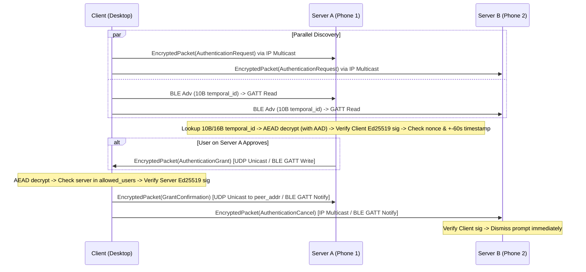

# Authentication Flow Protocol (v2)

## 1. Overview

This document specifies the post-pairing network and BLE protocol for authenticating a user on a **Client** (Linux desktop) via a paired **Server** (Android phone). Protocol v2 preserves the low-latency parallel transport race while fixing wire evolvability, single-signature verification, AEAD header authentication, per-user server authorization, and transport reliability bugs.

The core design is a **parallel discovery model**:
* The Client simultaneously sends `EncryptedPacket(AuthenticationRequest)` over **Local IP Network (IPv4 & IPv6 Multicast)** and advertises a rotating 10-byte identifier over **Bluetooth Low Energy (BLE)**.
* The first Server that receives, decrypts, verifies, and authorizes the request prompts the user; the first valid signed response (`Grant` or `Denial`) wins the race.
* Confirmations (`GrantConfirmation`) are delivered back to the responding Server (via **UDP unicast** to its observed `peer_addr` or **BLE GATT Notification + Read**), while cancellations (`AuthenticationCancel`) are broadcast/notified across active transports so any other prompted phones dismiss immediately.



## 2. Technical Specifications

### 2.1. Message Encryption & Packet Structure (`EncryptedPacket`)

All post-pairing communication is wrapped in `EncryptedPacket` (`proto/auth_protocol.proto`):

* **Temporal Identifier Generation**:
    1. Both Client and Server compute the 60-second time window `floor(unix_timestamp / 60)`.
    2. The full **16-byte** identifier is `HMAC(hash_alg, CSK, u64_be(window))[0..16]`, where `hash_alg` is the `HashAlgorithm` persisted for that Client (`SHA256` or `BLAKE3`, default `SHA256`).
    3. For **BLE Advertisements only**, the identifier is truncated to the first **10 bytes** (`[0..10]`) so the complete legacy advertisement fits within 31 bytes. Once connected over GATT, all `EncryptedPacket` messages use the full 16-byte `temporal_identifier`.
* **Encryption Process & Header AAD**:
    1. Construct the inner message (e.g., `AuthenticationRequest`) and encode it to `raw_payload`.
    2. Construct and sign `WrapperMessage` (see §2.3), then serialize `WrapperMessage` to `plaintext`.
    3. Determine `alg = CSK's SymmetricAlgorithm` (`AES_256_GCM` or `CHACHA20_POLY1305`) and the current 16-byte `temporal_identifier`.
    4. Construct the canonical **AEAD Associated Data (AAD)**:
       ```text
       aad = "tapauth-pkt-v2"
             || be32(alg as u32)
             || be16(temporal_identifier.len() as u16)
             || temporal_identifier
       ```
    5. Generate a fresh 12-byte cryptographically random nonce and compute:
       `ciphertext = nonce || AEAD_Encrypt(CSK, nonce, plaintext, aad)`.
    6. Transmit `EncryptedPacket { temporal_identifier, encryption_algorithm: alg, ciphertext }`.

Binding `encryption_algorithm` and `temporal_identifier` via AAD prevents an attacker from mutating the cleartext header fields without invalidating the 16-byte authentication tag.

### 2.2. Timings, Retransmission & Duplicate Suppression

* **Client `AuthenticationRequest` Retransmission**:
    * **Strategy**: Exponential backoff: `200ms × 2^attempt`, capped at `6400ms` from the sixth interval onwards (`200ms, 400ms, 800ms, 1600ms, 3200ms, 6400ms`).
* **Server `AuthenticationGrant` / `AuthenticationDenial` Retransmission**:
    * **Strategy**: Fixed interval of **500ms** for up to **10 seconds** (max 20 attempts), stopping immediately when a valid, signature-verified `GrantConfirmation` arrives.
* **Session Timeouts**:
    * Daemon authentication session timeout: **120 seconds** (`get_session_timeout()`, bounded on PAM hosts by `pam_operation_timeout_secs` and, for sequential hosts without a TTY, `pam_gui_timeout_secs`).
* **Daemon-side duplicate suppression**:
    * `tapauthd` suppresses rapid duplicate PAM requests for the same username within a **1-second** window (`DEDUP_WINDOW`), returning `PamOutcome::Ignore`.

### 2.3. Raw-Payload Signature Generation & Verification (`WrapperMessage`)

To achieve true wire evolvability (and one-way backwards compatibility when older Linux Clients communicate with newer Android Servers), `WrapperMessage` **never** re-encodes a decoded protobuf struct during signature verification:

* **Structure** (`proto/auth_protocol.proto`):
  * `uint32 version = 1` (Protocol version `2`)
  * `SignatureAlgorithm signature_algorithm = 2` (e.g., `ED25519 = 1`)
  * `PayloadType payload_type = 3` (identifies inner message type `1..5`)
  * `bytes payload = 4` (raw serialized wire bytes of the inner message)
  * `bytes signature = 5`
* **Signing Input (`wrapper_signing_transcript`)**:
  ```text
  transcript = "tapauth-sig-v2"
               || be32(version)
               || be32(signature_algorithm as u32)
               || be32(payload_type as u32)
               || payload
  ```
* **Process**:
  1. Serialize the inner message (e.g., `AuthenticationRequest`) to `raw_payload`.
  2. Sign `wrapper_signing_transcript(version, sig_alg, payload_type, &raw_payload)` with the sender's private Ed25519 key.
  3. On reception:
     * Verify `wrapper.signature_algorithm` matches the peer's persisted `signature_algorithm` (preventing algorithm substitution).
     * Verify `wrapper.signature` over `wrapper_signing_transcript(..., &wrapper.payload)` **before** decoding `wrapper.payload`.
     * Decode `wrapper.payload` according to `wrapper.payload_type`. Unknown optional fields added in future protocol versions remain intact inside `wrapper.payload` during verification and are safely ignored by older decoders.
* **Mandatory Verification on ALL 5 Message Types**:
  * **Android (Server)**: JNI (`shared/src/jni_api.rs`) verifies `WrapperMessage.signature` against the paired Client's `ed25519_public_key` **inside Rust** when parsing `AuthenticationRequest`, `GrantConfirmation`, and `AuthenticationCancel` — callers in Kotlin cannot act on an unverified message.
  * **Linux (`tapauthd`, Client)**: Verifies `WrapperMessage.signature` on `AuthenticationGrant` and `AuthenticationDenial` **only** against `PairedServer` entries authorized for the target `username` (`server.is_user_allowed(&username)`). A second paired phone belonging to another user sharing `CSK` cannot grant or deny someone else's authentication.
  * `AuthenticationGrant` carries `bytes challenge = 1` signed once by `WrapperMessage.signature` (removing the redundant inner `signed_challenge`). `AuthenticationDenial` likewise carries `bytes challenge = 1` to bind denials strictly to the active session.

### 2.4. Contextual Metadata (`AuthenticationRequest` Fields 5–8)

To give users clear context on their phone (e.g., distinguishing `sudo` from lockscreen unlock or seeing the requested command), `AuthenticationRequest` includes optional signed fields:
* `string pam_service = 5` (max **32 UTF-8 bytes**, e.g., `"sudo"`, `"polkit-1"`, `"su"`)
* `string process_name = 6` (max **32 UTF-8 bytes**, e.g., `"sudo"`, `"pkexec"`, resolved from `SO_PEERCRED` `/proc/<pid>/exe`)
* `string command_preview = 7` (max **128 UTF-8 bytes**, sanitized argv preview read from `/proc/<pid>/cmdline` via kernel-verified `SO_PEERCRED` PID)
* `bool tty_present = 8`

With these strict caps, worst-case `EncryptedPacket` size is **470 bytes** (strictly under the **512-byte** Bluetooth Core Spec GATT attribute maximum). See [`security-hardening.md`](security-hardening.md) for control-character and Bidi-override stripping rules.

### 2.5. Transport Layer Considerations

* **IP Network (UDP port `36692`, configurable)**:
  * **Requests & Cancels**: Multicast to IPv4 **`239.255.26.44`** (RFC 2365) and IPv6 **`ff12::fdec:fc27`** (RFC 10028) across suitable interfaces (plus loopback shim in E2E dev mode).
  * **Grant / Denial**: Server unicasts to the request's observed source address on the Client.
  * **GrantConfirmation**: Client **unicasts** directly to the granting Server's `peer_addr` (the exact `(ip, port)` observed via `recv_from`, preserving QEMU SLIRP NAT ephemeral ports and delivering reliably on Wi-Fi even after Android releases `MulticastLock` on screen-off). Wait-loop retransmissions from the Server trigger up to 3 additional unicast resends of `GrantConfirmation`.
* **Bluetooth Low Energy (BLE)**:
  * Client acts as **Peripheral / Advertiser**, Server acts as **Central / Scanner**. See [`ble-gatt-specification.md`](ble-gatt-specification.md).

### 2.6. One-Way Backwards Compatibility (Old Client $\leftrightarrow$ New Server)

Because Linux distribution packages may keep Clients (`tapauthd`) on older stabilized versions longer than mobile app updates:
* New Android Servers **must** continue supporting requests from stabilized older Clients:
  * If a Server pairs with an older v1 Client (sending `PairingHello` rather than v2 `PairingInit`), the Server persists `protocolVersion = 1` on that `PairedDevice` (while still enforcing QR `pk` / transition rules as documented), whereas v2 pairings record `protocolVersion = 2`.
  * Once stabilized on v2, future optional additions (like new fields on `AuthenticationRequest`, new UI hints, or new context metadata) require **no protocol version bump**: old v2 Clients simply omit new fields and sign `WrapperMessage.payload`, while newer Servers display them when present (and vice versa).
* Conversely, newer Clients talking to obsolete v1 Servers need not fall back and may prompt the user to update the Android app.
