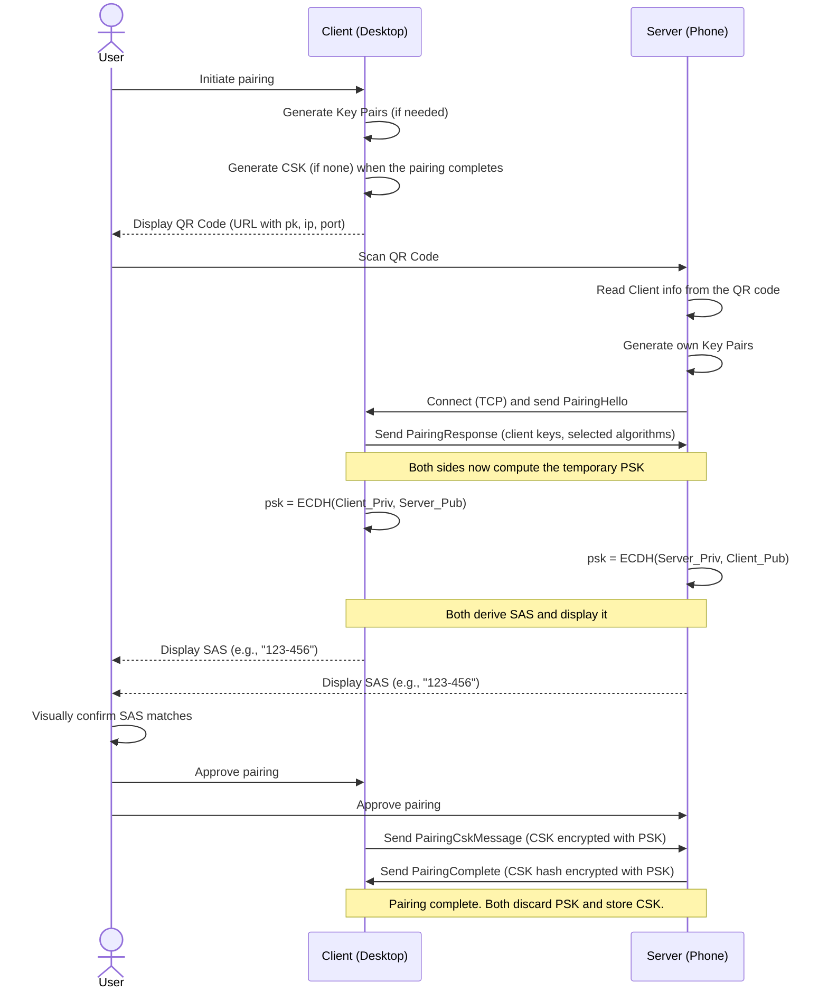

# Initial Key Exchange Protocol

## Overview

This document outlines a secure and byte-efficient protocol for the initial pairing of a **Client** (e.g., a Linux desktop) with a **Server** (e.g., an Android phone). The goal is to securely share the Client's long-term symmetric key with a new Server. The protocol uses a QR code to bootstrap trust, a high-speed key exchange to create a temporary secure channel, and a user-verified Short Authentication String (SAS) to prevent Man-in-the-Middle (MITM) attacks.

***

## Cryptography and Keys

* **Cryptographic Primitives**: All cryptographic algorithms used in this protocol are explicitly defined in the [`cryptography-specification.md`](cryptography-specification.md) document.
* **Key Exchange**: An X25519 key exchange is performed to generate a temporary **Pairing Symmetric Key (`PSK`)**.
* **Client Symmetric Key** (`CSK`): The Client's long-term key for encrypting all standard communication. This is the key that will be shared during this protocol.

***

## Pairing Protocol Visualization

***

## Pairing Protocol Steps

### Step 1: Client Presents QR Code

The **Client (desktop)** generates its key pair (if one doesn't exist) — and, when a pairing completes, its Client Symmetric Key (`CSK`) if it has none yet — then encodes its connection information into a QR code which **must** contain a custom URL with the following format:

`tapauth://pair?v=1&pk=<hex_encoded_pubkey>&p=<port>&ip4=<ipv4_address>&ip6=<ipv6_address>`

* **`tapauth://pair`**: The scheme and action that identifies this as a TapAuth pairing request.
* **`v=1`**: The protocol version for the pairing process (`PAIRING_VERSION`; a mismatch in either handshake message is rejected).
* **`pk`**: The Client's **ephemeral X25519** public key for this pairing session, encoded as a hexadecimal string (`ClientPairingSession::x25519_public_key`). It is not the long-term Ed25519 identity key: both sides exchange X25519 and Ed25519 keys inside `PairingHello`/`PairingResponse`, and the shipped Android client derives the PSK from the X25519 key in `PairingResponse` rather than from `pk`.
* **`p`**: The **TCP** port the Client is listening on for the pairing connection — an ephemeral port the daemon binds (`0.0.0.0:0`) when the QR code is generated.
* **`ip4` / `ip6`**: The Client's IP addresses. At least one **must** be present for the Server to reach it; the URL parser itself treats both as optional (`PairingInfo::parse`).

> **Security Warning**: The security of this initial step relies on the user scanning the QR code directly from the trusted Client's screen. An attacker could attempt to trick a user into scanning a malicious QR code (e.g., from a photo or a different screen), which would lead to pairing with the attacker's device. The Short Authentication String (SAS) in Step 4 is the critical defense against this.

### Step 2: Server Initiates Connection

The **User** scans the code with the **Server (phone)**. The app parses the URL, extracts the connection details — the address to dial and the TCP port — and generates its own key pair. It then establishes a **TCP connection** to the Client. (The `pk` value is parsed as well, but the shipped Android client does not use it for the key exchange; see Step 1.)

Upon connection, the Server sends a `PairingHello` message. This message contains:
*   The Server's X25519 public key and its long-term Ed25519 public key.
*   The Server's device name (display only).
*   A list of cryptographic algorithms the Server supports (for signatures, symmetric encryption, and hashing).

The Client stores the Server's public keys and its list of supported algorithms for the duration of the pairing session, then replies with a `PairingResponse` containing its own X25519 and Ed25519 public keys, its device name, and the algorithms it selected from the Server's list (`selected_symmetric_algorithm`, `selected_hash_algorithm`, `selected_signature_algorithm`). The response is sent **before** the SAS is shown, so the Server has the Client's keys in time to derive the same SAS.

### Step 3: Temporary Key Agreement

Both devices independently compute the same temporary **Pairing Symmetric Key (`PSK`)** using X25519 and the specified KDF. This key exists only for the duration of this pairing session.

### Step 4: Anti-MITM Verification

This is the most critical security step in the pairing process. Both devices compute and display a **Short Authentication String (SAS)**.

**SAS Generation:**
The SAS **must** be a 6-digit number derived as follows:
1.  Create a byte string by concatenating the two ephemeral X25519 public keys, Client first: `input_material = Client_X25519_Pub | Server_X25519_Pub`.
2.  Derive 8 bytes with HKDF-SHA256, using the `PSK` as the input keying material (`IKM`), no salt, and `info = "tapauth-sas" | input_material` (the label and the concatenated public keys are passed as successive HKDF info chunks, `derive_sas` in `shared/src/crypto/kdf.rs`).
3.  Read those 8 bytes as a big-endian `u64`, calculate `value mod 1,000,000`, and pad with leading zeros if necessary to create a 6-digit string. This string should be displayed to the user in a friendly format (e.g., "123-456").

**The user MUST visually confirm that the SAS displayed on the Client screen and the Server screen are identical before proceeding.**

Failure to verify the SAS could allow a Man-in-the-Middle (MITM) attacker to intercept the connection and compromise the shared key. The user interface on both devices **must** make this verification step prominent and mandatory. For example, the confirmation button could be disabled until the user actively confirms the match via a checkbox.

### Step 5: Client Sends Shared Key

After the user confirms the SAS on the Client, the Client sends a `PairingCskMessage` message to the Server. This message contains the long-term `CSK`, encrypted with the temporary `PSK`, plus the username of the user who is pairing (`encrypted_csk`, `username`). The algorithm choices were already sent in `PairingResponse`; today they carry no operational weight, because each algorithm enumeration defines a single value and every send and verify path hardcodes it.

### Step 6: Server Confirms and Finalizes

The Server receives the message and decrypts it using the `PSK` to retrieve the `CSK`. After the user confirms the SAS on the Server, it computes a hash of the received `CSK` using SHA-256 — the only hash the protocol defines, and the value the implementation always reports in `hash_algorithm` regardless of what the Client selected. It then sends a `PairingComplete` message back to the Client, containing:
*   A `success` flag (a false flag is treated as a failed pairing).
*   The `hash_algorithm` used.
*   The resulting hash, encrypted with the `PSK`.

### Step 7: Completion

The Client decrypts the confirmation. If the hash matches the hash of the `CSK` it sent (calculated with the same algorithm), the pairing is successful. Both devices **must** now securely discard the ephemeral `PSK` and store the long-term `CSK` and the peer's Ed25519 public key (the Client stores it as a paired server, the Server as a paired device together with its `allowed_users` list).