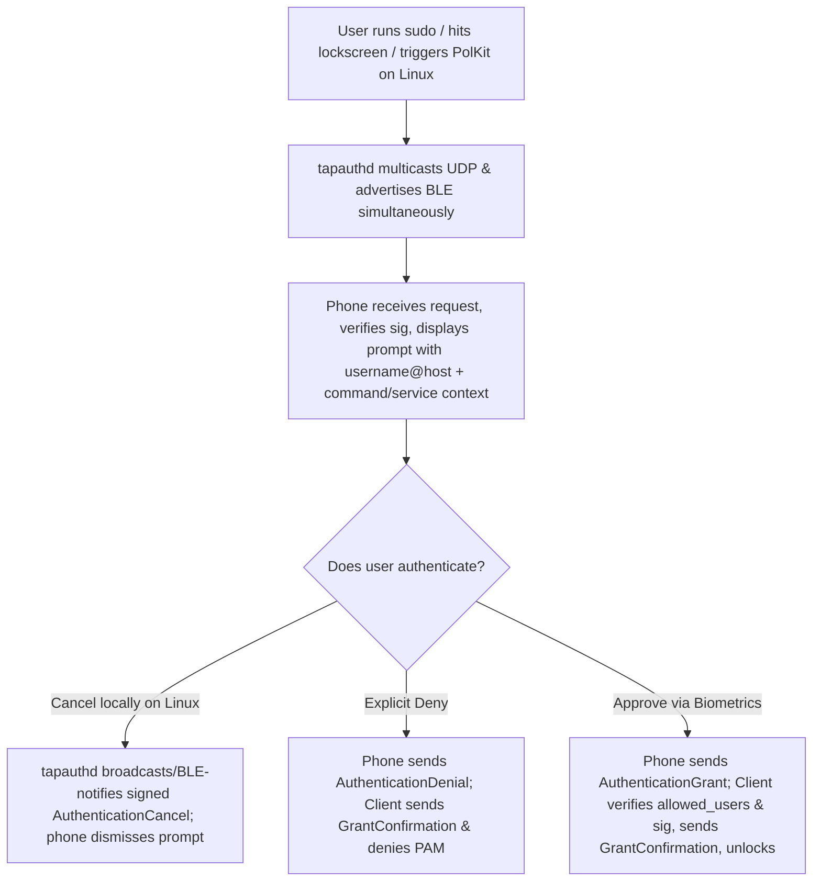

# User Authentication Interaction Flow (v2)

## User grants authentication on server (i.e. scans their fingerprint)

When the Server receives an `AuthenticationRequest`, verifies its AEAD tag, Client Ed25519 signature, replay nonce, and timestamp window, and confirms the target `username` is in the paired Client's `allowedUsers`, it prompts the user via notification / `BiometricPromptActivity`.

In v2, if the verified request carries optional signed contextual fields (`pam_service`, `process_name`, `command_preview`, `tty_present`), the prompt renders:
* **Primary identity**: Target `username` @ `hostname` (prominent header).
* **Secondary context** (sanitized, truncated preview): e.g., `sudo • sudo apt full-upgrade` or `polkit-1 • pkexec`, helping the user distinguish routine commands from unexpected privilege escalations before approving.

```mermaid
flowchart TD
    A[Server receives, decrypts & verifies AuthenticationRequest] --> B{User approves biometric prompt?}
    B -- Yes --> C[Sign AuthenticationGrant (challenge) -> Send & retransmit 500ms]
    B -- No, Explicit Deny --> D[Sign AuthenticationDenial (challenge) -> Send & retransmit 500ms]
    B -- Dismiss / Timeout --> E[End silently on timeout]
    C --> F[Wait for verified GrantConfirmation (UDP Unicast / BLE Notify)]
```

A user who explicitly declines is reported to the Client via `AuthenticationDenial` (bound to `challenge` and retransmitted every 500ms until confirmed by `GrantConfirmation`), which surfaces as an explicit denial on PAM (`PAM_PERM_DENIED` on GUI/PAM hosts). Timeouts end silently without sending a denial.

## User flow from receiving authentication request to being logged in on client


