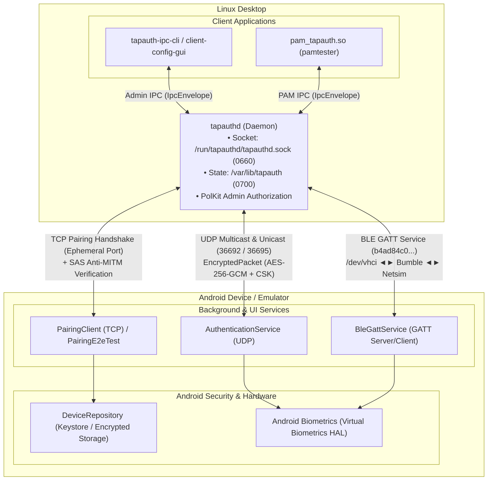

# TapAuth End-to-End (E2E) Testing Guide

This document describes the automated end-to-end (E2E) test harness for TapAuth, which tests the complete system lifecycle against a real Android device/emulator without mocks.

---

## 1. Overview & Test Architecture

The E2E test stack validates real cryptographic protocols, daemon state transitions, IPC boundaries, PAM module integration, network transports (TCP/UDP), and Bluetooth Low Energy (BLE) GATT communication against real Android software stacks and the Linux PAM infrastructure.



---

## 2. Test Lifecycle Phases

The master test runner (`scripts/test-e2e.sh`) executes a comprehensive test matrix covering positive authentication, protocol races, adversarial injections, timeout handling, and un-pairing:

### Phase 1: Real TCP Device Pairing & SAS Anti-MITM Verification
- **Phase 1a (Negative Pairing / SAS Rejection)**:
  1. Desktop starts an ephemeral TCP pairing listener.
  2. Android connects via `PairingE2eTest -e reject_sas true`.
  3. Ephemeral ECDH exchange completes and derives the SAS, but Android rejects the SAS confirmation and closes the TCP connection.
  4. Desktop's `complete-pairing` fails: the suite asserts both its non-zero exit code and that `get-servers` records 0 paired devices on disk.
- **Phase 1b (Legitimate Pairing Handshake)**:
  1. `tapauthd` generates a dynamic TCP listener port and ephemeral X25519 pairing keypair.
  2. Android emulator runs `PairingE2eTest` connecting to host `10.0.2.2:<port>`.
  3. Handshake executes:
     - `PairingHello` with Android public keys.
     - `PairingResponse` with Desktop public keys.
     - Both derive ephemeral PSK via ECDH and compute 6-digit Short Authentication String (SAS).
  4. Desktop and Android assert identical SAS codes (`XXX-XXX`).
  5. Desktop transmits AES-256-GCM encrypted Client Symmetric Key (CSK) with SHA-256 hash confirmation.
  6. Android stores paired desktop in `DeviceRepository`, and desktop saves server key to `/var/lib/tapauth/paired_servers.json`.
  7. State directory security properties are asserted (`/var/lib/tapauth` 700 `tapauthd:tapauthd`, key files 600, socket 660 `root:tapauthd-clients`).

### Phase 2: Local Network (UDP) End-to-End Authentication
1. Desktop enables UDP transport and disables BLE via admin IPC (`set-transports --network true --ble false`).
2. Authentication is requested for the test user via `tapauth-ipc-cli pam-auth <user> 20`.
3. `tapauthd` multicasts `EncryptedPacket` to the IPv4 (`239.255.26.44`) and IPv6 (`ff12::fdec:fc27`) discovery groups on UDP port 36692 (and forwards to emulator port `36695` via dev shim).
4. An AF_PACKET watcher asserts the daemon really emitted a packet to **both** groups (the emulator delivery itself goes through the dev shim, not LAN multicast).
5. `AuthenticationService` on Android receives packet, validates temporal ID via `TemporalIdCache`, decrypts `AuthRequest`, and prompts for biometrics.
6. Android verifies biometrics and replies with `AuthenticationGrant` signed by its Ed25519 key to `10.0.2.2:36692`.
7. `tapauthd` verifies signature, responds with `GrantConfirmation` (up to 3 times), and returns `SUCCESS` (0) to PAM client.

### Phase 2b: Real PAM Module Authentication (`pamtester`)
1. Test suite creates temporary PAM service definition at `/etc/pam.d/tapauth-test-e2e` pointing to `libclient_pam.so`.
2. `pamtester` invokes `pam_sm_authenticate` against the real Linux-PAM C ABI.
3. `client-pam` connects to `tapauthd` over Unix domain socket and completes full PAM authentication returning `PAM_SUCCESS`.

### Phase 2e: Mixed-Stack PAM Semantics (Grant Path)
1. A real-world PAM stack is installed: `auth [success=1 default=ignore] pam_tapauth.so` followed by `pam_unix.so` and `pam_permit.so`.
2. **Grant path**: with the device still paired, `pamtester` authenticates with stdin held open without data — `pam_sm_authenticate` returns `PAM_SUCCESS` upon phone grant and the `[success=1]` jump skips the password module entirely.

### Phase 2c: Adversarial UDP — Replay & `PamCancel`
1. The legitimate `AuthenticationGrant` from Phase 2 is captured via an `AF_PACKET` sniffer (`scripts/ci/udp_attack.py sniff`, root-only) and re-injected while a **fresh** auth session is pending.
2. The daemon rejects the stale-session grant (asserted: "Grant challenge verification failed" in audit log) and detects immediate duplicate injections via its per-session nonce cache (asserted: "Replayed packet detected").
3. The pending session is cancelled via `pam-cancel` IPC; the blocked client exits promptly with `OUTCOME=IGNORE` (never `SUCCESS`).

### Phase 2d: Adversarial UDP — Tampered Ciphertext
1. The captured grant is re-injected with a flipped bit inside the AES-256-GCM tag (protobuf framing and temporal ID stay intact).
2. The daemon fails AEAD verification, aborts fail-closed (`OUTCOME=IGNORE` → PAM password fallback), and logs "Failed to decrypt response packet".

### Phase 3: Bluetooth Low Energy (BLE) Authentication
1. Desktop enables BLE transport and disables UDP (`set-transports --network false --ble true`).
2. Authentication is requested over virtual BLE via Google Bumble + Netsim.
3. `tapauthd` acts as GATT Server and Peripheral advertiser (`b4ad84c0-2adb-4876-8315-b39d983b2bde`).
4. Android `BleGattService` acts as GATT Client and Central scanner, exchanging `AuthRequest` and `AuthenticationGrant` characteristics.

### Phase 4: Parallel Discovery Race (UDP + BLE Simultaneous)
1. Both transports enabled (`set-transports --network true --ble true`).
2. Desktop fires simultaneous discovery on UDP and BLE.
3. First responding transport wins; `tapauthd` cleans up the competing transport without duplicate grant conflicts.

### Phase 5: Explicit User Denial
1. Authentication requested while auto-grant helper is paused.
2. Simulated biometric rejection / `ACTION_DEV_DENY` broadcast is triggered.
3. Android sends signed `AuthenticationDenial`.
4. `tapauthd` returns `DENIED` outcome to PAM module.

### Phase 5b: Authentication Timeout Verification
1. Android app is stopped so no device responds to the auth multicast.
2. Authentication is requested with a 2-second timeout.
3. `tapauthd` detects deadline expiry, multicasts `AuthenticationCancel`, and returns `TIMEOUT` outcome.

### Phase 6: Device Removal / Un-pairing Lifecycle
1. Desktop invokes `remove-device <server_public_key>` via admin IPC.
2. `tapauthd` removes server, purges keys, and refreshes in-memory state.
3. Subsequent auth requests immediately return `IGNORE` ("No paired devices configured").

### Phase 6b: Mixed-Stack PAM Password Fallback
1. With no paired devices, `pamtester` is invoked against the mixed stack.
2. `pam_tapauth.so` returns `PAM_AUTHINFO_UNAVAIL`, which the stack's
   `default=ignore` turns into a fallthrough to `pam_unix.so`. (`PAM_IGNORE`
   cannot be used for this: Linux-PAM records no failure for it, so a later
   `optional pam_permit.so` voting success would grant the whole stack.)
3. Asserts that a correct password succeeds and an incorrect password fails.

### Phase 7: Admin IPC Authorization Enforcement (PolKit)
1. An unprivileged user **in** `tapauthd-clients` group sends an admin request — daemon denies it via PolKit (`auth_admin`) and records an audit log.
2. An unprivileged user **outside** `tapauthd-clients` cannot connect to `/run/tapauthd/tapauthd.sock` (0660 permission gate).

---

## 3. Defense-in-Depth & Protocol Unit Test Coverage

In addition to end-to-end integration flows, core protocol defenses are verified through dedicated unit test suites:

- **`RequestRateLimiterTest`**:
  - Burst allowance (first 3 distinct requests in 2s accepted without penalty).
  - Escalating backoff doubling upon rejection ($1\text{s} \to 2\text{s} \to 4\text{s} \to \max 5\text{s}$).
  - Re-transmission de-duplication pass-through without backoff escalation.
  - Per-client state reset on session completion (`resetClient`).
- **`ReplayMitigationCacheTest`**:
  - Primary defense: Challenge nonce replay cache rejection.
  - Secondary defense: Rejection of timestamps outside the $\pm 60$-second window.
  - Acceptance of valid timestamps and cache clearing.
- **`RetransmissionManagerTest`**:
  - 500ms fixed interval retransmission for `AuthenticationGrant` and `AuthenticationDenial`.
  - Immediate cancellation when `GrantConfirmation` is received.

`TemporalIdCache` (O(1) pre-authentication filter across current and previous 60s windows, with
immediate cache clearance when the paired-device list becomes empty) has no dedicated JVM unit
test; its behavior is exercised end-to-end by Phases 2–4, where every inbound packet must pass
its filter before decryption.

---

## 4. Transport Virtualization Details

### UDP Network Bridge
Android emulators run on a virtual NAT subnet (`10.0.2.15`), where `10.0.2.2` represents the host.
- **Inbound (Host $\to$ Emulator)**: In dev mode (`TAPAUTH_DEV_MODE`, feature `dev-udp-loopback`), the daemon unicasts every request to `127.0.0.1:36695` (configured via `TAPAUTH_DEV_UDP_TARGET`), which `adb emu redir add udp:36695:36692` forwards directly to the guest emulator. The same feature makes the receiver accept locally-sourced replies, which the production filter would otherwise drop as self-sent.
- **Outbound (Emulator $\to$ Host)**: Android replies directly to `senderAddress.hostAddress:appConfig.udpPort` (`10.0.2.2:36692`), which SLIRP delivers to the daemon's socket.

### Virtual BLE Bridge (Google Bumble + Netsim)
Android emulators provide an internal Bluetooth simulation service called **Netsim** on gRPC port 8554.
- `bumble-hci-bridge` connects to `android-netsim:localhost:8554` and bridges HCI packets to Linux `/dev/vhci`.
- BlueZ on Linux discovers the virtual controller and exposes it as a standard Bluetooth adapter (e.g. `hci1`).
- `tapauthd` publishes its GATT service and BLE advertisements via BlueZ, and the Android emulator scans and connects.

### Biometric Virtualization (Android Virtual Biometrics HAL)
- `scripts/ci/emulator-bio-helper.sh setup` configures Android 14+ Virtual Biometrics HAL (`persist.vendor.fingerprint.virtual.enrollments 1` + `cmd fingerprint sync`).
- Background auto-grant daemon (`emulator-bio-helper.sh start-auto-grant`) monitors logcat for prompt display and issues `adb emu finger touch 1`.
- Safe fallback: in `e2e` build variant (`BuildConfig.E2E_TESTING == true`), un-enrolled environments auto-approve after a brief delay.

---

## 5. Running the Tests

### In CI (GitHub Actions)
E2E testing runs in `.github/workflows/ci-android.yml` on every pull request and on every
`merge_group` event, where it will be a required merge-queue check once the ruleset is
configured. It also runs on pushes to `main` that touch that workflow's `paths:` list — the
`push` trigger is deliberately path-filtered, so a
merge that changed none of those paths produces no post-merge `e2e` run (the pull request and the
merge group already ran it). The required-check names are recorded in
`scripts/ci/check-required-checks.sh`.

CI runs in **systemd mode on all three distros**. The daemon is installed as the real
`tapauthd.service`/`tapauthd.socket` units, is socket-activated (no `fallback-socket`), runs as the
unprivileged `tapauthd` user, and keeps state in `/var/lib/tapauth` and config in
`/etc/tapauth/config.toml`. The Ubuntu host build enables `dev-udp-loopback` (the emulator UDP shim; a
hosted runner has no LAN multicast path into the emulator) and `dev-polkit-bypass` (so the root harness
needs no authentication agent); the Fedora/Arch container builds add `dev-firewall-bypass` because
containers lack usable `iptables`. `dev-state-override` is **off** in every case, so `TAPAUTH_STATE_DIR`
is not compiled in at all and every path is the production one. Phase 7 therefore proves that PolKit
still denies unprivileged non-owner callers; it does not prove anything about the root path, which is
bypassed by design in this build.

The Ubuntu pass runs on the host. The Fedora and Arch passes run inside containers that boot **real
systemd as PID 1** (`archlinux:base-devel` ships it; `fedora:latest` does not, so that container's command
installs `systemd`+`dbus` and execs `/sbin/init`). Each container runs its **own** D-Bus,
polkitd and bluetoothd — the host D-Bus socket is deliberately not bind-mounted — so the installed units
are genuinely socket-activated, Phase 7 exercises the package's real PolKit action, and BLE runs too: the
host owns the Bumble bridge, and the container's bluetoothd claims the resulting vhci adapter (the host
bluetoothd is stopped first, since only one daemon may own an adapter). The container packages add
`dev-firewall-bypass` to the systemd-mode feature set because containers lack usable `iptables`. The
systemd containers cannot use `--pid=host` (incompatible with systemd as PID 1); they need `--privileged
--cgroupns=host` and a writable `/sys/fs/cgroup`.

Note that the test packages are not byte-for-byte the shipped feature set: because Cargo unifies features
per package across a `--workspace` build, the test features requested for `tapauthd` also compile into
that package's `client-pam`/`tapauth-config` (e.g. `shared/dev-udp-loopback` in the PAM module). No distro
E2E package is byte-for-byte the production feature set; production artifacts are built per crate and
scanned separately (`check-production-build.sh`).

Other CI steps that back this suite:
- `./gradlew test` runs the Android JVM unit tests (§3) without an emulator.
- `./scripts/ci/check-production-build.sh` verifies the shipped binaries contain no dev env-var overrides.
- `./scripts/ci/test-pam-host-cases.sh` (root, in the `build-and-test` job) pins the module's non-interactive verdicts against real `/etc/pam.d` stacks — TTY-less wait announcement, display-manager bypass, `sufficient` fallthrough and double invocation; see the section below.
- `./scripts/ci/test-pam-conv-thread.sh` (unprivileged, in the same `build-and-test` job) drives the module's three conversation strategies through the 16 real PAM stack shapes of the caller corpus — password fallback on `sufficient`, fail-closed on `required`, the keyring-bypass shape, pre-collected hosts, the phone winning while the host is parked, the duplicate family and the refused `sshd`/`sshd-session` names; see the section below.
- `tapauth-ipc-cli` is a testing-only admin harness and is deliberately **not** shipped by the distro packages. The E2E runner builds it from the workspace and the container runs reuse that binary through the mounted workspace (`scripts/ci/run-all-e2e.sh`).
- The CI pipeline builds real `.deb`/`.rpm`/`.pkg.tar.zst` packages and runs the suite against an installed Ubuntu package on the host plus installed Fedora/Arch packages inside systemd containers; see `.github/workflows/ci-android.yml`, `scripts/ci/run-all-e2e.sh`, `scripts/ci/run-systemd-container.sh` and `scripts/ci/run-container-e2e.sh`.

**CI Artifacts**:
- `tapauth-debug-apk`: Standard safe debug build.
- `tapauth-e2e-apk-UNSAFE-auto-approves`: Test-only auto-approving APK (short 7-day retention; never distribute or install on physical devices).

### PAM Host Cases (`scripts/ci/test-pam-host-cases.sh`)

A focused regression suite for the module's **host-facing** verdicts, i.e. the
behaviour a real display manager, lock screen or `sufficient` line sees. It drives
the real Linux-PAM C ABI through `scripts/ci/pamtester.c` against stacks written to
`/etc/pam.d`, with **no controlling terminal** (the child is detached with `setsid`
and reads `/dev/null`) and the **production** socket path
`/run/tapauthd/tapauthd.sock` bound by `scripts/ci/pam-stub-daemon.py` — a silent
stand-in daemon that accepts connections, discards whatever arrives and never
replies. With a reachable-but-silent daemon the module's own deadline decides the
outcome, so the suite is deterministic and fast: it writes
`/etc/tapauth/config.toml` with `pam_gui_timeout_secs = 2` and
`pam_operation_timeout_secs = 4` (backing up and restoring any existing file), and
each blocking case settles in about 2 s.

Requirements: root (it writes `/etc/pam.d/tapauth-host-*` plus the synthetic
display-manager service `/etc/pam.d/gdm-tapauth-host`, and replaces
`/etc/tapauth/config.toml`), `cc` (to compile `pamtester.c`), `python3`, `setsid`
(util-linux) and `libpam` headers. Cleanup only removes files this run actually
wrote and only restores a file it actually backed up, so a run that aborts early
leaves the host untouched; a pre-existing socket at
`/run/tapauthd/tapauthd.sock` is **refused** (the script aborts with a message)
rather than shadowed or deleted, so a real daemon is never disturbed. The real
`/etc/pam.d/gdm-password` is never touched: the DM bypass only matches on the
service-name prefix, and the synthetic service exercises it. The script is
root-required: a non-root run prints one `SKIP` line per case and then **fails**
(exit 1), so a CI job that lost its `sudo` prefix fails instead of going green
with zero cases run. `ALLOW_NONROOT=1` is the local opt-out — it keeps the `SKIP`
lines, the summary and the `Re-run as root` hint and exits 0; it is refused
(exit 1) whenever `CI` is non-empty, so an accidental opt-out in a workflow
cannot pass by skipping. The script exports `LC_ALL=C` and
`LANG=C`, so the module's own localized messages cannot turn a correct run into
a failure under `sudo env` with a non-English user locale.

```bash
sudo ./scripts/ci/test-pam-host-cases.sh

# Local run without root: prints the SKIP lines and exits 0 (never in CI, which
# does not honour the opt-out and fails instead):
ALLOW_NONROOT=1 ./scripts/ci/test-pam-host-cases.sh

# Against another build (e.g. the pre-fix module), skipping the cargo build:
sudo env \
  PAM_MODULE_PATH=/tmp/pam-base/target/debug/libclient_pam.so \
  SKIP_BUILD=1 \
  ./scripts/ci/test-pam-host-cases.sh
```

Every case asserts the **numeric** `PAM_RESULT=` that `pamtester` prints (0 success,
6 explicit denial, 7 internal failure, 9 consult-unavailable), not just the exit
status, and prints the elapsed time on failure:

| Case | Discriminates | What it asserts (and what it would catch) |
| :--- | :--- | :--- |
| `ttyless_wait_announced_before_blocking` | `c40543f` | exactly one `TEXT_INFO` delivered *before the wait ends* (at `T < 1.0 s`, while the call blocks `> 1.5 s`) and its wording names the password route. It does **not** pin the position relative to the daemon request (the announcement is logged after the request is sent and the stub only stamps connections, so the two are unordered); that the announcement is not emitted before the module can possibly wait — at module entry, before connecting — is what `fast_path_does_not_announce_the_wait` pins, via the no-daemon path. The `TEXT_INFO` the module emits when it times out is a separate, post-wait message and is not counted. |
| `conv_error_still_verdicts` | `0868f81` | a host whose conversation returns `PAM_CONV_ERR` for every message still gets a real verdict (exactly `9`) and the process is not killed by a signal |
| `null_conv_is_survivable` | none | `SKIP`ped on the libpam versions this suite runs against (1.7.3 on Arch, 1.5.3 on Ubuntu 24.04): `pam_start` rejects a NULL conversation (`PAM error 4`), so the state is unreachable through the public libpam API and the `7` it would assert is **not** covered behaviour. The SKIP is expected, not pending. |
| `required_arch_gdm_stack_not_success` | `0868f81` | (a) the display-manager bypass under the synthetic service `gdm-tapauth-host` and (b) the same `required` + `optional pam_permit` + `required pam_env` stack under a non-DM service must both return exactly `9`; the pre-fix `PAM_IGNORE` let `pam_permit` grant the whole stack (`0`) |
| `sufficient_stack_falls_through` | none — regression guard | on a `sufficient` line the skip verdict expands to `default=ignore`: the following `pam_permit` decides success and the following `pam_deny` decides failure. `PAM_IGNORE` expands identically, so this case passes on the pre-fix tree too; it only catches a module that starts returning `PAM_SUCCESS` |
| `double_invocation_never_ignore` | `0868f81`; widened by the verdict cache | a second invocation of the module in the same transaction also returns exactly `9`, and it is answered from the per-process verdict cache: exactly one daemon connection and exactly one `${GUI_TIMEOUT_SECS}`s wait are observed (more than half a wait, less than one and a half), so a regression that loses the cache shows up as a second connection and a second wait |
| `fast_path_does_not_announce_the_wait` | `c40543f` | with no daemon the module fails fast (exactly `9`, `< 1.5 s`) and emits **no** `TEXT_INFO`; it does emit a `PAM_ERROR_MSG` ("Cannot connect to daemon…"), which is allowed and expected — only the wait announcement is forbidden on a path that never waits |

### PAM Conversation Shapes (`scripts/ci/test-pam-conv-thread.sh`)

The module's other half — how it talks to the host's PAM conversation — is
covered by a second suite. The choice is made by a rule table keyed on the
caller (`classify` in `client-pam/src/policy.rs`, table in
`client-pam/src/policy/table.rs`); the decision can be asserted from the corpus,
but *executing* it cannot: that needs a real libpam stack, a dynamically loaded
`pam_tapauth.so`, and a process whose `/proc/self/exe` basename is on the table.
The rules behind the table are documented in
[`docs/design-documents/pam-conversation-policy.md`](../design-documents/pam-conversation-policy.md).

It runs **unprivileged** and needs Linux-PAM ≥ 1.5 (`pam_start_confdir`, so it
writes no file under `/etc/pam.d`), `gcc` and the `libpam` headers; it builds the
module itself in release with `dev-socket-override` (the socket is the script's
own, under `$TMPDIR`) and compiles its C harness into `$TMPDIR`.

Each executed shape is one `e2e=1` row of the shared caller corpus
(`client-pam/tests/fixtures/callers.csv`, 16 rows today): the row supplies the
service name, the `exe` name, the env value and mode, and its `case` arm supplies
the stack and the assertions. The run fails if a row has no arm, if the executed
count differs from the corpus, or if it drops below the script's floor of 15.
Every row asserts numeric facts — daemon accept counts, whether the conversation
was entered (and on which thread), the number of messages shown, and the token
marker that the module after `pam_tapauth.so` sees.

```bash
./scripts/ci/test-pam-conv-thread.sh
```

### Manual test matrix (cannot be automated)

These need a real desktop session or a real distro install and stay manual:

| Scenario | Do | Observe | Failure looks like |
| :--- | :--- | :--- | :--- |
| GDM / gnome-shell password entry | install the module, log out to GDM, start typing at the password prompt | on a **login** TapAuth is bypassed (`DmLoginBypass` `skip_keyring`, `client-pam/src/policy/table.rs`): no message, no wait, and `PAM_AUTHTOK` is left for the keyring module, so the field is available immediately; on a **reauthentication** (`GDM_SESSION_FOR_REAUTH`, `GdmReauthWorker`) the conversation is threaded, one "Waiting for your phone…" message is shown, the field accepts typing during the wait, and the wait runs to `pam_operation_timeout_secs` | no prompt/field until a TapAuth timeout elapses, or the session hangs with a frozen spinner |
| KDE lock screen (`kscreenlocker_worker`) | lock the session with a paired phone present but unlocked/away | one "Waiting for your phone…" message, the unlock field is revealed during the wait (the `kscreenlocker_worker` row of the rule table in `client-pam/src/policy/table.rs` is threaded, so the conversation collects the password with `pam_get_authtok` and leaves it in `PAM_AUTHTOK` — it is not consumed by TapAuth and the next password module uses it), and unlocking with the password works immediately — TapAuth stops waiting as soon as it is entered, while the phone wait runs to `pam_operation_timeout_secs`, not the 30 s GUI timeout | the lock screen freezes, never shows the field, or the worker dies (lock screen crash / X session reset) |
| Arch GDM boot with the required stack | on a real Arch GDM install, put `auth required pam_tapauth.so`, `auth optional pam_permit.so`, `auth required pam_env.so` in `/etc/pam.d/gdm-password` | login without a phone fails (returns the password prompt / denies), never grants a session | you land on the desktop with only the password (or with no credentials) — a `PAM_IGNORE` verdict would have granted the stack |
| Distro `sufficient` line | use the packaged `sufficient`/`[success=1 default=ignore]` line from `packaging/` | login with the phone → session starts; without the phone → password prompt; wrong password → rejected | TapAuth silently succeeds without the phone, or the password prompt never appears |

### Locally (Dev Sandbox vs. Systemd Mode)
The test runner automatically selects **dev mode** when run unprivileged:
- `TAPAUTH_STATE_DIR`: Isolated state directory (`/tmp/tapauth-e2e.XXXXXX/state`).
- `TAPAUTHD_SOCK`: Isolated Unix socket (`/tmp/tapauth-e2e.XXXXXX/tapauthd.sock`).
- `TAPAUTH_DEV_MODE=1`: Enables the dev sandbox (same-UID PolKit bypass on the isolated socket).

Running locally as root with `TAPAUTH_E2E_DAEMON_MODE=systemd` exercises full production wiring against
`/etc/tapauth` and `/var/lib/tapauth`. Because that mode installs over a real system installation
(`/usr/bin/tapauthd`, the systemd units, `/etc/tapauth`, `/var/lib/tapauth`), it **refuses to run** when it
finds an existing daemon binary or a non-empty state directory; set `TAPAUTH_E2E_ALLOW_DESTRUCTIVE=1` to
acknowledge that your own pairing state and binaries will be replaced. Whatever the suite installs it also
removes again on exit (units, drop-in, binaries, registered PolKit policy, created config), and it never
deletes files that already existed.

#### Prerequisites
1. Have an Android emulator running (API 33 to 36):
   ```bash
   emulator @<your_avd_name>
   ```
2. Build Android E2E APKs:
   ```bash
   cd server-android && ./gradlew assembleE2e assembleE2eAndroidTest
   ```
3. Run Test Suite:
   ```bash
   ./scripts/test-e2e.sh
   ```

> **Virtual BLE is mandatory.** `scripts/ci/setup-emulator-ble-bridge.sh` builds/loads `hci_vhci` when the
> kernel lacks it and exits non-zero if no virtual adapter appears; the suite then aborts rather than
> skipping Phases 3 and 4.

---

## 6. One-Time Setup for Local Virtual BLE (`/dev/vhci`)

To allow non-root access to `/dev/vhci` for virtual Bluetooth controller creation:

```bash
# Ensure kernel module is loaded
sudo modprobe hci_vhci

# Add udev rule for persistent non-root access
echo 'KERNEL=="vhci", MODE="0666"' | sudo tee /etc/udev/rules.d/99-vhci.rules
sudo udevadm control --reload-rules && sudo udevadm trigger

# Immediate permissions for current session:
sudo chmod 666 /dev/vhci
```
